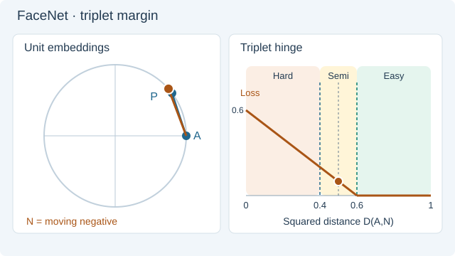
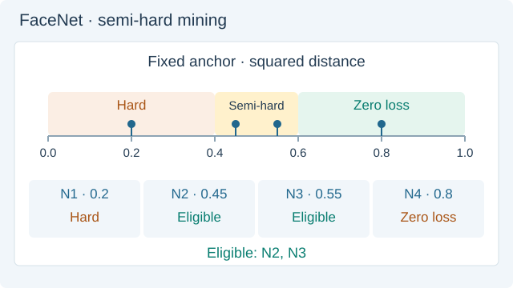
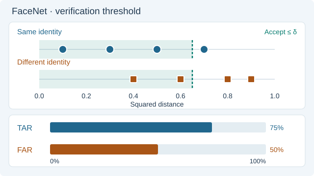

# FaceNet

FaceNet trains a deep convolutional network to map a face image to a 128-dimensional vector, so that the Euclidean distance between two vectors measures whether the faces show the same person. Unlike a classifier trained on a fixed set of identities, the learned space can be used for new identities without retraining. The parent page, [Embeddings and Representation Learning](index.md), describes metric learning as one of the four training signals; this page gives the method in detail.

## Problem

Face recognition systems of the time often trained a classifier over a fixed set of identities and used a layer of its network as the face representation. That approach has two limits. The classifier's output categories are fixed by its training identities, although its intermediate features can still be reused for new identities. FaceNet instead optimises the distance representation directly. Schroff, Kalenichenko and Philbin (2015) asked for a representation that is learned directly from the distances the task cares about, so that it can be used for verification, recognition and clustering with one embedding.

## Core idea

The network $f$ maps each image to a vector normalised to unit length, $\lVert f(x)\rVert_2=1$, so that all embeddings lie on a hypersphere. Training uses triplets with an anchor image $x^a$, a positive image $x^p$ of the same person, and a negative image $x^n$ of a different person. The objective requires the anchor–positive **squared** distance to be smaller than the anchor–negative squared distance by a margin $\alpha$.[^geometry]

Because the target is a distance comparison, the embedding is trained for the task itself. The same vectors can then be compared directly, with no separate classifier.

## Equation and algorithm

### Unit-sphere geometry

For unit embeddings $u$ and $v$, define the squared Euclidean distance

$$
D(u,v)=\lVert u-v\rVert_2^2=2-2u^\top v,\qquad 0\le D(u,v)\le4.
$$

Here $u^\top v$ is their cosine similarity. This identity follows by expanding the squared norm using $\lVert u\rVert_2=\lVert v\rVert_2=1$. It applies to the normalised embeddings, so distances and thresholds must use the same normalisation convention.

### Triplet objective

The loss over $N$ triplets is

$$
L=\sum_{i=1}^N\left[\lVert f(x_i^a)-f(x_i^p)\rVert_2^2-\lVert f(x_i^a)-f(x_i^n)\rVert_2^2+\alpha\right]_+.
$$

Here $[z]_+=\max(z,0)$ is the hinge, which is zero when the margin constraint is satisfied. The paper sets $\alpha=0.2$.[^mining] Write $a=f(x^a)$, $p=f(x^p)$ and $n=f(x^n)$. On the unit sphere, zero triplet loss requires

$$
D(a,p)+\alpha\le D(a,n)
\quad\Longleftrightarrow\quad
a^\top p-a^\top n\ge\alpha/2.
$$

Thus the paper's squared-distance margin corresponds to a cosine gap of $0.1$. Replacing squared distances in the loss with unsquared distances changes the objective and the interpretation of its numerical margin.

### Mining and a calculated example

Choosing which triplets to train on matters. The paper mines triplets online, inside each mini-batch of a few thousand face images, so that the network sees about 40 images per identity. Every anchor–positive pair in the batch is used. The authors use *semi-hard* negatives: those farther from the anchor than the positive, but still inside the margin. They report that always choosing the hardest negatives can lead to poor local minima early in training, including collapse of the learned representation.[^mining]

Let $D_{ap}=D(a,p)$ and $D_{an}=D(a,n)$. A hard negative satisfies $D_{an}\le D_{ap}$. A semi-hard negative satisfies $D_{ap}<D_{an}<D_{ap}+\alpha$. At or beyond the upper boundary, the triplet's hinge loss is zero. A negative farther away than the positive can therefore still contribute a positive loss.[^mining]

For a constructed example, take $a=(1,0)$ and $p=(0.8,0.6)$, so $D_{ap}=0.4$. For each row, choose the unit negative $n=(c,\sqrt{1-c^2})$, where $c=a^\top n$. With $\alpha=0.2$, the loss contribution is $\max(0.6-D_{an},0)$.

| Negative case | Cosine $c$ | Squared distance $D_{an}$ | Triplet loss |
|---|---|---|---|
| Hard | 0.90 | 0.20 | 0.40 |
| Semi-hard | 0.75 | 0.50 | 0.10 |
| At the margin boundary | 0.70 | 0.60 | 0 |
| Easy, beyond the margin | 0.60 | 0.80 | 0 |

These two-dimensional vectors can be extended to 128 dimensions by appending zeros. The values illustrate the geometry and mining conditions, not measured performance. The semi-hard row already ranks the positive closer, yet still incurs a loss because it misses the required gap.

### Moving a negative across the margin

*Original 12-second teaching animation (CC BY-SA 4.0).* Use the site's Play/Pause button; scroll horizontally on narrow screens. GitHub provides the [static fallback](../../../assets/concept-animations/facenet-triplet-margin-still.svg) and [full SVG animation](../../../assets/concept-animations/facenet-triplet-margin-motion.svg).

The anchor and positive from the example stay fixed, with squared distance 0.4 and margin 0.2. As the negative moves, its squared distance from the anchor sweeps from 0.1 to 0.9 and back. At 0.4 it ties the positive; between 0.4 and 0.6 it is semi-hard with nonzero hinge loss; from 0.6 onward the loss is zero. The two points can coincide in the illustration even if their source identities differ. The right plot is restricted to squared distances from zero to one for readability; the full feasible range is zero to four. The static view shows distance 0.5 and loss 0.1. This is toy unit-circle geometry, not a learned embedding or an optimisation trajectory. Intermediate coordinates are sampled and interpolated.

### Screening candidates in a batch

*Original 12-second teaching animation (CC BY-SA 4.0).* Use the site's Play/Pause button; scroll horizontally on narrow screens. GitHub provides the [static fallback](../../../assets/concept-animations/facenet-semi-hard-screening-still.svg) and [full SVG animation](../../../assets/concept-animations/facenet-semi-hard-screening-motion.svg).

Hold the anchor–positive squared distance at 0.4 and the margin at 0.2. Four different-identity candidates have constructed squared distances of 0.2, 0.45, 0.55 and 0.8. The moving cursor tests each candidate against the strict semi-hard interval (0.4, 0.6). Candidates N2 and N3 are eligible, with respective hinge losses 0.15 and 0.05. N1 is hard despite a larger loss of 0.4; N4 has zero loss. The eligible set is not the same as the set of all positive-loss triplets.

The scan order only explains the predicate, not a prescribed sequential implementation, tie-breaking policy, or measured batch. A batch may contain no eligible negatives; this illustration does not prescribe a fallback. The selection condition follows the semi-hard mining definition above.[^mining]

## Verification thresholds

Verification compares a single pair against a decision threshold $\delta$. Using the paper's convention of accepting a pair at the threshold, the rule for unit embeddings is[^verification]

$$
D(u,v)\le\delta
\quad\Longleftrightarrow\quad
u^\top v\ge1-\delta/2.
$$

For $0\le\delta\le4$, the equivalent unsquared Euclidean threshold is $\sqrt{\delta}$. The training margin $\alpha$ compares two distances within a triplet. It does not set the verification threshold for a single pair.

The paper's LFW evaluation selects a threshold on nine splits and tests it on the remaining split.[^verification] Report the threshold-selection protocol and distance convention with the result. Section 4 separately defines the true-acceptance rate among same-identity pairs and the false-acceptance rate among different-identity pairs. These rates at a chosen threshold describe a different aspect of performance from a single overall accuracy. See [ROC-AUC](../../evaluation/metrics/classification/roc-auc.md) for threshold trade-offs.

### Sweeping a verification threshold

*Original 12-second teaching animation (CC BY-SA 4.0).* Use the site's Play/Pause button; scroll horizontally on narrow screens. GitHub provides the [static fallback](../../../assets/concept-animations/facenet-verification-sweep-still.svg) and [full SVG animation](../../../assets/concept-animations/facenet-verification-sweep-motion.svg).

The blue circles represent same-identity squared distances 0.1, 0.3, 0.5 and 0.7. The orange squares represent different-identity distances 0.4, 0.6, 0.8 and 0.9. A pair is accepted when its squared distance is no greater than the green threshold. The two rates count accepted pairs within their respective groups and divide by four. The moving boundary is continuous, but the empirical rates change in discrete steps.

| Threshold | True acceptance rate (TAR) | False acceptance rate (FAR) |
|---:|---:|---:|
| 0.35 | 50% | 0% |
| 0.55 | 75% | 25% |
| 0.65 | 75% | 50% |
| 0.75 | 100% | 50% |

The static preview uses threshold 0.65. The plotted distance interval is zero to one, a subset of the feasible squared-distance range for unit vectors. These eight distances are constructed solely to demonstrate threshold trade-offs; they are not FaceNet measurements or a recommended operational threshold. A real decision threshold must be selected on held-out validation data according to the desired false-acceptance constraint, independently of the triplet training margin.

## Results

[Schroff et al. (2015), Sections 5.6–5.7](https://arxiv.org/abs/1503.03832), report verification accuracy on two benchmarks:

| Benchmark | Protocol | Accuracy |
|---|---|---|
| Labeled Faces in the Wild (LFW) | Standard unrestricted protocol, with extra face alignment | 99.63% ± 0.09 percentage points (standard error) |
| YouTube Faces DB | Average similarity over all pairs of the first 100 detected-face frames from each video | 95.12% ± 0.39 |

The main evaluations use 128-dimensional vectors; Section 5.4 reports that quantising each dimension to one byte did not reduce accuracy in the authors' tests. This is an empirical observation, not a guarantee for arbitrary data. The LFW figure is the one most often quoted, and it is the paper's own measurement. The paper reports clustering only as a qualitative example, a cluster from one user's photo collection, and it does not report a quantitative clustering score.

## Limitations

- **Training cost.** Training took 1,000 to 2,000 hours on a CPU cluster (elapsed training time, not aggregate CPU-core hours), and the authors say that the loss decrease slows sharply after about 500 hours.
- **Label noise.** The sharp drop in the ROC curve at very low false-acceptance rates is attributed to noisy ground-truth labels in the test data.
- **Image quality.** Accuracy falls for small thumbnails, and the main model was trained at 220 by 220 pixels.
- **Mining evidence.** The offline triplet-generation experiments were inconclusive, and the paper does not directly compare hard with all anchor–positive selection.
- **Unfinished evaluation.** The authors list better understanding of the error cases and smaller models as future work.

[^geometry]: Schroff, Kalenichenko and Philbin (2015), Section 3.1, defines the unit-length embedding and squared-distance triplet constraint. The distance–cosine identities on this page follow algebraically from that normalisation.
[^mining]: Schroff et al. (2015), Sections 3.1–3.3, describe the hinge objective, online selection of semi-hard negatives and margin $0.2$. The table is calculated from the stated objective and unit vectors.
[^verification]: Schroff et al. (2015), Section 4, Equations (5)–(7), defines thresholded accepts and acceptance rates. Section 5.6 describes threshold selection for LFW.

## References

### Seminal papers

- Schroff, F., Kalenichenko, D. & Philbin, J. (2015). *FaceNet: A Unified Embedding for Face Recognition and Clustering*. arXiv. https://arxiv.org/abs/1503.03832 — Defines the triplet loss, semi-hard mining and the LFW and YouTube Faces results reported on this page.
- Hermans, A., Beyer, L. & Leibe, B. (2017). *In Defense of the Triplet Loss for Person Re-Identification*. arXiv. https://arxiv.org/abs/1703.07737 — Argues that the triplet loss remains a strong end-to-end metric-learning objective, with results on person re-identification.

### Surveys and textbooks

- Bengio, Y., Courville, A. & Vincent, P. (2012). *Representation Learning: A Review and New Perspectives*. arXiv. https://arxiv.org/abs/1206.5538 — Background on learned representations and their use across tasks.

### Articles and documentation

- Khosla, P. et al. (2020). *Supervised Contrastive Learning*. arXiv. https://arxiv.org/abs/2004.11362 — Extends the pull-and-push idea of contrastive embeddings to batches that use class labels.
- Wang, T. & Isola, P. (2020). *Understanding Contrastive Representation Learning through Alignment and Uniformity on the Hypersphere*. arXiv. https://arxiv.org/abs/2005.10242 — Describes the alignment and uniformity properties of normalised embeddings, the geometry FaceNet relies on.
