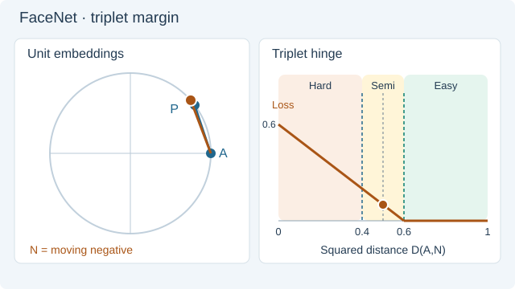
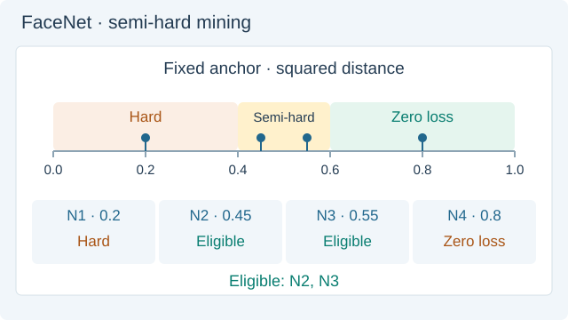
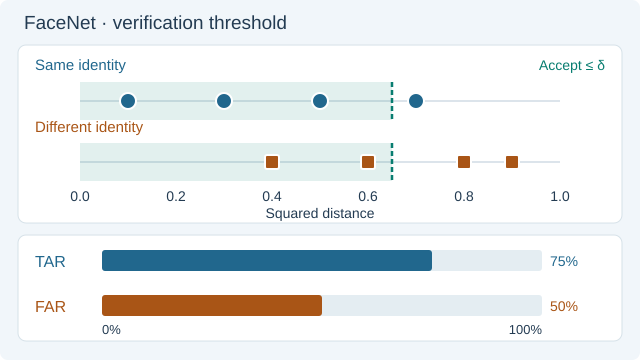

# FaceNet

FaceNet 使用深度卷積網路，把人臉影像映射成 128 維向量，讓歐氏距離成為身分相似度的判斷依據。學到的空間可用於新的身分，不必為每位新人物重新訓練嵌入網路。父頁[嵌入與表徵學習](index.md)將它歸於度量學習。

## 問題

較早系統常先訓練固定身分類別的分類器，再取中間層作為人臉表示。分類器的輸出類別由訓練身分決定，但中間特徵仍可轉用於新身分，不能說它們完全不具泛化能力。Schroff、Kalenichenko 與 Philbin（2015）改為直接最佳化距離表示，讓同一嵌入適用於驗證、辨識與分群。

## 核心概念

網路 $f$ 將影像映射為單位長度向量，$\lVert f(x)\rVert_2=1$。每個三元組包含錨點 $x^a$、同一人的正例 $x^p$，以及不同人的負例 $x^n$。訓練要求錨點到正例的**平方**距離，比到負例至少小一個間隔 $\alpha$。[^geometry]

因為直接訓練距離關係，推論可比較向量，不需為每次驗證另外建立身分類別的分類器。

## 方程與演算法

### 單位球面的幾何

對單位嵌入 $u$、$v$，定義平方歐氏距離為

$$
D(u,v)=\lVert u-v\rVert_2^2=2-2u^\top v,\qquad 0\le D(u,v)\le4.
$$

此時 $u^\top v$ 就是餘弦相似度。將平方範數展開，再代入 $\lVert u\rVert_2=\lVert v\rVert_2=1$，即可得到此恆等式。此關係適用於正規化後的嵌入，因此距離與門檻必須使用相同的正規化方式。

### 三元組目標

對 $N$ 個三元組，損失為

$$
L=\sum_{i=1}^N\left[\lVert f(x_i^a)-f(x_i^p)\rVert_2^2-\lVert f(x_i^a)-f(x_i^n)\rVert_2^2+\alpha\right]_+.
$$

令 $[z]_+=\max(z,0)$ 為鉸鏈函數，滿足間隔條件時該項為零。論文使用 $\alpha=0.2$。[^mining] 寫成 $a=f(x^a)$、$p=f(x^p)$、$n=f(x^n)$，在單位球面上，零三元組損失要求

$$
D(a,p)+\alpha\le D(a,n)
\quad\Longleftrightarrow\quad
a^\top p-a^\top n\ge\alpha/2.
$$

因此，論文的平方距離間隔對應到 $0.1$ 的餘弦差距。若將損失中的平方距離換成未平方距離，目標函數及其數值間隔的意義都會改變。

### 挖掘與計算例子

三元組選擇很重要。作者在含數千張人臉、每身分約 40 張影像的批次內進行線上挖掘，使用錨點與正例配對，再選擇**半困難負例**：距離比正例遠，但仍落在間隔內。始終選最困難的負例，可能在訓練早期導致不良局部解；論文以所有輸出趨同的崩塌情況說明風險。[^mining]

令 $D_{ap}=D(a,p)$、$D_{an}=D(a,n)$。困難負例滿足 $D_{an}\le D_{ap}$。半困難負例滿足 $D_{ap}<D_{an}<D_{ap}+\alpha$。到達或超過上界時，該三元組的鉸鏈損失為零。因此，負例比正例遠，仍不足以判定它已不提供訓練訊號。[^mining]

取一個建構例子，令 $a=(1,0)$、$p=(0.8,0.6)$，所以 $D_{ap}=0.4$。每列都取單位負例 $n=(c,\sqrt{1-c^2})$，其中 $c=a^\top n$。使用 $\alpha=0.2$，損失貢獻為 $\max(0.6-D_{an},0)$。

| 負例情況 | 餘弦值 $c$ | 平方距離 $D_{an}$ | 三元組損失 |
|---|---|---|---|
| 困難 | 0.90 | 0.20 | 0.40 |
| 半困難 | 0.75 | 0.50 | 0.10 |
| 恰在間隔邊界 | 0.70 | 0.60 | 0 |
| 容易，超出間隔 | 0.60 | 0.80 | 0 |

這些二維向量可補零延伸至 128 維。數值用來展示幾何與挖掘條件，不是實測表現。半困難那列已將正例排在較近的位置，但仍因未達到所需差距而產生損失。

### 負樣本穿越間隔邊界

*原創 12 秒教學動畫（CC BY-SA 4.0）。* 使用網站播放／暫停按鈕，窄螢幕可水平捲動。GitHub 提供[靜態預覽](../../../assets/concept-animations/facenet-triplet-margin-still.svg)及[完整 SVG 動畫](../../../assets/concept-animations/facenet-triplet-margin-motion.svg)。

固定上述算例的錨點及正樣本，平方距離為 0.4、間隔為 0.2。負樣本與錨點的平方距離從 0.1 增至 0.9 再返回。距離為 0.4 時與正樣本並列；介於 0.4 與 0.6 時為半困難負樣本，仍有正的鉸鏈損失；從 0.6 起損失為零。即使來源身分不同，示意嵌入仍可能重合。為便於閱讀，右圖只顯示平方距離零至一，完整可行範圍為零至四。靜態圖顯示距離 0.5、損失 0.1。這是人工單位圓幾何算例，不是學得的嵌入或最佳化軌跡；中間座標經取樣與插值顯示。

### 篩選批次中的候選負例

*原創 12 秒教學動畫（CC BY-SA 4.0）。* 使用網站播放／暫停按鈕，窄螢幕可水平捲動。GitHub 提供[靜態預覽](../../../assets/concept-animations/facenet-semi-hard-screening-still.svg)及[完整 SVG 動畫](../../../assets/concept-animations/facenet-semi-hard-screening-motion.svg)。

固定錨點與正例的平方距離為 0.4，間隔為 0.2。四個不同身分的候選負例具有人工設定的平方距離 0.2、0.45、0.55 與 0.8。移動游標逐一檢查是否位於嚴格的半困難區間 (0.4, 0.6)。N2 與 N3 符合條件，鉸鏈損失分別為 0.15 與 0.05；N1 雖有較大的 0.4 損失，卻是困難負例；N4 的損失為零。符合條件的集合不等於所有具有正損失的三元組集合。

掃描順序只是說明篩選條件，並非規定必須循序執行、指定並列處理策略或批次實測資料。批次內也可能沒有符合條件的負例，本圖不指定此時的回退策略。篩選條件來自前述半困難挖掘定義。[^mining]

## 驗證門檻

驗證將單一配對與決策門檻 $\delta$ 比較。採用論文在等號成立時也接受的方式，單位嵌入的判斷規則為[^verification]

$$
D(u,v)\le\delta
\quad\Longleftrightarrow\quad
u^\top v\ge1-\delta/2.
$$

當 $0\le\delta\le4$ 時，等價的未平方歐氏距離門檻為 $\sqrt{\delta}$。訓練間隔 $\alpha$ 比較的是三元組內的兩個距離，並不決定單一配對的驗證門檻。

論文的 LFW 評估用九個分割選擇門檻，再於剩下一個分割測試。[^verification] 報告結果時應交代門檻選擇流程與距離定義。第 4 節另外定義同身分配對中的真接受率，以及不同身分配對中的誤接受率。在指定門檻下報告這些比率，呈現的面向與單一總體準確率不同。門檻取捨可參閱 [ROC-AUC](../../evaluation/metrics/classification/roc-auc.md)。

### 掃描驗證門檻

*原創 12 秒教學動畫（CC BY-SA 4.0）。* 使用網站播放／暫停按鈕，窄螢幕可水平捲動。GitHub 提供[靜態預覽](../../../assets/concept-animations/facenet-verification-sweep-still.svg)及[完整 SVG 動畫](../../../assets/concept-animations/facenet-verification-sweep-motion.svg)。

藍色圓點代表同身分配對的平方距離 0.1、0.3、0.5、0.7；橘色方塊代表不同身分配對的平方距離 0.4、0.6、0.8、0.9。平方距離不大於綠色門檻時接受配對。兩個比率分別計算各組被接受的數量並除以四。門檻連續移動，但經驗比率呈離散階梯變化。

| 門檻 | 真接受率（TAR） | 誤接受率（FAR） |
|---:|---:|---:|
| 0.35 | 50% | 0% |
| 0.55 | 75% | 25% |
| 0.65 | 75% | 50% |
| 0.75 | 100% | 50% |

靜態預覽採門檻 0.65。圖中距離區間為零至一，是單位向量可行平方距離範圍的子集。八個距離為展示門檻取捨而建構，並非 FaceNet 實測結果或建議的實際使用門檻。實際決策門檻須依所需的誤接受限制於保留的驗證資料上選擇，不由三元組訓練間隔直接決定。

## 結果

[原論文第 5.6–5.7 節](https://arxiv.org/abs/1503.03832)報告：

| 資料集 | 評估流程 | 準確率 |
|---|---|---|
| Labeled Faces in the Wild（LFW） | 標準不受限流程，加上額外人臉對齊 | 99.63% ± 0.09 個百分點（標準誤） |
| YouTube Faces DB | 每影片最先偵測到人臉的 100 個影格，計算跨影片所有影格配對相似度的平均 | 95.12% ± 0.39 |

主要評估採 128 維向量。第 5.4 節指出，在作者的測試中，每維量化為一個位元組未降低準確率；這不是對任意資料的保證。上述數值均為原論文量測。人臉分群僅展示使用者照片集中的定性範例，沒有量化分群分數。

## 限制

- **訓練成本**：CPU 叢集上花費 1,000–2,000 小時，指經過的訓練時間，不是把所有核心加總的 CPU 核心小時。作者指出約 500 小時後損失下降速度明顯變慢。
- **標籤雜訊**：極低誤接受率下的 ROC 曲線急降，被作者歸因於測試標籤雜訊。
- **影像品質**：縮圖過小會降低表現；主要模型訓練影像為 220×220 像素。
- **挖掘證據有限**：離線三元組實驗尚無定論，論文也未直接比較「只選困難錨點／正例」與「使用全部錨點／正例」策略。
- **尚待研究**：錯誤案例分析與更小模型仍是後續方向。

[^geometry]: Schroff、Kalenichenko 與 Philbin（2015）第 3.1 節，定義單位長度嵌入與平方距離三元組條件。本頁距離與餘弦的恆等式由該正規化條件直接推導。
[^mining]: Schroff 等人（2015）第 3.1–3.3 節，說明鉸鏈目標、線上半困難負例選擇與間隔 $0.2$。表格由前述目標函數與單位向量直接計算。
[^verification]: Schroff 等人（2015）第 4 節式（5）–（7），定義門檻接受條件與接受比率；第 5.6 節說明 LFW 的門檻選擇。

## 參考資料

### 奠基論文

- Schroff, F., Kalenichenko, D. & Philbin, J. (2015). *FaceNet: A Unified Embedding for Face Recognition and Clustering*. arXiv. https://arxiv.org/abs/1503.03832 — 定義三元組損失、半困難挖掘與本頁人臉驗證結果。
- Hermans, A., Beyer, L. & Leibe, B. (2017). *In Defense of the Triplet Loss for Person Re-Identification*. arXiv. https://arxiv.org/abs/1703.07737 — 研究三元組損失在行人再辨識中的效果。

### 綜述與教科書

- Bengio, Y., Courville, A. & Vincent, P. (2012). *Representation Learning: A Review and New Perspectives*. arXiv. https://arxiv.org/abs/1206.5538 — 學習表示與跨任務應用的背景。

### 文章與文件

- Khosla, P. et al. (2020). *Supervised Contrastive Learning*. arXiv. https://arxiv.org/abs/2004.11362 — 以類別標籤建立批次對比學習目標。
- Wang, T. & Isola, P. (2020). *Understanding Contrastive Representation Learning through Alignment and Uniformity on the Hypersphere*. arXiv. https://arxiv.org/abs/2005.10242 — 分析單位球面表示的對齊與均勻性。
