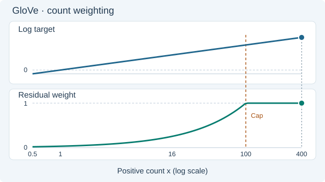

# GloVe

GloVe (Global Vectors for Word Representation) learns one vector per word by fitting the logarithm of word–word co-occurrence counts over the whole corpus. It was designed to combine two families of methods: count-based methods, which use global statistics, and prediction-based methods such as [word2vec](word2vec.md), which capture linear structure in the vectors. The parent page, [Embeddings and Representation Learning](index.md), places it among the other training signals.

## Problem

Pennington, Socher and Manning (2014) observed that the two families had complementary strengths. Count-based methods such as latent semantic analysis use global co-occurrence statistics efficiently, but they performed poorly on word analogies. Window-based prediction methods captured the linear structure that the analogies test, but they learned from local windows and did not use the global counts directly. The question was whether one model could use both.

## Core idea

Let $X_{ij}$ be the accumulated co-occurrence count for word $i$ and context word $j$. GloVe learns a word vector $w_i$, a separate context vector $\widetilde w_j$, and a bias for each, so that their dot product plus biases approximates $\log X_{ij}$.[^objective]

There are two distinct places where weighting enters. When constructing $X$, the paper makes a pair at token distance $d$ contribute $1/d$. Counts can therefore be fractional. For example, two occurrences of a pair at distances 2 and 3 contribute $1/2+1/3=5/6$, assuming both lie inside the context window. The corpus is aggregated into these counts before fitting. The loss then uses a separate function $f(X_{ij})$ to weight the regression error for each observed pair.[^counts]

The result is a model that starts from aggregated corpus co-occurrences, as count-based methods do, but optimises a regression target in the style of prediction-based methods. The authors argue that the two families are not fundamentally different, because both draw on the same co-occurrence statistics.

## Equation and algorithm

The model minimises a weighted least-squares objective over observed word–context pairs:

$$
J=\sum_{i,j:X_{ij}>0}f(X_{ij})\left(w_i^\top\widetilde w_j+b_i+\widetilde b_j-\log X_{ij}\right)^2.
$$

Restricting the sum to positive counts avoids evaluating $\log 0$. A zero entry contributes no regression term. It does not impose a target dot product of zero, and the model does not need to replace the target with $\log(1+X_{ij})$. For a positive count below one, the log target is negative and remains valid.[^objective]

The weighting function is

$$
f(x)=\begin{cases}(x/x_{\max})^\alpha,&0<x<x_{\max},\\1,&x\ge x_{\max}.\end{cases}
$$

with $x_{\max}=100$ and $\alpha=3/4$. The weight increases with the count up to the cutoff, then stays at one. Thus rare pairs are downweighted, while very frequent pairs receive no further increase in per-pair weight, and the authors report that the choice of cutoff matters only weakly. They also report that $\alpha=3/4$ gave a modest improvement over a linear weighting with $\alpha=1$.[^objective]

### Reading a weighted residual

For the preceding settings, the following constructed counts give these targets and weights, rounded to four decimals.

| Positive count $x$ | Regression target $\log x$ | Weight $f(x)$ |
|---|---|---|
| 0.5 | -0.6931 | 0.0188 |
| 1 | 0.0000 | 0.0316 |
| 16 | 2.7726 | 0.2530 |
| 100 | 4.6052 | 1.0000 |
| 400 | 5.9915 | 1.0000 |

If the fitted value $w_i^\top\widetilde w_j+b_i+\widetilde b_j$ exceeds its target by one, that pair contributes exactly $f(x)$ to the displayed objective. In particular, $x=1$ remains a training example even though its target is zero. The cutoff caps the **weight**, while the log target continues to increase beyond 100. These are direct calculations for illustration, not a trained model's measured errors.

Training is a single pass to build the co-occurrence matrix, followed by an iterative optimisation of `J` over the non-zero entries. Because only pairs with `X_ij > 0` contribute, the optimisation cost depends on the number of observed pairs rather than on the full vocabulary.

### Count sweep: log target versus loss weight

*Original 12-second teaching animation (CC BY-SA 4.0).* Use the site's Play/Pause button; scroll horizontally on narrow screens. GitHub provides the [static fallback](../../../assets/concept-animations/glove-count-weighting-still.svg) and [full SVG animation](../../../assets/concept-animations/glove-count-weighting-motion.svg).

The blue curve shows the log target and the green curve shows the residual weight. Both use the same logarithmic count axis. For a residual of magnitude one, the green value is also the pair's loss contribution. The cursor sweeps positive counts from 0.5 to 400 and back: at 1 the target is zero but the weight is positive; at and above 100 the weight stays at one while the target continues to grow. This is a sensitivity sweep over the analytic objective, not an optimisation trajectory or a measured corpus. The moving curves are sampled and linearly interpolated for display.

## Using the learned vectors

Training maintains two vector tables and two bias tables. For downstream word representations, the paper adds the word and context vectors for the same vocabulary item.[^vectors]

$$
e_i=w_i+\widetilde w_i.
$$

The cited reference implementation exports this sum without biases in text mode `-model 2`, its default. Text mode `-model 1` exports only the word vector, while `-model 0` exports both vector tables and their biases. Check the output mode before treating every number on a line as a coordinate of $e_i$.[^implementation]

For nonzero exported vectors, a common comparison is cosine similarity,

$$
\operatorname{cos}(e_i,e_j)=\frac{e_i^\top e_j}{\lVert e_i\rVert_2\lVert e_j\rVert_2}.
$$

This comparison uses two exported word representations. The regression fits a word–context dot product with biases. A cosine value between exported vectors therefore cannot be read directly as a fitted log count.

## Results

The paper evaluates on word analogies, using the same semantic and syntactic question sets as [word2vec](word2vec.md). The accuracies in [the paper's Table 2](https://aclanthology.org/D14-1162/) include:

| Model | Vector size | Corpus | Semantic | Syntactic | Overall |
|---|---|---|---|---|---|
| GloVe | 300 | 42B tokens | 81.9% | 69.3% | 75.0% |
| GloVe | 300 | 6B tokens | 77.4% | 67.0% | 71.7% |
| Skip-gram (authors' run) | 300 | 6B tokens | 73.0% | 66.0% | 69.1% |
| CBOW (authors' run) | 300 | 6B tokens | 63.6% | 67.4% | 65.7% |

The 75% headline figure comes from the 42-billion-token model. The authors also report that, when corpus, vocabulary, window size and training time are matched, GloVe outperforms word2vec. The corpora were Wikipedia dumps, Gigaword 5 and Common Crawl, and the vocabularies were the most frequent 400,000 words, apart from the Common Crawl model.

## Limitations

- **Empirical weighting.** The authors justify $\alpha=3/4$ only empirically.
- **Hard comparison.** Many parameters affect word2vec and GloVe, so the comparison depends on defaults. The authors acknowledge that a more thorough analysis would relax this simplification.
- **Corpus effects.** Semantic accuracy did not increase monotonically with corpus size. The authors attribute part of this to Gigaword being a fixed news source that may contain outdated facts.
- **Cost bound.** The worst-case complexity is quadratic in the vocabulary size. A tighter estimate relies on an assumed power-law distribution of co-occurrences.
- **Static vectors.** As with word2vec, each word has one vector whatever its sense.

[^objective]: Pennington, Socher and Manning (2014), Section 3, Equations (8) and (9). The preceding additive-log shift is discussed as a different baseline, and the proposed loss weights only observed co-occurrences.
[^counts]: Pennington, Socher and Manning (2014), Section 4.2, specifies inverse-distance contributions when building the counts. This differs from the regression weighting function.
[^vectors]: Pennington, Socher and Manning (2014), Section 4.2, describes the two vector tables and their sum for evaluation.
[^implementation]: Stanford NLP Group, `src/glove.c`, `save_params` and the `-model` option at commit `52f7dbc`, linked below. The output-mode statements here apply to text output.

## References

### Seminal papers

- Pennington, J., Socher, R. & Manning, C. (2014). GloVe: Global Vectors for Word Representation. In *Proceedings of EMNLP 2014*, pp. 1532–1543. https://aclanthology.org/D14-1162/ — Defines the weighted least-squares objective, the weighting function and the analogy results reported on this page.
- Mikolov, T., Chen, K., Corrado, G. & Dean, J. (2013). *Efficient Estimation of Word Representations in Vector Space*. arXiv. https://arxiv.org/abs/1301.3781 — The prediction-based word2vec models that GloVe is compared against.

### Surveys and textbooks

- Bengio, Y., Courville, A. & Vincent, P. (2012). *Representation Learning: A Review and New Perspectives*. arXiv. https://arxiv.org/abs/1206.5538 — Background on distributed representations and why they generalise.

### Articles and documentation

- Mikolov, T., Sutskever, I., Chen, K., Corrado, G. & Dean, J. (2013). *Distributed Representations of Words and Phrases and their Compositionality*. arXiv. https://arxiv.org/abs/1310.4546 — The negative-sampling variant of word2vec, used in most comparisons with GloVe.
- Goldberg, Y. & Levy, O. (2014). *word2vec Explained: deriving Mikolov et al.'s negative-sampling word-embedding method*. arXiv. https://arxiv.org/abs/1402.3722 — Explains the word2vec objective that GloVe's results are compared with.
- Stanford NLP Group. *GloVe reference implementation, src/glove.c*. https://github.com/stanfordnlp/GloVe/blob/52f7dbc512be3f72e9c11e7cbb19dfdfa4651e9c/src/glove.c — The training residual and text output modes show which vectors and biases are learned and exported.
