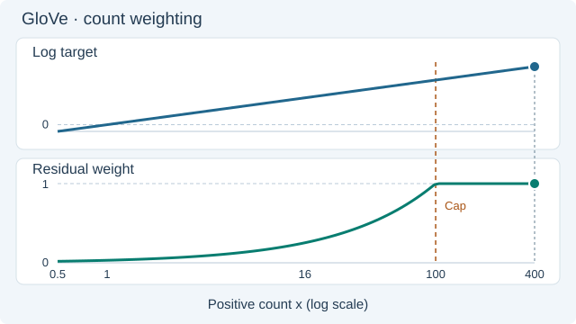
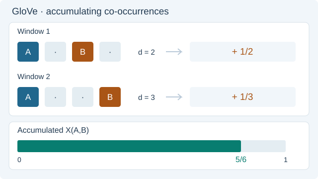
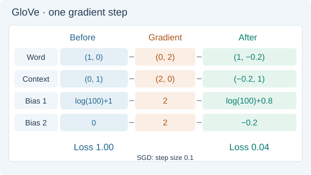

# GloVe

GloVe（Global Vectors for Word Representation）透過擬合全語料詞對共現次數的對數，為每個詞學習一個向量。它結合全域計數統計與 [word2vec](word2vec.md) 等預測型方法所捕捉的線性關係。父頁[嵌入與表徵學習](index.md)說明這類訓練訊號的位置。

## 問題

Pennington、Socher 與 Manning（2014）指出，潛在語義分析等計數方法能利用全域共現統計，但詞類比表現較弱；局部視窗預測方法則能捕捉類比關係，卻不直接擬合全域計數。GloVe 試圖結合兩者。

## 核心概念

令 $X_{ij}$ 為詞 $i$ 與上下文詞 $j$ 累積的共現計數。模型分別學習詞向量 $w_i$、上下文向量 $\widetilde w_j$ 及各自的偏置，使內積加偏置近似 $\log X_{ij}$。[^objective]

加權發生在兩個不同階段。建立 $X$ 時，論文讓相隔 $d$ 個詞元位置的詞對貢獻 $1/d$，所以計數可以是分數。例如，同一詞對的兩次出現分別相隔 2 與 3 個位置，若都在上下文視窗內，累積貢獻就是 $1/2+1/3=5/6$。先將語料彙整成這些計數，再進行擬合。損失則另外使用 $f(X_{ij})$，為每個已觀察詞對的迴歸誤差加權。[^counts]

模型由共現矩陣出發，卻使用可最佳化的迴歸目標。作者指出，計數與預測兩類方法都利用同一種共現資訊，並非完全對立。

## 方程與演算法

對觀察過的詞與上下文配對，最小化加權平方誤差：

$$
J=\sum_{i,j:X_{ij}>0}f(X_{ij})\left(w_i^\top\widetilde w_j+b_i+\widetilde b_j-\log X_{ij}\right)^2.
$$

僅對正計數求和，避免計算 $\log 0$。零項不產生迴歸損失，也不要求內積等於零。模型不需要把目標換成 $\log(1+X_{ij})$。介於零與一之間的正計數，其對數值為負，仍是有效目標。[^objective]

權重為

$$
f(x)=\begin{cases}(x/x_{\max})^\alpha,&0<x<x_{\max},\\1,&x\ge x_{\max}.\end{cases}
$$

論文設定 $x_{\max}=100$、$\alpha=3/4$。權重隨計數增加，直到封頂為 1；不是高頻越高、權重越低。作者發現截止值影響較小，$\alpha=3/4$ 相較線性權重 $\alpha=1$ 有適度改善。[^objective]

### 如何閱讀加權殘差

使用前述設定，下列建構的計數會得到這些目標與權重，四捨五入至小數點後四位。

| 正計數 $x$ | 迴歸目標 $\log x$ | 權重 $f(x)$ |
|---|---|---|
| 0.5 | -0.6931 | 0.0188 |
| 1 | 0.0000 | 0.0316 |
| 16 | 2.7726 | 0.2530 |
| 100 | 4.6052 | 1.0000 |
| 400 | 5.9915 | 1.0000 |

若擬合值 $w_i^\top\widetilde w_j+b_i+\widetilde b_j$ 比目標大一，該詞對對上述目標函數的貢獻恰為 $f(x)$。因此，$x=1$ 即使對應零目標，仍然是訓練樣本。截止值封頂的是**權重**，對數目標在計數超過 100 後仍持續增加。這些是直接計算的說明例子，不是已訓練模型的實測誤差。

先掃描語料建立共現矩陣，再對非零項迭代最佳化；因此每輪成本依賴實際觀察到的詞對數，而非必須遍歷完整矩陣。

### 共現計數掃描：對數目標與損失權重

*原創 12 秒教學動畫（CC BY-SA 4.0）。* 使用網站播放／暫停按鈕，窄螢幕可水平捲動。GitHub 提供[靜態預覽](../../../assets/concept-animations/glove-count-weighting-still.svg)及[完整 SVG 動畫](../../../assets/concept-animations/glove-count-weighting-motion.svg)。

藍線為對數目標，綠線為殘差權重，兩者共用對數計數橫軸。當殘差絕對值為一時，綠線數值亦為該詞對的損失貢獻。游標在正計數 0.5 至 400 間往返：計數為 1 時目標為零，但權重仍為正；達到 100 後權重維持為一，對數目標卻繼續上升。這是解析目標函數的敏感度分析，不是最佳化軌跡或語料實測。動畫採離散取樣後線性插值顯示。

### 建立單一分數共現計數

*原創 12 秒教學動畫（CC BY-SA 4.0）。* 使用網站播放／暫停按鈕，窄螢幕可水平捲動。GitHub 提供[靜態預覽](../../../assets/concept-animations/glove-window-accumulation-still.svg)及[完整 SVG 動畫](../../../assets/concept-animations/glove-window-accumulation-motion.svg)。

由目標詞 A 朝上下文詞 B 閱讀兩個獨立的人工視窗，假設兩者的距離都在上下文視窗內。對有方向性的項目 X(A,B)，第一次貢獻 1/2，第二次貢獻 1/3，合計 5/6。每次貢獻抵達後才更新長條，省略視窗內其他詞對。這是追蹤單一矩陣項目的示意，並非語料實測或完整的共現計數流程。長條刻度上限一只是本例設定，不代表共現計數不能超過一。彙整後，該正計數項目在上述加權迴歸目標中出現一次，其對數目標約為 -0.1823。反距離貢獻不是迴歸殘差的權重。

### 單次同步梯度更新

*原創 12 秒教學動畫（CC BY-SA 4.0）。* 使用網站播放／暫停按鈕，窄螢幕可水平捲動。GitHub 提供[靜態預覽](../../../assets/concept-animations/glove-simultaneous-gradient-still.svg)及[完整 SVG 動畫](../../../assets/concept-animations/glove-simultaneous-gradient-motion.svg)。

對單一正計數項，令 $r=w_i^\top\widetilde w_j+b_i+\widetilde b_j-\log X_{ij}$，以及 $g=2f(X_{ij})r$。由上述目標函數微分可得

$
\nabla_{w_i}J_{ij}=g\widetilde w_j,\qquad
\nabla_{\widetilde w_j}J_{ij}=gw_i.
$

兩個偏置的偏微分皆為 $g$。兩個向量梯度皆採用更新前的狀態。取共現計數 100（權重為一）、詞向量 (1, 0)、上下文向量 (0, 1)、第一個偏置 $\log(100)+1$、第二個偏置為零，殘差即為一。以步長 0.1 執行一次同步的基本 SGD 更新，兩個向量變成 (1, −0.2) 與 (−0.2, 1)，兩個偏置均減少 0.2。更新後內積為 −0.4，殘差為 0.2，該詞對的損失為 0.04。

橘色標記追蹤同步更新：梯度先出現，參數才同時更新。這是單一詞對的人工微分算例，並非 GloVe 原始最佳化器的精確更新規則、全語料損失或訓練實測資料。若先更新其中一個向量，再使用新向量計算另一個梯度，就不是相同的同步 SGD 更新。

## 使用學得的向量

訓練維護兩組向量表與兩組偏置表。用作下游詞表示時，論文將同一詞彙項目的詞向量與上下文向量相加。[^vectors]

$$
e_i=w_i+\widetilde w_i.
$$

所引用的參考實作在預設的文字輸出模式 `-model 2` 中，輸出不含偏置的向量和。文字模式 `-model 1` 只輸出詞向量，`-model 0` 則輸出兩組向量與偏置。把一行的所有數值視為 $e_i$ 的座標前，應先確認輸出模式。[^implementation]

對非零的輸出向量，常見比較方式是餘弦相似度，

$$
\operatorname{cos}(e_i,e_j)=\frac{e_i^\top e_j}{\lVert e_i\rVert_2\lVert e_j\rVert_2}.
$$

此比較使用兩個輸出的詞表示。迴歸擬合的是帶有偏置的詞與上下文內積，因此不能把輸出向量間的餘弦值直接解讀為擬合的對數計數。

## 結果

[原論文表 2](https://aclanthology.org/D14-1162/)使用與 word2vec 相同的語義／語法詞類比測試：

| 模型 | 向量維度 | 語料詞數 | 語義 | 語法 | 總體 |
|---|---|---|---|---|---|
| GloVe | 300 | 420 億 | 81.9% | 69.3% | 75.0% |
| GloVe | 300 | 60 億 | 77.4% | 67.0% | 71.7% |
| Skip-gram（作者實作設定） | 300 | 60 億 | 73.0% | 66.0% | 69.1% |
| CBOW（作者實作設定） | 300 | 60 億 | 63.6% | 67.4% | 65.7% |

75% 的結果來自 420 億詞模型。作者也報告，在匹配語料、詞彙、視窗與訓練時間的比較中，GloVe 表現較好。語料包括 Wikipedia、Gigaword 5 與 Common Crawl；除 Common Crawl 模型外，詞彙表取最常見的 40 萬詞。這些是論文實驗結果，不是本頁重現的量測。

## 限制

- **經驗性權重**：$\alpha=3/4$ 的選擇主要由實驗支持。
- **比較依賴設定**：兩類模型有多種超參數；作者承認需要更完整的分析。
- **語料組成影響**：語義準確率未隨語料量單調上升；作者認為 Gigaword 的固定新聞來源與過時事實可能是原因之一。
- **最壞成本**：非零詞對數最壞可與詞彙量平方同階；更緊的估計依賴共現計數的冪律假設。
- **靜態向量**：不同詞義仍共用同一向量。

[^objective]: Pennington、Socher 與 Manning（2014）第 3 節，式（8）、（9）。前文將對數內加一的做法列為另一個基準；提出的損失只對已觀察的共現項加權。
[^counts]: Pennington、Socher 與 Manning（2014）第 4.2 節，說明建立計數時採用反距離貢獻；此步驟與迴歸權重函數不同。
[^vectors]: Pennington、Socher 與 Manning（2014）第 4.2 節，說明兩組向量與用於評估的向量和。
[^implementation]: Stanford NLP Group，提交 `52f7dbc` 的 `src/glove.c`，見下方連結的 `save_params` 與 `-model` 選項。此處輸出模式的敘述適用於文字輸出。

## 參考資料

### 奠基論文

- Pennington, J., Socher, R. & Manning, C. (2014). GloVe: Global Vectors for Word Representation. In *Proceedings of EMNLP 2014*, pp. 1532–1543. https://aclanthology.org/D14-1162/ — 定義加權平方誤差、權重函數與本頁類比結果。
- Mikolov, T., Chen, K., Corrado, G. & Dean, J. (2013). *Efficient Estimation of Word Representations in Vector Space*. arXiv. https://arxiv.org/abs/1301.3781 — 介紹用於比較的 word2vec 預測模型。

### 綜述與教科書

- Bengio, Y., Courville, A. & Vincent, P. (2012). *Representation Learning: A Review and New Perspectives*. arXiv. https://arxiv.org/abs/1206.5538 — 分布式表示與泛化的背景。

### 文章與文件

- Mikolov, T., Sutskever, I., Chen, K., Corrado, G. & Dean, J. (2013). *Distributed Representations of Words and Phrases and their Compositionality*. arXiv. https://arxiv.org/abs/1310.4546 — 說明常用於比較的負採樣詞向量方法。
- Goldberg, Y. & Levy, O. (2014). *word2vec Explained: deriving Mikolov et al.'s negative-sampling word-embedding method*. arXiv. https://arxiv.org/abs/1402.3722 — 解釋 word2vec 負採樣目標。
- Stanford NLP Group. *GloVe reference implementation, src/glove.c*. https://github.com/stanfordnlp/GloVe/blob/52f7dbc512be3f72e9c11e7cbb19dfdfa4651e9c/src/glove.c — 訓練殘差與文字輸出模式展示模型學習及輸出的向量與偏置。
