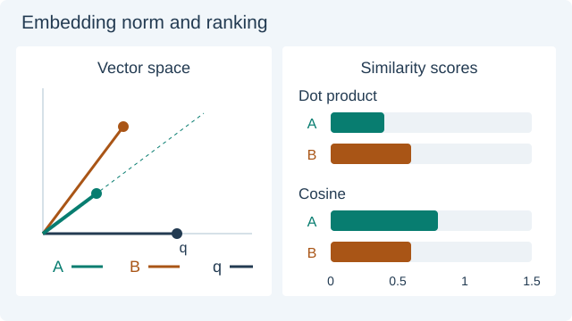
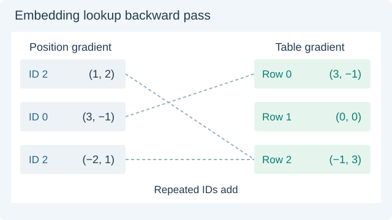

# Embeddings and Representation Learning

An embedding maps an object, such as a word, sentence, image, user or graph node, to a vector, so that the geometry of the vector space reflects the similarity the task cares about. Once objects live in such a space, distance, angle and simple linear operations become useful tools for search, clustering, classification and recommendation. Learning the embedding, rather than designing it by hand, is what made embeddings central to modern AI.

## Overview

Bengio, Courville and Vincent (2012) frame the problem as *representation learning*: finding a transformation of the input that makes the features useful for many later tasks. Their review argues that good representations are often distributed, meaning each concept is spread over many units, and that they disentangle the factors that vary in the data. An embedding is the most common concrete form of such a representation: a fixed-length vector, stored and compared directly.

The same idea appears in every modality. A word embedding places words with related uses near each other. A sentence embedding places whole passages in one space so that they can be compared. An image–text embedding puts pictures and captions in one space. The training signal decides what the geometry means, and that choice is the main design decision.

## Key concepts

- **Embedding table**: a lookup from discrete items, such as word identifiers, to learned vectors.
- **Similarity**: usually cosine similarity or a dot product between two vectors, after normalisation.
- **Contrastive objective**: a loss that pulls matching pairs together and pushes non-matching pairs apart.
- **Triplet loss**: a loss over an anchor, a positive and a negative example, requiring the anchor to be closer to the positive by a margin.
- **Dimensionality**: the length of the vector. Higher dimensions hold more information, at a larger cost in storage and search.

### Norm versus direction in similarity ranking

*Original 12-second teaching animation (CC BY-SA 4.0).* Use the site's Play/Pause button; scroll horizontally on narrow screens. GitHub provides the [static fallback](../../../assets/concept-animations/embedding-norm-ranking-still.svg) and [full SVG animation](../../../assets/concept-animations/embedding-norm-ranking-motion.svg).

For a constructed example, take query $q=(1,0)$, candidate $A=r(0.8,0.6)$ with positive norm $r$, and candidate $B=(0.6,0.8)$. As A's norm sweeps from 0.5 to 1.5, its dot product changes from 0.4 to 1.2, while B's stays at 0.6. The dot-product ranking reverses at $r=0.75$. The cosine scores stay 0.8 and 0.6, so A always ranks above B by cosine. Both panels use the same score scale. The dotted ray indicates A's fixed direction.

For nonzero embeddings, normalising both vectors makes the dot product equal to cosine similarity. Which score to use depends on whether the learned norms contain useful task information; normalisation is not always an improvement. These vectors and their scores are illustrative, not measurements from a trained embedding model.

### Repeated indices in embedding lookup

*Original 12-second teaching animation (CC BY-SA 4.0).* Use the site's Play/Pause button; scroll horizontally on narrow screens. GitHub provides the [static fallback](../../../assets/concept-animations/embedding-lookup-accumulation-still.svg) and [full SVG animation](../../../assets/concept-animations/embedding-lookup-accumulation-motion.svg).

For a plain embedding table $E$, position $t$ retrieves row $i_t$, so $h_t=E_{i_t}$. If the upstream gradient is $g_t$, the chain rule gives

$
\nabla_{E_j} L=\sum_{t:i_t=j}g_t.
$

This is a scatter-add, not assignment to a row. In the constructed example, indices 2, 0 and 2 have gradients (1, 2), (3, -1) and (-2, 1). Follow each blue marker: row 2 first receives (1, 2), row 0 receives (3, -1), then row 2 adds (-2, 1) to reach (-1, 3). Row 1 has no contribution from this lookup. The scan is instructional; parallel accumulation can implement the same sum. This is the lookup gradient alone, without frequency scaling, padding rules, regularisation or optimiser state. It is not a model measurement.

## How it works

Four families of training signal cover most embeddings in use.

**Prediction from context.** word2vec (Mikolov et al., 2013) learns word vectors from large text corpora by predicting words from their neighbours. Words that occur in similar contexts end up with similar vectors. The paper's aim was to make such training efficient enough to run on very large corpora.

**Factorising co-occurrence counts.** GloVe (Pennington, Socher & Manning, 2014) starts from global word–word co-occurrence statistics and learns vectors whose inner products reflect them. It combines the global counts used by older count-based methods with the vector structure of prediction-based ones.

**Metric learning.** FaceNet (Schroff et al., 2015) trains a deep convolutional network to map face images into a space where distances reflect identity. The paper trains the embedding itself with a triplet-based objective, so that the same person is closer than a different person by a margin. The learned vectors are then used directly for recognition and clustering.

**Aligning modalities and sentences.** Sentence-BERT (Reimers & Gurevych, 2019) adapts a pre-trained transformer into a siamese network, so that sentences can be embedded once and compared with cosine similarity, rather than passed through the model in pairs. CLIP (Radford et al., 2021) learns image and text encoders from natural language supervision, so that matching images and captions have similar embeddings and can be used for zero-shot classification by comparing an image with text prompts.

## Key methods

Each method below has its own page, with the problem, the training objective, the reported results and the limitations.

- [word2vec](word2vec.md) (prediction from context): local context prediction, fast on large text. Produces static word vectors, one per word.
- [GloVe](glove.md) (co-occurrence factorisation): fits global counts, so it uses corpus-wide statistics. Static vectors, with a different route to similar results.
- [FaceNet](facenet.md) (metric learning): a learned embedding for identity, trained directly on distances with a triplet loss. Specialised to comparisons between instances.
- [Sentence-BERT](sentence-bert.md) (siamese encoder): sentence vectors from a pre-trained transformer that can be compared quickly with cosine similarity. Trained for similarity rather than generation.
- [CLIP](clip.md) (modality alignment): a shared space for images and text, learned from paired data, which supports zero-shot classification.

## Connections

Embeddings are the bridge between the [Transformer](../transformer/index.md) and [Large Language Models](../llm/index.md) on one side and retrieval, recommendation and multimodal systems on the other. Self-supervised pre-training is the usual source of the training signal, see [Self-Supervised Learning](../../paradigms/self-supervised/index.md). Image–text embeddings are central to [Multimodal Models](../multimodal/index.md).

Distributed representations have a long history in neuroscience. Population codes, in which a stimulus is represented by the joint activity of many neurons, are a natural counterpart to embedding vectors, and similarity structure in neural population activity is compared with model representations in [NeuroAI](../../../brain-mind/neuroai/index.md). The comparison is a hypothesis to be tested, not an established equivalence.

## Applications

- **Search and retrieval.** Nearest-neighbour search over embeddings finds documents, images or products similar to a query.
- **Recommendation.** Users and items are embedded so that the score is a similarity between them.
- **Face recognition and clustering.** FaceNet-style embeddings compare identities by distance.
- **Zero-shot classification.** Images are classified by comparing their embeddings with text descriptions of the classes.

## Open questions

- Static embeddings give a word one vector regardless of its sense. Contextual embeddings solve this, but at the cost of computing them per use.
- What the geometry of an embedding space means is hard to read, and similarity may encode biases from the training data.
- It is still unclear how much of an embedding's usefulness comes from scale of data rather than from the training objective.

## References

### Seminal papers

- Mikolov, T., Chen, K., Corrado, G. & Dean, J. (2013). *Efficient Estimation of Word Representations in Vector Space*. arXiv. https://arxiv.org/abs/1301.3781 — Introduces efficient word-vector training from large corpora, the basis of word2vec.
- Pennington, J., Socher, R. & Manning, C. (2014). GloVe: Global Vectors for Word Representation. In *Proceedings of EMNLP 2014*, pp. 1532–1543. https://aclanthology.org/D14-1162/ — Learns word vectors from global co-occurrence statistics.
- Schroff, F., Kalenichenko, D. & Philbin, J. (2015). *FaceNet: A Unified Embedding for Face Recognition and Clustering*. arXiv. https://arxiv.org/abs/1503.03832 — Trains a deep network to embed face images directly, with a triplet-based objective.
- Reimers, N. & Gurevych, I. (2019). *Sentence-BERT: Sentence Embeddings using Siamese BERT-Networks*. arXiv. https://arxiv.org/abs/1908.10084 — Produces sentence embeddings that can be compared with cosine similarity, without pairwise passes through the model.
- Radford, A., Kim, J. W., Hallacy, C., Ramesh, A., Goh, G., Agarwal, S., Sastry, G., Askell, A., Mishkin, P., Clark, J., Krueger, G. & Sutskever, I. (2021). *Learning Transferable Visual Models From Natural Language Supervision*. arXiv. https://arxiv.org/abs/2103.00020 — CLIP: image and text embeddings learned from natural language supervision, with zero-shot transfer.

### Surveys and textbooks

- Bengio, Y., Courville, A. & Vincent, P. (2012). *Representation Learning: A Review and New Perspectives*. arXiv. https://arxiv.org/abs/1206.5538 — A review of representation learning and the properties that make representations useful.
