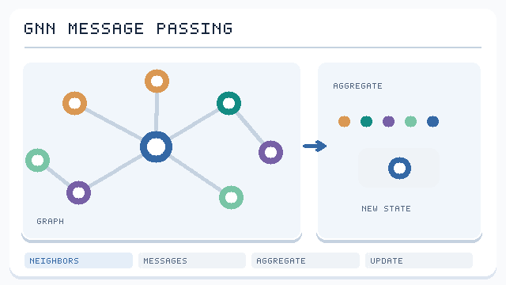

---
related:
- applications/life-science
- applications/science
- brain-mind/neuroscience
---

# Graph Neural Networks

## Why graphs?

Much data is naturally a graph: molecules (atoms and bonds), social networks, knowledge graphs, road networks, citation networks, protein interaction networks — and **brain connectomes**. CNNs and RNNs assume grids or sequences; GNNs handle arbitrary graphs.

## Message passing

At each layer, every node gathers messages from its neighbours, aggregates them, and updates itself:

\[
h_v^{(k+1)} = \text{UPDATE}\Big(h_v^{(k)},\; \text{AGG}_{u\in\mathcal{N}(v)}\, \text{MSG}(h_u^{(k)}, h_v^{(k)}, e_{uv})\Big)
\]

The aggregation must be **permutation-invariant** (sum, mean, max, attention).

*Original message-passing schematic, CC BY-SA 4.0.* A node receives messages **along existing graph edges**, aggregates the incoming information using a permutation-invariant operation, and computes an updated embedding. The colours and pulses are schematic, not computed node features. Multiple layers let information propagate across progressively larger neighbourhoods. See [Gilmer et al. (2017)](https://arxiv.org/abs/1704.01212).

## Components and variants

How messages are formed and aggregated, and how deep the network can go before its node features blur together, are covered on the [message-passing](message-passing/index.md) page. It compares normalised convolution, neighbour sampling, attention, and the expressivity of sum-based aggregation.

## Key methods

| Method | Year | Core idea | Page |
|---|---|---|---|
| Graph convolutional networks (GCN) | 2016 | Degree-normalised neighbour averaging, a first-order spectral filter | [GCN](message-passing/gcn/index.md) |
| Graph attention networks (GAT) | 2017 | Learned attention weights over neighbours | [GAT](message-passing/gat/index.md) |
| Graph isomorphism networks (GIN) | 2018 | Sum aggregation with an MLP update, as expressive as the WL test | [GIN](message-passing/gin/index.md) |

The three methods differ in how they weight neighbours: GCN uses fixed degree-based weights, GAT learns attention weights, and GIN sums neighbours with an MLP update.

## Representative models

| Model | Character |
|---|---|
| GCN (Kipf & Welling, 2017) | First-order approximation of spectral graph convolution |
| GraphSAGE | Neighbour sampling; scales to large graphs; inductive |
| GAT | Attention over neighbours |
| GIN | As expressive as the 1-WL graph isomorphism test |
| MPNN | Unified message-passing framework (quantum chemistry) |
| Equivariant GNNs (EGNN, NequIP, MACE) | Equivariant to 3D rotations and translations; molecular simulation |
| Graph Transformers | Global attention plus structural encodings |

## Tasks

- Node classification (paper topics, fraudulent accounts)
- Link prediction (recommendation, drug–drug interactions, knowledge-graph completion)
- Graph classification / regression (molecular properties, toxicity)
- Graph generation (molecule design)

## Known issues

- **Over-smoothing**: node representations converge as depth grows
- **Over-squashing**: long-range information is compressed into fixed-size vectors
- **Expressivity limits**: standard message passing cannot distinguish some non-isomorphic graphs

## Major applications

- **GNoME** (2023) used GNNs to predict a very large number of new stable crystal structures
- **GraphCast** (2023): global medium-range weather forecasting with a GNN, outperforming the leading operational numerical model on most targets
- Recommendation (Pinterest's PinSage), Google Maps arrival-time prediction
- Drug discovery and materials science — see [Life Sciences](../../../applications/life-science/index.md), [Scientific Discovery](../../../applications/science/index.md)

## Neuroscience: connectomics

- A **connectome** is the complete wiring diagram of neurons and synapses. The nematode *C. elegans* (302 neurons) was mapped in 1986; the **whole adult fruit-fly brain** connectome (FlyWire, ~140,000 neurons) was published in *Nature* in 2024
- Connectome-constrained network models can predict neural activity in the fly visual system (Lappalainen et al., 2024)
- **Network neuroscience** uses graph theory to study small-worldness, modularity and hubs in brain networks
- The MICrONS project (2025) released structural and functional data for a cubic millimetre of mouse visual cortex
- Deep learning is what made dense connectome reconstruction from electron microscopy feasible

## Resources

- Stanford CS224W, *Machine Learning with Graphs*
- [PyTorch Geometric](https://pyg.org/), [DGL](https://www.dgl.ai/)
- Hamilton, *Graph Representation Learning* (free PDF)
- Bronstein et al., *Geometric Deep Learning* (free online)

## References

### Seminal papers

- Gilmer, J., et al. (2017). "Neural Message Passing for Quantum Chemistry". arXiv:1704.01212 — Gives the message-passing framework and shows that several graph models fit it.
- Kipf, T. N. & Welling, M. (2016). "Semi-Supervised Classification with Graph Convolutional Networks". arXiv:1609.02907 — The GCN layer with symmetric degree normalisation.
- Hamilton, W., Ying, Z. & Leskovec, J. (2017). "Inductive Representation Learning on Large Graphs". arXiv:1706.02216 — GraphSAGE, sampled neighbourhood aggregation for unseen nodes.
- Veličković, P., et al. (2017). "Graph Attention Networks". arXiv:1710.10903 — Learned attention weights over neighbours, computed from the features of the two endpoints.

### Articles and documentation

- Xu, K., et al. (2018). "How Powerful are Graph Neural Networks?". arXiv:1810.00826 — Shows the expressivity limits of aggregation functions and proposes sum-based GIN.
- Li, Q., Han, Z. & Wu, X.-M. (2018). "Deeper Insights into Graph Convolutional Networks for Semi-Supervised Learning". arXiv:1801.07606 — Analyses how repeated graph convolution makes node features converge.
