---
related:
- theory/models/gnn/message-passing
- theory/models/gnn
aliases:
  - Graph Attention Networks
  - GAT
  - 圖注意力網路
tags:
  - graph neural networks
  - attention
  - message passing
translation_reviewed: 2026-10-29
---

# 圖注意力網路（GAT）

圖注意力網路（GAT）讓每個節點以學習得到的注意力權重來加權其鄰居。此模型由 Veličković 等人（2017）提出。與 GCN 固定、依度數的正規化不同，注意力係數是由每條邊兩端點的特徵計算而得。

## 問題

頻譜濾波器依賴圖的 Laplacian。因此，在某一圖結構上訓練的模型無法直接套用到另一個結構上，而且這些濾波器在空間上並不是局部化的。

## 核心想法

每個節點對其鄰居做注意力。注意力係數來自節點特徵經過共享線性轉換後的結果，並在鄰域上以 softmax 正規化。數個注意力頭平行執行，其輸出在隱藏層中串接。

### 動態概念解說

*原創 CC BY-SA 4.0 教學動畫，依據 Veličković 等人（2017；見參考文獻）。圖中展示的是**單一注意力頭**，而非多頭輸出的串接。MkDocs 網站提供支援鍵盤操作的**播放／暫停**按鈕；偏好減少動態效果時，預設顯示 [GitHub 可閱讀的靜態概覽](../../../../../assets/concept-animations/gat-aggregation-still.svg)。[開啟完整動畫](../../../../../assets/concept-animations/gat-aggregation-motion.svg)。*

圖中使用與 GCN 動畫**相同的四節點星狀圖與純量特徵**：$h_i=0.5,\ h_A=1,\ h_B=1.5,\ h_C=2$，並將目標節點自身納入鄰域。為了讓計算可以重現，設定 $W=1$，採用一組示意的共享加法式注意力評分函數 $e_{ij}=\operatorname{LeakyReLU}(h_j-h_i)$。四個分數都非負，因此 logits 為 $(0,0.5,1,1.5)$。在鄰域上執行 softmax 後，對應 $(i,A,B,C)$ 的係數約為 $(0.1015,0.1674,0.2760,0.4551)$；若輸出激活函數為恆等函數，加權特徵和為 $1.5423$。這些係數加總為一，與 GCN 的度數正規化權重不同。圖中的評分函數、特徵及輸出均為**刻意建構的教學數值**，不是訓練後 GAT 的實測參數或激活值。

## 方程式或演算法

對節點 i 與其鄰居 j，此層的計算為

\[
e_{ij} = a(\mathbf{W}\vec{h}_i,\; \mathbf{W}\vec{h}_j), \qquad
\alpha_{ij} = \frac{\exp(e_{ij})}{\sum_{k\in\mathcal{N}_i}\exp(e_{ik})}, \qquad
\vec{h}'_i = \sigma\!\Big(\sum_{j\in\mathcal{N}_i}\alpha_{ij}\,\mathbf{W}\vec{h}_j\Big)
\]

此處 e_ij 為節點 i 與 j 之間的注意力分數，a 為共享的注意力函數，W 為共享的線性轉換，N_i 為節點 i 的鄰域，σ 為非線性函數。

## 結果

在 Cora 的直推式（transductive）設定下，論文報告的測試準確率為 83.0% ± 0.7%（GCN 為 81.5%）。在 Citeseer 上為 72.5% ± 0.7%（GCN 為 70.3%）。在 Pubmed 上與 GCN 持平，為 79.0%。在歸納式（inductive）的 PPI 資料集上，micro-F1 為 0.973，而論文比較表中列出的 GraphSAGE 為 0.768。

## 限制

稀疏實作只支援二階張量（rank-2），限制了跨圖的批次處理。感受野受深度限制。多頭注意力會使參數量乘以頭數。

## 相關連結

GAT 是訊息傳遞架構中採用學習型注意力的特例：其聚合權重由特徵計算，而非由圖結構固定決定。一般框架見[訊息傳遞](../index.md)頁面，更完整的家族見[圖神經網路](../../index.md)頁面。固定權重與基於求和的替代方法，分別見 [GCN](../gcn/index.md) 與 [GIN](../gin/index.md) 頁面。

## 未解問題與更多變體

- **跨圖批次處理。** 稀疏實作的 rank-2 限制會限制跨圖的批次處理。此頁未描述解法。
- **注意力與求和聚合。** softmax 使每一層成為鄰居訊息的加權平均。其相對於求和聚合的表達力，此頁並未確立。作為參考，[GIN](../gin/index.md)頁面列出論文中平均聚合在 REDDIT-BINARY 上的結果 50.0。
- **頭數。** 多頭注意力會使參數量倍增，而此頁未提供選擇頭數的準則。

## 參考文獻

### 開創性論文

- Veličković, P., et al. (2017). "Graph Attention Networks". [arXiv:1710.10903](https://arxiv.org/abs/1710.10903) — 對鄰居學習注意力權重，權重由兩端點的特徵計算。
- Kipf, T. N. & Welling, M. (2016). "Semi-Supervised Classification with Graph Convolutional Networks". [arXiv:1609.02907](https://arxiv.org/abs/1609.02907) — 依對稱度數正規化的 GCN 層。
- Gilmer, J., et al. (2017). "Neural Message Passing for Quantum Chemistry". [arXiv:1704.01212](https://arxiv.org/abs/1704.01212) — 提出訊息傳遞框架，並說明多種圖模型都符合它。
- Hamilton, W., Ying, Z. & Leskovec, J. (2017). "Inductive Representation Learning on Large Graphs". [arXiv:1706.02216](https://arxiv.org/abs/1706.02216) — GraphSAGE，對採樣鄰域做聚合，可用於未見過的節點。

### 綜述與教科書

（本頁未查核任何項目）

### 講座與影片

（本頁未查核任何項目）

### 文章與文件

- Xu, K., et al. (2018). "How Powerful are Graph Neural Networks?". [arXiv:1810.00826](https://arxiv.org/abs/1810.00826) — 顯示聚合函數的表達力限制，並提出基於求和的 GIN。
- Li, Q., Han, Z. & Wu, X.-M. (2018). "Deeper Insights into Graph Convolutional Networks for Semi-Supervised Learning". [arXiv:1801.07606](https://arxiv.org/abs/1801.07606) — 分析重複圖卷積如何使節點特徵趨於一致。
