---
related:
- theory/models/gnn/message-passing
- theory/models/gnn
aliases:
  - Graph Convolutional Networks
  - GCN
  - 圖卷積網路
tags:
  - graph neural networks
  - spectral convolution
  - semi-supervised learning
  - message passing
last_reviewed: 2026-10-28
---

# Graph Convolutional Networks

Graph convolutional networks (GCN) classify the nodes of a graph when only a few of them have labels. The model was introduced by Kipf and Welling (2016). Each layer propagates node features over the adjacency matrix of the graph, so the network is conditioned on the graph's structure. The propagation step adds self-loops and normalises by node degree on both sides.

## Problem

Node classification is hard when labels exist for only a few nodes. Earlier graph methods handled this by adding a Laplacian regulariser, which assumes that connected nodes tend to share labels.

## Core idea

Instead of adding a penalty based on that assumption, the GCN conditions the network on the adjacency matrix. Each layer propagates features over that matrix with self-loops and symmetric degree normalisation. The authors describe the result as a first-order approximation of a localised spectral convolution.

### Animated walkthrough

*Original CC BY-SA 4.0 teaching animation based on Kipf and Welling (2016; see References). The phases show self-loop augmentation, degree-based coefficients, aggregation, and the updated node feature. On MkDocs, the **Play/Pause** control is keyboard accessible; reduced-motion preferences initially select the [GitHub-readable static overview](../../../../../assets/concept-animations/gcn-aggregation-still.svg). [Open the animated SVG](../../../../../assets/concept-animations/gcn-aggregation-motion.svg).*

The toy graph is a four-node star with target $i$ and three leaves $A,B,C$. Their scalar input features are $h_i=0.5,\ h_A=1,\ h_B=1.5,\ h_C=2$. After adding self-loops, the target degree is $4$ and every leaf degree is $2$. Thus the self-message coefficient is $1/4$, while each incoming leaf coefficient is $1/\sqrt{4\cdot2}$. With $W=1$ and ReLU, the target update is $0.25(0.5)+(1+1.5+2)/\sqrt{8}\approx1.716$. Unlike a softmax, these symmetric-normalization coefficients do **not** have to sum to one. The features and numbers are hand-computed teaching values, not learned embeddings or benchmark measurements.

## Equation or algorithm

With à = A + I, where I is the identity matrix (so à adds self-loops to the adjacency matrix A), and D̃ the diagonal degree matrix of Ã, one layer computes

\[
H^{(l+1)} = \sigma\!\left(\tilde{D}^{-1/2}\,\tilde{A}\,\tilde{D}^{-1/2}\,H^{(l)}\,W^{(l)}\right)
\]

Here H^(l) stacks the node features at layer l, W^(l) is the layer's weight matrix, and σ is a nonlinearity. Each row of the output mixes a node's features with those of its neighbours, weighted by the degrees of both endpoints.

## Results

On Citeseer, Cora, Pubmed and NELL, the paper reports test accuracies of 70.3%, 81.5%, 79.0% and 66.0%, in that order. These were the best results among the methods the paper compares against.

## Limitations

Full-batch training needs memory that grows linearly with the dataset. The model does not support edge features. The best results came from two or three layers, and training deeper models without residual connections becomes difficult beyond about seven layers.

## Connections

GCN is the first-order, spectrally motivated case of the message-passing scheme, with a fixed, degree-weighted sum over neighbours. The general framework is on the [message-passing](../index.md) page, and the wider family is on the [graph neural networks](../../index.md) page. The learned-attention and sum-based alternatives are on the [GAT](../gat/index.md) and [GIN](../gin/index.md) pages.

## Open issues and further variants

- **Edge features.** The layer as defined takes no edge features, while the general message function on the [graph neural networks](../../index.md) page includes an edge term. How to add edge information to the GCN layer is not covered here.
- **Depth.** Results were best at two or three layers, and training deeper stacks without residual connections is hard. This page does not cover how to make deep graph convolutions trainable.
- **Large graphs.** Full-batch training is limited by memory. Neighbour sampling, as in GraphSAGE, is the approach the family page lists for scaling to large graphs.

## References

### Seminal papers

- Kipf, T. N. & Welling, M. (2016). "Semi-Supervised Classification with Graph Convolutional Networks". [arXiv:1609.02907](https://arxiv.org/abs/1609.02907) — The GCN layer with symmetric degree normalisation.
- Gilmer, J., et al. (2017). "Neural Message Passing for Quantum Chemistry". [arXiv:1704.01212](https://arxiv.org/abs/1704.01212) — Gives the message-passing framework and shows that several graph models fit it.
- Hamilton, W., Ying, Z. & Leskovec, J. (2017). "Inductive Representation Learning on Large Graphs". [arXiv:1706.02216](https://arxiv.org/abs/1706.02216) — GraphSAGE, sampled neighbourhood aggregation for unseen nodes.
- Veličković, P., et al. (2017). "Graph Attention Networks". [arXiv:1710.10903](https://arxiv.org/abs/1710.10903) — Learned attention weights over neighbours, computed from the features of the two endpoints.

### Surveys and textbooks

(none checked for this page)

### Lectures and videos

(none checked for this page)

### Articles and documentation

- Xu, K., et al. (2018). "How Powerful are Graph Neural Networks?". [arXiv:1810.00826](https://arxiv.org/abs/1810.00826) — Shows the expressivity limits of aggregation functions and proposes sum-based GIN.
- Li, Q., Han, Z. & Wu, X.-M. (2018). "Deeper Insights into Graph Convolutional Networks for Semi-Supervised Learning". [arXiv:1801.07606](https://arxiv.org/abs/1801.07606) — Analyses how repeated graph convolution makes node features converge.
