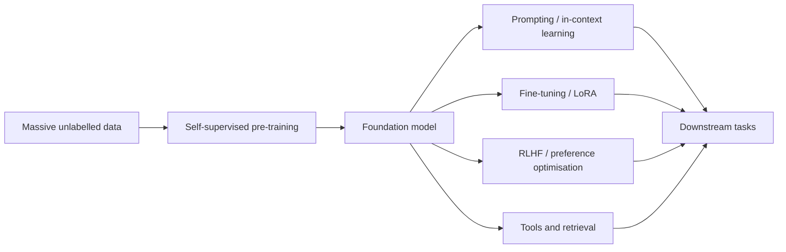

# Models

The architecture families of contemporary AI, and the systems built from them. A family is a way of building a network: how it routes information across inputs, and what it assumes about the data. The general theory behind them is in [Theory](../index.md). Generative modelling is not listed here, because any family can be trained that way; see [Generative Modelling](../generative/index.md).

## Architecture families

| Family | Core idea | Components and variants |
|---|---|---|
| [Multilayer Perceptrons](mlp/index.md) | Stacked affine maps and nonlinearities, with no assumed structure | Activations, normalisation, residual connections |
| [Convolutional Networks](cnn/index.md) | A shared local filter applied at every position | [Convolution variants](cnn/convolution-variants/index.md), [backbones and scaling](cnn/backbones-and-scaling/index.md) |
| [Recurrent Networks](rnn/index.md) | A hidden state carried step by step through a sequence | [Gated cells](rnn/gated-cells/index.md), [sequence modes](rnn/sequence-modes/index.md) |
| [Transformers & Attention](transformer/index.md) | Content-based routing of information with attention | [Attention variants](transformer/attention-variants/index.md), [positional encodings](transformer/positional-encodings/index.md), [KV cache](transformer/kv-cache/index.md) |
| [State-Space Models](ssm/index.md) | A linear state updated over time, with long-range memory | [Structured state spaces](ssm/structured-state-spaces/index.md), [selective state spaces](ssm/selective-state-spaces/index.md) |
| [Diffusion Models](diffusion/index.md) | Generate by learning to reverse a gradual noising process | Denoising backbones (U-Net, DiT), latent diffusion, guidance |
| [Graph Neural Networks](gnn/index.md) | Message passing over the edges of a graph | [Message passing](gnn/message-passing/index.md) |

## Applications and systems

These pages describe tasks, modalities and systems. Each one is built from one or more of the families above.

| Page | Focus |
|---|---|
| [Large Language Models](llm/index.md) | Pre-training, alignment, reasoning models, the open-weight ecosystem |
| [Computer Vision](computer-vision/index.md) | Classification, detection, segmentation, 3D, video |
| [Natural Language Processing](nlp/index.md) | From word vectors to LLMs |
| [Speech & Audio](speech/index.md) | Recognition, synthesis, music generation |
| [Multimodal Models](multimodal/index.md) | Vision-language models, text-to-image/video, omni models |
| [AI Agents](agents/index.md) | Tool use, planning, memory, multi-agent systems |
| [World Models & Embodied AI](world-models/index.md) | Predicting environments, planning in imagination, robot foundation models |

## The foundation-model paradigm

In 2021 Stanford researchers coined "foundation models" for this pattern: pre-train once at scale, adapt everywhere. It changed the economics of AI — a few organisations train foundation models, and very many developers build on them.
