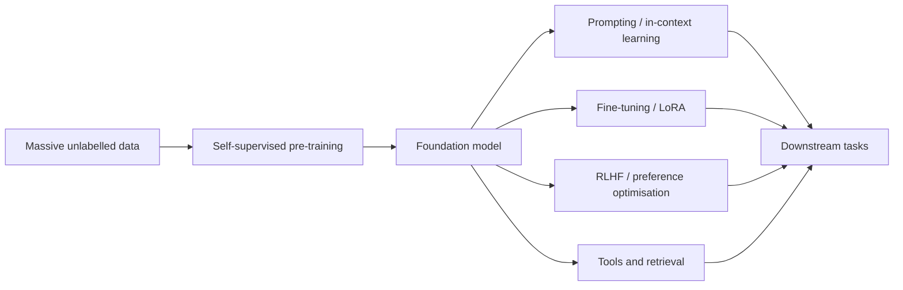

# Models

The architecture families of contemporary AI, and the systems built from them. A family is a way of building a network: how it routes information across inputs, and what it assumes about the data. The general theory behind them is in [Theory](../index.md). Generative modelling is not listed here, because any family can be trained that way; see [Generative Models](../generative/index.md), where diffusion and the other generative algorithms are described.

## Architecture families

| Family | Core idea | Components and variants |
|---|---|---|
| [Multilayer Perceptrons](mlp/index.md) | Stacked affine maps and nonlinearities, with no assumed structure | [GELU](mlp/gelu/index.md), [layer normalisation](mlp/layer-normalisation/index.md) |
| [Convolutional Networks](cnn/index.md) | A shared local filter applied at every position | [Convolution variants](cnn/convolution-variants/index.md): [dilated](cnn/convolution-variants/dilated-convolution/index.md), [depthwise separable](cnn/convolution-variants/depthwise-separable-convolution/index.md), [deformable](cnn/convolution-variants/deformable-convolution/index.md). [Backbones and scaling](cnn/backbones-and-scaling/index.md): [VGG](cnn/backbones-and-scaling/vgg/index.md), [ResNet](cnn/backbones-and-scaling/resnet/index.md), [EfficientNet](cnn/backbones-and-scaling/efficientnet/index.md), [ConvNeXt](cnn/backbones-and-scaling/convnext/index.md) |
| [Recurrent Networks](rnn/index.md) | A hidden state carried step by step through a sequence | [Gated cells](rnn/gated-cells/index.md): [LSTM](rnn/gated-cells/lstm/index.md), [GRU](rnn/gated-cells/gru/index.md). [Sequence modes](rnn/sequence-modes/index.md): [sequence to sequence](rnn/sequence-modes/sequence-to-sequence/index.md) |
| [Transformers & Attention](transformer/index.md) | Content-based routing of information with attention | [Attention variants](transformer/attention-variants/index.md), [positional encodings](transformer/positional-encodings/index.md), [KV cache](transformer/kv-cache/index.md), [Attention Is All You Need](transformer/attention-is-all-you-need/index.md), [Additive attention](transformer/bahdanau-attention/index.md) |
| [State-Space Models](ssm/index.md) | A linear state updated over time, with long-range memory | [Structured state spaces](ssm/structured-state-spaces/index.md): [HiPPO](ssm/structured-state-spaces/hippo/index.md), [S4](ssm/structured-state-spaces/s4/index.md), [S4D](ssm/structured-state-spaces/s4d/index.md), [S5](ssm/structured-state-spaces/s5/index.md), [linear recurrent units](ssm/structured-state-spaces/linear-recurrent-units/index.md). [Selective state spaces](ssm/selective-state-spaces/index.md): [Mamba](ssm/selective-state-spaces/mamba/index.md), [Mamba-2](ssm/selective-state-spaces/mamba-2/index.md) |
| [Graph Neural Networks](gnn/index.md) | Message passing over the edges of a graph | [Message passing](gnn/message-passing/index.md): [GraphSAGE](gnn/message-passing/graphsage/index.md), [GCN](gnn/message-passing/gcn/index.md), [GAT](gnn/message-passing/gat/index.md), [GIN](gnn/message-passing/gin/index.md) |

## Applications and systems

These pages describe tasks, modalities and systems. Each one is built from one or more of the families above.

| Page | Focus |
|---|---|
| [Large Language Models](llm/index.md) | Pre-training, alignment, reasoning models, the open-weight ecosystem |
| [Reasoning Models & Test-Time Compute](reasoning/index.md) | Long chain-of-thought, reinforcement learning on verifiable rewards, test-time scaling |
| [Computer Vision](computer-vision/index.md) | Classification, detection, segmentation, 3D, video |
| [Natural Language Processing](nlp/index.md) | From word vectors to LLMs |
| [Speech & Audio](speech/index.md) | Recognition, synthesis, music generation |
| [Multimodal Models](multimodal/index.md) | Vision-language models, text-to-image/video, omni models |
| [AI Agents](agents/index.md) | Tool use, planning, memory, multi-agent systems |
| [World Models & Embodied AI](world-models/index.md) | Predicting environments, planning in imagination, robot foundation models |

## The foundation-model paradigm

In 2021 Stanford researchers coined "foundation models" for this pattern: pre-train once at scale, adapt everywhere. It changed the economics of AI — a few organisations train foundation models, and very many developers build on them.
