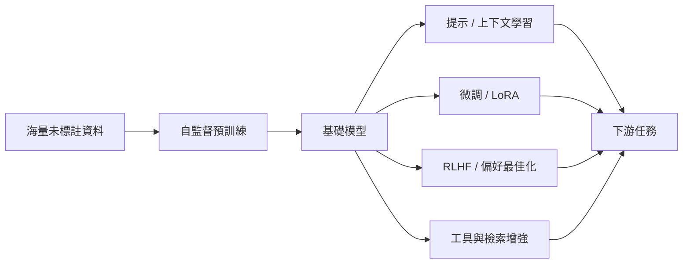

# 模型與技術

這一區介紹當代 AI 的架構家族，以及由它們組成的系統。架構家族是指一種建構網路的方式：資訊如何在輸入之間傳遞，以及它對資料做了什麼假設。這些模型背後的一般理論見[理論](../index.md)。生成式建模不在此列，因為任何家族都可以用這種方式訓練；見[生成式建模](../generative/index.md)。

## 架構家族

| 家族 | 核心想法 | 組件與變體 |
|---|---|---|
| [多層感知器](mlp/index.md) | 疊加的仿射映射與非線性，沒有假設結構 | [GELU](mlp/gelu/index.md)、[層正規化](mlp/layer-normalisation/index.md) |
| [卷積網路](cnn/index.md) | 在每個位置套用同一個局部濾波器 | [卷積變體](cnn/convolution-variants/index.md)：[空洞](cnn/convolution-variants/dilated-convolution/index.md)、[深度可分離](cnn/convolution-variants/depthwise-separable-convolution/index.md)、[可變形](cnn/convolution-variants/deformable-convolution/index.md)。[骨幹與縮放](cnn/backbones-and-scaling/index.md)：[VGG](cnn/backbones-and-scaling/vgg/index.md)、[ResNet](cnn/backbones-and-scaling/resnet/index.md)、[EfficientNet](cnn/backbones-and-scaling/efficientnet/index.md)、[ConvNeXt](cnn/backbones-and-scaling/convnext/index.md) |
| [循環網路](rnn/index.md) | 隱藏狀態逐步在序列中傳遞 | [門控單元](rnn/gated-cells/index.md)：[LSTM](rnn/gated-cells/lstm/index.md)、[GRU](rnn/gated-cells/gru/index.md)。[序列模式](rnn/sequence-modes/index.md)：[序列到序列](rnn/sequence-modes/sequence-to-sequence/index.md) |
| [Transformer 與注意力](transformer/index.md) | 以注意力依內容路由資訊 | [注意力變體](transformer/attention-variants/index.md)、[位置編碼](transformer/positional-encodings/index.md)、[KV 快取](transformer/kv-cache/index.md)、[Attention Is All You Need](transformer/attention-is-all-you-need/index.md)、[加性注意力](transformer/bahdanau-attention/index.md) |
| [狀態空間模型](ssm/index.md) | 隨時間更新的線性狀態，具有長程記憶 | [結構化狀態空間](ssm/structured-state-spaces/index.md)：[HiPPO](ssm/structured-state-spaces/hippo/index.md)、[S4](ssm/structured-state-spaces/s4/index.md)、[S4D](ssm/structured-state-spaces/s4d/index.md)、[S5](ssm/structured-state-spaces/s5/index.md)、[線性循環單元](ssm/structured-state-spaces/linear-recurrent-units/index.md)。[選擇性狀態空間](ssm/selective-state-spaces/index.md)：[Mamba](ssm/selective-state-spaces/mamba/index.md)、[Mamba-2](ssm/selective-state-spaces/mamba-2/index.md) |
| [圖神經網路](gnn/index.md) | 沿圖的邊進行訊息傳遞 | [訊息傳遞](gnn/message-passing/index.md)：[GraphSAGE](gnn/message-passing/graphsage/index.md)、[GCN](gnn/message-passing/gcn/index.md)、[GAT](gnn/message-passing/gat/index.md)、[GIN](gnn/message-passing/gin/index.md) |

## 應用與系統

這些頁面描述任務、模態與系統。每一個都由上述一個或多個家族組成。

| 頁面 | 重點 |
|---|---|
| [大型語言模型](llm/index.md) | 預訓練、對齊、推理模型、開放權重生態 |
| [推理模型與測試時運算](reasoning/index.md) | 長鏈式思維、以可驗證獎勵進行強化學習、測試時運算擴展 |
| [電腦視覺](computer-vision/index.md) | 分類、偵測、分割、3D、影片理解 |
| [自然語言處理](nlp/index.md) | 從詞向量到 LLM 的 NLP 任務 |
| [語音與音訊](speech/index.md) | 語音辨識、語音合成、音樂生成 |
| [多模態模型](multimodal/index.md) | 視覺語言模型、文生圖／影片、全模態模型 |
| [AI 代理人](agents/index.md) | 工具使用、規劃、記憶、多代理系統 |
| [世界模型與具身智慧](world-models/index.md) | 預測環境、在想像中規劃、機器人基礎模型 |

## 「基礎模型」範式

2021 年 Stanford 提出「基礎模型」（foundation models）一詞，描述這種「一次大規模預訓練、多處適應」的模式。它改變了 AI 的研發經濟學：少數組織訓練基礎模型，大量開發者在其上建構應用。
