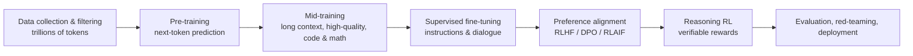

---
related:
- theory/models/nlp
- theory/models/agents
- engineering/prompting
- engineering/rag
- engineering/training
- brain-mind/psychology
- society/safety-alignment
aliases:
  - LLM
  - 大語言模型
---

# Large Language Models

## In one sentence

An LLM is a very large Transformer trained on enormous amounts of text (and code and other modalities) to **predict the next token**, then instruction-tuned and preference-aligned into a general model that can converse, write, reason, code and use tools.

## Lifecycle

### 1. Tokenisation

Text is split into tokens (BPE, SentencePiece, Unigram). Tokeniser design affects multilingual efficiency (Chinese characters may take one or more tokens each) and even arithmetic ability.

### 2. Pre-training

Objective: minimise \(-\sum_t \log p_\theta(x_t\mid x_{<t})\).

Data: filtered web crawls (Common Crawl), books, papers, code, multilingual corpora, synthetic data. Quality filtering and deduplication are major competitive advantages.

### 3. Post-training

| Stage | Method | Purpose |
|---|---|---|
| SFT | Fine-tune on high-quality instruction–response pairs | Follow instructions and dialogue format ([imitation](../../paradigms/imitation/index.md)) |
| RLHF | Humans compare answers → reward model → PPO | More helpful, honest, harmless |
| DPO and variants | Optimise directly on preference pairs without a separate reward model | Simpler, more stable |
| RLAIF / Constitutional AI | AI feedback guided by written principles | Scale oversight |
| RL with verifiable rewards (RLVR) | Automatic grading (math answers, unit tests) | Train reasoning |

The imitation step, and what it can and cannot teach, is covered in [Imitation in Foundation Models](imitation-in-foundation-models/index.md).

## Capabilities and phenomena

- **In-context learning**: learn a task from a few examples in the prompt (GPT-3)
- **Chain-of-thought**: step-by-step reasoning greatly improves math and logic (Wei et al., 2022)
- **Reasoning models**: RL-trained to produce long reasoning before answering (OpenAI o-series, DeepSeek-R1, Claude extended thinking, Gemini thinking models, etc.); big gains on competition math, programming and science questions. See [Reasoning Models and Test-Time Compute](../reasoning/index.md) for the methods
- **Tool use**: search, code execution, APIs — see [AI Agents](../agents/index.md)
- **Long context**: from 2K tokens to the million-token range
- **Multimodality**: see [Multimodal Models](../multimodal/index.md)

## Known limitations

| Problem | Description | Mitigation |
|---|---|---|
| Hallucination | Confident, wrong output | RAG, citations, calibration, training to abstain |
| Knowledge cutoff | Training data ends at a date | Search tools, RAG |
| Brittle reasoning | Small rephrasings can break solutions | Reasoning training, tools, verifiers |
| Sycophancy | Tendency to agree with the user | Alignment training, evaluation |
| Prompt injection | Instructions hidden in external content hijack the model | Privilege separation, input marking, monitoring |
| Bias | Social biases from training data | Data curation, evaluation, alignment |
| Cost and latency | Large models are expensive to run | Distillation, quantisation, MoE, speculative decoding |

## The model ecosystem (2026 overview)

!!! note "Fast-moving"
    Only families are listed. Check official sites and leaderboards such as [LMArena](https://lmarena.ai/) and [Artificial Analysis](https://artificialanalysis.ai/) for current versions.

| Type | Families (examples) |
|---|---|
| Closed frontier models | OpenAI GPT, Anthropic Claude, Google Gemini, xAI Grok |
| Open-weight models | Meta Llama, Alibaba Qwen, DeepSeek, Mistral, Google Gemma, Microsoft Phi, Moonshot Kimi, Zhipu GLM, OpenAI gpt-oss |
| Regional / sovereign models | Many countries fund models tuned to local languages and culture (e.g. Taiwan's TAIDE and MediaTek's Breeze for Traditional Chinese) |

## LLMs and human language cognition

- **LLMs predict brain activity in language areas**: models that predict the next word better also predict human language-network responses better (Schrimpf et al., 2021, *PNAS*)
- **Formal vs functional linguistic competence**: Mahowald, Fedorenko and colleagues (2024) argue LLMs master formal competence (grammar), while functional competence (reasoning, world knowledge, social cognition) — supported by brain networks outside the language network — remains less reliable
- **Data efficiency**: children hear on the order of tens of millions of words by adolescence (well under 100 million); LLMs see trillions of tokens. The BabyLM challenge studies learning from child-scale data
- **Theory-of-mind tests**: LLMs pass many false-belief tasks but are sensitive to perturbations; whether they "have" theory of mind is contested (Kosinski, 2023 vs Ullman, 2023; Strachan et al., 2024)
- See [Psychology & AI](../../../brain-mind/psychology/index.md) and [NeuroAI](../../../brain-mind/neuroai/index.md)

## Key methods

### GPT-3: few-shot learning from the prompt (Brown et al., 2020)

- **Problem:** can a language model learn a new task from a few examples in its prompt, without any gradient update?
- **Core idea:** scale an autoregressive Transformer to 175 billion parameters and test it with zero, one or a few worked examples in the prompt. The model is not fine-tuned on the task.
- **Algorithm:**
    1. Write a task description and a few input–output examples into the prompt.
    2. Append the new input.
    3. Let the model generate the output token by token. No weights change.
- **Results:** strong performance on translation, question answering and cloze tasks, and on 3-digit arithmetic, which the abstract names among its on-the-fly reasoning tasks.
- **Limitations:** the paper reports that few-shot performance still lags behind models fine-tuned on task-specific data on some tasks.

### Compute-optimal training (Hoffmann et al., 2022)

- **Problem:** for a fixed compute budget, how should model size and the number of training tokens be balanced?
- **Core idea:** train more than 400 language models, from 70 million to over 16 billion parameters, on 5 to 500 billion tokens, then find the best size for each budget. Model size and data should grow together.
- **Rule:** for every doubling of model size, double the number of training tokens.
- **Results:** Chinchilla, with 70 billion parameters and four times more data, used the same compute as Gopher (280 billion parameters) and outperformed Gopher, GPT-3 and others on a wide range of downstream tasks. It reached 67.5% average accuracy on MMLU.
- **Limitations:** the rule was fitted on the range the authors trained. Many later models train well beyond this ratio, because a smaller model is cheaper to serve.

### InstructGPT: reinforcement learning from human feedback (Ouyang et al., 2022)

- **Problem:** a larger model is not automatically better at following user intent. It can still be untruthful, toxic or unhelpful.
- **Core idea:** fine-tune GPT-3 in three stages: supervised learning on human demonstrations, a reward model trained on rankings of model outputs, and reinforcement learning against that reward.
- **Algorithm:**
    1. Collect labeller demonstrations and fine-tune with supervised learning.
    2. Collect rankings of model outputs and train a reward model on them.
    3. Optimise the policy with reinforcement learning (PPO) against the reward model.
- **Results:** human raters preferred outputs from the 1.3-billion-parameter InstructGPT over those from the 175-billion-parameter GPT-3. The models were more truthful and produced less toxic output, with minimal regressions on public NLP datasets.
- **Limitations:** the authors note that InstructGPT still makes simple mistakes. The reward reflects the preferences of a small group of labellers, not a universal standard.

## Resources

- [mlabonne/llm-course](https://github.com/mlabonne/llm-course)
- Raschka, *Build a Large Language Model (From Scratch)*
- Stanford CS336, *Language Modeling from Scratch*
- Hugging Face [LLM Course](https://huggingface.co/learn/llm-course)
- Karpathy, "Intro to Large Language Models" and "Deep Dive into LLMs like ChatGPT"

## References

### Seminal papers

- Brown, T. B., et al. (2020). *Language Models are Few-Shot Learners*. arXiv. https://arxiv.org/abs/2005.14165 — The GPT-3 paper, showing that very large models can learn new tasks from a few examples given in the prompt.
- Kaplan, J., et al. (2020). *Scaling Laws for Neural Language Models*. arXiv. https://arxiv.org/abs/2001.08361 — Shows how loss falls predictably as model size, data and compute increase.
- Hoffmann, J., et al. (2022). *Training Compute-Optimal Large Language Models*. arXiv. https://arxiv.org/abs/2203.15556 — The Chinchilla study, arguing that model size and training tokens should grow together for a fixed compute budget.
- Ouyang, L., et al. (2022). *Training language models to follow instructions with human feedback*. arXiv. https://arxiv.org/abs/2203.02155 — InstructGPT, which combines supervised fine-tuning with reinforcement learning from human preferences.
- Wei, J., et al. (2022). *Chain-of-Thought Prompting Elicits Reasoning in Large Language Models*. arXiv. https://arxiv.org/abs/2201.11903 — Shows that prompting models to write intermediate reasoning steps improves multi-step problem solving.

### Surveys and textbooks

- Zhao, W. X., et al. (2023). *A Survey of Large Language Models*. arXiv. https://arxiv.org/abs/2303.18223 — A broad survey of pre-training, adaptation and evaluation of LLMs, with a timeline of models.

### Lectures and videos

- Karpathy, A. (2023). *[1hr Talk] Intro to Large Language Models*. YouTube. https://www.youtube.com/watch?v=zjkBMFhNj_g — A one-hour non-technical overview of how LLMs are trained, what they can do and where they fail.

### Articles and documentation

- Hugging Face. *LLM Course*. https://huggingface.co/learn/llm-course — Hands-on course on using, fine-tuning and building LLMs with the Hugging Face libraries.
