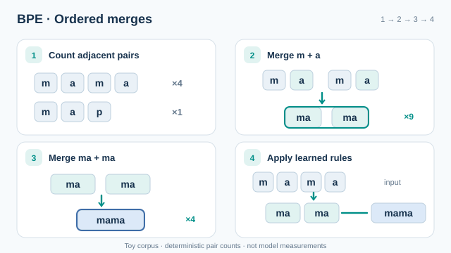

# 位元組對編碼（Sennrich 等人，2016）

位元組對編碼（BPE）透過反覆合併語料中最常相鄰的一對符號，建立子詞詞彙表。學到的合併規則決定任何新文字如何被切分。本頁是[分詞](index.md)的一部分。

## 概述

Sennrich、Haddow 與 Birch（2016）把 BPE 改寫為神經機器翻譯的方法。從字元開始，每次合併都為詞彙表加入一個新符號，因此固定的合併次數就對應固定的詞彙表大小。常見的字會成為單一詞元，罕見的字則拆成模型見過的幾個片段。

## 關鍵概念

- **符號**：目前詞彙表中的單位，初始為單一字元加上字尾標記。
- **配對次數**：兩個相鄰符號在語料中相鄰出現的次數，依字的出現頻率加權。
- **合併規則**：把兩個符號合成一個的有序規則。學習的順序決定新文字的切分方式。
- **詞彙表大小**：初始符號數加上合併次數。

## 問題

給定語料與目標詞彙表大小，詞彙表應包含哪些子詞單位，才能讓常見字串的成本低，同時仍能寫出罕見的字串？

## 運作方式

令 \(V\) 為目前的符號集合，\(c(a,b)\) 為相鄰配對 \((a,b)\) 在訓練語料中的次數。每一步選擇

\[
(a^\ast, b^\ast) = \arg\max_{(a,b)} c(a,b),
\]

把語料中所有 \(a^\ast b^\ast\) 出現的地方替換為新符號 \(a^\ast b^\ast\)，並加入 \(V\)。重複此程序，直到 \(|V|\) 達到目標大小。

要對新文字做分詞時，先把文字切成字元，再依學習的順序套用合併規則，使最常見的合併先生效。

### 動畫解說：學習並套用合併規則

*原創教學動畫，CC BY-SA 4.0。* 假設玩具語料包含 **mama × 4** 與 **map × 1**，相鄰配對 `m + a` 共出現 **9** 次（每個 `mama` 有兩次、`map` 有一次）。在整個語料合併後，`ma + ma` 出現 **4** 次。依學習順序套用這兩條規則，就能將輸入 `mama` 編碼成單一符號。本圖示範的是**以字元為起點、僅在字內合併的 BPE**，不代表位元組級分詞或字尾標記的完整實作；配對次數來自示意語料，並非訓練完成的分詞器實測值。MkDocs 網站提供播放／暫停按鈕（可使用鍵盤操作）；GitHub Markdown 可查看[四階段靜態回退圖](../../../../assets/concept-animations/bpe-ordered-merges-still.svg)。

## 主要方法

這個方法是一個演算法，在實務上有數種變體。步驟如下：

1. 計算語料中每個字的次數，並把每個字切成字元，加上字尾標記。
2. 以字的頻率為權重，計算所有相鄰符號配對的次數。
3. 合併次數最高的配對，並更新字的切分。
4. 重複第 2 與第 3 步，直到詞彙表達到目標大小。
5. 編碼文字時，依學習的順序套用合併規則。

## 變體

- **字內 BPE**：合併只發生在字之內，因此詞元不會跨越空白。這是 Sennrich 等人（2016）採用的版本。
- **位元組級 BPE**：以 256 個位元組值而非字元為起點。任何字串都能編碼，也不會出現未知符號。Wang、Cho 與 Gu（2020）研究了這個變體。
- **機率式切分**：以取樣取代貪婪選擇，從可能的切分中抽樣，如子詞正則化所做的（見 [SentencePiece 與 unigram 模型](sentencepiece.md)）。

## 結果與限制

- 在 Sennrich 等人（2016）的實驗中，子詞單位讓翻譯模型能處理罕見與未見過的字，並且相較於以字為單位的基準模型，提升了翻譯品質。
- 每次合併都依頻率貪婪地選擇。此方法並未優化似然，因此可能偏好一個頻繁、但對某些字切分效果不佳的合併。
- 在一個語料上學到的詞彙表，若用於另一種語言或領域的文字，可能會把文字切成多得多的詞元，因而提高成本。
- 位元組級變體避免了未知符號，但對字元集很大的書寫系統，會產生較長的序列。

## 應用

- **機器翻譯**：來源語言與目標語言共用一個子詞詞彙表。
- **語言模型**：許多 GPT 類模型的分詞器是一個位元組級 BPE，一次學習後即固定不變。
- **資料壓縮**：如 Sennrich 等人（2016）所述，BPE 起源於壓縮方法，其合併規則因此很精簡，便於儲存。

## 開放問題

- 對某一種語言而言，哪種語料與詞彙表大小能在序列長度與涵蓋範圍之間取得最佳平衡？
- 能否以更符合下游損失的目標取代貪婪合併，而不使訓練變得太慢？

## 與其他頁面的連結

- 上層主題：[分詞](index.md)
- 本主題的另一方法：[SentencePiece 與 unigram 模型](sentencepiece.md)
- 使用於：[大語言模型](../index.md)

## 參考文獻

### 奠基性論文

- Sennrich, R., Haddow, B. & Birch, A. (2016). Neural Machine Translation of Rare Words with Subword Units. In *Proceedings of the 54th Annual Meeting of the ACL (Volume 1: Long Papers)*, 1715–1725. https://doi.org/10.18653/v1/P16-1162 — 把 BPE 改寫為建立神經機器翻譯子詞詞彙表的方法，並報告相對於以字為單位模型的提升。
- Wang, C., Cho, K. & Gu, J. (2020). Neural Machine Translation with Byte-Level Subwords. In *AAAI 2020*. arXiv:1909.03341. https://arxiv.org/abs/1909.03341 — 用於翻譯的位元組級 BPE，沒有未知符號的問題。
- Kudo, T. & Richardson, J. (2018). SentencePiece: A simple and language independent subword tokenizer and detokenizer for Neural Text Processing. arXiv:1808.06226. https://arxiv.org/abs/1808.06226 — 在同一框架中實作 BPE 與 unigram 切分，直接在原始文字上訓練。

### 綜述與教科書

- Xue, L. et al. (2022). ByT5: Towards a Token-Free Future with Pre-trained Byte-to-Byte Models. *Transactions of the ACL* 10, 291–306. https://doi.org/10.1162/tacl_a_00461 — 討論位元組級序列與基於 BPE 的子詞模型之間的成本權衡。
- Schuster, M. & Nakajima, K. (2012). Japanese and Korean voice search. In *ICASSP 2012*, 5149–5152. https://doi.org/10.1109/ICASSP.2012.6289079 — 提出 WordPiece，一種常與 BPE 相比較的資料驅動子詞切分。
- Devlin, J. et al. (2019). BERT: Pre-training of Deep Bidirectional Transformers for Language Understanding. In *NAACL-HLT 2019*. arXiv:1810.04805. https://arxiv.org/abs/1810.04805 — 在廣泛使用的模型中採用與 BPE 相近的 WordPiece。
