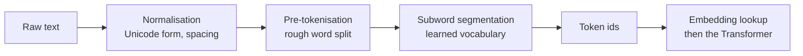

# Tokenisation

Tokenisation is the step that turns raw text into the discrete units, called tokens, that a language model reads and predicts. The choice of units decides how much text fits in a context window, how evenly languages are served, and which tasks, such as counting letters or adding long numbers, come easily to a model.

## Overview

A neural language model does not read characters or words directly. It reads a sequence of integer ids drawn from a fixed vocabulary, and each id is looked up in a table of learned vectors. Tokenisation defines that vocabulary and the rules for turning any string into ids and back again. Both are fixed before pre-training begins, so every later stage of the model inherits the tokeniser's choices.

Two simple choices show the trade-off. A word-level vocabulary keeps each word as one unit, but it needs a very large vocabulary, and any word missing from training becomes an unknown symbol. A character- or byte-level scheme has a small vocabulary and no unknown symbols, but it produces long sequences, which cost computation and spread the model's attention over many more positions. Subword tokenisation, the dominant approach in large language models, sits between the two: frequent words become single tokens, while rare words are broken into smaller pieces the model has seen before.[^1]

## Key concepts

- **Token**: one entry in the vocabulary. A token may be a whole word, a fragment of a word, a punctuation mark or a single byte. Tokens are not the same as words, and one word may take several tokens.
- **Vocabulary**: the finite list of tokens and their ids. Vocabularies commonly hold tens of thousands to a few hundred thousand entries; the size is a design choice.
- **Pre-tokenisation**: an optional first split, usually on whitespace and punctuation, applied before the learned segmentation. Some systems skip it.
- **Segmentation**: the rule that cuts a string into tokens given a vocabulary. Two segmenters can share one vocabulary and still cut the same text differently.
- **Byte fallback**: a rule that encodes any character not in the vocabulary as its raw UTF-8 bytes, so no input is unknown.
- **Special tokens**: reserved ids for markers such as end-of-text, padding and the boundaries between chat turns.

## How it works

Training a tokeniser means counting statistics in a corpus and deciding which pieces earn a place in the vocabulary. The influential recipes differ in how they decide. [Byte-pair encoding](bpe/index.md) starts from single symbols and repeatedly merges the most frequent adjacent pair. [SentencePiece](sentencepiece/index.md) with its unigram model starts from a large set of candidate pieces and removes those whose loss would hurt the corpus likelihood the least. WordPiece, used in many BERT-style encoders and described for machine translation in the GNMT system, resembles BPE but scores each candidate merge by how much it raises the likelihood of the training data, rather than by raw frequency.[^2]

Encoding new text applies the learned rules. For a BPE tokeniser, the merges are replayed in the order they were learned. For a unigram tokeniser, the most probable segmentation is found with dynamic programming. Decoding maps ids back to pieces and joins them. A good tokeniser is lossless: decoding the ids returns the original string, spacing included. Many schemes mark word-initial spaces with a special symbol so that the original spacing can be restored.

Pre-tokenisation changes what the learned segmenter sees. Schemes that split on whitespace first cannot merge across word boundaries, which is efficient but a poor fit for languages that do not separate words with spaces. Schemes that work on the raw character stream, as SentencePiece does, treat the space as an ordinary symbol and need no language-specific rules.

The third family drops the learned vocabulary altogether. [ByT5](byt5/index.md) reads the UTF-8 bytes of the text directly, so its vocabulary is the set of byte values. The price is sequence length. A Chinese character takes three bytes in UTF-8 and an English letter takes one, so the same passage can be several times longer in bytes than in tokens from a learned vocabulary.

## Key methods

| Method | Basic unit | How the vocabulary is chosen | Page |
|---|---|---|---|
| Byte-pair encoding (BPE) | Symbols, from characters or bytes | Repeatedly merge the most frequent adjacent pair | [BPE](bpe/index.md) |
| SentencePiece (unigram model) | Subwords from raw text, spaces included | Prune candidate pieces that least reduce corpus likelihood | [SentencePiece](sentencepiece/index.md) |
| ByT5 (token-free) | Raw UTF-8 bytes | No learned vocabulary; the byte values are the vocabulary | [ByT5](byt5/index.md) |

Each method has its own page with the algorithm, the reported results and the limitations.

## Connections

- Parent topic: [Large Language Models](../index.md). Tokenisation is the first stage of the model lifecycle described there.
- [Natural Language Processing](../../nlp/index.md) treated tokenisation as a standalone analysis step, often with rules and language-specific tools. In the LLM era it is usually learned from data and bundled with the model.
- [Transformers](../../transformer/index.md) consume the token sequence, so the vocabulary sets the size of the input embedding and output layers.
- [Multimodal Models](../../multimodal/index.md) apply the same idea to images, audio and video, which are converted into units before a shared model reads them.
- The brain-and-mind angle is discussed under Open questions: human readers and listeners do not obviously segment language into the units a tokeniser learns. See [Language in the Brain](../../../../brain-mind/language-in-brain/index.md).

## Applications

- **Every deployed LLM** depends on a tokeniser. Providers price usage and set context limits in tokens, so the tokeniser changes both cost and the amount of text a model can take in one request.
- **Open-source tooling.** Libraries such as the Hugging Face tokenizers library and SentencePiece train and run tokenisers for research and production; see [Frameworks](../../../../engineering/frameworks/index.md).
- **Multilingual systems.** Vocabulary coverage decides how efficiently a model handles each script. Teams build vocabularies from balanced corpora, add language-specific pieces, or move to byte-level models. The cost gap between languages is documented in Petrov et al. (2023).[^3]

## Open questions

- **Language fairness.** Tokenisers trained on unbalanced corpora can make the same content much more expensive in some languages than in English. Whether vocabularies should be balanced by cost, built per language, or replaced by byte-level models is unresolved.
- **Arithmetic and counting.** Models often struggle to count letters or add long numbers. Tokenisation is one suspected cause, because digits and letters may be split into arbitrary pieces. Singh and Strouse (2024) show that the grouping of digits matters, but model capacity and training also contribute.
- **Vocabulary size.** A larger vocabulary shortens sequences, but it enlarges the embedding and output layers and leaves rare tokens with little training data. No principled rule for choosing the size has become standard.
- **Token-free models.** Byte-level models avoid the vocabulary problem but lengthen sequences. Dynamic patching of bytes, as in the Byte Latent Transformer (Pagnoni et al., 2024), is one attempt to recover efficiency. Whether it matches tokeniser-based models at scale needs wider testing.
- **Human comparison.** Whether human language processing uses units closer to morphemes, words or syllables is debated, and subword tokens are a different kind of unit. The question matters for interpreting what models learn from text.

## References

### Seminal papers

- Sennrich, R., Haddow, B. & Birch, A. (2016). *Neural Machine Translation of Rare Words with Subword Units*. ACL. https://arxiv.org/abs/1508.07909 — Introduces byte-pair encoding for neural machine translation, so that rare and unseen words can be built from known subword units.
- Kudo, T. & Richardson, J. (2018). *SentencePiece: A simple and language independent subword tokenizer and detokenizer for Neural Text Processing*. EMNLP (System Demonstrations). https://arxiv.org/abs/1808.06226 — Describes the SentencePiece library, which trains subword models directly on raw text without language-specific pre-tokenisation.
- Kudo, T. (2018). *Subword Regularization: Improving Neural Network Translation Models with Multiple Subword Candidates*. ACL. https://arxiv.org/abs/1804.10959 — Proposes sampling among several segmentations drawn from a unigram language model during training.
- Wu, Y. et al. (2016). *Google's Neural Machine Translation System: Bridging the Gap between Human and Machine Translation*. arXiv. https://arxiv.org/abs/1609.08144 — Describes the GNMT system and its wordpiece segmentation, a BPE-like subword method used in production translation.
- Xue, L. et al. (2022). *ByT5: Towards a token-free future with pre-trained byte-to-byte models*. TACL. https://arxiv.org/abs/2105.13626 — A byte-level pretrained Transformer that removes the tokeniser entirely and compares it with subword models.

### Surveys and textbooks

- Mielke, S. J. et al. (2021). *Between words and characters: A Brief History of Open-Vocabulary Modeling and Tokenization in NLP*. arXiv. https://arxiv.org/abs/2112.10508 — A survey of how NLP moved from words to characters and subwords, with the trade-offs of each unit.

### Articles and documentation

- Petrov, A. et al. (2023). *Language Model Tokenizers Introduce Unfairness Between Languages*. arXiv. https://arxiv.org/abs/2305.15425 — Shows that tokenisers can make the same content cost many more tokens in some languages than in English.
- Singh, A. K. & Strouse, D. J. (2024). *Tokenization counts: the impact of tokenization on arithmetic in frontier LLMs*. arXiv. https://arxiv.org/abs/2402.14903 — Examines how the grouping of digits in tokenisers affects arithmetic accuracy in frontier language models.
- Nogueira, R., Jiang, Z. & Lin, J. (2021). *Investigating the Limitations of Transformers with Simple Arithmetic Tasks*. arXiv. https://arxiv.org/abs/2102.13019 — Shows that Transformers trained on simple arithmetic generalise poorly to numbers unlike those seen in training, an early warning about number representation.
- Rust, P. et al. (2021). *How Good is Your Tokenizer? On the Monolingual Performance of Multilingual Language Models*. ACL. https://arxiv.org/abs/2012.15613 — Finds that a multilingual model's performance in a single language depends on how well the shared tokeniser fits that language.
- Schmidt, C. W. et al. (2024). *Tokenization Is More Than Compression*. arXiv. https://arxiv.org/abs/2402.18376 — Argues that compression alone does not predict how well a tokeniser serves downstream language modelling, and compares tokenisers on other criteria.
- Pagnoni, A. et al. (2024). *Byte Latent Transformer: Patches Scale Better Than Tokens*. arXiv. https://arxiv.org/abs/2412.09871 — Proposes a byte-level model that groups bytes into dynamically sized patches and compares its scaling with tokeniser-based models.
- Wang, C., Cho, K. & Gu, J. (2019). *Neural Machine Translation with Byte-Level Subwords*. arXiv. https://arxiv.org/abs/1909.03341 — Applies byte-level BPE to translation, so that any text can be encoded from a base vocabulary of 256 byte values.

[^1]: The history of open-vocabulary modelling, from words to characters to subwords, is surveyed in Mielke et al. (2021); see References.
[^2]: WordPiece is described in the GNMT paper (Wu et al., 2016). The likelihood-based scoring rule is the detail to double-check against that paper before relying on it.
[^3]: The unequal token cost across languages is measured in Petrov et al. (2023); see References.
