# Mixture of Experts

A mixture of experts (MoE) layer holds many sub-networks, called experts, and a small trainable router that sends each input to only a few of them. The model's total parameter count can therefore grow large while the compute spent on each input stays modest. The idea dates to adaptive mixtures in the early 1990s and became central to large language models after sparse routing was scaled up.

## Overview

MoE is a way of building a layer, not a separate model family. It is most often used inside a [Transformer](../transformer/index.md), where it replaces the feed-forward block. Each method page below describes one influential design.

## Key concepts

- **Expert:** an ordinary feed-forward network, one of several in the layer.
- **Router (gate):** a trainable network that scores the experts for each input. Its output decides which experts run.
- **Sparse activation:** only the top-scoring experts, often one or two, process each token, so most parameters are idle for any given input.
- **Capacity:** a limit on how many tokens an expert may process in one batch, which keeps the work balanced across experts.
- **Load balancing:** the problem of the router sending most inputs to a few experts, which wastes the others. Training usually adds terms to prevent it.

## How it works

For an input \(x\), the router computes a score for each expert, keeps the top \(k\), and combines their outputs with normalised weights. Only the chosen experts are evaluated, so the compute per input depends on \(k\), not on the number of experts. The router is trained together with the experts, usually by gradient descent through its selected weights.

Sparse routing makes the layer hard to scale in practice. Experts must be placed on different accelerators, and each step must send tokens to the right expert and back, an all-to-all communication pattern. The cost of MoE is therefore paid partly in memory and communication rather than in arithmetic, which is why hardware and interconnect design matter for it.

*Original looping instructional animation, CC BY-SA 4.0.* The teal token selects E1 and E3; the amber token selects E2 and E4. Only the selected experts run for each token, then their outputs are combined using router-derived weights (the merge symbol is **not** an unweighted sum). This simplified four-expert illustration omits capacity limits, weight magnitudes and inter-device communications. The paths and colours are **schematic, not measured routing scores or model activations**. The [Mixtral paper](https://arxiv.org/abs/2401.04088) describes per-token top-two routing. On the wiki website, **Step through tokens** freezes the loop on token A (E1/E3), then advances to token B (E2/E4) with each click; **Play animation** resumes the loop. A still version is displayed automatically when reduced motion is preferred.

## Key methods

| Method | Contribution | Routing | Page |
|---|---|---|---|
| Adaptive mixtures of local experts (Jacobs et al., 1991) | The original mixture with a gating network | Soft weights over all experts | This page |
| Sparsely-gated MoE (Shazeer et al., 2017) | Sparse top-k gating at very large scale | Top-k | [Sparsely-gated MoE](sparsely-gated.md) |
| Switch Transformer (Fedus et al., 2021) | Routes each token to a single expert | Top-1 | [Switch Transformer](switch-transformer.md) |
| Mixtral 8x7B (Jiang et al., 2024) | An open-weight sparse Transformer with eight experts | Top-2 | [Mixtral](mixtral.md) |

## Connections

- [Transformer](../transformer/index.md) is the architecture in which MoE usually replaces the feed-forward block.
- [Large language models](../llm/index.md) are where MoE is used most, because it adds parameters without adding compute per token.
- [Model compression](../../model-compression/index.md) addresses the opposite goal, using fewer parameters, but sparse experts and compressed models share the idea of not using every weight on every input.
- [Interconnects](../../../engineering/hardware/interconnects/index.md) explain why the all-to-all traffic of expert routing limits scaling.

## Applications

- Open-weight language models that combine a large total parameter count with a smaller active count per token.
- Multilingual machine translation, where GShard used sparse experts to scale to more than 600 billion parameters.

## Open questions

- How should the router be trained so that experts specialise without leaving some idle?
- How much of the benefit of MoE persists when the number of active experts is small compared with the total?

## References

### Seminal papers

- Jacobs, R. A., Jordan, M. I., Nowlan, S. J. & Hinton, G. E. (1991). Adaptive Mixtures of Local Experts. *Neural Computation*, 3(1), 79–87. https://doi.org/10.1162/neco.1991.3.1.79 — The original mixture of experts, in which a gating network weights a set of local experts.
- Shazeer, N., et al. (2017). *Outrageously Large Neural Networks: The Sparsely-Gated Mixture-of-Experts Layer*. arXiv. https://arxiv.org/abs/1701.06538 — Sparse top-k gating that scales a layer to billions of parameters with modest efficiency loss.
- Lepikhin, D., et al. (2020). *GShard: Scaling Giant Models with Conditional Computation and Automatic Sharding*. arXiv. https://arxiv.org/abs/2006.16668 — Scales sparse Transformer translation models beyond 600 billion parameters with automatic sharding.
- Fedus, W., Zoph, B. & Shazeer, N. (2021). *Switch Transformers: Scaling to Trillion Parameter Models with Simple and Efficient Sparsity*. arXiv. https://arxiv.org/abs/2101.03961 — Simplifies routing to a single expert per token and reports large pre-training speed-ups.
- Jiang, A. Q., et al. (2024). *Mixtral of Experts*. arXiv. https://arxiv.org/abs/2401.04088 — An open-weight sparse model with eight experts, two active per token.

### Surveys and textbooks

- Fedus, W., Dean, J. & Zoph, B. (2022). *A Review of Sparse Expert Models in Deep Learning*. arXiv. https://arxiv.org/abs/2209.01667 — Review of sparse expert models and the common algorithms behind them.
