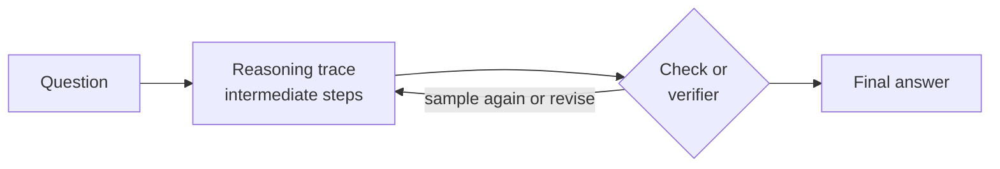

# Reasoning Models and Test-Time Compute

A reasoning model is a language model trained or prompted to spend extra computation before it answers, usually by writing out a chain of intermediate steps and checking them. Test-time compute is the wider idea: a model can do better on hard problems by spending more computation on each query at inference time, not only by being larger or trained on more data.

## Overview

Early large language models answered in one pass. Each token came from a single forward pass through the network, so a multi-step problem such as competition mathematics had little room for intermediate work. Prompting the model to write its steps helped, and later training made that habit more reliable. Models trained with reinforcement learning on tasks that can be checked automatically went further: they learned to produce long reasoning traces, sometimes including self-correction, before giving an answer. Huang and Chang (2023) survey this line of work and its evaluation.

## Key concepts

- **Chain of thought**: intermediate steps written in natural language before the final answer.
- **Test-time compute**: the work spent per query at inference, counted in generated tokens, sampled solutions or search steps.
- **Verifiable reward**: a reward computed by a program, such as an exact answer check or a unit test. Training with these rewards is called reinforcement learning with verifiable rewards (RLVR), described in [Large Language Models](../llm/index.md).
- **Self-consistency**: sampling several reasoning paths and keeping the answer they agree on most often.
- **Verifier**: a model or program that scores a candidate solution, or each step of one.

## How it works

There are two ways to get more reasoning out of a model. At **train time**, reinforcement learning on verifiable tasks lengthens and improves the reasoning the model produces by default. At **test time**, the system spends more compute on one query: it samples many candidate solutions and selects one by majority vote, a verifier or search, or it lets the model reason for longer before answering.

## Key methods

Six landmark methods, each with its own page. They are ordered roughly by when they appeared.

| Method | Year | What separates it |
|---|---|---|
| [Chain of thought](chain-of-thought.md) | 2022 | Prompt exemplars that include written steps. No training needed |
| [Self-consistency](self-consistency.md) | 2022 | Samples many reasoning paths and keeps the most consistent answer, instead of one greedy path |
| [Zero-shot chain of thought](zero-shot-chain-of-thought.md) | 2022 | Appends "Let's think step by step" to the question, with no exemplars |
| [Process reward models](process-reward-models.md) | 2023 | Scores each step of a solution, not only the final answer, to rank or guide search |
| [Test-time compute scaling](test-time-scaling.md) | 2024 | Chooses how to spend test-time compute per prompt, through verifier-guided search or revision |
| [DeepSeek-R1](deepseek-r1.md) | 2025 | Reinforcement learning with rule-based rewards that teaches long reasoning into the model weights |

## Connections

- [Large Language Models](../llm/index.md): reasoning models are LLMs whose post-training ends with reinforcement learning on verifiable rewards.
- [AI Agents](../agents/index.md): an agent's planning and tool choices are a form of test-time reasoning, and long reasoning often comes before a tool call.
- [Reinforcement learning](../../paradigms/reinforcement-learning/index.md): the training signal behind the reasoning-RL methods on this page.

## Applications

- Competition mathematics, programming and science questions, where answers can be checked automatically.
- Coding assistants that run tests on their own output and revise it.
- Transferring reasoning from a large model into a smaller one by training on its traces, as DeepSeek-R1 reports.

## Open questions

- Do longer reasoning traces reliably improve answers, or do they sometimes add errors that the final answer hides?
- Do reasoning gains from verifiable domains such as mathematics and code carry over to open-ended tasks?
- Do written traces faithfully reflect the computation that produced the answer?
- How should a fixed compute budget be split across queries when most queries are easy?

## References

### Seminal papers

- Wei, J., et al. (2022). *Chain-of-Thought Prompting Elicits Reasoning in Large Language Models*. arXiv. https://arxiv.org/abs/2201.11903 — Introduces chain-of-thought exemplars and shows gains on arithmetic and reasoning benchmarks at large scale.
- Wang, X., et al. (2022). *Self-Consistency Improves Chain of Thought Reasoning in Language Models*. arXiv. https://arxiv.org/abs/2203.11171 — Samples diverse reasoning paths and marginalises them, improving over greedy chain-of-thought decoding.
- DeepSeek-AI (2025). *DeepSeek-R1: Incentivizing Reasoning Capability in LLMs via Reinforcement Learning*. arXiv. https://arxiv.org/abs/2501.12948 — Trains long reasoning with reinforcement learning on verifiable rewards and reports open-weight results.
- Snell, C., Lee, J., Xu, K. & Kumar, A. (2024). *Scaling LLM Test-Time Compute Optimally can be More Effective than Scaling Model Parameters*. arXiv. https://arxiv.org/abs/2408.03314 — Compares adaptive allocation of test-time compute with simply training a larger model.

### Surveys and textbooks

- Huang, J. & Chang, K. C.-C. (2023). *Towards Reasoning in Large Language Models: A Survey*. arXiv. https://arxiv.org/abs/2212.10403 — Surveys methods for eliciting reasoning in LLMs, benchmarks for evaluating it, and open directions.
- Zhao, W. X., et al. (2023). *A Survey of Large Language Models*. arXiv. https://arxiv.org/abs/2303.18223 — Broad survey of LLM pre-training and adaptation, placing reasoning among the emergent abilities.
