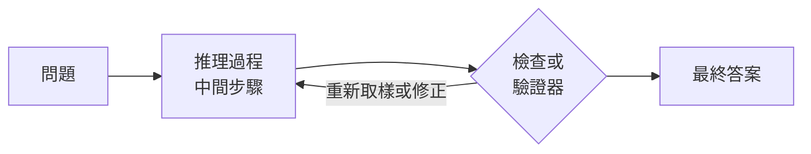

# 推理模型與測試時運算

推理模型是經過訓練或提示、會在回答前花費額外運算的語言模型，通常做法是寫出一連串中間步驟並加以檢查。測試時運算則是更廣的概念：模型可以在推論時對每個查詢投入更多運算，從而在困難問題上表現更好，而不只是靠擴大模型或使用更多資料訓練。

## 概述

早期的大型語言模型是一次成答。每個 token 都來自網路的一次前向傳播，因此像競賽數學這類多步驟問題幾乎沒有空間做中間工作。提示模型寫出步驟（思維鏈）有所幫助，之後的訓練又讓這種習慣更穩定。以可自動驗證的任務進行強化學習，則讓模型進一步學會在回答前產生很長的推理過程，有時還包括自我修正。Huang 與 Chang（2023）綜述了這條研究路線及其評估方法。

## 核心概念

- **思維鏈**：在最終答案之前，以自然語言寫出的中間步驟。
- **測試時運算**：推論時每個查詢所花費的運算量，以生成的 token 數、取樣的解或搜尋步數計算。
- **可驗證獎勵**：由程式計算的獎勵，例如精確的答案比對或單元測試。以這類獎勵訓練稱為可驗證獎勵的強化學習（RLVR），詳見[大型語言模型](../llm/index.md)。
- **自洽性**：取樣多條推理路徑，並保留它們最常達成一致的答案。
- **驗證器**：一個為候選解（或其每個步驟）評分的模型或程式。

## 運作方式

讓模型推理更多，有兩種途徑。在**訓練時**，以可驗證任務進行強化學習，可以延長並改善模型預設產生的推理。在**測試時**，系統會為單一查詢投入更多運算：取樣許多候選解，再以多數決、驗證器或搜尋來選出一個；或讓模型在回答前推理更久。

## 關鍵方法

以下六個里程碑式方法各有獨立的頁面，依大致出現的時間排列。

| 方法 | 年份 | 區別所在 |
|---|---|---|
| [思維鏈](chain-of-thought.md) | 2022 | 提示中的範例包含寫出的步驟，不需訓練 |
| [自洽性](self-consistency.md) | 2022 | 取樣多條推理路徑並保留最一致的答案，而不是只用一條貪婪路徑 |
| [零樣本思維鏈](zero-shot-chain-of-thought.md) | 2022 | 在問題後加上「Let's think step by step」，不提供範例 |
| [過程獎勵模型](process-reward-models.md) | 2023 | 為解答的每個步驟評分，而不只評估最終答案，用於排序或引導搜尋 |
| [測試時運算擴展](test-time-scaling.md) | 2024 | 依每個提示決定如何投入測試時運算，透過驗證器引導的搜尋或修正 |
| [DeepSeek-R1](deepseek-r1.md) | 2025 | 以規則式獎勵進行強化學習，把長推理學進模型權重 |

## 關聯

- [大型語言模型](../llm/index.md)：推理模型是 LLM，其後訓練以可驗證獎勵的強化學習作結。
- [AI 代理人](../agents/index.md)：代理人的規劃與工具選擇是一種測試時推理，而且長推理常出現在工具呼叫之前。
- [強化學習](../../paradigms/reinforcement-learning/index.md)：本頁推理強化學習方法背後的訓練訊號。

## 應用

- 競賽數學、程式設計與科學問題，這些答案可以自動檢查。
- 會對自己的輸出執行測試並加以修正的程式設計助手。
- 如 DeepSeek-R1 所述，以大型模型的推理過程進行訓練，把推理能力轉移到較小的模型。

## 開放問題

- 較長的推理過程是否可靠地改善答案，還是有時會加入被最終答案掩蓋的錯誤？
- 數學與程式碼等可驗證領域的推理增益，能否延伸到開放式任務？
- 寫出的推理過程是否忠實反映產生答案的運算？
- 當多數查詢都很簡單時，固定的運算預算應如何分配給各個查詢？

## 參考文獻

### 開創性論文

- Wei, J., et al. (2022). *Chain-of-Thought Prompting Elicits Reasoning in Large Language Models*. arXiv. https://arxiv.org/abs/2201.11903 — 提出思維鏈範例，並顯示在大規模模型上對算術與推理基準的提升。
- Wang, X., et al. (2022). *Self-Consistency Improves Chain of Thought Reasoning in Language Models*. arXiv. https://arxiv.org/abs/2203.11171 — 取樣多樣的推理路徑並加以邊際化，勝過貪婪的思維鏈解碼。
- DeepSeek-AI（2025）。*DeepSeek-R1: Incentivizing Reasoning Capability in LLMs via Reinforcement Learning*. arXiv. https://arxiv.org/abs/2501.12948 — 描述 R1-Zero、R1、訓練流程與蒸餾模型的報告，以可驗證獎勵的強化學習訓練長推理。
- Snell, C., Lee, J., Xu, K. & Kumar, A.（2024）。*Scaling LLM Test-Time Compute Optimally can be More Effective than Scaling Model Parameters*. arXiv. https://arxiv.org/abs/2408.03314 — 比較測試時運算的適應性配置與單純訓練更大模型的效果。

### 綜述與教科書

- Huang, J. & Chang, K. C.-C.（2023）。*Towards Reasoning in Large Language Models: A Survey*. arXiv. https://arxiv.org/abs/2212.10403 — 綜述 LLM 推理的引出方法、評估基準與開放方向。
- Zhao, W. X., et al.（2023）。*A Survey of Large Language Models*. arXiv. https://arxiv.org/abs/2303.18223 — 對 LLM 預訓練與適應的廣泛綜述，並將推理列為湧現能力之一。
