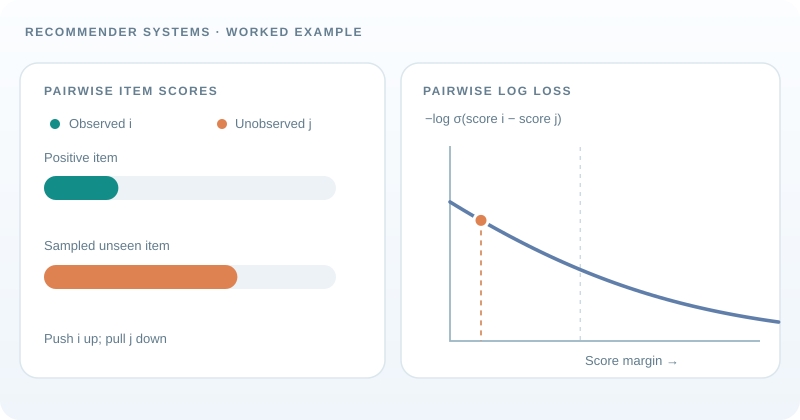
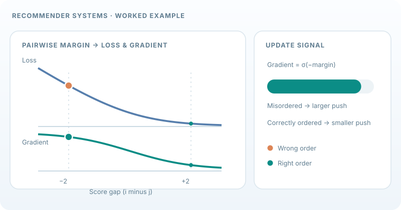

# BPR: Bayesian Personalised Ranking (Rendle et al., 2012)

Bayesian Personalised Ranking (BPR) trains a recommender from implicit feedback by learning which items a user prefers over others, rather than by fitting a score to each interaction. The method is a standard starting point for top-N ranking.

This page is part of [Recommender Systems](index.md).

## Problem

Implicit feedback such as clicks, views and purchases records what a user did, not what the user disliked. A missing interaction may mean "not interested" or "never seen". Common models, such as matrix factorisation and nearest-neighbour methods, are usually trained to predict a value for each observed entry. Rendle et al. (2012) argue that none of these is trained directly on the ranking task, which is what the recommender is used for.

## Core idea

For a user $u$, BPR assumes that an observed item $i$ should rank above an unobserved item $j$. It infers no order between two observed items or between two unobserved items. This is a training assumption, not a verified dislike for $j$. The criterion applies to different scoring models, including matrix factorisation and adaptive nearest neighbours.[^bpr-training]

Let $I$ be the item catalogue and $I_u^+$ the items observed for user $u$. The training set is

$$D_S=\{(u,i,j)\mid i\in I_u^+,\ j\in I\setminus I_u^+\}.$$

For example, if $I=\{a,b,c,d\}$ and $I_u^+=\{a,b\}$, the four triples compare $a$ with $c,d$ and $b$ with $c,d$. They do not compare $a$ with $b$ or $c$ with $d$. This enumeration follows directly from the set definition.

## Equation

Let $\hat{x}_{uij}$ be the model's score difference for user $u$ between items $i$ and $j$, written as $\hat{x}_{ui} - \hat{x}_{uj}$. The likelihood that the user prefers $i$ to $j$ is modelled with the logistic sigmoid:

$$p(i >_u j \mid \Theta) = \sigma\left(\hat{x}_{uij}(\Theta)\right), \qquad \sigma(x) = \frac{1}{1 + e^{-x}}$$

With a zero-mean normal prior on the parameters $\Theta$, the paper's maximum posterior estimate gives the criterion BPR-Opt:

$$\text{BPR-Opt} = \sum_{(u,i,j)\in D_S} \ln \sigma\left(\hat{x}_{uij}\right) - \lambda_\Theta \lVert \Theta \rVert^2$$

Here $D_S$ is the set of training triples and $\lambda_\Theta$ is a model-specific regularisation parameter.

### Animated worked example: one BPR ranking pair

[GitHub-readable static preview](../../../assets/concept-animations/bpr-pairwise-ranking-still.svg)

For a single sampled triple $(u,i,j)$, use a fixed scalar user factor $p_u=1$ and two item factors $q_i=0.5$, $q_j=1.3$. The observed item $i$ is initially scored **below** the unobserved item $j$. To isolate the item updates, keep $p_u$ fixed and use no regularisation. With $\Delta=p_u(q_i-q_j)$ and $\eta=0.4$, one ascent step on $\log\sigma(\Delta)$ gives

$$g=\sigma(-\Delta),\qquad q_i\leftarrow q_i+\eta g p_u,\qquad q_j\leftarrow q_j-\eta g p_u.$$

The left panel pushes the observed-item score upward and the sampled unseen-item score downward; the right panel follows the pairwise loss $-\log\sigma(\Delta)$. Over four updates, the margin moves from **−0.8000** to approximately **0.8518**, and the loss decreases from **1.1711** to **0.3553**.

The numbers are an **analytically computed toy sequence**, not a model experiment. The user factor is deliberately frozen, unlike full BPR-MF training; the animated interpolation between sampled updates is not a continuous optimisation trajectory. The second half rewinds the illustration for replay; it is not reverse training or further updates. An unobserved item is a training comparison, **not verified negative preference**.

In MkDocs, use the accessible **Play/Pause** control; on narrow screens, focus and horizontally scroll the illustration. The static fallback is available on GitHub and under `prefers-reduced-motion`. Original illustration, **CC BY-SA 4.0**.

### Animated worked example: how the BPR gradient depends on the margin

[GitHub-readable static preview](../../../assets/concept-animations/bpr-gradient-saturation-still.svg)

For a **single** illustrative training triple, define the score gap $\Delta=\hat{x}_{ui}-\hat{x}_{uj}$ and minimise its negative log-likelihood:

$$\ell(\Delta)=-\log\sigma(\Delta)=\log(1+e^{-\Delta}), \qquad \frac{\partial\ell}{\partial\Delta}=-\sigma(-\Delta).$$

The teal curve and bar follow the **magnitude** of the loss derivative, $g=\sigma(-\Delta)$, not the signed derivative itself. At $\Delta=-2$, the observed item is misordered and $g\approx0.8808$ with $\ell\approx2.1269$; at $\Delta=+2$, $g\approx0.1192$ with $\ell\approx0.1269$. For a one-dimensional factor model with fixed $p_u=1$, the corresponding negative-loss-gradient update moves $q_i$ up and $q_j$ down by $\eta g$ (omitting regularisation). Thus the correction signal weakens as the margin becomes positive. The animation **sweeps an input margin** to explain its derivative; it is *not* a trained optimisation trajectory or a measurement of gradient norms in a real model. The logistic criterion comes from Rendle et al. in the References.

Use the MkDocs **Play/Pause** control and keyboard-accessible horizontal scroll on mobile. GitHub and `prefers-reduced-motion` show the static comparison. Original artwork, **CC BY-SA 4.0**.

## Algorithm

LearnBPR draws triples uniformly from $D_S$ with replacement, then takes a stochastic gradient ascent step on the ranking criterion, including regularisation. The paper describes sampling triples, so “choose an observed pair, then an unobserved item” is incomplete unless the first draw's distribution is specified.[^bpr-training]

### Sampling changes the weighting

The following probabilities are derived from the training-set definition. Write $m=|I|$ and $r_u=|I_u^+|$. User $u$ contributes $n_u=r_u(m-r_u)$ triples. Users with $r_u=0$ or $r_u=m$ contribute none and cannot supply a training triple. Let $U_*$ contain the remaining users, and suppose it is nonempty.

To sample a uniform triple without materialising $D_S$:

1. Draw $u\in U_*$ with probability $P(u)=n_u/\sum_{v\in U_*}n_v$.
2. Draw $i$ uniformly from $I_u^+$.
3. Draw $j$ uniformly from $I\setminus I_u^+$.

Multiplying the three probabilities gives

$$P(u,i,j)=\frac{r_u(m-r_u)}{\sum_{v\in U_*}r_v(m-r_v)}\frac{1}{r_u}\frac{1}{m-r_u}=\frac{1}{|D_S|}.$$

Consider an illustrative four-item catalogue with two users: $I_A^+=\{a\}$ and $I_B^+=\{a,b\}$. Their triple counts are $3$ and $4$, so $|D_S|=7$. Compare three sampling procedures; each chooses $i$ and $j$ uniformly conditional on the chosen user, except that the last procedure first chooses an observed pair:

| Procedure | $P(A)$ | $P(B)$ | Probability of each A triple | Probability of each B triple |
|---|---|---|---|---|
| Uniform triple | $3/7$ | $4/7$ | $1/7$ | $1/7$ |
| Uniform user, then $i,j$ | $1/2$ | $1/2$ | $1/6$ | $1/8$ |
| Uniform observed pair $(u,i)$, then $j$ | $1/3$ | $2/3$ | $1/9$ | $1/6$ |

For example, the last row assigns $(A,a,c)$ probability $(1/3)(1/3)=1/9$ and $(B,a,c)$ probability $(1/3)(1/2)=1/6$. These are exact toy probabilities, not measured recommendation results.

For a fixed sampling distribution $\rho(u,i,j)$, the expected unweighted pairwise loss is

$$L_\rho=\sum_{(u,i,j)\in D_S}\rho(u,i,j)\,\ell(\hat{x}_{ui}-\hat{x}_{uj}).$$

Here only the data term is shown; regularisation is separate. Changing the sampler therefore changes the triples' weights in this expectation. Uniform users and uniform observed pairs are possible training choices, but neither generally reproduces uniform triples. State the sampling procedure when comparing runs; matching the loss formula alone does not match the training objective.

## Results

The paper evaluates on two datasets converted to implicit feedback. The first is a Rossmann online-shop purchase history with 10,000 users, 4,000 items and 426,612 purchases. The second is a Netflix subsample of 10,000 users and 5,000 items with 565,738 rating actions, where the ratings are stripped to implicit feedback. The exact AUC values are shown in a figure in the paper. The text reports the following comparisons:

- On both datasets, BPR-MF "outperforms WR-MF clearly for the task of ranking".
- On Netflix, an 8-dimensional BPR-MF model achieves comparable quality to a 128-dimensional WR-MF model.
- The two BPR-optimised methods outperform the other methods in prediction quality.
- The quality of SVD-MF decreases as the number of dimensions increases.

## Limitations

- The paper focuses on offline learning of the model parameters. Online learning is mentioned as a possible extension, and the authors note that a fold-in strategy could be used, but they do not evaluate it.
- The authors compute an upper bound on the AUC that is "non-tight", so the bound does not show how close the methods come to the best achievable ranking.
- Hyperparameters were set by grid search in the first round and then kept constant in the remaining repetitions.
- The paper draws the unobserved item $j$ uniformly at random. It does not study other ways of choosing negatives. [Neural collaborative filtering](neural-cf.md) likewise leaves non-uniform negative sampling as future work.

## Connections

BPR is a pairwise ranking loss, a close relative of the ranking objectives used in learning to rank. Its user and item factors are the same kind of [embedding](../embeddings/index.md) that the [matrix factorisation](matrix-factorization.md) page describes, and it is the ranking baseline against which [neural collaborative filtering](neural-cf.md) is compared.

## Applications

- **Product and media ranking**, where logged purchases or views are the only signal available.
- **Top-N lists**, where the output is an ordered short list and the order matters more than the predicted value.

## Open questions

- Which negatives should be sampled for pairwise training, and how much does that choice change the final ranking?
- How should pairwise objectives be combined with the sequential and context information that now drives many recommenders?

[^bpr-training]: Rendle et al., *BPR* (listed below), §3.2 defines $D_S$; §4.2 describes uniform sampling with replacement for LearnBPR. https://arxiv.org/pdf/1205.2618

## References

### Seminal papers

- Rendle, S., Freudenthaler, C., Gantner, Z. & Schmidt-Thieme, L. (2012). *BPR: Bayesian Personalized Ranking from Implicit Feedback*. arXiv:1205.2618, first published at UAI 2009. https://arxiv.org/abs/1205.2618 — The source of this page: the BPR-Opt criterion, sampled training triples and AUC comparisons.
- Sarwar, B., Karypis, G., Konstan, J. & Riedl, J. (2001). Item-based collaborative filtering recommendation algorithms. In *Proceedings of the 10th International World Wide Web Conference (WWW10)*, pp. 285–295. https://doi.org/10.1145/371920.372071 — A neighbourhood baseline for item-based collaborative filtering, cited for context.
- Koren, Y., Bell, R. & Volinsky, C. (2009). Matrix factorization techniques for recommender systems. *Computer*, 42, pp. 30–37. https://doi.org/10.1109/MC.2009.263 — The rating-based matrix factorisation that BPR-MF retrains with a ranking objective.
- He, X., Liao, L., Zhang, H., Nie, L., Hu, X. & Chua, T.-S. (2017). Neural collaborative filtering. In *Proceedings of the 26th International Conference on World Wide Web (WWW 2017)*, pp. 173–182. https://doi.org/10.1145/3038912.3052569 — A later model evaluated with top-N metrics, which lists pairwise learning as future work.

### Surveys and textbooks

- Ricci, F., Rokach, L. & Shapira, B. (eds.) (2015). *Recommender Systems Handbook*, 2nd ed. Springer. https://doi.org/10.1007/978-1-4899-7637-6 — Reference handbook covering collaborative, content-based and hybrid methods, and evaluation.
