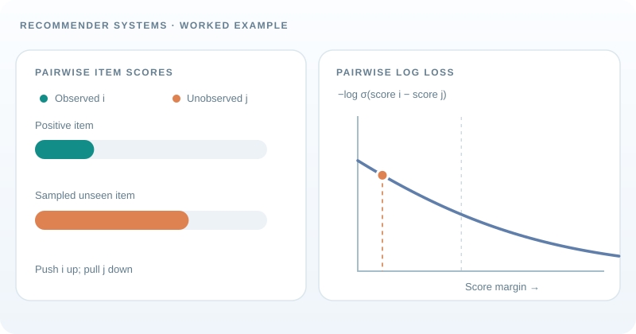
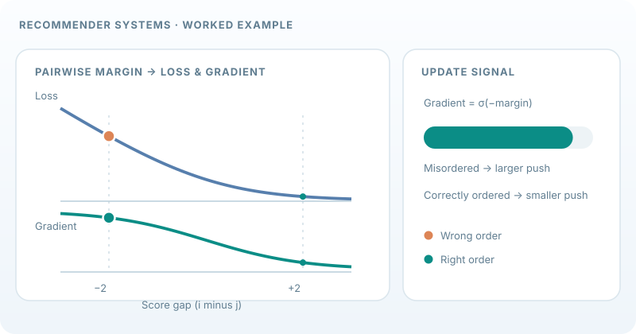

# BPR：貝氏個人化排序（Rendle 等人，2012）

貝氏個人化排序（BPR）從隱式回饋訓練推薦模型，方法是學習使用者偏好哪些項目勝過其他項目，而不是為每筆互動擬合一個分數。它是 Top-N 排序的標準起點。

本頁是[推薦系統](index.md)的一部分。

## 問題

點擊、瀏覽與購買等隱式回饋記錄的是使用者做了什麼，而不是他不喜歡什麼。缺漏的互動可能代表「沒興趣」，也可能代表「從未看過」。矩陣分解與鄰域方法等常見模型，通常被訓練來為每筆已觀察到的紀錄預測一個值。Rendle 等人（2012）主張，這些方法都沒有直接針對推薦實際使用的排序任務進行訓練。

## 核心想法

對使用者 $u$ 而言，BPR 假設已觀察項目 $i$ 應排在未觀察項目 $j$ 之前。兩個已觀察項目之間，或兩個未觀察項目之間，都不推定順序。這是訓練假設，不能當成使用者確實不喜歡 $j$ 的證據。此準則可套用於不同的評分模型，包括矩陣分解與適應性最近鄰模型。[^bpr-training]

令 $I$ 為項目全集，$I_u^+$ 為使用者 $u$ 已觀察的項目集合，則訓練集合為

$$D_S=\{(u,i,j)\mid i\in I_u^+,\ j\in I\setminus I_u^+\}.$$

例如，若 $I=\{a,b,c,d\}$、$I_u^+=\{a,b\}$，四個三元組分別比較 $a$ 與 $c,d$，以及 $b$ 與 $c,d$；不比較 $a$ 與 $b$，也不比較 $c$ 與 $d$。這是直接由集合定義列舉的結果。

## 方程式

令 $\hat{x}_{uij}$ 為使用者 $u$ 對項目 $i$ 與 $j$ 的模型分數差，即 $\hat{x}_{ui} - \hat{x}_{uj}$。使用者偏好 $i$ 勝過 $j$ 的可能性，以邏輯斯諦函數（sigmoid）建模：

$$p(i >_u j \mid \Theta) = \sigma\left(\hat{x}_{uij}(\Theta)\right), \qquad \sigma(x) = \frac{1}{1 + e^{-x}}$$

在參數 $\Theta$ 上取零均值常態先驗，論文的最大後驗估計給出 BPR-Opt 準則：

$$\text{BPR-Opt} = \sum_{(u,i,j)\in D_S} \ln \sigma\left(\hat{x}_{uij}\right) - \lambda_\Theta \lVert \Theta \rVert^2$$

其中 $D_S$ 是訓練三元組的集合，$\lambda_\Theta$ 是模型專屬的正則化參數。

### 動畫算例：單一 BPR 配對的排序更新

[GitHub 可讀的靜態預覽](../../../assets/concept-animations/bpr-pairwise-ranking-still.svg)

以一組抽樣三元組 $(u,i,j)$ 示範，固定一維使用者因子 $p_u=1$，並設定兩個項目因子 $q_i=0.5$、$q_j=1.3$。起初，已觀察項目 $i$ 的預測分數**低於**未觀察項目 $j$。為了單獨呈現項目因子的梯度更新，此例固定 $p_u$，不加入正則化。令 $\Delta=p_u(q_i-q_j)$、$\eta=0.4$，則對 $\log\sigma(\Delta)$ 做一步梯度上升：

$$g=\sigma(-\Delta),\qquad q_i\leftarrow q_i+\eta g p_u,\qquad q_j\leftarrow q_j-\eta g p_u.$$

左圖顯示已觀察項目的分數上升，抽到的未觀察項目分數下降；右圖追蹤配對損失 $-\log\sigma(\Delta)$。四次更新後，分數差由 **−0.8000** 變為約 **0.8518**，損失則由 **1.1711** 降至 **0.3553**。

所有數值皆為**人工解析計算**，不是模型實測。為隔離項目梯度而固定使用者因子，與完整 BPR-MF 訓練不同；更新之間的平滑動畫只是視覺過渡，不代表連續最佳化軌跡。 動畫後半段會倒播回起點以便重播，並非反向訓練或新的更新。「未觀察項目」只是訓練用的比較對象，**不能當作已確認的負向偏好**。

在 MkDocs 網站中可使用支援鍵盤操作的**播放／暫停**控制；窄螢幕可聚焦圖像並水平捲動。GitHub 與 `prefers-reduced-motion` 模式使用靜態回退圖。原創圖像，**CC BY-SA 4.0**。

### 動畫算例：BPR 梯度訊號如何隨排序分數差改變

[GitHub 可閱讀的靜態預覽](../../../assets/concept-animations/bpr-gradient-saturation-still.svg)

對**單一人工訓練三元組**，定義分數差 $\Delta=\hat{x}_{ui}-\hat{x}_{uj}$，最小化負對數概似：

$$\ell(\Delta)=-\log\sigma(\Delta)=\log(1+e^{-\Delta}), \qquad \frac{\partial\ell}{\partial\Delta}=-\sigma(-\Delta).$$

青綠色曲線與長條代表**梯度大小** $g=\sigma(-\Delta)$，不是帶符號的導數。當 $\Delta=-2$ 時，已觀察項目排序錯誤，$g\approx0.8808$、$\ell\approx2.1269$；當 $\Delta=+2$ 時，$g\approx0.1192$、$\ell\approx0.1269$。在固定一維使用者因子 $p_u=1$ 且省略正則化的設定下，負損失梯度更新會讓 $q_i$ 增加、$q_j$ 減少，每次改變量為 $\eta g$。因此，排序分數差轉為正值後，校正訊號逐漸減弱。動畫只是**掃過輸入分數差以展示導數變化**，不是模型實際訓練的最佳化路徑或梯度範數實測。邏輯目標的文獻來源是下方 Rendle 等人的原始研究。

MkDocs 網站提供**播放／暫停**與手機版的鍵盤水平捲動。GitHub 與 `prefers-reduced-motion` 模式使用靜態比較圖。原創圖像，**CC BY-SA 4.0**。

## 演算法

LearnBPR 從 $D_S$ 均勻且有放回地抽取三元組，再對包含正則化的排序準則做一步隨機梯度上升。論文描述的是抽取三元組，因此只說「先選已觀察配對，再選未觀察項目」並不完整，還必須指定第一次抽樣的分布。[^bpr-training]

### 抽樣會改變權重

以下機率由訓練集合的定義推導。令 $m=|I|$、$r_u=|I_u^+|$，使用者 $u$ 提供 $n_u=r_u(m-r_u)$ 個三元組。當 $r_u=0$ 或 $r_u=m$ 時，該使用者沒有可供訓練的三元組。令 $U_*$ 包含其餘使用者，並假設此集合非空。

若要在不實際列出 $D_S$ 的情況下均勻抽取三元組：

1. 以機率 $P(u)=n_u/\sum_{v\in U_*}n_v$ 抽取 $u\in U_*$。
2. 從 $I_u^+$ 均勻抽取 $i$。
3. 從 $I\setminus I_u^+$ 均勻抽取 $j$。

將三個機率相乘可得

$$P(u,i,j)=\frac{r_u(m-r_u)}{\sum_{v\in U_*}r_v(m-r_v)}\frac{1}{r_u}\frac{1}{m-r_u}=\frac{1}{|D_S|}.$$

考慮一個人工四項目範例，其中兩位使用者的紀錄為 $I_A^+=\{a\}$、$I_B^+=\{a,b\}$。兩人分別提供 $3$ 與 $4$ 個三元組，所以 $|D_S|=7$。比較三種抽樣程序；給定使用者後，皆均勻抽取 $i$ 與 $j$，但最後一種程序先抽取已觀察配對：

| 程序 | $P(A)$ | $P(B)$ | 每個 A 三元組的機率 | 每個 B 三元組的機率 |
|---|---|---|---|---|
| 均勻抽三元組 | $3/7$ | $4/7$ | $1/7$ | $1/7$ |
| 均勻抽使用者，再抽 $i,j$ | $1/2$ | $1/2$ | $1/6$ | $1/8$ |
| 均勻抽已觀察配對 $(u,i)$，再抽 $j$ | $1/3$ | $2/3$ | $1/9$ | $1/6$ |

例如，最後一列抽到 $(A,a,c)$ 的機率為 $(1/3)(1/3)=1/9$，抽到 $(B,a,c)$ 的機率則為 $(1/3)(1/2)=1/6$。這些是精確的人工範例機率，不是推薦效果的實測結果。

若抽樣分布 $\rho(u,i,j)$ 固定，未加權配對損失的期望值為

$$L_\rho=\sum_{(u,i,j)\in D_S}\rho(u,i,j)\,\ell(\hat{x}_{ui}-\hat{x}_{uj}).$$

此處只列出資料項，正則化另計。因此，更換抽樣器會改變此期望值中各三元組的權重。均勻抽使用者或均勻抽已觀察配對，都是可採用的訓練選擇，但通常無法重現均勻抽三元組的分布。比較訓練結果時應交代抽樣程序；損失公式相同，仍不代表訓練目標相同。

## 結果

論文在兩個轉換為隱式回饋的資料集上評估。第一個是 Rossmann 線上商店的購買紀錄，含一萬名使用者、四千個項目與 426,612 次購買。第二個是 Netflix 的子樣本，含一萬名使用者、五千個項目與 565,738 筆評分行為，評分已被去除，只保留隱式回饋。精確的 AUC 數值在論文中以圖表呈現。文中報告的比較如下：

- 在兩個資料集上，BPR-MF「在排序任務上明顯優於 WR-MF」。
- 在 Netflix 上，八維的 BPR-MF 與一百二十八維的 WR-MF 品質相當。
- 兩個以 BPR 最佳化的方法，在預測品質上優於其他所有方法。
- SVD-MF 的品質隨維度增加而下降。

## 限制

- 論文聚焦於模型參數的離線學習。線上學習只被提及為可能的延伸，作者指出一種 fold-in 策略也可用於 BPR，但沒有評估。
- 作者計算了 AUC 的上界，但該上界是「非緊的」，因此無法說明各方法離最佳排序有多遠。
- 超參數第一輪以網格搜尋設定，之後的重複實驗中保持不變。
- 論文以均勻隨機方式抽取未觀察到的項目 $j$，沒有研究其他選擇負例的方式。[神經協同過濾](neural-cf.md)同樣把非均勻的負採樣留待未來研究。

## 關聯

BPR 是一種配對排序損失，與學習排序（learning to rank）中使用的排序目標相近。它的使用者與項目因子，就是[矩陣分解](matrix-factorization.md)頁面所述的那類[嵌入](../embeddings/index.md)；它也是[神經協同過濾](neural-cf.md)所比較的排序基準。

## 應用

- **商品與媒體排序**：在只有記錄下來的購買或瀏覽資料時。
- **Top-N 清單**：輸出是一份有序的短清單，順序比預測值本身更重要。

## 開放問題

- 配對訓練應抽取哪些負例？這個選擇會在多大程度上改變最終的排序？
- 當許多推薦系統已依賴序列與情境資訊時，應如何結合配對目標與這些資訊？

[^bpr-training]: Rendle et al., *BPR*（下方參考文獻），§3.2 定義 $D_S$；§4.2 說明 LearnBPR 的均勻、有放回抽樣。https://arxiv.org/pdf/1205.2618

## 參考文獻

### 開創性論文

- Rendle, S., Freudenthaler, C., Gantner, Z. & Schmidt-Thieme, L. (2012). *BPR: Bayesian Personalized Ranking from Implicit Feedback*. arXiv:1205.2618，首次發表於 UAI 2009。https://arxiv.org/abs/1205.2618 — 本頁的來源：BPR-Opt 準則、抽樣的訓練三元組與 AUC 比較。
- Sarwar, B., Karypis, G., Konstan, J. & Riedl, J. (2001). Item-based collaborative filtering recommendation algorithms. In *Proceedings of the 10th International World Wide Web Conference (WWW10)*, pp. 285–295. https://doi.org/10.1145/371920.372071 — 項目為基礎的鄰域協同過濾基準，作為背景引用。
- Koren, Y., Bell, R. & Volinsky, C. (2009). Matrix factorization techniques for recommender systems. *Computer*, 42, pp. 30–37. https://doi.org/10.1109/MC.2009.263 — BPR-MF 以排序目標重新訓練的、基於評分的矩陣分解。
- He, X., Liao, L., Zhang, H., Nie, L., Hu, X. & Chua, T.-S. (2017). Neural collaborative filtering. In *Proceedings of the 26th International Conference on World Wide Web (WWW 2017)*, pp. 173–182. https://doi.org/10.1145/3038912.3052569 — 以 Top-N 指標評估的後續模型，並將配對學習列為未來工作。

### 綜述與教科書

- Ricci, F., Rokach, L. & Shapira, B. (eds.) (2015). *Recommender Systems Handbook*, 2nd ed. Springer. https://doi.org/10.1007/978-1-4899-7637-6 — 參考手冊，涵蓋協同式、內容式與混合式方法，以及評估。
