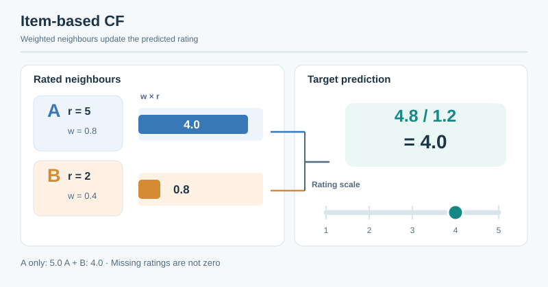

# Item-based Collaborative Filtering

Item-based collaborative filtering predicts an unknown rating using the same user's ratings of related items. Here “related” means agreement in historical rating data, not shared words, images or product categories.

This method belongs to [Recommender Systems](index.md). Sarwar et al. (2001) compare three item-similarity measures, weighted-sum and regression prediction, and precomputed neighbourhoods.[^sarwar]

## Problem and core idea

Let $r_{ui}$ be an observed rating by user $u$ on item $i$, and $I_u$ the items that user rated. We want to estimate $r_{ui}$ when $i\notin I_u$. A missing entry is unknown, not a zero-star opinion.

There are two different populations in a prediction:

- **Other users** provide the evidence that two items behave similarly.
- **The target user's own ratings** supply the values combined at prediction time.

For example, other people's ratings can establish that two films have similar audiences. The prediction for Alice then uses Alice's film ratings. No search for “users most like Alice” is required at request time.

## Similarity: what is being centred?

For an item pair, define $U_{ij}$ as users who rated both. For a common-support calculation, collect two vectors over this set. Their cosine is

$$
s_{ij}^{\mathrm{cos}}=
\frac{\sum_{v\in U_{ij}}r_{vi}r_{vj}}
{\sqrt{\sum_{v\in U_{ij}}r_{vi}^2}\sqrt{\sum_{v\in U_{ij}}r_{vj}^2}}.
$$

State the support convention: the paper also describes cosine as a vector in the full user space. Zero-filled full vectors and pair-restricted vectors can have different norms. Zero filling is a representation choice, not evidence of dislike.

Two centring choices produce different questions:

| Measure | Subtract from each observed rating | Interpretation |
| --- | --- | --- |
| Pearson item correlation | The corresponding item's mean | Do users rate both items above or below their respective item averages? |
| Adjusted cosine | That user's mean over their observed training ratings | Does each user rate both items above or below their own usual level? |

For adjusted cosine, put $x_{vi}=r_{vi}-\bar r_v$ and use

$$
s_{ij}^{\mathrm{adj}}=
\frac{\sum_{v\in U_{ij}}x_{vi}x_{vj}}
{\sqrt{\sum_{v\in U_{ij}}x_{vi}^2}\sqrt{\sum_{v\in U_{ij}}x_{vj}^2}}.
$$

The paper's item-correlation equation instead subtracts item means. Its notation calls these item averages; implementations should state whether means use the item's whole training history or only the pair's common support.[^sarwar] Do not silently replace user means with item means: this changes the estimator.

### Constructed centring example

These three users have rated exactly A, B and C. All numbers are invented for teaching.

| User | A | B | C | User mean |
| --- | --- | --- | --- | --- |
| 1 | 5 | 4 | 3 | 4 |
| 2 | 3 | 2 | 1 | 2 |
| 3 | 1 | 2 | 3 | 2 |

Raw A and B have dot product $28$ and norms $\sqrt{35}$ and $\sqrt{24}$, giving cosine about $0.966$. User-centred A is $(1,1,-1)$ and B is $(0,0,0)$. Adjusted cosine is **undefined**, because B has zero norm. Reporting it as zero or one without a declared fallback would conceal the lack of information. In contrast, item-centred Pearson correlation is about $0.866$: a different, well-defined calculation on these same observations.

## Prediction: choose neighbours, then combine

Let $N_i(u)\subseteq I_u$ contain at most $k$ eligible neighbours of target item $i$. The paper's weighted-sum rule is[^sarwar]

$$
\hat r_{ui}=\frac{\sum_{j\in N_i(u)}s_{ij}r_{uj}}
{\sum_{j\in N_i(u)}|s_{ij}|}.
$$

**The denominator does not guarantee the rating range when negative weights are retained.** With nonnegative weights and a nonzero denominator, this is a convex combination. With just $s=-1$ and a rating of 5, it returns $-5$. A system must explicitly choose a sign policy, a baseline-residual formulation, or clipping. These are modelling choices, not interchangeable implementations of the displayed equation. Surprise's `KNNBasic`, for example, aggregates positive-similarity neighbours and falls back to a global mean when too few remain.[^knn]

### Constructed prediction and regression example

Suppose a target user rated A=5 and B=2, with supplied target-item similarities $s_{iA}=0.8$ and $s_{iB}=0.4$. The weighted prediction is $(0.8\cdot5+0.4\cdot2)/1.2=4$. These similarities are stipulated, not estimated from the earlier table.

Regression first calibrates a neighbour's rating to the target's scale. To make the direction unambiguous, **this teaching formulation** fits target-on-neighbour least squares:

$$
(a_{ij},b_{ij})=\arg\min_{a,b}\sum_{v\in U_{ij}}
(r_{vi}-a r_{vj}-b)^2.
$$

Replace each neighbour rating in the numerator with $a_{ij}r_{uj}+b_{ij}$. For illustrative fitted maps $A\mapsto0.5A+1$ and $B\mapsto B+1$, the two target estimates are 3.5 and 3, and their weighted combination is $10/3$. This is an original numerical example, not a reproduced experimental result.

Sarwar et al. describe regression-adjusted values, but their displayed regression notation runs in the other direction (neighbour from target). The predictive target-on-neighbour formulation above makes inference explicit; it is not a verbatim transcription of that equation.[^sarwar] Reversing a fitted least-squares line is generally not the same as fitting the opposite direction. A constant predictor or inadequate common support also needs a declared fallback.

### Animated example: adding a rated neighbour

[GitHub-readable static preview](../../../assets/concept-animations/itemcf-weighted-neighbors-still.svg)

Using the **constructed**, supplied similarities in the example above, $r_{uA}=5$, $r_{uB}=2$, $s_{iA}=0.8$ and $s_{iB}=0.4$. With only neighbour A the weighted prediction is $4/0.8=5$; including B gives $(4+0.8)/(0.8+0.4)=4$. The changing orange contribution and the cursor explicitly demonstrate why the **denominator changes too**. The blue bar is A's $0.8\times5=4$ numerator contribution, not its similarity.

These are illustrative ratings and stipulated similarities, **not model measurements**. The interpolation between the two eligibility states is visual, not a recommender training procedure or proof that a second neighbour always improves accuracy. Missing ratings never enter as zero. On MkDocs, use **Play/Pause**; the diagram is keyboard-focusable and horizontally scrollable at phone widths. GitHub and reduced-motion users see the static snapshot. Original CC BY-SA 4.0 artwork.

## Precomputation and evaluation

A full similarity table for $n$ items stores $O(n^2)$ values. Keeping $k$ neighbours per item reduces storage to $O(nk)$; intersecting a retained list with $I_u$ may yield fewer than $k$ usable neighbours. It need not equal finding the best $k$ items *within* $I_u$. The paper explicitly explores this storage/accuracy trade-off.[^sarwar]

Its experiments use MovieLens ratings and mean absolute error (MAE); adjusted cosine and basic weighted prediction perform well in that setting, while regression is not uniformly better.[^sarwar] Those comparisons are not evidence of universal superiority or modern click-ranking quality. GroupLens provides the MovieLens 100K benchmark and its documentation.[^data]

A reproducible evaluation should state the split, rating coverage, fallback and clipping rules, minimum overlap, neighbourhood size and sign policy. Compute means, similarities and regression parameters on training data only. Otherwise held-out target ratings leak into the predictor. Keep tuning separate from final evaluation, and report how often the method cannot form a neighbourhood.

## Limitations and connections

Sparse co-rating support makes pair estimates fragile. A new item has no collaborative neighbours; a new user has no ratings to combine. Restricting storage can also remove an item the user actually rated. Explicit-rating accuracy does not by itself establish useful top-N rankings.

[Matrix factorization](matrix-factorization.md) represents users and items with learned latent vectors instead of explicit neighbour tables. [BPR](bpr.md) directly optimises an implicit-feedback ranking criterion, including an adaptive k-nearest-neighbour model.[^bpr] [Neural collaborative filtering](neural-cf.md) learns a neural user–item interaction function.[^ncf] These change the representation or objective; they are not alternative names for the weighted sum above.

[^sarwar]: Sarwar et al. (2001), References; especially §§3.1–3.3 and §4.3.
[^knn]: Surprise, *k-NN inspired algorithms*, References.
[^data]: GroupLens, *MovieLens 100K Dataset*, References.
[^bpr]: Rendle et al., *BPR*, References.
[^ncf]: He et al., *Neural Collaborative Filtering*, References.

## References

- Sarwar, B., Karypis, G., Konstan, J. & Riedl, J. (2001). *Item-based collaborative filtering recommendation algorithms*. WWW10. [Author-hosted full text](https://grouplens.org/site-content/uploads/Item-Based-WWW-2001.pdf) — Sections 3–4 describe similarity, prediction, precomputation and experiments.
- Surprise documentation. *k-NN inspired algorithms*. https://surprise.readthedocs.io/en/stable/knn_inspired.html — Defines implementation-specific positive-neighbour and minimum-neighbour policies.
- GroupLens. *MovieLens 100K Dataset*. https://grouplens.org/datasets/movielens/100k/ — Official benchmark download and dataset documentation.
- Rendle, S., Freudenthaler, C., Gantner, Z. & Schmidt-Thieme, L. (2009; arXiv version 2012). *BPR: Bayesian Personalized Ranking from Implicit Feedback*. https://arxiv.org/abs/1205.2618 — Ranking criterion applied to matrix factorisation and adaptive kNN.
- He, X., Liao, L., Zhang, H., Nie, L., Hu, X. & Chua, T.-S. (2017). *Neural Collaborative Filtering*. https://arxiv.org/abs/1708.05031 — Neural interaction models for implicit-feedback recommendation.
