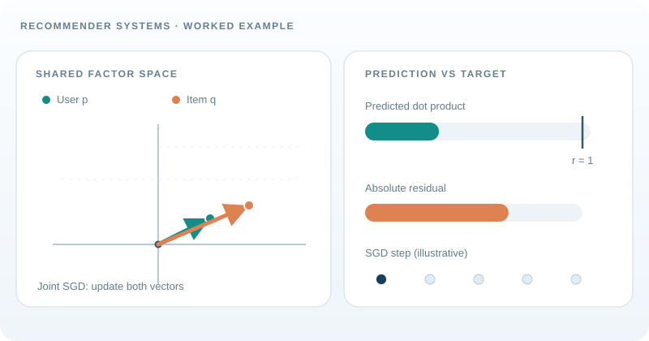

# Matrix Factorization (Koren et al., 2009)

Matrix factorisation predicts a user's rating of an item from a short vector for each of them. The approach became the standard for large rating-prediction problems, and it is the basis of much of the later [recommender-systems](index.md) work.

This page is part of [Recommender Systems](index.md).

## Problem

A user–item rating matrix is very sparse. A user rates only a small fraction of the items, and the task is to fill in the missing ratings well enough to rank or predict. Neighbourhood methods, which compare users or items directly, struggle to find good matches in sparse data and give less compact models. Koren, Bell and Volinsky (2009) describe a latent-factor model that learns a compact representation from the observed ratings.

## Core idea

Users and items are mapped into a shared space of *f* dimensions. Each item has a factor vector $q_i$ and each user has a factor vector $p_u$. Their inner product estimates the rating. Much of the variation in ratings comes from the tendencies of users and items, so the model also adds a global average $\mu$ and bias terms $b_u$ and $b_i$.

## Equation

The prediction is

$$\hat{r}_{ui} = \mu + b_i + b_u + q_i^{\top} p_u$$

The parameters are fitted only on the known ratings $\kappa$, with a penalty on their size to reduce overfitting:

$$\min_{q, p, b} \sum_{(u,i)\in\kappa} \left[ \left(r_{ui} - \hat{r}_{ui}\right)^2 + \lambda \left(\lVert q_i \rVert^2 + \lVert p_u \rVert^2 + b_u^2 + b_i^2\right) \right]$$

The constant $\lambda$ controls the strength of the penalty and is usually chosen by cross-validation.

### Animated worked example: coupled factor updates

[GitHub-readable static preview](../../../assets/concept-animations/mf-coupled-sgd-still.svg)

For one **illustrative** known rating, set the global and item/user biases to zero and omit regularisation: $r=1$, $p_u^{(0)}=(0.4,0.2)$, $q_i^{(0)}=(0.7,0.3)$, and learning rate $\eta=0.2$. A simultaneous SGD update based on the *pre-update* vectors is
$$
e=r-p_u^\top q_i,\qquad
p_u\leftarrow p_u+\eta e q_i,\qquad
q_i\leftarrow q_i+\eta e p_u.
$$
Both arrows in the shared latent space move at each update. The green bar shows their new dot product; the orange bar shows the remaining absolute error. Five displayed states (initial plus four updates) move the prediction from **0.3400** to approximately **0.7643**, reducing the absolute error from **0.6600** to **0.2357**.

This is a computed, regularisation-free **toy example**, not trained-model measurements or a claim about convergence. Smooth interpolation between displayed iterations is visual only; SGD updates occur at the five marked states. Actual training uses many observed user–item pairs and generally includes biases and regularisation.

In MkDocs, use the accessible **Play/Pause** control; on narrow screens, focus and horizontally scroll the illustration. The static fallback is available on GitHub and under `prefers-reduced-motion`. Original illustration, **CC BY-SA 4.0**.

## Learning algorithms

The paper describes two ways to minimise the objective.

1. **Stochastic gradient descent (SGD).** Loop over each known rating, compute the prediction error, and move the user and item vectors against the gradient. The paper calls it simple and relatively fast.
2. **Alternating least squares (ALS).** The objective is not jointly convex, but it is quadratic when one set of vectors is held fixed. ALS alternates between solving for all item vectors and for all user vectors. The paper prefers ALS when the computation can be parallelised, because each vector can be solved independently, and for implicit-feedback data.

## Implicit feedback extension

The paper also extends the model to implicit signals. Items a user has interacted with, and user attributes such as demographics, add extra factor vectors to the user's profile. The authors give three reasons: explicit ratings are sparse, implicit behaviour such as purchases and browsing needs no effort from the user, and extra user information helps in the cold-start case. Confidence weights let one-off events count for less than repeated behaviour.

## Results

The paper evaluates on the Netflix Prize data: more than 100 million ratings from about 500,000 anonymous customers on more than 17,000 movies, with a test set of about 3 million ratings scored by root-mean-square error (RMSE). Netflix's own system reached an RMSE of 0.9514 on this data, and the grand-prize threshold was 0.8563. The authors report improvements of 8.43% over Netflix's algorithm for the 2007 Progress Prize, and 9.46% for their 2008 Progress Prize entry. That entry combined more than 100 predictor sets, mostly factorisation models.

## Limitations

- The paper's main target is rating prediction, while most real systems must rank a short list from implicit feedback. The ranking objective of [BPR](bpr.md) was designed for that case.
- The joint objective is non-convex, so ALS and SGD find local solutions, and the result depends on the starting point and the regularisation.
- The model is a linear interaction between two vectors. [Neural collaborative filtering](neural-cf.md) argues that a learned interaction function is more flexible, and reports gains on top-N evaluation.
- The vectors describe users and items from interaction data alone, so new users and items need side information.

## Connections

The user and item vectors are embeddings, and the same idea underlies the [embedding](../embeddings/index.md) view of recommendation. The neighbourhood methods that matrix factorisation was compared against are described in the [Recommender Systems](index.md) overview.

## Applications

- **Rating and ranking services**, where latent vectors predict a user's score for an unseen item.
- **Retrieval systems**, where item vectors are indexed for fast nearest-neighbour search.

## Open questions

- How much does a richer interaction function help, once the training objective and the data are matched to the task?
- How should the regularisation and dimension be chosen when the data change over time?

## References

### Seminal papers

- Koren, Y., Bell, R. & Volinsky, C. (2009). Matrix factorization techniques for recommender systems. *Computer*, 42, pp. 30–37. https://doi.org/10.1109/MC.2009.263 — The source of this page: latent-factor models with biases, fitted to ratings with SGD or ALS.
- Sarwar, B., Karypis, G., Konstan, J. & Riedl, J. (2001). Item-based collaborative filtering recommendation algorithms. In *Proceedings of the 10th International World Wide Web Conference (WWW10)*, pp. 285–295. https://doi.org/10.1145/371920.372071 — The neighbourhood approach that factorisation methods were compared against.
- Rendle, S., Freudenthaler, C., Gantner, Z. & Schmidt-Thieme, L. (2012). *BPR: Bayesian Personalized Ranking from Implicit Feedback*. arXiv:1205.2618, first published at UAI 2009. https://arxiv.org/abs/1205.2618 — Applies a pairwise ranking objective to matrix factorisation for implicit feedback.
- He, X., Liao, L., Zhang, H., Nie, L., Hu, X. & Chua, T.-S. (2017). Neural collaborative filtering. In *Proceedings of the 26th International Conference on World Wide Web (WWW 2017)*, pp. 173–182. https://doi.org/10.1145/3038912.3052569 — Argues that the inner product of matrix factorisation can be replaced by a learned network.

### Surveys and textbooks

- Ricci, F., Rokach, L. & Shapira, B. (eds.) (2015). *Recommender Systems Handbook*, 2nd ed. Springer. https://doi.org/10.1007/978-1-4899-7637-6 — Reference handbook covering collaborative, content-based and hybrid methods, and evaluation.
