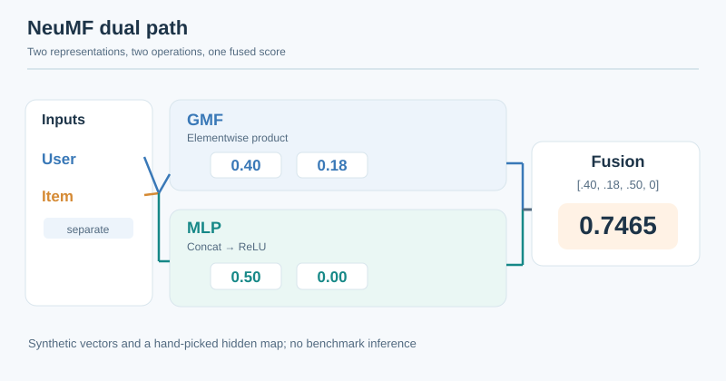

# Neural Collaborative Filtering (He et al., 2017)

Neural collaborative filtering (NCF) replaces the fixed inner product of [matrix factorisation](matrix-factorization.md) with a neural network that learns how a user and an item interact. The paper's main model, NeuMF, combines a matrix-factorisation path with a multi-layer perceptron (MLP) path.

This page is part of [Recommender Systems](index.md).

## Problem

Deep learning had succeeded in speech, vision and language, but in recommendation it was mostly used for side information, such as item text or audio. The user–item interaction itself was still scored by a matrix-factorisation inner product. He et al. (2017) ask whether a learned interaction function can improve pure collaborative filtering, which uses only the interaction data.

## Core idea

Each user and item is represented by an embedding. Instead of taking the inner product of the two vectors, the model passes them through layers that can learn a non-linear interaction. The paper states that NCF is generic and can express and generalise matrix factorisation within its framework. The output is a score that the user will interact with the item.

## Equation and training

The prediction has the form $\hat{y}_{ui} = f(P^{\top} v_u^{U}, Q^{\top} v_i^{I} \mid P, Q, \Theta_f)$, where $v_u^{U}$ and $v_i^{I}$ are one-hot encodings of the user and item, $P$ and $Q$ are the embedding matrices, and $f$ is the network. The network is trained on observed interactions as positives and sampled unobserved items as negatives, with four negatives per positive in the main setup. The loss is log loss, which the paper identifies with binary cross-entropy. The objective is non-convex, so gradient methods are not guaranteed to find a global optimum.

## Architecture

NeuMF combines two paths, and the paper lets each path learn its own embeddings.

- **GMF path.** The element-wise product of the user and item embeddings is kept as a vector, which generalises the matrix-factorisation inner product.
- **MLP path.** The user and item embeddings are concatenated and passed through hidden layers with ReLU activations.

The two paths are fused by concatenating the GMF product vector with the last MLP hidden layer. A final output layer with a sigmoid activation gives the predicted score. The paper also studies pre-training each path before the joint training.

### Animated example: NeuMF's two branches and fusion

[GitHub-readable static preview](../../../assets/concept-animations/neumf-dual-path-still.svg)

A **synthetic** two-dimensional GMF branch uses $p^G=(0.8,0.2)$ and $q^G=(0.5,0.9)$, whose elementwise product is $(0.40,0.18)$. The MLP branch has **separate embeddings**, $p^M=(0.6,0.1)$ and $q^M=(0.2,0.7)$. For an invented two-unit hidden map, $h=\operatorname{ReLU}(p^M_1-p^M_2,\;q^M_1-q^M_2)=(0.50,0)$. Concatenating the branches gives $z=(0.40,0.18,0.50,0)$; a hand-chosen unit output vector and zero bias yield $\sigma(\sum z)=\sigma(1.08)\approx0.7465$.

The moving markers highlight **parallel computation and feature fusion**, not sequential model training. Both user and item embeddings participate in **both** branches; the branch embeddings need not be shared. The numbers, hidden map, and score are **illustrative, not the paper's trained weights, probability calibration, or measured recommendation quality**. The score is a sigmoid output, not a validated probability estimate. Play/Pause is available on MkDocs, with keyboard-scroll access and a GitHub/reduced-motion static fallback. Original CC BY-SA 4.0 illustration.

## Results

The paper evaluates on two datasets. MovieLens has 1,000,209 interactions, 6,040 users and 3,706 items, with the explicit ratings converted to implicit feedback. The Pinterest subset has 1,500,809 interactions, 55,187 users and 9,916 items. The protocol is leave-one-out: each user's latest interaction is held out as the test item, and it is ranked against 100 sampled items the user has not interacted with. Hit ratio (HR@10) and NDCG@10 measure the result. The baselines include ItemPop, item-based nearest neighbours (ItemKNN), BPR and eALS.[^ncf-protocol]

- With pre-training, NeuMF on MovieLens with 64 factors reaches HR@10 of 0.730 and NDCG@10 of 0.447.
- On Pinterest with 8 factors, NeuMF with pre-training reaches HR@10 of 0.878 and NDCG@10 of 0.555.
- The average relative improvement over the eALS and BPR baselines is 4.5% and 4.9%.
- Stacking MLP layers also helps. On MovieLens with 8 factors, HR@10 rises from 0.452 with no hidden layers to 0.678 with four layers. The authors also note that a model with no hidden layers is not better than the non-personalised ItemPop baseline.

## Interpreting the evaluation

### HR and NDCG with one held-out item

Let $r_u$ be the held-out item's one-based rank for test user $u$ in the chosen candidate set, and let $K$ be the cutoff. With binary relevance and exactly one relevant item, the per-user contributions are[^sampled-metrics]

$$h_K(r)=\mathbf{1}[r\le K],\qquad d_K(r)=\frac{\mathbf{1}[r\le K]}{\log_2(r+1)}.$$

The indicator is one when its condition holds and zero otherwise. The ideal discounted gain is one in this setting. Averaging over the set $T$ of test users gives

$$\mathrm{HR}@K=\frac{1}{|T|}\sum_{u\in T}h_K(r_u),\qquad \mathrm{NDCG}@K=\frac{1}{|T|}\sum_{u\in T}d_K(r_u).$$

These single-positive formulas do not replace the general NDCG definition for multiple relevant items or graded relevance.

### Worked example: a sampled hit can miss the full top-K

This is an **invented evaluation example**, not a result from training NeuMF. Fix a model's scores on seven eligible candidates: the held-out positive has score $6$; three other candidates score $9,8,7$, and three score $5,4,3$. The evaluation labels only the held-out item as relevant. There are no ties. On all seven candidates, its rank is $4$, so both HR@2 and NDCG@2 are zero.

Now keep the positive and sample two of the other six candidates uniformly **without replacement**. This replacement rule is part of this toy example, not an additional claim about the NCF paper. There are $\binom{6}{2}=15$ equally likely subsets. Let $H$ count sampled items with higher scores than the positive:

| Higher-scoring sampled items $H$ | Probability | Positive's sampled rank | HR@2 contribution | NDCG@2 contribution |
|---|---|---|---|---|
| $0$ | $3/15$ | $1$ | $1$ | $1$ |
| $1$ | $9/15$ | $2$ | $1$ | $1/\log_2(3)\approx0.6309$ |
| $2$ | $3/15$ | $3$ | $0$ | $0$ |

The counts are $\binom{3}{2}=3$ pairs of lower-scoring items, $3\cdot3=9$ mixed pairs, and $\binom{3}{2}=3$ pairs of higher-scoring items. Thus the exact expectations over this sampling process are

$$\mathbb{E}[\mathrm{HR}@2]=\frac{12}{15}=0.8,\qquad \mathbb{E}[\mathrm{NDCG}@2]=\frac{3}{15}+\frac{9}{15\log_2(3)}\approx0.5786.$$

No model score changed: removing competitors changed the rank being measured. These expectations describe repeated samples for this single test case, not averages from a real user population. The unobserved candidates' evaluation labels do not establish that the user dislikes them.

### Comparing reported scores

The NCF protocol ranks one positive with 100 sampled items, so its HR@10 and NDCG@10 concern a 101-item candidate set.[^ncf-protocol] Krichene and Rendle show that sampled ranking metrics can even change the relative ordering of recommenders in expectation.[^sampled-metrics]

For a reproducible comparison, state the candidate pool, excluded history, sample count and distribution, replacement and tie rules, held-out split, and cutoff. Use the same evaluation candidates across compared models. Distinguish this evaluation sampling from the negative samples used to train the model. Repeating random samples can quantify variability; it does not by itself remove the difference from full-candidate evaluation.[^sampled-metrics]

## Limitations

- The paper's experiments focus on the pure collaborative-filtering setting. Side information is not used.
- Pairwise learning for NCF, such as the [BPR](bpr.md) objective, is left as future work, and so is non-uniform negative sampling.
- Large embedding sizes may overfit and reduce performance.
- Because the NeuMF objective is non-convex, gradient-based training is not guaranteed to find a global optimum.
- The evaluation uses sampled negatives. Scores on 100 sampled items are not the same as ranking the full catalogue.

## Connections

NCF keeps the embedding view of recommendation from the [Recommender Systems](index.md) overview and the [embedding](../embeddings/index.md) page. The MLP path is a standard [feed-forward network](../mlp/index.md).

## Applications

- **Personalised ranking** of items from logged clicks or purchases, where the learned interaction function replaces a fixed inner product.
- **Benchmarking** on public datasets with sampled-negative top-N metrics, a protocol the paper uses.

## Open questions

- How much a learned interaction function adds over a well-tuned inner product, on data other than these two, is not settled by the paper's experiments.
- The paper ranks each held-out item against 100 sampled negatives. Its numbers therefore do not directly show performance when ranking the full catalogue.

[^ncf-protocol]: He et al. (2017, below), §4.1 specifies latest-interaction holdout, 100 sampled comparison items, and user-averaged HR and NDCG. https://arxiv.org/pdf/1708.05031
[^sampled-metrics]: Krichene & Rendle (2021, below), §2 defines single-relevant-item metrics; §3 and §6 discuss sampling bias. https://ijcai.org/proceedings/2021/651

## References

### Seminal papers

- He, X., Liao, L., Zhang, H., Nie, L., Hu, X. & Chua, T.-S. (2017). Neural collaborative filtering. In *Proceedings of the 26th International Conference on World Wide Web (WWW 2017)*, pp. 173–182. https://doi.org/10.1145/3038912.3052569 — The source of this page: NeuMF, its datasets, leave-one-out protocol and HR@10 and NDCG@10 results.
- Krichene, W. & Rendle, S. (2021). *On Sampled Metrics for Item Recommendation (Extended Abstract).* IJCAI-21, pp. 4784–4788. https://ijcai.org/proceedings/2021/651 — Defines single-relevant-item ranking metrics and explains why sampled evaluation can change comparisons between recommenders.
- Koren, Y., Bell, R. & Volinsky, C. (2009). Matrix factorization techniques for recommender systems. *Computer*, 42, pp. 30–37. https://doi.org/10.1109/MC.2009.263 — The inner-product model that NCF generalises.
- Rendle, S., Freudenthaler, C., Gantner, Z. & Schmidt-Thieme, L. (2012). *BPR: Bayesian Personalized Ranking from Implicit Feedback*. arXiv:1205.2618, first published at UAI 2009. https://arxiv.org/abs/1205.2618 — The pairwise BPR baseline that NCF is compared against, and the pairwise objective it leaves to future work.
- Sarwar, B., Karypis, G., Konstan, J. & Riedl, J. (2001). Item-based collaborative filtering recommendation algorithms. In *Proceedings of the 10th International World Wide Web Conference (WWW10)*, pp. 285–295. https://doi.org/10.1145/371920.372071 — A neighbourhood baseline for item-based collaborative filtering, cited for context.

### Surveys and textbooks

- Ricci, F., Rokach, L. & Shapira, B. (eds.) (2015). *Recommender Systems Handbook*, 2nd ed. Springer. https://doi.org/10.1007/978-1-4899-7637-6 — Reference handbook covering collaborative, content-based and hybrid methods, and evaluation.
