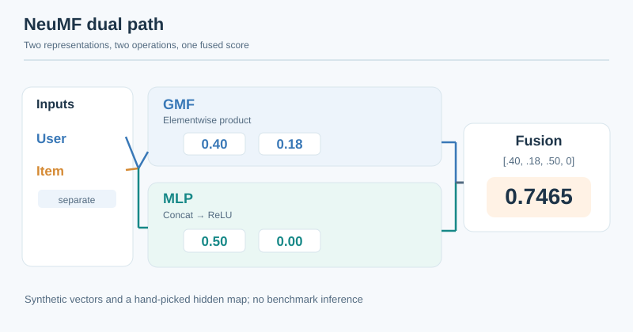

# 神經協同過濾（He 等人，2017）

神經協同過濾（NCF）以一個學得的神經網路，取代[矩陣分解](matrix-factorization.md)中固定的內積，來學習使用者與項目如何互動。論文的主要模型 NeuMF 結合了矩陣分解路徑與多層感知器（MLP）路徑。

本頁是[推薦系統](index.md)的一部分。

## 問題

深度學習已在語音、視覺與語言上取得成功，但在推薦中它多半用於附加資訊，例如項目的文字或音訊。使用者與項目的互動本身，仍由矩陣分解的內積來評分。He 等人（2017）探討：學得的互動函數能否改善只使用互動資料的純協同過濾。

## 核心想法

每位使用者與每個項目都以一個嵌入表示。模型不取兩個向量的內積，而是將它們輸入能學習非線性互動的層。論文指出，NCF 是通用的，在其框架內能表達並推廣矩陣分解。輸出是使用者與項目發生互動的分數。

## 方程式與訓練

預測式的形式為 $\hat{y}_{ui} = f(P^{\top} v_u^{U}, Q^{\top} v_i^{I} \mid P, Q, \Theta_f)$，其中 $v_u^{U}$ 與 $v_i^{I}$ 是使用者與項目的獨熱編碼，$P$ 與 $Q$ 是嵌入矩陣，$f$ 是網路。網路以已觀察到的互動為正例，以抽樣的未觀察項目為負例進行訓練，主要設定中每個正例配四個負例。損失為對數損失（log loss），論文將其等同於二元交叉熵。目標函數是非凸的，因此梯度方法不保證找到全域最優解。

## 架構

NeuMF 結合兩條路徑，且論文允許每條路徑學習各自的嵌入。

- **GMF 路徑。** 使用者與項目嵌入的逐元素乘積，保留為一個向量，這推廣了矩陣分解的內積。
- **MLP 路徑。** 將使用者與項目嵌入串接，再經過帶有 ReLU 激活函數的隱藏層。

兩條路徑的融合方式，是把 GMF 的乘積向量與 MLP 最後一個隱藏層串接起來。最後的輸出層使用 sigmoid 激活函數，給出預測分數。論文也研究在聯合訓練前，先分別預訓練各條路徑。

### 動畫範例：NeuMF 雙分支與特徵融合

[GitHub-readable static preview](../../../assets/concept-animations/neumf-dual-path-still.svg)

以**人工數值**示範：GMF 分支使用 $p^G=(0.8,0.2)$ 與 $q^G=(0.5,0.9)$，逐元素相乘得到 $(0.40,0.18)$。MLP 分支使用**另一組獨立嵌入** $p^M=(0.6,0.1)$、$q^M=(0.2,0.7)$；自行設定兩個隱藏單元 $h=\operatorname{ReLU}(p^M_1-p^M_2,\;q^M_1-q^M_2)=(0.50,0)$。串接後 $z=(0.40,0.18,0.50,0)$。若示意輸出層權重全為一、偏差為零，則 $\sigma(\sum z)=\sigma(1.08)\approx0.7465$。

移動標記用來凸顯**兩條路徑的並行運算與特徵融合**，不是依序訓練模型。使用者與項目嵌入都會進入**兩個**分支，不代表兩條路徑共用嵌入參數。上述向量、權重與分數**皆非論文的訓練結果、機率校準證據或推薦品質實測**；sigmoid 輸出不等於經驗證的機率估計。MkDocs 網站可使用 Play/Pause，並支援鍵盤水平捲動；GitHub 與減少動態效果模式使用靜態回退。原創圖像採 CC BY-SA 4.0 授權。

## 結果

論文在兩個資料集上評估。MovieLens 含 1,000,209 筆互動、6,040 名使用者與 3,706 個項目，其明確評分已轉換為隱式回饋。Pinterest 子集含 1,500,809 筆互動、55,187 名使用者與 9,916 個項目。評估協定為留一法（leave-one-out）：每位使用者保留一筆互動作為測試項目，並與該使用者未互動過的 100 個抽樣項目一起排序。指標為命中率（HR@10）與 NDCG@10。比較基準包含 ItemPop、以項目為基礎的最近鄰方法（ItemKNN）、BPR 與 eALS。

- 使用預訓練時，MovieLens 上 64 個因子的 NeuMF 達到 HR@10 0.730、NDCG@10 0.447。
- Pinterest 上 8 個因子、使用預訓練的 NeuMF 達到 HR@10 0.878、NDCG@10 0.555。
- 相較於 eALS 與 BPR 基準，平均相對提升分別為 4.5% 與 4.9%。
- 堆疊 MLP 層也有幫助。MovieLens 上 8 個因子的模型，HR@10 從沒有隱藏層時的 0.452 提升到四層時的 0.678。作者也指出，沒有隱藏層的模型並不優於非個人化的 ItemPop 基準。

## 限制

- 論文的實驗聚焦於純協同過濾設定，未使用附加資訊。
- NCF 的配對學習（例如 [BPR](bpr.md) 目標）與非均勻的負採樣都留待未來研究。
- 嵌入維度過大可能造成過度擬合並降低表現。
- 由於 NeuMF 的目標函數是非凸的，基於梯度的訓練不保證找到全域最優解。
- 評估使用抽樣的負例。在 100 個抽樣項目上的分數，與對完整目錄排序的結果並不相同。

## 關聯

NCF 保留了[推薦系統](index.md)概述與[嵌入](../embeddings/index.md)頁面中的嵌入觀點。MLP 路徑是標準的[前饋網路](../mlp/index.md)。

## 應用

- **個人化排序**：以記錄下來的點擊或購買，用學得的互動函數取代固定的內積。
- **在公開資料集上的基準測試**：使用論文採用的抽樣負例 Top-N 指標。

## 開放問題

- 在這兩個資料集之外，學得的互動函數比調校良好的內積多出多少效益，論文的實驗並未定論。
- 論文以 100 個抽樣負例對每個留出的項目排序，因此其數字無法直接說明在完整目錄上排序的表現。

## 參考文獻

### 開創性論文

- He, X., Liao, L., Zhang, H., Nie, L., Hu, X. & Chua, T.-S. (2017). Neural collaborative filtering. In *Proceedings of the 26th International Conference on World Wide Web (WWW 2017)*, pp. 173–182. https://doi.org/10.1145/3038912.3052569 — 本頁的來源：NeuMF、其資料集、留一法協定，以及 HR@10 與 NDCG@10 結果。
- Koren, Y., Bell, R. & Volinsky, C. (2009). Matrix factorization techniques for recommender systems. *Computer*, 42, pp. 30–37. https://doi.org/10.1109/MC.2009.263 — NCF 所推廣的內積模型。
- Rendle, S., Freudenthaler, C., Gantner, Z. & Schmidt-Thieme, L. (2012). *BPR: Bayesian Personalized Ranking from Implicit Feedback*. arXiv:1205.2618，首次發表於 UAI 2009。https://arxiv.org/abs/1205.2618 — NCF 所比較的 BPR 基準，以及 NCF 留待未來研究的配對目標。
- Sarwar, B., Karypis, G., Konstan, J. & Riedl, J. (2001). Item-based collaborative filtering recommendation algorithms. In *Proceedings of the 10th International World Wide Web Conference (WWW10)*, pp. 285–295. https://doi.org/10.1145/371920.372071 — 項目為基礎的鄰域協同過濾基準，作為背景引用。

### 綜述與教科書

- Ricci, F., Rokach, L. & Shapira, B. (eds.) (2015). *Recommender Systems Handbook*, 2nd ed. Springer. https://doi.org/10.1007/978-1-4899-7637-6 — 參考手冊，涵蓋協同式、內容式與混合式方法，以及評估。
