---
related:
- theory/models/rnn/gated-cells
- theory/models/rnn
aliases:
  - Gated Recurrent Unit
  - GRU
  - 門控循環單元
tags:
  - recurrent networks
  - gating
  - long-term dependencies
translation_reviewed: 2026-10-28
---

# 門控循環單元

門控循環單元（GRU）是一種循環單元，只有兩個閘門，也沒有獨立的記憶狀態。它由 Cho 等人在 2014 年的論文 "Learning Phrase Representations using RNN Encoder-Decoder for Statistical Machine Translation" 中提出，以較少的參數提供了 LSTM 大部分的長程好處。

## 問題

原始的循環單元以通過時間的反向傳播訓練，其梯度會在許多步之後消失或爆炸，因此很難把相距遙遠的輸入與輸出連結起來。LSTM 以獨立的加法記憶與三個閘門解決了這個問題，但這個設計較為龐大。GRU 想問的是：一個較小的門控單元能否保有同樣的梯度優勢。

## 核心想法

GRU 把記憶與隱藏狀態合併成同一個向量，只使用兩個閘門：

- **更新閘門**決定保留多少舊狀態，又以多少新的候選值取代。由於新狀態是舊狀態與候選值的加權平均，這個單元的行為像一個自適應的漏積分器。
- **重置閘門**決定計算候選值時使用多少舊狀態。當重置閘門接近零時，候選值會忽略前一個狀態，使單元能夠忘掉過去、重新開始。

論文把這個單元稱為一個 "adaptively remembers and forgets" 的隱藏單元。由於沒有獨立的輸出閘門，GRU 在每一步都會暴露它的整個狀態。

### 動態概念解說

*原創 CC BY-SA 4.0 教學動畫，依據 Cho 等人（2014；見參考文獻）。四階段分別呈現計算閘門、以重設閘門控制候選狀態的循環輸入、混合舊狀態與候選狀態，以及輸出新的隱藏狀態。**Cho 等人原始定義**中的 $z_t$ 是**保留舊狀態**的權重；圖內 $z=0.7$ 和色塊比例僅供教學示意，並非訓練所得的激活值或實測結果。為了讓視覺保持清楚，圖中省略部分連線：兩個閘門都依賴 $x_t$ 與 $h_{t-1}$，候選狀態也直接依賴 $x_t$。MkDocs 網站可透過支援鍵盤的**播放／暫停**按鈕控制；偏好減少動態效果時，預設顯示 [GitHub 可讀的靜態概覽](../../../../../assets/concept-animations/gru-gate-flow-still.svg)。[開啟完整動畫](../../../../../assets/concept-animations/gru-gate-flow-motion.svg)。*

## 方程式或演算法

論文在其第 2.3 節以 Eqs. 5 到 8 定義此單元。以下方程式取自論文，針對時間 \(t\) 的單一分量 \(j\) 書寫，其中 \(\sigma\) 為 logistic sigmoid，\(\varphi\) 為候選值的激活函數：

\[
r_j = \sigma\big([W_r x]_j + [U_r h_{t-1}]_j\big) \qquad \text{（重置閘門）}
\]

\[
z_j = \sigma\big([W_z x]_j + [U_z h_{t-1}]_j\big) \qquad \text{（更新閘門）}
\]

\[
\tilde{h}_j = \varphi\big([W x]_j + [U(r \odot h_{t-1})]_j\big) \qquad \text{（候選狀態）}
\]

\[
h_j^{\langle t \rangle} = z_j\, h_j^{\langle t-1 \rangle} + (1 - z_j)\, \tilde{h}_j^{\langle t \rangle} \qquad \text{（新狀態）}
\]

論文以分量形式書寫，並省略了偏置項。它的實驗章節把候選值的激活函數指定為 \(\tanh\)。以下是同一單元的向量形式，這是描述此單元的標準寫法，其中 \(\odot\) 為逐元素乘積：

\[
r_t = \sigma(W_r x_t + U_r h_{t-1}), \quad z_t = \sigma(W_z x_t + U_z h_{t-1}),
\]
\[
\tilde{h}_t = \tanh\big(W x_t + U (r_t \odot h_{t-1})\big), \quad h_t = z_t \odot h_{t-1} + (1 - z_t) \odot \tilde{h}_t.
\]

之後的一些文獻與函式庫會在最後一式中互換 \(z\) 與 \(1 - z\) 的角色。比較不同來源的程式碼或方程式之前，請先確認其約定。

## 結果

論文報告了統計機器翻譯系統的 BLEU 分數，其中一個 RNN 編碼器–解碼器用來重新評分片語對。論文表 1 的分數（取自已核對的原文）如下：

| 模型 | BLEU dev | BLEU test |
|---|---|---|
| Baseline | 30.64 | 33.30 |
| RNN | 31.20 | 33.87 |
| CSLM + RNN | 31.48 | 34.64 |
| CSLM + RNN + WP | 31.50 | 34.54 |

這些分數描述的是整個翻譯系統。已核對的原文沒有提供單獨門控單元的分數。

Chung 等人（2014）之後在多個序列任務上比較了 GRU 與 LSTM 及原始單元。如[門控單元](../index.md)頁面所整理，兩種門控單元都明顯優於原始單元，而兩者之間也沒有一致的優劣。

## 限制

論文指出，在其初步實驗中，沒有門控的單元無法運作："We were not able to get meaningful result with an oft-used tanh unit without any gating."（我們無法以常用、沒有任何門控的 tanh 單元得到有意義的結果。）因此，在那些實驗中，門控正是讓單元可以訓練的關鍵之一。

論文也說明了其方法的一項限制："we only consider rescoring the phrase pairs in the phrase table"（我們只考慮重新評分片語表中的片語對）。若要以此模型取代片語表，就需要昂貴的反覆取樣。這項限制屬於翻譯的設定，而非 GRU 單元本身。

## 相關連結

GRU 是[門控單元](../index.md)家族中兩個閘門的成員，與保有獨立單元狀態與輸出閘門的 [LSTM](../lstm/index.md) 並列。[循環神經網路](../../index.md)頁面把兩者都歸在循環模型之中。論文的編碼器–解碼器設計，與 [序列到序列學習](../../sequence-modes/sequence-to-sequence/index.md)模型所用的模式相同。[Transformer](../../../transformer/index.md) 以注意力取代循環，而[狀態空間模型](../../../ssm/index.md)則以不同的長程機制回到循環的觀點。與工作記憶的比較見[記憶與學習](../../../../../brain-mind/memory-learning/index.md)。

## 未解問題與更多變體

- **合併的狀態。** 移除獨立記憶是否會損失容量，尤其是在需要長期、獨立儲存的任務上，正如 LSTM 的單元狀態所提供的，目前尚無定論。
- **閘門的角色。** 兩個閘門中哪一個對準確率更重要，以及重置閘門在不同任務上是否必要，不同研究的結論不一，仍未完全解決。
- **無門控的基線。** 論文指出沒有門控的 tanh 單元會失敗，但此結論來自初步實驗，它在不同任務與規模上成立到什麼程度，尚未被充分測試。

## 參考文獻

### 開創性論文

- Cho, K., et al. (2014). "Learning Phrase Representations using RNN Encoder-Decoder for Statistical Machine Translation". [arXiv:1406.1078](https://arxiv.org/abs/1406.1078) — 提出 GRU，以及用於序列到序列任務的編碼器–解碼器架構。
- Hochreiter, S. & Schmidhuber, J. (1997). "Long Short-Term Memory". *Neural Computation* 9(8). https://doi.org/10.1162/neco.1997.9.8.1735 — LSTM，以加法更新的記憶單元解決梯度消失問題。
- Bengio, Y., Simard, P. & Frasconi, P. (1994). "Learning long-term dependencies with gradient descent is difficult". *IEEE Transactions on Neural Networks* 5(2). https://doi.org/10.1109/72.279181 — 說明為何以梯度下降學習循環網路中的長程依賴很困難。

### 綜述與教科書

（本頁尚未核對）

### 講座與影片

（本頁尚未核對）

### 文章與文件

- Chung, J., et al. (2014). "Empirical Evaluation of Gated Recurrent Neural Networks on Sequence Modeling". [arXiv:1412.3555](https://arxiv.org/abs/1412.3555) — 在多個序列任務上比較 LSTM、GRU 與原始循環單元。
- Greff, K., et al. (2017). "LSTM: A Search Space Odyssey". [arXiv:1503.04069](https://arxiv.org/abs/1503.04069) — 比較多種 LSTM 變體，發現原始設計難以超越。
- Pascanu, R., Mikolov, T. & Bengio, Y. (2013). "On the difficulty of training Recurrent Neural Networks". [arXiv:1211.5063](https://arxiv.org/abs/1211.5063) — 分析梯度爆炸與消失，並提出梯度範數裁剪。
