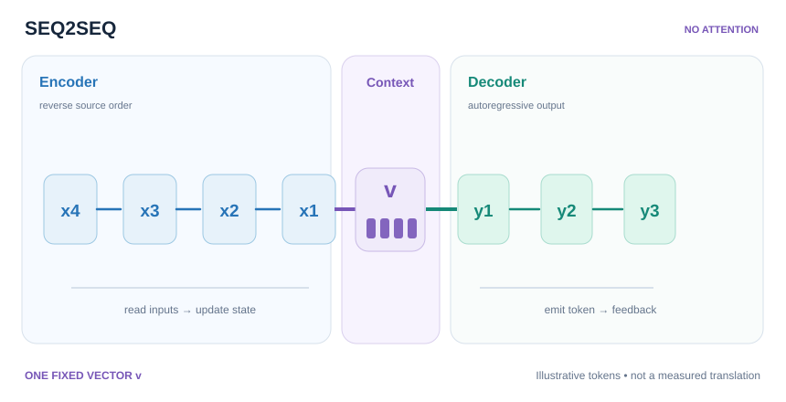

---
related:
- theory/models/rnn/sequence-modes
- theory/models/rnn
aliases:
  - Sequence to Sequence Learning
  - Seq2Seq
  - 序列到序列學習
tags:
  - recurrent networks
  - sequence modelling
  - machine translation
translation_reviewed: 2026-11-14
---

# 序列到序列學習

序列到序列學習是一種編碼器–解碼器方法，其中多層 LSTM 把輸入序列映射為長度可能不同的輸出序列。它由 Sutskever、Vinyals 與 Le 在 2014 年 NeurIPS 的論文 "Sequence to Sequence Learning with Neural Networks" 中提出，並展示了神經網路可以端到端地學會翻譯。

## 問題

深度網路需要固定維度的輸入與目標，但翻譯所處理的序列長度事先並不知道。因此，適用於機器翻譯的方法必須能接受任意長度的來源句，並產生任意長度的目標句。

## 核心想法

一個多層 LSTM 讀取來源句，並把它編碼為一個固定大小的向量。第二個 LSTM 再從這個向量出發，每次生成目標句的一個詞。來源詞以相反的順序輸入。

## 方程式或演算法

模型把目標句的機率分解為

\[
p(y_1,\dots,y_{T'} \mid x_1,\dots,x_T) = \prod_{t} p(y_t \mid v,\, y_1,\dots,y_{t-1}),
\]

其中 \(v\) 是編碼器產生的固定向量，每個因子都是對詞彙表的 softmax。

### 視覺化解析：單一脈絡向量的交接

*原創教學視覺（CC BY-SA 4.0）。* MkDocs 網站可透過**播放／暫停**，依序追蹤編碼器讀取來源詞元、將資訊壓縮到**單一固定維度向量** \(v\)，以及解碼器自回歸產生 \(y_1,y_2,y_3\) 的過程。此示意依循 Sutskever、Vinyals 與 Le（2014）反轉來源序列的慣例；**解碼器僅透過初始狀態取得脈絡資訊，沒有逐步交叉注意力**。詞元代號與訊號移動時間都是教學構造，並非實際翻譯、注意力權重或學得的表徵。GitHub 靜態回退能直接看出完整依賴結構，網站則支援鍵盤播放／暫停與減少動態效果。

### 互動實驗：遞迴狀態與單次脈絡交接

使用**上一步／下一步、播放／暫停、進度滑桿及速度調整**，依序檢視四次來源詞元更新、單次脈絡交接及三次解碼器狀態更新。可切換**原論文使用的反向讀取**及原始順序，觀察遞迴狀態如何受輸入順序影響。編碼完成後，脈絡向量 \(v\) 才會顯示；解碼器以同一向量作為初始狀態。每個中間時間步的狀態都可檢視，不再只有最終結果。

  
逐步運算實驗僅在 MkDocs 網站執行；GitHub 或停用 JavaScript 時，仍可閱讀上方原創 SVG 靜態圖理解真正的編碼器—解碼器依賴。

**數值模型界線：** 此實驗故意採用**人工二維遞迴** \(h_t=0.65h_{t-1}+e(x_t)\)，接著設定 \(s_0=v=h_4\)、\(s_t=0.7s_{t-1}+e(y_{t-1})\)。來源嵌入分別為 \(e(A)=(1,0.2)\)、\(e(B)=(0.2,0.9)\)、\(e(C)=(-0.6,0.4)\)、\(e(D)=(0.6,-0.8)\)；前一詞元嵌入為 \(e(\mathrm{BOS})=(0.1,0.15)\)、\(e(y_1)=(0.15,-0.25)\)、\(e(y_2)=(-0.2,0.3)\)。固定的 \(y_1,y_2,y_3\) 只是代號，**不是訓練模型產生的預測**；此規則**不是 LSTM 單元或語言模型**，也不能用來證明反轉來源一定改善翻譯。它只用來解釋 2014 年原架構的**初始狀態單次脈絡交接，沒有逐步交叉注意力**。

## 結果

在 WMT'14 英文到法文任務（ntst14 測試集）上，由五個反向 LSTM 組成的集成、束寬為 12，達到 BLEU 34.81，而短語式統計機器翻譯基線為 33.30。把來源句反轉，使單一模型的 BLEU 從 25.9 提升到 30.6。

## 限制

論文指出，對於少於 35 個詞的句子沒有效能下降，只有最長的句子有輕微下降。作者表示他們"do not have a complete explanation"，即無法完整解釋為何反轉來源句會有幫助。訓練在 8 GPU 的設定下耗時約十天。

## 相關連結

[序列模式](../index.md)頁面把編碼器–解碼器模式與雙向及堆疊的循環結構並列描述，而[循環神經網路](../../index.md)頁面則把它放在其他循環模型之中。[LSTM](../../gated-cells/lstm/index.md)頁面說明編碼器與解碼器共同使用的單元。固定大小的向量正是注意力被提出來紓解的瓶頸，見[注意力變體](../../../transformer/attention-variants/index.md)。

## 未解問題與更多變體

- **固定大小的瓶頸。** 單一向量限制了長輸入中有多少資訊能傳給解碼器，這正是注意力機制設計來彌補的缺口。
- **反轉來源。** 反轉來源句的好處已被觀察到，但作者並未解釋其原因，因此仍是開放問題。
- **長輸入。** 論文中最長句子的準確率只有輕微下降，但在更長輸入上的表現是另一個問題。

## 參考文獻

### 開創性論文

- Sutskever, I., Vinyals, O. & Le, Q. V. (2014). "Sequence to Sequence Learning with Neural Networks". NeurIPS. [arXiv:1409.3215](https://arxiv.org/abs/1409.3215) — Encoder–decoder LSTMs for machine translation, trained end to end.
- Cho, K., et al. (2014). "Learning Phrase Representations using RNN Encoder-Decoder for Statistical Machine Translation". [arXiv:1406.1078](https://arxiv.org/abs/1406.1078) — 提出 GRU，以及用於序列到序列任務的編碼器–解碼器架構。
- Bahdanau, D., Cho, K. & Bengio, Y. (2014). "Neural Machine Translation by Jointly Learning to Align and Translate". [arXiv:1409.0473](https://arxiv.org/abs/1409.0473) — 加入注意力，使解碼器能回看整個輸入。

### 綜述與教科書

- Goodfellow, I., Bengio, Y. & Courville, A. (2016). *Deep Learning*. MIT Press. https://www.deeplearningbook.org/ — 第 10 章涵蓋雙向與編碼器–解碼器循環網路，以及截斷式的通過時間反向傳播。

### 講座與影片

（本頁尚未核對）

### 文章與文件

- Chung, J., et al. (2014). "Empirical Evaluation of Gated Recurrent Neural Networks on Sequence Modeling". [arXiv:1412.3555](https://arxiv.org/abs/1412.3555) — 在多個序列任務上比較 LSTM、GRU 與原始循環單元。
