---
related:
- brain-mind/bci
- theory/models/multimodal
---

# Speech & Audio

## Tasks

| Task | Description | Models / tools |
|---|---|---|
| Automatic speech recognition (ASR) | Speech → text | Whisper, wav2vec 2.0, Conformer, Paraformer |
| Text-to-speech (TTS) | Text → speech | Tacotron, FastSpeech, VITS, neural-codec language models (VALL-E style) |
| Voice conversion / cloning | Change speaker identity | RVC, zero-shot TTS |
| Speaker recognition and diarisation | Who spoke when | pyannote |
| Speech enhancement | Denoising, dereverberation | Demucs and others |
| Music generation | Text or melody → music | MusicLM, MusicGen, Suno, Udio, etc. |
| Source separation | Isolate vocals, instruments | Demucs |
| Sound event detection | Gunshots, glass breaking, birdsong | PANNs, BirdNET |
| Spoken dialogue models | Real-time end-to-end voice conversation | GPT-4o-style omni models, Moshi |

## Key techniques

- **Features**: mel spectrograms, MFCCs — or learn directly from waveforms (wav2vec)
- **Neural audio codecs**: EnCodec and SoundStream compress audio into discrete tokens so language models can "speak" and "compose"
- **End-to-end speech LLMs**: process speech tokens directly, preserving prosody and emotion with lower latency
- **Vocoders**: WaveNet → HiFi-GAN → codec decoders

## Frame alignments in speech recognition

Connectionist temporal classification (CTC) assigns probabilities to transcripts without requiring a label for every encoder frame. A path uses the label alphabet plus a special blank symbol (∅); the collapse map first merges consecutive repeated symbols, then removes blanks.[^ctc]

[GitHub-readable static preview](../../../assets/concept-animations/ctc-collapse-scan-still.svg)

The moving marker carries emitted labels into the transcript. The second frame repeats A, so it emits nothing; the blank at frame three separates the next A from the previous run. Removing blanks before merging repeats would incorrectly produce AB. The blank is not a word separator or a literal output character.

### Why greedy decoding can disagree with the best transcript

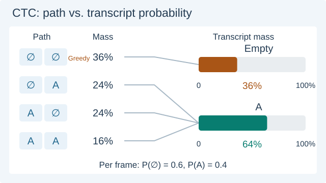

[GitHub-readable static preview](../../../assets/concept-animations/ctc-path-mass-still.svg)

For two frames, let each frame give blank probability 0.6 and label A probability 0.4. Given the input, CTC multiplies frame probabilities along a path and sums over all paths that collapse to the same transcript.[^ctc] The four paths have masses 0.36, 0.24, 0.24 and 0.16. Greedy framewise decoding selects blank-blank, hence an empty transcript. The three paths for A instead sum to 0.64, exceeding the empty transcript's 0.36. The animation accumulates exact path masses upon arrival; its intermediate sums are not a normalized transcript distribution. Practical CTC training uses forward-backward dynamic programming rather than enumerating paths, and decoding may use prefix beam search.

Both are constructed teaching examples, **not recognizer measurements**. On MkDocs, use the existing Play/Pause control and focus the diagram to scroll horizontally on narrow screens. GitHub and reduced-motion users have a static fallback. Original CC BY-SA 4.0 artwork.

### Forward recursion: sum compatible alignments without enumeration

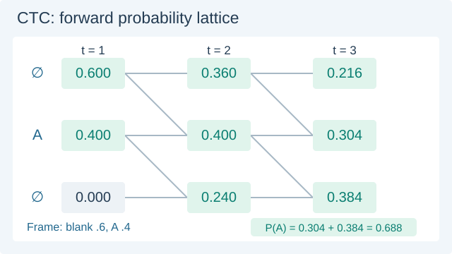

[GitHub-readable static preview](../../../assets/concept-animations/ctc-forward-lattice-still.svg)

For target A, expand the state sequence to (blank, A, blank). With each frame assigning probabilities 0.6 to blank and 0.4 to A, initialize the forward masses to (0.6, 0.4, 0). In this example a transition can stay in its state or advance by one. With zero-based state indices, each new mass is[^ctc]

$
\alpha_t(s)=p_t(l'_s)\big(\alpha_{t-1}(s)+\alpha_{t-1}(s-1)\big).
$

Out-of-range states contribute zero. For example, at frame three the A state receives $(0.36+0.4)0.4=0.304$; the trailing blank receives $(0.4+0.24)0.6=0.384$. The leading blank represents an unfinished alignment, so it does not contribute to the final target probability: $P(A\mid x)=0.304+0.384=0.688$. The moving dots indicate predecessor contributions, not equally weighted paths; numerical cells update after the contributions arrive. These unpruned prefix masses need not sum to one because paths incompatible with the target are excluded.

### Repeated labels and the skip transition

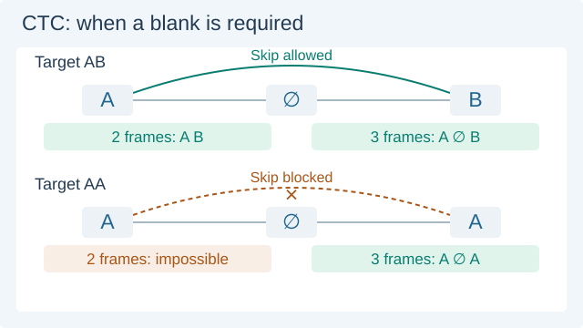

[GitHub-readable static preview](../../../assets/concept-animations/ctc-repeat-skip-still.svg)

For longer targets, the forward recursion also permits advancing by two states when the destination is nonblank and differs from the label two states earlier. The additional predecessor term is then $\alpha_{t-1}(s-2)$.[^ctc] The diagram isolates this local transition, omitting self-loops and the leading and trailing blanks. AB can be aligned in two frames, but AA needs at least three (A, blank, A); skipping the blank would merge both A labels. For a nonempty target of length $U$, the minimum feasible frame count is $U$ plus the number of adjacent equal label pairs. This is a feasibility condition, not a decoding heuristic.

Both animations use constructed examples rather than model measurements. Use the site's Play/Pause control and focus the diagram to scroll on narrow screens. Static previews preserve the final states. Original CC BY-SA 4.0 artwork.

### Forward-backward alignment posterior

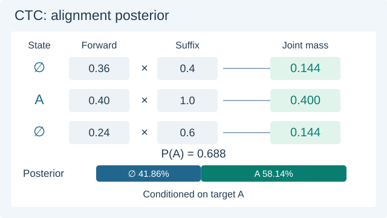

[GitHub-readable static preview](../../../assets/concept-animations/ctc-alignment-posterior-still.svg)

Training needs the distribution over alignments compatible with the target, not merely the framewise prediction. Let $\beta^+_t(s)$ be the suffix probability after frame $t$ given state $s$ (excluding the current emission). Then $\alpha_t(s)\beta^+_t(s)$ is the joint mass of compatible paths passing through that state. This convention excludes the duplicated current emission in the original paper's backward variable.[^ctc]

For the preceding three-frame target A example, frame two has forward masses $(0.36,0.40,0.24)$ and suffix probabilities $(0.4,1,0.6)$. Their products are $(0.144,0.400,0.144)$, summing to $P(A\mid x)=0.688$. Normalize by this total and sum over states emitting the same symbol: the posterior occupancy of A is $0.400/0.688\approx0.5814$ and blank is $0.288/0.688\approx0.4186$. The original frame probabilities were 0.4 and 0.6 respectively. For softmax logits, the gradient of the negative log-likelihood is frame probability minus posterior occupancy, so the A logit gradient here is about −0.1814. This is a soft alignment signal, not a hard frame label.

### Prefix decoding: repeated emissions have two destinations

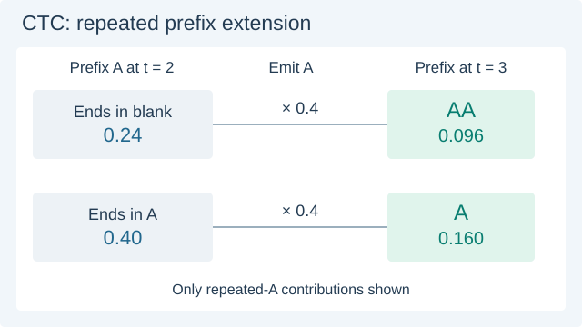

[GitHub-readable static preview](../../../assets/concept-animations/ctc-prefix-repeat-still.svg)

Prefix search groups paths by collapsed prefix but must distinguish their blank-ending and nonblank-ending masses. For the two-frame prefix A, these are 0.24 (A, blank) and 0.40 (blank, A or A, A). Appending A with probability 0.4 adds 0.096 to prefix AA from the blank-ending paths, but 0.160 to unchanged prefix A from the nonblank-ending paths. The same emitted label therefore has two distinct destinations. The diagram isolates these contributions, not the complete beam update: appending blank and extending the empty prefix also contribute to the next frame. Without pruning, the full third-frame masses are empty 0.216, A 0.688 and AA 0.096. Beam search merges contributions before ranking and pruning; the finite beam need not preserve all probability mass.[^ctc-prefix]

These are constructed examples, not recognizer measurements. On MkDocs use Play/Pause; focus the diagram to scroll on narrow screens. Static fallbacks show the final states. Original CC BY-SA 4.0 artwork.

[^ctc-prefix]: Hannun, A. Y., Maas, A. L., Jurafsky, D. & Ng, A. Y. (2014). First-pass large vocabulary continuous speech recognition using bi-directional recurrent DNNs. https://arxiv.org/abs/1408.2873

[^ctc]: Graves, A., Fernández, S., Gomez, F. & Schmidhuber, J. (2006). Connectionist temporal classification. ICML, section 3.1 and 4.1. https://doi.org/10.1145/1143844.1143891

## Self-supervised speech representations: wav2vec 2.0

### Masked context and unmasked targets

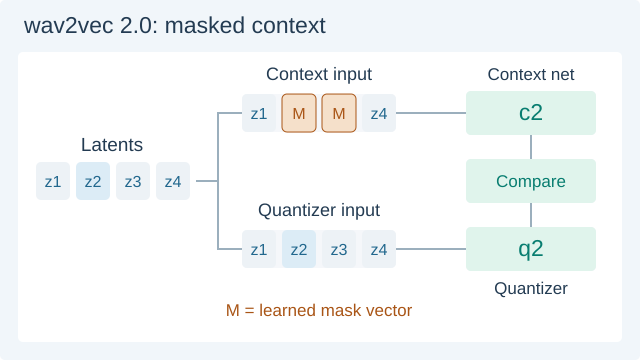

[GitHub-readable static preview](../../../assets/concept-animations/wav2vec-mask-target-still.svg)

The convolutional feature encoder produces latent vectors $z_t$. During pre-training, spans of these vectors are replaced by a shared learned mask vector before the Transformer context network, but the quantizer receives the original, unmasked vectors. In the illustrated example, positions two and three are masked in the context input, while the positive target $q_2$ still comes from $z_2$. The context representation $c_2$ is trained to distinguish its positive quantized target from distractors using cosine similarity and a contrastive loss. In the original paper, distractors are sampled from other masked positions of the same utterance; the diagram shows only the positive comparison, not all candidates or the diversity loss.[^wav2vec]

The split is at the feature-encoder output, not at raw waveform samples. Masking does not mean replacing the target with the mask vector. Both branches participate in the self-supervised training objective; this diagram is not a stop-gradient prescription. After pre-training, speech recognition fine-tuning uses the context network with a task-specific output projection and CTC loss.[^wav2vec]

### Product quantization: select, concatenate, project

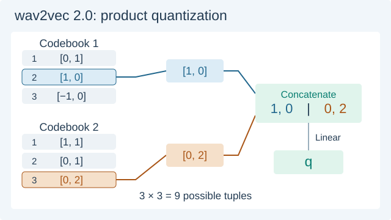

[GitHub-readable static preview](../../../assets/concept-animations/wav2vec-product-quantization-still.svg)

The quantizer selects one entry from each of $G$ learned codebooks, each containing $V$ entries, using hard Gumbel-softmax with a straight-through estimator during pre-training. It concatenates the selected vectors and applies a learned linear projection to obtain $q_t$. The schematic uses two codebooks with three entries each: selecting indices 2 and 3 (one-based) yields $(1,0)$ and $(0,2)$, hence the concatenated vector $(1,0,0,2)$. The projection output is not assigned a numeric value because no projection weights are specified.[^wav2vec]

There are $V^G$ possible index tuples (nine in the toy example). This is a combinatorial capacity, not the number of distinct projected vectors guaranteed by training or the number of observed speech units. Different tuples may coincide after projection; the diversity objective encourages codebook usage, but does not guarantee uniform usage of the joint tuples. The animation depicts hard selections and concatenation, not the Gumbel sampling or surrogate backward gradient.

Both diagrams use constructed examples, not model measurements. Use the site's Play/Pause control; focus the diagram to scroll on narrow screens. The static fallback shows the completed computation. Original CC BY-SA 4.0 artwork.

[^wav2vec]: Baevski, A., Zhou, H., Mohamed, A. & Auli, M. (2020). *wav2vec 2.0: A Framework for Self-Supervised Learning of Speech Representations*. NeurIPS, sections 2 and 3. https://arxiv.org/abs/2006.11477

### Contrastive loss: normalize over the candidate set

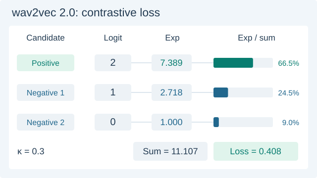

[GitHub-readable static preview](../../../assets/concept-animations/wav2vec-contrastive-normalization-still.svg)

For a masked position, the context representation is compared with its quantized positive and sampled distractors. For a toy cosine-similarity vector $(0.6,0.3,0)$ and contrastive temperature $\kappa=0.3$, the logits are $(2,1,0)$. Exponentiating and dividing by the shared sum gives $(0.6652,0.2447,0.0900)$ (rounded). The positive loss is $-\log(0.6652)\approx0.408$. The denominator includes the positive as well as both negatives. These are candidate probabilities at one masked position, not a distribution over the codebook or vocabulary. The contrastive temperature is distinct from the Gumbel-softmax temperature used in quantization.[^wav2vec]

### Diversity loss: entropy of the mean, not mean entropy

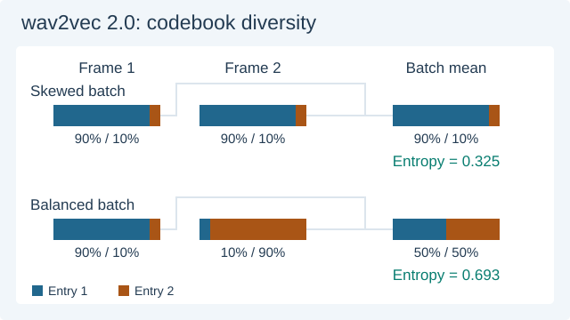

[GitHub-readable static preview](../../../assets/concept-animations/wav2vec-diversity-mean-still.svg)

The diversity objective encourages use of each codebook's entries by maximizing the entropy of its batch-averaged selection probabilities, computed from ordinary softmax logits without Gumbel noise or temperature scaling. For one codebook with two entries, compare two frames with probabilities $(0.9,0.1)$ and $(0.9,0.1)$ against two frames with $(0.9,0.1)$ and $(0.1,0.9)$. Both batches have identical per-frame entropy, but their means are $(0.9,0.1)$ and $(0.5,0.5)$, whose entropies are 0.325 and 0.693 nats respectively. The original paper's equation (4) minimizes negative entropy of the mean; its implementation instead uses a normalized perplexity deficit (footnote 2). The two forms favor uniform usage but are not numerically identical objectives. The diagram shows soft marginal probabilities, not counts of hard Gumbel selections or joint codebook combinations.[^wav2vec]

Both are constructed numerical examples, not model measurements. The moving dots represent complete row contributions, not individual sampled entries. Use Play/Pause on MkDocs; focus the diagram to scroll on narrow screens. Static fallbacks show completed computations. Original CC BY-SA 4.0 artwork.

### Feature encoder: receptive field versus hop

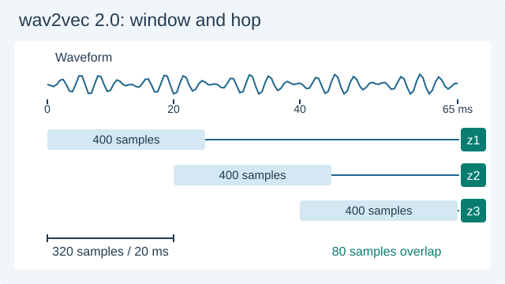

[GitHub-readable static preview](../../../assets/concept-animations/wav2vec-window-hop-still.svg)

The original seven convolutional layers use strides (5, 2, 2, 2, 2, 2, 2) and kernel widths (10, 3, 3, 3, 3, 2, 2). Their cumulative stride is 320 samples and their geometric convolutional receptive field is 400 samples, or 20 ms and 25 ms at 16 kHz respectively.[^wav2vec] Without padding or dilation, the illustrated 1,040-sample input yields three outputs with half-open support intervals [0,400), [320,720), [640,1040). Adjacent windows overlap by 80 samples. The scan reveals support geometry, not serial execution, streaming latency, or the full dependency of contextual representations; normalization may also couple positions. The waveform is synthetic.

### Span masking: overlap is counted once

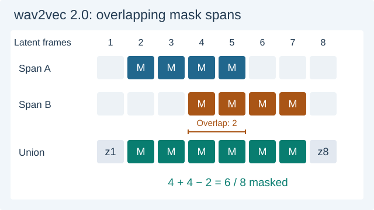

[GitHub-readable static preview](../../../assets/concept-animations/wav2vec-mask-overlap-still.svg)

The original method samples distinct start indices without replacement and masks consecutive latent time steps; spans may overlap.[^wav2vec] In this constructed eight-frame example, length-four spans start at positions 2 and 4 (one-based). Their intersection is positions 4 and 5; the union contains six frames rather than eight. The shared learned mask vector replaces each covered position once in the context input, while the quantizer input stays unmasked. The toy 75% coverage is not the original model's measured masking rate; the paper uses span length 10 and start proportion 0.065. The scanning order is illustrative, not an implementation constraint.

Both are schematic teaching examples, not model measurements. Use Play/Pause on MkDocs and focus the diagram for horizontal scrolling; the static fallback shows the completed state. Original CC BY-SA 4.0 artwork.

## Low-resource and code-switched speech

Most languages and dialects lack large transcribed corpora. Code-switching (mixing languages within a sentence) and regional languages (e.g. Taiwanese Hokkien, Hakka and Indigenous languages in Taiwan) are active research areas; Whisper-style models often need fine-tuning and post-processing for them.

## Auditory neuroscience

- The cochlea decomposes sound into frequencies (like a short-time Fourier transform); auditory cortex is **tonotopically** organised
- Deep networks trained on speech and music tasks predict human auditory-cortex responses and show a cortex-like hierarchy (Kell et al., 2018; Tuckute et al., 2023)
- Self-supervised speech models (wav2vec 2.0) align with the brain's speech-processing hierarchy (Millet et al., 2022)
- The **cocktail-party effect** — attending to one voice in a crowd — inspired source separation and attention research
- **Speech neuroprostheses** decode intended speech from motor cortex — see [Brain-Computer Interfaces](../../../brain-mind/bci/index.md)

## Ethical risks

Deepfake voice scams, cloning without consent, voice actors' rights. Countermeasures: audio watermarking, liveness detection, regulation (see [Law, Policy & Governance](../../../society/governance/index.md)).

## References

- Hannun, A. Y. et al. (2014). *First-Pass Large Vocabulary Continuous Speech Recognition using Bi-Directional Recurrent DNNs*. https://arxiv.org/abs/1408.2873 — Modified prefix-search decoding with separate blank and nonblank scores.
- Graves, A. et al. (2006). Connectionist temporal classification: labelling unsegmented sequence data with recurrent neural networks. *Proceedings of ICML 2006*. https://doi.org/10.1145/1143844.1143891 — Trains a recurrent network to align unsegmented audio with label sequences, the basis of many end-to-end recognisers.
- Hinton, G. et al. (2012). Deep neural networks for acoustic modeling in speech recognition: The shared views of four research groups. *IEEE Signal Processing Magazine*. https://doi.org/10.1109/MSP.2012.2205597 — Reviews how deep networks replaced Gaussian mixture models in acoustic modelling, with large error reductions.
- Chan, W. et al. (2015). *Listen, Attend and Spell*. arXiv:1508.01211. https://arxiv.org/abs/1508.01211 — End-to-end attention model that transcribes speech directly into characters.
- Baevski, A. et al. (2020). wav2vec 2.0: A Framework for Self-Supervised Learning of Speech Representations. *NeurIPS 2020*. https://arxiv.org/abs/2006.11477 — Learns speech representations from unlabelled audio and then fine-tunes them with little labelled data, which matters for low-resource languages.
- Radford, A. et al. (2022). *Robust Speech Recognition via Large-Scale Weak Supervision*. arXiv:2212.04356. https://arxiv.org/abs/2212.04356 — Whisper: trains on large amounts of weakly labelled multilingual audio for robust transcription and translation.

## Further learning

- [SpeechBrain](https://speechbrain.github.io/), [ESPnet](https://github.com/espnet/espnet) and [NeMo](https://github.com/NVIDIA/NeMo) — open-source speech toolkits.
- [Hugging Face Audio Course](https://huggingface.co/learn/audio-course) — hands-on course on audio models.
