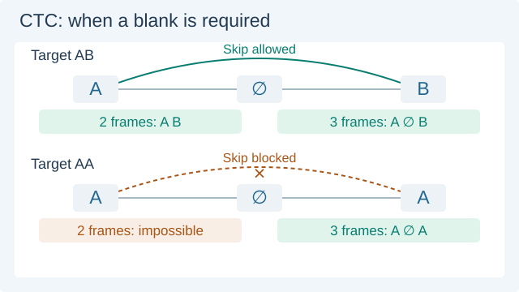
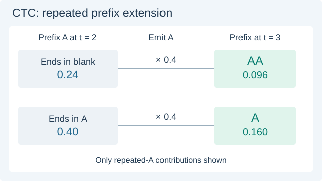
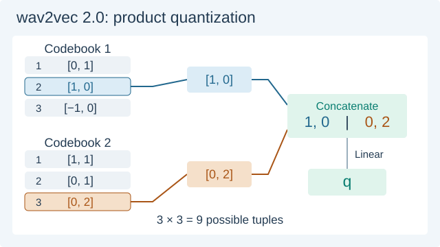
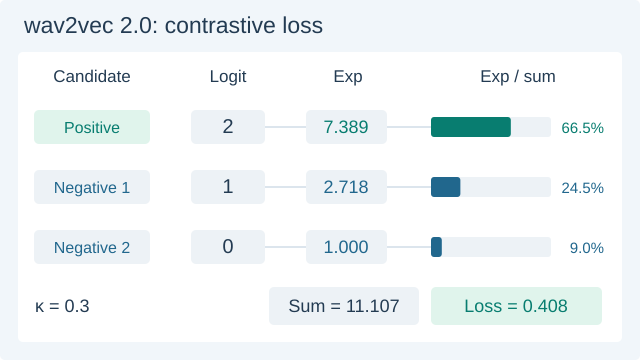
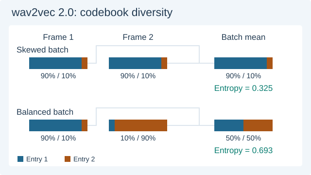
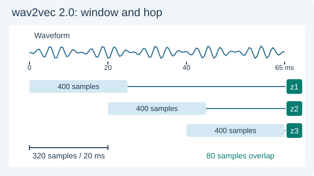
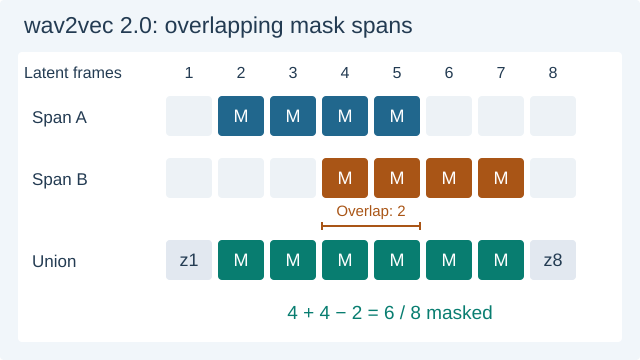
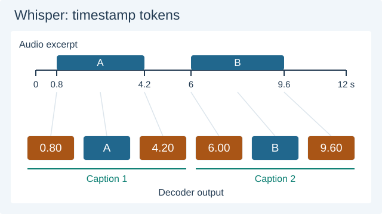
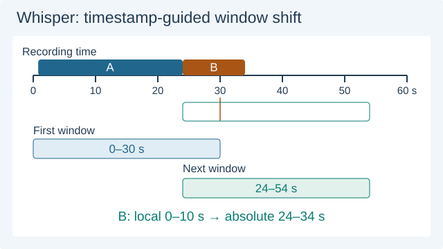

# 語音與音訊

## 任務

| 任務 | 說明 | 代表模型／工具 |
|---|---|---|
| 自動語音辨識 ASR | 語音 → 文字 | Whisper、wav2vec 2.0、Conformer、Paraformer |
| 語音合成 TTS | 文字 → 語音 | Tacotron、FastSpeech、VITS、神經編解碼器語言模型（VALL-E 類） |
| 語音轉換 / 聲音複製 | 改變說話者音色 | RVC、零樣本 TTS |
| 說話者辨識與分離 | 誰在說話、何時說 | pyannote |
| 語音增強 | 降噪、去迴響 | Demucs 等 |
| 音樂生成 | 文字或旋律 → 音樂 | MusicLM、MusicGen、Suno、Udio 等 |
| 音源分離 | 分離人聲、樂器 | Demucs |
| 聲音事件偵測 | 槍聲、玻璃破裂、鳥鳴 | PANNs、BirdNET |
| 語音對話模型 | 端到端即時語音對話 | GPT-4o 類全模態模型、Moshi |

## 技術要點

- **特徵**：梅爾頻譜、MFCC；或直接從波形學（wav2vec）
- **神經音訊編解碼器**：EnCodec、SoundStream 把音訊壓縮成離散 token，讓語言模型能「說話」與「作曲」
- **端到端語音 LLM**：不經過文字轉換，直接處理語音 token，保留語調與情緒，延遲更低
- **聲碼器**：WaveNet → HiFi-GAN → 編解碼器解碼

## 語音辨識中的影格對齊

連結式時間分類（Connectionist Temporal Classification，CTC）不需要逐一標註每個編碼器影格，就能計算轉錄序列的機率。路徑的符號集合包含標籤與特殊空白符號（∅）；折疊映射先合併連續重複的符號，再移除空白符號。[^ctc]

[GitHub 可讀靜態預覽](../../../assets/concept-animations/ctc-collapse-scan-still.svg)

移動的訊號代表輸出標籤送至轉錄序列。第二個影格重複 A，因此不輸出；第三個影格的空白隔開前後兩段 A。若先移除空白再合併重複標籤，會錯誤得到 AB。空白不是分詞符號，也不是實際輸出的字元。

### 為什麼貪婪解碼不一定得到最可能的轉錄序列

[GitHub 可讀靜態預覽](../../../assets/concept-animations/ctc-path-mass-still.svg)

設定兩個影格各自對空白給予 0.6 的機率、對 A 給予 0.4 的機率。給定輸入，CTC 將路徑上的影格機率相乘，並加總所有折疊成相同轉錄序列的路徑機率。[^ctc] 四條路徑的機率分別為 0.36、0.24、0.24、0.16。逐影格貪婪解碼選擇雙空白，產生空轉錄序列；然而三條對應 A 的路徑機率相加為 0.64，高於空轉錄序列的 0.36。動畫在訊號抵達時累加精確的路徑機率；中途的累積值尚不是正規化的轉錄機率分布。實際 CTC 訓練採前向－後向動態規劃，而非列舉路徑；解碼則可採用前綴束搜尋（prefix beam search）。

兩圖皆為人工教學算例，**不是語音辨識模型實測值**。在 MkDocs 網站可使用既有播放／暫停控制；窄螢幕可聚焦圖示後水平捲動。GitHub 與減少動態效果的使用者可閱讀靜態回退圖。原創圖示，CC BY-SA 4.0。

### 前向遞迴：不列舉路徑即可加總相容對齊

[GitHub 可讀靜態預覽](../../../assets/concept-animations/ctc-forward-lattice-still.svg)

以 A 為目標，將狀態序列擴充為（空白、A、空白）。每個影格的空白機率為 0.6、A 機率為 0.4，初始前向機率質量為（0.6、0.4、0）。此算例的轉移可停留於原狀態或前進一個狀態。採從零開始的狀態索引，每一個新機率質量為：[^ctc]

$
\alpha_t(s)=p_t(l'_s)\big(\alpha_{t-1}(s)+\alpha_{t-1}(s-1)\big).
$

超出索引範圍的狀態貢獻為零。例如第三個影格的 A 狀態接收 $(0.36+0.4)0.4=0.304$；後置空白接收 $(0.4+0.24)0.6=0.384$。前置空白代表尚未完成的對齊，因此不計入最後的目標機率：$P(A\mid x)=0.304+0.384=0.688$。移動圓點代表前驅狀態的貢獻，而非等權重路徑；訊號抵達後才更新數值。這些未剪枝的前綴機率質量不必加總為一，因為不相容的路徑已被排除。

### 重複標籤與跳躍轉移

[GitHub 可讀靜態預覽](../../../assets/concept-animations/ctc-repeat-skip-still.svg)

對較長的目標序列，若目的狀態非空白，且與前兩個狀態的標籤不同，前向遞迴也允許一次前進兩個狀態，額外加入前驅項 $\alpha_{t-1}(s-2)$。[^ctc] 圖示只呈現此局部轉移，省略自迴圈、前置與後置空白。AB 可以用兩個影格完成對齊；AA 至少需要三個影格（A、空白、A），否則兩個 A 會在折疊時合併。非空目標長度為 $U$ 時，最少可行影格數為 $U$ 加上相鄰相同標籤對的數量。這是對齊可行性的條件，而非解碼啟發式規則。

兩圖皆為人工算例而非模型實測值。使用網站的播放／暫停控制，窄螢幕可聚焦圖示後水平捲動；靜態預覽保留最終狀態。原創圖示，CC BY-SA 4.0。

### 前向－後向對齊後驗機率

[GitHub 可讀靜態預覽](../../../assets/concept-animations/ctc-alignment-posterior-still.svg)

訓練需要與目標相容的對齊分布，而不只是逐影格的預測。令 $\beta^+_t(s)$ 為在狀態 $s$ 下第 $t$ 個影格之後的後綴機率（不含當前影格的輸出機率），則 $\alpha_t(s)\beta^+_t(s)$ 為通過該狀態的相容路徑聯合機率質量。此定義排除了原始論文後向變數中重複計入的當前影格輸出機率。[^ctc]

沿用前三個影格、目標 A 的算例，第二個影格的前向機率質量為 $(0.36,0.40,0.24)$，後綴機率為 $(0.4,1,0.6)$，相乘得到 $(0.144,0.400,0.144)$，總和為 $P(A\mid x)=0.688$。以總和正規化，並加總輸出相同符號的狀態：A 的後驗佔用機率為 $0.400/0.688\approx0.5814$，空白為 $0.288/0.688\approx0.4186$。原始影格機率分別為 0.4 與 0.6。對 softmax logits，負對數概似的梯度為影格機率減去後驗佔用機率，因此此處 A 的 logit 梯度約為 −0.1814。這是軟性對齊訊號，不是固定的影格標籤。

### 前綴解碼：重複輸出的兩種目的狀態

[GitHub 可讀靜態預覽](../../../assets/concept-animations/ctc-prefix-repeat-still.svg)

前綴搜尋依折疊後的前綴合併路徑，但必須區分以空白與非空白結尾的機率質量。雙影格前綴 A 的兩者分別為 0.24（A、空白）及 0.40（空白、A 或 A、A）。下一個影格以 0.4 的機率輸出 A 時，空白結尾路徑向前綴 AA 貢獻 0.096，而非空白結尾路徑向維持不變的前綴 A 貢獻 0.160。同一輸出標籤因此具有兩種目的狀態。圖示只呈現這兩項貢獻，而非完整的束搜尋更新：追加空白與延伸空前綴也會貢獻下一個影格的機率質量。未剪枝時，第三個影格的完整機率質量為空序列 0.216、A 為 0.688、AA 為 0.096。束搜尋先合併貢獻再排序與剪枝；有限的束寬不一定保留全部機率質量。[^ctc-prefix]

兩圖皆為人工算例，非模型實測值。MkDocs 網站可使用播放／暫停控制；窄螢幕可聚焦圖示後水平捲動。靜態回退圖保留最終狀態。原創圖示，CC BY-SA 4.0。

[^ctc-prefix]: Hannun, A. Y., Maas, A. L., Jurafsky, D. & Ng, A. Y. (2014). First-pass large vocabulary continuous speech recognition using bi-directional recurrent DNNs. https://arxiv.org/abs/1408.2873

[^ctc]: Graves, A., Fernández, S., Gomez, F. & Schmidhuber, J. (2006). Connectionist temporal classification. ICML，第 3.1 與 4.1 節。https://doi.org/10.1145/1143844.1143891

## 自監督語音表徵：wav2vec 2.0

### 遮罩上下文與未遮罩目標

[GitHub 可讀靜態預覽](../../../assets/concept-animations/wav2vec-mask-target-still.svg)

卷積特徵編碼器產生潛在向量 $z_t$。預訓練時，將部分連續位置替換為共用的可學習遮罩向量，再送入 Transformer 上下文網路；量化器仍接收未遮罩的原始向量。圖中上下文輸入的第二、第三個位置被遮罩，但正例目標 $q_2$ 仍由 $z_2$ 產生。透過餘弦相似度與對比損失，訓練上下文表徵 $c_2$ 區分正例量化目標及干擾候選。原始論文從同一段語音中其他被遮罩的位置抽取干擾候選；圖中僅呈現正例比較，未畫出全部候選或多樣性損失。[^wav2vec]

分支發生於特徵編碼器的輸出端，而非原始波形的取樣點。遮罩不代表將目標替換成遮罩向量。兩個分支均參與自監督訓練目標；圖示並非指定停止梯度的策略。預訓練完成後，語音辨識微調使用上下文網路、任務專屬的輸出投影及 CTC 損失。[^wav2vec]

### 乘積量化：選取、串接、投影

[GitHub 可讀靜態預覽](../../../assets/concept-animations/wav2vec-product-quantization-still.svg)

量化器在 $G$ 個可學習碼本中各選一筆向量，每個碼本有 $V$ 個項目；預訓練使用硬式 Gumbel-softmax 搭配直通估計器（straight-through estimator）。將選取的向量串接，再經過可學習的線性投影得到 $q_t$。圖中兩個碼本各有三個項目，分別選取索引 2、3（從一開始），得到 $(1,0)$ 與 $(0,2)$，串接後為 $(1,0,0,2)$。因未指定投影權重，圖中不提供投影後的數值。[^wav2vec]

可能的索引組合數為 $V^G$（此算例為九種）。這是組合容量，不代表訓練必然產生相同數量的相異投影向量或實際觀察到的語音單元。不同組合經投影後可能相同；多樣性目標鼓勵使用各碼本，但不保證聯合組合的均勻使用。動畫呈現硬式選取及串接，不包含 Gumbel 取樣或替代反向梯度。

兩圖皆為人工算例，非模型實測值。MkDocs 網站可使用播放／暫停控制；窄螢幕可聚焦圖示後水平捲動。靜態回退圖呈現完成運算的狀態。原創圖示，CC BY-SA 4.0。

[^wav2vec]: Baevski, A., Zhou, H., Mohamed, A. & Auli, M. (2020). *wav2vec 2.0: A Framework for Self-Supervised Learning of Speech Representations*. NeurIPS，第 2 與第 3 節。https://arxiv.org/abs/2006.11477

### 對比損失：在候選集合內正規化

[GitHub 可讀靜態預覽](../../../assets/concept-animations/wav2vec-contrastive-normalization-still.svg)

對被遮罩的位置，將上下文表徵與量化正例及抽樣的干擾候選比較。人工算例的餘弦相似度為 $(0.6,0.3,0)$，對比溫度 $\kappa=0.3$，因此 logits 為 $(2,1,0)$。取指數後除以共同總和，得到機率 $(0.6652,0.2447,0.0900)$（四捨五入）。正例損失為 $-\log(0.6652)\approx0.408$。分母包含正例及兩個負例。這是一個被遮罩位置的候選機率，而非碼本或詞彙表的機率分布。對比溫度與量化時的 Gumbel-softmax 溫度不同。[^wav2vec]

### 多樣性損失：平均分布的熵，而非熵的平均

[GitHub 可讀靜態預覽](../../../assets/concept-animations/wav2vec-diversity-mean-still.svg)

多樣性目標藉由最大化各碼本的批次平均選取機率分布的熵，鼓勵使用各個項目。這些機率由一般 softmax 計算，不加入 Gumbel 雜訊或溫度縮放。以單一碼本、兩個項目為例，比較兩個影格皆為 $(0.9,0.1)$ 的批次，以及兩個影格分別為 $(0.9,0.1)$、$(0.1,0.9)$ 的批次。兩批次的逐影格熵相同，但平均分布分別為 $(0.9,0.1)$、$(0.5,0.5)$，熵分別為 0.325、0.693 nat。原始論文式（4）最小化平均分布的負熵，實作則採正規化的困惑度缺額（註 2）。兩者皆鼓勵均勻使用，但並非數值相同的目標函數。圖中呈現軟性邊際機率，而非硬式 Gumbel 選取次數或聯合碼本組合。[^wav2vec]

兩圖皆為人工數值算例，非模型實測值。移動圓點代表整列分布的運算貢獻，不是個別抽樣項目。MkDocs 可使用播放／暫停控制；窄螢幕可聚焦圖示後水平捲動。靜態回退圖保留完成運算的狀態。原創圖示，CC BY-SA 4.0。

### 特徵編碼器：感受野與影格間距

[GitHub 可讀靜態預覽](../../../assets/concept-animations/wav2vec-window-hop-still.svg)

原始七層卷積的步幅為 (5, 2, 2, 2, 2, 2, 2)，核寬為 (10, 3, 3, 3, 3, 2, 2)。累積步幅為 320 個取樣點，幾何卷積感受野為 400 個取樣點；在 16 kHz 下分別為 20 ms 與 25 ms。[^wav2vec] 在無填補、無膨脹的情況下，圖中 1,040 個取樣點產生三個輸出，半開支撐區間為 [0,400)、[320,720)、[640,1040)，相鄰視窗重疊 80 個取樣點。掃描呈現卷積支撐範圍，不代表循序執行、串流延遲或上下文表徵的完整依賴範圍；正規化也可能耦合不同位置。波形為人工示意。

### 區段遮罩：重疊位置僅計算一次

[GitHub 可讀靜態預覽](../../../assets/concept-animations/wav2vec-mask-overlap-still.svg)

原始方法不放回地抽取不同的起始索引，並遮罩連續的潛在時間步；區段允許重疊。[^wav2vec] 在此八影格人工算例中，兩個長度為四的區段分別從第 2、4 個位置開始（索引從一開始）。交集為第 4、5 個位置，因此聯集只有六個影格，而非八個。上下文輸入的每個涵蓋位置只替換一次，共用同一個可學習遮罩向量；量化器輸入仍保持未遮罩。此例 75% 的覆蓋率並非原始模型實測遮罩比例；原始論文使用長度 10 及起始位置比例 0.065。逐步掃描為教學示意，並非實作限制。

兩圖皆為教學示意，非模型實測。MkDocs 可使用播放／暫停控制，聚焦圖形可水平捲動；靜態回退呈現完成狀態。原創圖形採 CC BY-SA 4.0 授權。

## Whisper：時間戳記條件式轉錄

### 交錯產生時間戳記與文字

[GitHub 可讀靜態預覽](../../../assets/concept-animations/whisper-timestamp-interleave-still.svg)

不同於 CTC 的影格折疊，Whisper 採用編碼器－解碼器 Transformer，根據編碼後的音訊與先前解碼 token 自回歸產生輸出。時間戳記模式的詞彙表包含以當前音訊視窗為基準、間隔 20 ms 的時間 token；每段完整字幕依序包含開始時間、文字 token 與結束時間。[^whisper-timing] 橘色為時間戳記，藍色為字幕文字（A、B 代表任意 token 子序列）。例如 0.80 秒與 4.20 秒對應時間網格索引 40、210，而非絕對詞彙表 ID。移動圓點呈現輸出順序，並非實測注意力對齊、聽到語音的時刻或實際輸出延遲。圖中省略語言／任務前綴與轉錄結束 token。

### 長音訊：依時間戳記移動視窗

[GitHub 可讀靜態預覽](../../../assets/concept-animations/whisper-window-seek-still.svg)

原始方法處理長音訊時，以預測的時間戳記決定下一個 30 秒視窗的位置。在時間戳記模式的訓練格式中，跨出視窗的字幕僅標示開始時間，不包含部分字幕文字。[^whisper-timing] 人工算例中，字幕 A 於錄音第 24 秒結束，B 涵蓋第 24–34 秒。第一個視窗為 [0,30)，無法完整涵蓋 B。將視窗起點向後移動 24 秒，得到 [24,54)，與第一個視窗重疊 6 秒。此時 B 已完整涵蓋；其相對時間 0、10 秒加上新視窗起點 24 秒，即得到絕對時間 24、34 秒。移動框呈現視窗重新定位，而非連續執行模型推論。實際解碼的時間戳記可能有誤，並會使用其他啟發式策略；移動量不固定為 24 秒，也不一定總有重疊。

兩圖皆為教學算例，非辨識模型實測值。MkDocs 可使用播放／暫停控制；窄螢幕可聚焦圖示後水平捲動。靜態回退呈現完成狀態。原創圖示採 CC BY-SA 4.0 授權。

[^whisper-timing]: Radford, A. et al. (2022). *Robust Speech Recognition via Large-Scale Weak Supervision*. https://arxiv.org/abs/2212.04356 — 正式出版版本第 2.2–2.3 節與附錄 A。

## 台灣與華語語音

- 台語、客語、原住民族語辨識與合成：教育部、中研院、台大等計畫，以及「台灣媠聲」、意傳科技等
- 中英夾雜（code-switching）是在地語音辨識的難題
- Whisper 對繁中輸出常混入簡體，常需後處理或微調

## 與聽覺神經科學

- 耳蝸將聲音分解成頻率成分（類似短時傅立葉轉換），聽覺皮質具有音調拓撲（tonotopy）
- 以語音任務訓練的深度網路能預測人類聽覺皮質的反應，且呈現與皮質相似的階層（Kell et al., 2018；Li et al., 2023）
- 自監督語音模型（wav2vec 2.0）的表徵與人腦語音處理階層對齊（Millet et al., 2022）
- **雞尾酒會效應**：人類能在吵雜環境中專注於一個說話者，啟發了音源分離與注意力研究
- **語音神經義肢**：從運動皮質解碼想說的話，見 [腦機介面](../../../brain-mind/bci/index.md)

## 倫理風險

深偽語音詐騙、未經同意的聲音複製、配音員權益。對策：語音浮水印、活體偵測、法規（見 [法規與治理](../../../society/governance/index.md)）。

## 學習資源

- Hugging Face Audio Course
- [SpeechBrain](https://speechbrain.github.io/)、[ESPnet](https://github.com/espnet/espnet)、[NeMo](https://github.com/NVIDIA/NeMo)
- 李宏毅《Deep Learning for Human Language Processing》
