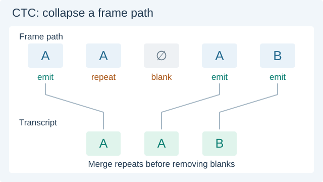
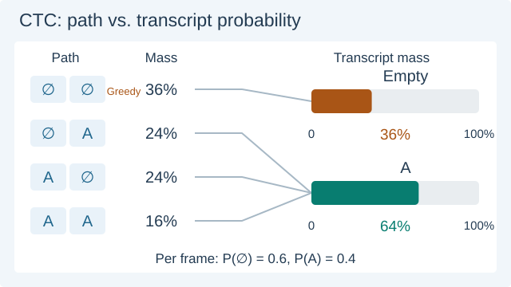
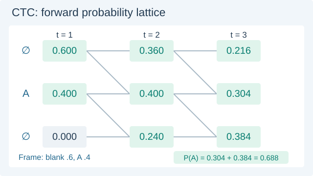
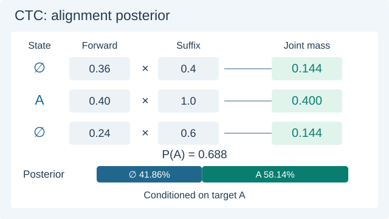

# 語音與音訊

## 任務

| 任務 | 說明 | 代表模型／工具 |
|---|---|---|
| 自動語音辨識 ASR | 語音 → 文字 | Whisper、wav2vec 2.0、Conformer、Paraformer |
| 語音合成 TTS | 文字 → 語音 | Tacotron、FastSpeech、VITS、神經編解碼器語言模型（VALL-E 類） |
| 語音轉換 / 聲音複製 | 改變說話者音色 | RVC、零樣本 TTS |
| 說話者辨識與分離 | 誰在說話、何時說 | pyannote |
| 語音增強 | 降噪、去迴響 | Demucs 等 |
| 音樂生成 | 文字或旋律 → 音樂 | MusicLM、MusicGen、Suno、Udio 等 |
| 音源分離 | 分離人聲、樂器 | Demucs |
| 聲音事件偵測 | 槍聲、玻璃破裂、鳥鳴 | PANNs、BirdNET |
| 語音對話模型 | 端到端即時語音對話 | GPT-4o 類全模態模型、Moshi |

## 技術要點

- **特徵**：梅爾頻譜、MFCC；或直接從波形學（wav2vec）
- **神經音訊編解碼器**：EnCodec、SoundStream 把音訊壓縮成離散 token，讓語言模型能「說話」與「作曲」
- **端到端語音 LLM**：不經過文字轉換，直接處理語音 token，保留語調與情緒，延遲更低
- **聲碼器**：WaveNet → HiFi-GAN → 編解碼器解碼

## 語音辨識中的影格對齊

連結式時間分類（Connectionist Temporal Classification，CTC）不需要逐一標註每個編碼器影格，就能計算轉錄序列的機率。路徑的符號集合包含標籤與特殊空白符號（∅）；折疊映射先合併連續重複的符號，再移除空白符號。[^ctc]

[GitHub 可讀靜態預覽](../../../assets/concept-animations/ctc-collapse-scan-still.svg)

移動的訊號代表輸出標籤送至轉錄序列。第二個影格重複 A，因此不輸出；第三個影格的空白隔開前後兩段 A。若先移除空白再合併重複標籤，會錯誤得到 AB。空白不是分詞符號，也不是實際輸出的字元。

### 為什麼貪婪解碼不一定得到最可能的轉錄序列

[GitHub 可讀靜態預覽](../../../assets/concept-animations/ctc-path-mass-still.svg)

設定兩個影格各自對空白給予 0.6 的機率、對 A 給予 0.4 的機率。給定輸入，CTC 將路徑上的影格機率相乘，並加總所有折疊成相同轉錄序列的路徑機率。[^ctc] 四條路徑的機率分別為 0.36、0.24、0.24、0.16。逐影格貪婪解碼選擇雙空白，產生空轉錄序列；然而三條對應 A 的路徑機率相加為 0.64，高於空轉錄序列的 0.36。動畫在訊號抵達時累加精確的路徑機率；中途的累積值尚不是正規化的轉錄機率分布。實際 CTC 訓練採前向－後向動態規劃，而非列舉路徑；解碼則可採用前綴束搜尋（prefix beam search）。

兩圖皆為人工教學算例，**不是語音辨識模型實測值**。在 MkDocs 網站可使用既有播放／暫停控制；窄螢幕可聚焦圖示後水平捲動。GitHub 與減少動態效果的使用者可閱讀靜態回退圖。原創圖示，CC BY-SA 4.0。

### 前向遞迴：不列舉路徑即可加總相容對齊

[GitHub 可讀靜態預覽](../../../assets/concept-animations/ctc-forward-lattice-still.svg)

以 A 為目標，將狀態序列擴充為（空白、A、空白）。每個影格的空白機率為 0.6、A 機率為 0.4，初始前向機率質量為（0.6、0.4、0）。此算例的轉移可停留於原狀態或前進一個狀態。採從零開始的狀態索引，每一個新機率質量為：[^ctc]

$
\alpha_t(s)=p_t(l'_s)\big(\alpha_{t-1}(s)+\alpha_{t-1}(s-1)\big).
$

超出索引範圍的狀態貢獻為零。例如第三個影格的 A 狀態接收 $(0.36+0.4)0.4=0.304$；後置空白接收 $(0.4+0.24)0.6=0.384$。前置空白代表尚未完成的對齊，因此不計入最後的目標機率：$P(A\mid x)=0.304+0.384=0.688$。移動圓點代表前驅狀態的貢獻，而非等權重路徑；訊號抵達後才更新數值。這些未剪枝的前綴機率質量不必加總為一，因為不相容的路徑已被排除。

### 重複標籤與跳躍轉移

[GitHub 可讀靜態預覽](../../../assets/concept-animations/ctc-repeat-skip-still.svg)

對較長的目標序列，若目的狀態非空白，且與前兩個狀態的標籤不同，前向遞迴也允許一次前進兩個狀態，額外加入前驅項 $\alpha_{t-1}(s-2)$。[^ctc] 圖示只呈現此局部轉移，省略自迴圈、前置與後置空白。AB 可以用兩個影格完成對齊；AA 至少需要三個影格（A、空白、A），否則兩個 A 會在折疊時合併。非空目標長度為 $U$ 時，最少可行影格數為 $U$ 加上相鄰相同標籤對的數量。這是對齊可行性的條件，而非解碼啟發式規則。

兩圖皆為人工算例而非模型實測值。使用網站的播放／暫停控制，窄螢幕可聚焦圖示後水平捲動；靜態預覽保留最終狀態。原創圖示，CC BY-SA 4.0。

### 前向－後向對齊後驗機率

[GitHub 可讀靜態預覽](../../../assets/concept-animations/ctc-alignment-posterior-still.svg)

訓練需要與目標相容的對齊分布，而不只是逐影格的預測。令 $\beta^+_t(s)$ 為在狀態 $s$ 下第 $t$ 個影格之後的後綴機率（不含當前影格的輸出機率），則 $\alpha_t(s)\beta^+_t(s)$ 為通過該狀態的相容路徑聯合機率質量。此定義排除了原始論文後向變數中重複計入的當前影格輸出機率。[^ctc]

沿用前三個影格、目標 A 的算例，第二個影格的前向機率質量為 $(0.36,0.40,0.24)$，後綴機率為 $(0.4,1,0.6)$，相乘得到 $(0.144,0.400,0.144)$，總和為 $P(A\mid x)=0.688$。以總和正規化，並加總輸出相同符號的狀態：A 的後驗佔用機率為 $0.400/0.688\approx0.5814$，空白為 $0.288/0.688\approx0.4186$。原始影格機率分別為 0.4 與 0.6。對 softmax logits，負對數概似的梯度為影格機率減去後驗佔用機率，因此此處 A 的 logit 梯度約為 −0.1814。這是軟性對齊訊號，不是固定的影格標籤。

### 前綴解碼：重複輸出的兩種目的狀態

[GitHub 可讀靜態預覽](../../../assets/concept-animations/ctc-prefix-repeat-still.svg)

前綴搜尋依折疊後的前綴合併路徑，但必須區分以空白與非空白結尾的機率質量。雙影格前綴 A 的兩者分別為 0.24（A、空白）及 0.40（空白、A 或 A、A）。下一個影格以 0.4 的機率輸出 A 時，空白結尾路徑向前綴 AA 貢獻 0.096，而非空白結尾路徑向維持不變的前綴 A 貢獻 0.160。同一輸出標籤因此具有兩種目的狀態。圖示只呈現這兩項貢獻，而非完整的束搜尋更新：追加空白與延伸空前綴也會貢獻下一個影格的機率質量。未剪枝時，第三個影格的完整機率質量為空序列 0.216、A 為 0.688、AA 為 0.096。束搜尋先合併貢獻再排序與剪枝；有限的束寬不一定保留全部機率質量。[^ctc-prefix]

兩圖皆為人工算例，非模型實測值。MkDocs 網站可使用播放／暫停控制；窄螢幕可聚焦圖示後水平捲動。靜態回退圖保留最終狀態。原創圖示，CC BY-SA 4.0。

[^ctc-prefix]: Hannun, A. Y., Maas, A. L., Jurafsky, D. & Ng, A. Y. (2014). First-pass large vocabulary continuous speech recognition using bi-directional recurrent DNNs. https://arxiv.org/abs/1408.2873

[^ctc]: Graves, A., Fernández, S., Gomez, F. & Schmidhuber, J. (2006). Connectionist temporal classification. ICML，第 3.1 與 4.1 節。https://doi.org/10.1145/1143844.1143891

## 台灣與華語語音

- 台語、客語、原住民族語辨識與合成：教育部、中研院、台大等計畫，以及「台灣媠聲」、意傳科技等
- 中英夾雜（code-switching）是在地語音辨識的難題
- Whisper 對繁中輸出常混入簡體，常需後處理或微調

## 與聽覺神經科學

- 耳蝸將聲音分解成頻率成分（類似短時傅立葉轉換），聽覺皮質具有音調拓撲（tonotopy）
- 以語音任務訓練的深度網路能預測人類聽覺皮質的反應，且呈現與皮質相似的階層（Kell et al., 2018；Li et al., 2023）
- 自監督語音模型（wav2vec 2.0）的表徵與人腦語音處理階層對齊（Millet et al., 2022）
- **雞尾酒會效應**：人類能在吵雜環境中專注於一個說話者，啟發了音源分離與注意力研究
- **語音神經義肢**：從運動皮質解碼想說的話，見 [腦機介面](../../../brain-mind/bci/index.md)

## 倫理風險

深偽語音詐騙、未經同意的聲音複製、配音員權益。對策：語音浮水印、活體偵測、法規（見 [法規與治理](../../../society/governance/index.md)）。

## 學習資源

- Hugging Face Audio Course
- [SpeechBrain](https://speechbrain.github.io/)、[ESPnet](https://github.com/espnet/espnet)、[NeMo](https://github.com/NVIDIA/NeMo)
- 李宏毅《Deep Learning for Human Language Processing》
