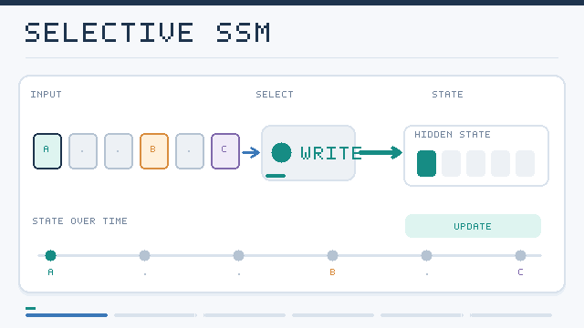

---
related:
- theory/models/transformer
aliases:
  - Selective State Spaces
  - Mamba
  - Selective Scan
  - 選擇性狀態空間
tags:
  - state-space models
  - selection
  - efficient sequence modelling
last_reviewed: 2026-10-28
---

# Selective State Spaces

A selective state-space model lets its parameters depend on the current input, so that the state can keep some information and discard the rest based on content. Earlier linear state-space models apply the same dynamics to every token, which means they cannot choose what to remember. Mamba showed that making the step size and the input and output matrices input-dependent gives a model that can select relevant content, and a hardware-aware scan keeps training efficient despite the loss of convolution form.

## Core idea

In a selective model, the discretisation step and the projections that read and write the state are computed from the input at each position. A large step size resets the state towards the current token, while a small one keeps the old state. The model can therefore learn to ignore filler and retain the tokens that matter, a behaviour that attention achieves by comparing keys and queries.

*Original animated schematic, CC BY-SA 4.0.* Relevant inputs are shown updating a **fixed-size recurrent state**, while filler inputs leave the illustrated state approximately unchanged. The **WRITE / KEEP** labels simplify Mamba's continuous, input-dependent state-space update: the discretisation step and input/output projections are functions of each token, not literal binary gates. The coloured state slots and token sequence are **illustrative, not measured activations**. See [Gu & Dao (2023)](https://arxiv.org/abs/2312.00752).

## Approaches

### Mamba

Gu and Dao (2023) introduced the selective scan. Because the parameters vary over time, the convolutional shortcut of earlier SSMs is no longer valid, so Mamba computes the recurrence with a parallel scan in fast on-chip memory, avoiding materialising the full state for every token. The model reports language modelling quality comparable with Transformers of similar size, with linear cost in sequence length and constant memory per generated token.

### Mamba-2 and structured duality

Dao and Gu (2024) showed that a restricted form of selective SSM, with a scalar state transition per head, is equivalent to a form of structured masked attention. This duality lets the same computation be written as matrix multiplications, which run efficiently on modern accelerators, and it clarifies how SSMs relate to attention.

### Hybrid models

Several language models interleave selective SSM blocks with attention blocks, keeping a few attention layers for exact recall while using SSM layers for most of the depth. The mixture of layer types is chosen empirically, and the best ratio depends on the task.

## Key methods

| Method | Year | Core idea | Page |
|---|---|---|---|
| Mamba | 2023 | Input-dependent parameters with a hardware-aware parallel scan | [Mamba](mamba/index.md) |
| Mamba-2 | 2024 | Structured state-space duality, linking selective SSMs to attention | [Mamba-2](mamba-2/index.md) |

## Trade-offs

- **Selection versus simplicity.** Input-dependent dynamics are more expressive, but they need the more complex parallel scan and cannot use the simple convolution.
- **Recall.** Selection helps, but a fixed-size state still compresses history, so exact retrieval of many earlier items remains weaker than with attention.
- **Hardware.** Speed depends on careful kernel design, which limits how quickly new variants can be adopted.

## Connections

Selective SSMs are the input-dependent side of the [state-space](../index.md) family, and they answer the gating question raised by the [gated cells](../../rnn/gated-cells/index.md) in the RNN family. The duality with attention links them to the [attention variants](../../transformer/attention-variants/index.md) page.

## Open issues and further variants

- **Recall limits.** Whether selective SSMs can match attention on tasks that need exact recall of many items, without hybrids, is still being tested.
- **What is selected.** Learned selection works well empirically, but the criteria it learns are hard to inspect.
- **Scaling laws.** How selective SSMs scale with data and compute compared with Transformers is an active area of measurement.

## References

### Seminal papers

- Gu, A. & Dao, T. (2023). "Mamba: Linear-Time Sequence Modeling with Selective State Spaces". arXiv:2312.00752 — Input-dependent state-space parameters, computed with a hardware-aware parallel scan.
- Gu, A., et al. (2020). "HiPPO: Recurrent Memory with Optimal Polynomial Projections". arXiv:2008.07669 — Polynomial projection framework that supplies the state matrices behind the S4 lineage.

### Surveys and textbooks

(none checked for this page)

### Lectures and videos

(none checked for this page)

### Articles and documentation

- Dao, T. & Gu, A. (2024). "Transformers are SSMs: Generalized Models and Efficient Algorithms Through Structured State Space Duality". arXiv:2405.21060 — Mamba-2 and the duality between selective SSMs and structured attention.
- Gu, A., Goel, K. & Ré, C. (2021). "Efficiently Modeling Long Sequences with Structured State Spaces". arXiv:2111.00396 — S4, the static structured model that selective SSMs extend.
- Orvieto, A., et al. (2023). "Resurrecting Recurrent Neural Networks for Long Sequences". arXiv:2303.06349 — Careful initialisation of diagonal linear recurrences that rivals S4 on long-range tasks.
