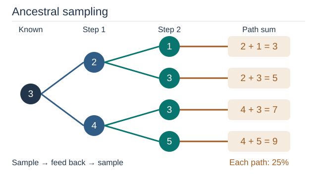
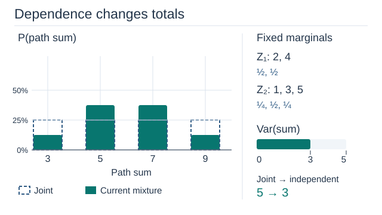

# DeepAR

DeepAR is a forecasting method that trains one autoregressive recurrent network on many related time series and outputs a full probability distribution for each future value. Its forecasts are sample paths, so sums, quantiles and other functions of the future can be read directly from the samples. It is one of the landmark methods compared on the [time-series forecasting](index.md) overview.

## Problem

Classical forecasting fits a separate model to each series, usually with a few parameters chosen by hand. That approach struggles when a series is short, intermittent or similar to thousands of others. Classical methods can also provide predictive distributions; DeepAR's distinguishing feature is learning a shared probabilistic model across many series. The motivating case is retail demand: a planner needs the probability that demand exceeds a stock level, for many products at once.

## Core idea

DeepAR learns one global model across all series in a dataset. At each time step, a multi-layer LSTM reads the covariates, the previous observation and its previous hidden state, and produces a hidden state $\mathbf{h}_{i,t}$ for series $i$. The network does not output a number. It outputs the parameters of a likelihood for the next observation.

Because the network is shared, a series with little history borrows statistical strength from the others. Differences between series are carried by covariates, by a learned embedding of the item, and by a per-series scale.

The shared autoregressive recurrence can be written as

\[
\begin{gathered}
\mathbf h_{i,t}=h(\mathbf h_{i,t-1},z_{i,t-1},x_{i,t};\Theta),\\
\vartheta_{i,t}=\vartheta(\mathbf h_{i,t};\Theta).
\end{gathered}
\]

## Model and likelihood

For a Gaussian likelihood, the network produces a mean and a standard deviation from the hidden state. The mean is an affine function, and the standard deviation passes through a softplus so that it stays positive:

$$
\mu_{i,t} = \mathbf{w}_\mu^\top \mathbf{h}_{i,t} + b_\mu, \qquad
\sigma_{i,t} = \log\!\left(1 + \exp\!\left(\mathbf{w}_\sigma^\top \mathbf{h}_{i,t} + b_\sigma\right)\right)
$$

For count data the paper uses a negative binomial with mean $\mu$ and shape $\alpha$, both produced through softplus-transformed outputs. Its variance is $\mu + \alpha\mu^2$. Other likelihoods can be used when samples can be drawn cheaply and log-likelihood gradients can be computed.

Training maximises the sum of log-likelihoods over all series and all steps in the prediction range:

$$
\mathcal{L}(\theta) = \sum_{i}\sum_{t=t_0}^{T} \log \ell\!\left(z_{i,t} \mid \vartheta(\mathbf{h}_{i,t})\right)
$$

Here $\vartheta$ denotes the parameters of the chosen likelihood. The experiments also include likelihood terms from the conditioning range. Because the hidden states are deterministic functions of observed inputs, no latent-variable inference is needed. Ordinary backpropagation through time is enough.

## Training and forecasting

Each training example is a window with two parts. The conditioning range, before a start point $t_0$, is observed. The prediction range, from $t_0$ through $T$, is the target. The encoder and decoder share weights, and the decoder's initial state $\mathbf{h}_{i,t_0-1}$ comes from running the network over the conditioning range. Windows may start before a series begins, with the unobserved target padded with zeros.

Values are divided by an item-specific scale $\nu_i = 1 + \frac{1}{t_0}\sum_{t=1}^{t_0} z_{i,t}$, and the scale also enters the output mean. Series are sampled for training windows with probability proportional to $\nu_i$. This choice gives large-volume series more weight, which counters the skewed volumes typical of retail data. The authors describe the scale as a heuristic that works well in practice.

Covariates include time features such as day of week and week of year, the age of the series since its first observation, and an embedding of the item identity. At forecast time the model uses ancestral sampling: it draws a value from the predicted distribution, feeds it back as the next input, and repeats. The experiments use 200 sample paths. Quantiles of aggregated quantities, such as weekly totals, are computed from those paths.

### Worked example: preserve dependence in sampled paths

Consider a toy conditional transition with last observed value 3. Each next value equals the previous value plus an independent increment of either -1 or +1 with probability one half each. This is a discrete teaching distribution, not the output of a trained DeepAR network.

| Step 1 | Step 2 | Two-step sum | Probability |
| ---: | ---: | ---: | ---: |
| 2 | 1 | 3 | 1/4 |
| 2 | 3 | 5 | 1/4 |
| 4 | 3 | 7 | 1/4 |
| 4 | 5 | 9 | 1/4 |

The blue branches show the first sample; the green branches condition the next draw on that particular sample. Orange boxes sum within the same path. The figure enumerates every possible path of this toy transition, rather than displaying independent marginal draws or four actual Monte Carlo samples. In DeepAR, the conditional likelihood is instead produced by the recurrent network (Salinas et al., 2020, Section 4). Each simulated trajectory retains its own history and recurrent state.

The two future values have covariance 1 and marginal variances 1 and 2. Their sum has variance 5, not 3 as independent marginal sampling would imply. Compute quantiles of a total from the distribution of path totals; in general, adding marginal quantiles does not give a quantile of the total.

*Original 12-second teaching animation (CC BY-SA 4.0).* Use the site's Play/Pause button; scroll horizontally on narrow screens. GitHub provides the [static fallback](../../../assets/concept-animations/deepar-path-sums-still.svg) and [full SVG animation](../../../assets/concept-animations/deepar-path-sums-motion.svg).

### Worked example: identical marginals, different totals

Keep the same two marginal distributions as above. Compare their original joint law with the product of the two marginals. Mixing these two joint laws with independent-law weight $t$ (between zero and one) preserves both marginal distributions exactly. The probabilities of totals 3 and 9 each decrease from 1/4 to 1/8; those of totals 5 and 7 each increase from 1/4 to 3/8. The mean total stays 6, while the covariance is $1-t$ and the total variance is $5-2t$.

The solid bars show the moving mixture and dashed outlines retain the original joint-law probabilities. The variance bar uses a common zero-based scale. At the independent endpoint the upper-tail probability of a total at least 9 is half its original value. The sweep illustrates hypothetical joint laws, not successive time steps, sampled paths, or a trained model's measurements. Independent marginals do not always underestimate variance: the sign of the covariance matters.

*Original 12-second teaching animation (CC BY-SA 4.0).* Use the site's Play/Pause button; scroll horizontally on narrow screens. GitHub provides the [static fallback](../../../assets/concept-animations/deepar-coupling-totals-still.svg) and [full SVG animation](../../../assets/concept-animations/deepar-coupling-totals-motion.svg).

## Results

The abstract reports accuracy improvements of around 15% over state-of-the-art methods on several real-world datasets. The main metric is the normalised $\rho$-risk, which is the quantile loss summed over series and divided by the summed targets. The tables report these values relative to a baseline for each dataset, so the gains are ratios rather than absolute errors. Point forecasts on electricity and traffic are compared with a matrix-factorisation baseline, using normalised deviation and normalised RMSE. Those comparisons cover two datasets and one competitor only. The numbers quoted here come from the arXiv preprint, and the journal version may differ.

## Limitations

- The Gaussian likelihood fits heavy-tailed or strictly positive series poorly unless a more suitable likelihood is chosen.
- The scaling rule is a heuristic. The authors note that it is hard to choose when data are missing or when variance differs widely across items.
- Training uses observed previous values, whereas forecasting feeds sampled predictions back into the network. The authors report no adverse effects from this mismatch in their experiments, but this is not a general guarantee.
- The paper reports differences as significant without a formal statistical test.
- Forecasting is sequential and needs many sample paths for good quantile estimates. It is slower than a model that outputs the whole horizon in one pass.

## Connections

DeepAR is a recurrent network, so it inherits the mechanics of [recurrent networks](../rnn/index.md), including the [LSTM](../rnn/gated-cells/lstm/index.md) cell. Its probabilistic output is a belief about the future in the sense used on the [probabilistic paradigm](../../paradigms/probabilistic/index.md) page. Its autoregressive sampling contrasts with direct multi-horizon methods such as [N-BEATS](n-beats.md) and [Informer](informer.md), which produce the whole horizon without feeding predictions back.

## References

### Seminal papers

- Salinas, D., Flunkert, V., Gasthaus, J. & Januschowski, T. (2020). DeepAR: Probabilistic forecasting with autoregressive recurrent networks. *International Journal of Forecasting*, 36, 1181–1191. doi:[10.1016/j.ijforecast.2019.07.001](https://doi.org/10.1016/j.ijforecast.2019.07.001) — The peer-reviewed version of the method, with the likelihood, training scheme and experiments described on this page.
- Salinas, D., Flunkert, V. & Gasthaus, J. (2017). DeepAR: Probabilistic forecasting with autoregressive recurrent networks. arXiv. https://arxiv.org/abs/1704.04110 — The preprint version, which the numbers on this page are taken from.
- Hochreiter, S. & Schmidhuber, J. (1997). Long short-term memory. *Neural Computation*, 9(8), 1735–1780. doi:[10.1162/neco.1997.9.8.1735](https://doi.org/10.1162/neco.1997.9.8.1735) — The LSTM cell that DeepAR uses as its recurrent core.

### Surveys and textbooks

- Lim, B. & Zohren, S. (2021). Time-series forecasting with deep learning: a survey. *Philosophical Transactions of the Royal Society A*, 379, 20200209. doi:[10.1098/rsta.2020.0209](https://doi.org/10.1098/rsta.2020.0209) — Surveys the encoder and decoder designs of deep forecasters, placing DeepAR among them.
- Makridakis, S., Spiliotis, E. & Assimakopoulos, V. (2020). The M4 Competition: 100,000 time series and 61 forecasting methods. *International Journal of Forecasting*, 36, 54–74. doi:[10.1016/j.ijforecast.2019.04.014](https://doi.org/10.1016/j.ijforecast.2019.04.014) — The large benchmark that later deep forecasters, including N-BEATS, were evaluated on.
- Hyndman, R. J. & Athanasopoulos, G. *Forecasting: Principles and Practice*, 3rd ed. OTexts. https://otexts.com/fpp3/ — The classical methods, such as exponential smoothing and ARIMA, against which DeepAR is measured.
