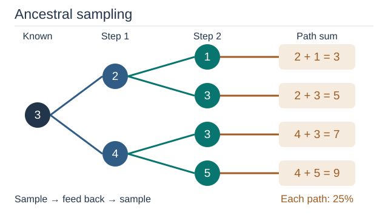

# DeepAR

DeepAR 是一種預測方法，它在許多相關的時間序列上訓練同一個自迴歸循環網路，並為每個未來值輸出完整的機率分布。它的預測是樣本路徑，因此總和、分位數與其他關於未來的函數都能直接從樣本中讀出。它是 [時間序列預測](index.md) 概觀頁比較的代表性方法之一。

## 問題

古典預測為每個序列分別擬合一個模型，通常只有少數由人工選定的參數。當序列很短、間歇性出現，或與數千個其他序列相似時，這種做法表現不佳。古典方法也能提供預測分布；DeepAR 的特色是在許多序列之間學習共享的機率模型。典型的例子是零售需求：規劃者需要同時為許多商品估計需求超過庫存水準的機率。

## 核心想法

DeepAR 在資料集中所有序列上學習一個全域模型。在每個時間步，多層 LSTM 讀取共變量、前一個觀測值以及前一個隱藏狀態，並為序列 $i$ 產生隱藏狀態 $\mathbf{h}_{i,t}$。網路輸出的不是一個數字，而是下一個觀測值的似然函數參數。

由於網路是共享的，歷史很少的序列能從其他序列借用統計強度。序列之間的差異則由共變量、商品的學習嵌入，以及每個序列各自的尺度來承載。

共享自迴歸遞推可寫成

\[
\begin{gathered}
\mathbf h_{i,t}=h(\mathbf h_{i,t-1},z_{i,t-1},x_{i,t};\Theta),\\
\vartheta_{i,t}=\vartheta(\mathbf h_{i,t};\Theta).
\end{gathered}
\]

## 模型與似然函數

對高斯似然而言，網路從隱藏狀態產生平均數與標準差。平均數是仿射函數，標準差則經過 softplus 轉換以保證為正：

$$
\mu_{i,t} = \mathbf{w}_\mu^\top \mathbf{h}_{i,t} + b_\mu, \qquad
\sigma_{i,t} = \log\!\left(1 + \exp\!\left(\mathbf{w}_\sigma^\top \mathbf{h}_{i,t} + b_\sigma\right)\right)
$$

對計數資料，論文使用平均數為 $\mu$、形狀參數為 $\alpha$ 的負二項分布，兩者都由經過 softplus 轉換的輸出產生。其變異數為 $\mu + \alpha\mu^2$。當樣本可以廉價抽取，且對數似然的梯度可以計算時，也能使用其他似然函數。

訓練時最大化所有序列在預測區間內所有時間步的對數似然總和：

$$
\mathcal{L}(\theta) = \sum_{i}\sum_{t=t_0}^{T} \log \ell\!\left(z_{i,t} \mid \vartheta(\mathbf{h}_{i,t})\right)
$$

其中 $\vartheta$ 表示所選似然函數的參數。實驗也把條件區間的對數似然項納入訓練。由於隱藏狀態是觀測輸入的確定性函數，不需要潛變數推論，一般的沿時間反向傳播即可。

## 訓練與預測

每個訓練樣本是一個視窗，分為兩部分。條件區間位於起點 $t_0$ 之前，是已觀測的部分；預測區間從 $t_0$ 到 $T$，是預測目標。編碼器與解碼器共享權重，解碼器的初始狀態 $\mathbf{h}_{i,t_0-1}$ 則由網路在條件區間上執行得到。視窗可以從序列開始之前取樣，未觀測的目標以零填補。

每個序列的數值會除以商品專屬的尺度 $\nu_i = 1 + \frac{1}{t_0}\sum_{t=1}^{t_0} z_{i,t}$，這個尺度也會進入輸出的平均數。訓練視窗抽樣時，序列被選中的機率與 $\nu_i$ 成正比。這種設計讓銷量較高的序列有更高的權重，以對抗零售資料中常見的偏態量級。論文作者把這個尺度描述為在實務上效果良好的啟發式規則。

共變量包括日期與時間特徵，例如星期幾與週次、序列自首次觀測以來的時間長度，以及商品識別碼的嵌入。預測時，模型使用祖先抽樣：它從預測分布中抽出一個值，把它當作下一步的輸入回授給模型，然後重複這個過程。實驗使用 200 條樣本路徑，週總量等聚合量的分位數則由這些路徑計算。

### 算例：保留抽樣路徑的相依性

考慮一個人工條件轉移分布，最後觀測值為 3。每個下一步數值等於前一步加上一個獨立增量，增量為 -1 或 +1，各以二分之一的機率出現。這是離散教學分布，不是已訓練 DeepAR 網路的輸出。

| 第一步 | 第二步 | 兩步總和 | 機率 |
| ---: | ---: | ---: | ---: |
| 2 | 1 | 3 | 1/4 |
| 2 | 3 | 5 | 1/4 |
| 4 | 3 | 7 | 1/4 |
| 4 | 5 | 9 | 1/4 |

藍色分支呈現第一次抽樣；綠色分支依該次抽樣值進行下一次條件抽樣。橘色方框計算同一條路徑內的總和。圖中列舉此人工轉移分布的所有可能路徑，而不是獨立的邊際抽樣或四筆實際 Monte Carlo 樣本。在 DeepAR 中，條件似然則由循環網路產生（Salinas 等人，2020，第 4 節）。每條模擬軌跡保有各自的歷史與循環狀態。

兩個未來值的共變異數為 1，邊際變異數分別為 1 與 2。總和的變異數為 5，而不是獨立邊際抽樣所導致的 3。總量的分位數應從路徑總量分布計算；一般而言，直接相加邊際分位數不等於總量的分位數。

*原創 12 秒教學動畫（CC BY-SA 4.0）。* 使用網站的播放／暫停按鈕；窄螢幕可水平捲動。GitHub 提供[靜態回退圖](../../../assets/concept-animations/deepar-path-sums-still.svg)與[完整 SVG 動畫](../../../assets/concept-animations/deepar-path-sums-motion.svg)。

## 結果

摘要指出，在數個真實世界資料集上，DeepAR 的準確度比當時最先進的方法提升約 15%。主要指標是正規化的 $\rho$ 風險，即所有序列的分位數損失總和除以目標值總和。表中的數值是相對於每個資料集的基準計算的，因此提升幅度是比率，而不是絕對誤差。在電力與交通資料上，點預測則與一個矩陣分解基準 MatFact 比較，使用正規化偏差與正規化 RMSE。這些比較只涵蓋兩個資料集與一個競爭方法。此頁的數字取自 arXiv 預印本，期刊版本可能有所不同。

## 限制

- 高斯似然對重尾或嚴格為正的序列擬合不佳，除非改選更合適的似然函數。
- 尺度規則是啟發式的。作者指出，當資料有缺漏或各商品的變異差異很大時，這個尺度很難選擇。
- 訓練時使用前一步的觀測值，預測時則把抽樣結果回授給網路。作者在實驗中未觀察到這種差異造成不良影響，但這不是一般性的保證。
- 論文把差異稱為顯著，但沒有進行正式的統計檢定。
- 預測是逐步進行的，要得到良好的分位數估計需要大量樣本路徑。相較於一次輸出整個預測期的模型，它速度較慢。

## 關聯

DeepAR 是循環網路，因此繼承了[循環神經網路](../rnn/index.md)的機制，包括 [LSTM](../rnn/gated-cells/lstm/index.md) 單元。它的機率輸出，就是[機率範式](../../paradigms/probabilistic/index.md)頁面所說的對未來的信念。它的自迴歸抽樣，與 [N-BEATS](n-beats.md) 和 [Informer](informer.md) 這類直接輸出多步預測、不把預測回授為輸入的方法形成對比。

## 參考文獻

### 開創性論文

- Salinas, D., Flunkert, V., Gasthaus, J. & Januschowski, T. (2020). DeepAR: Probabilistic forecasting with autoregressive recurrent networks. *International Journal of Forecasting*, 36, 1181–1191. doi:[10.1016/j.ijforecast.2019.07.001](https://doi.org/10.1016/j.ijforecast.2019.07.001) — 經同儕審查的正式版本，載有本頁描述的似然函數、訓練方式與實驗。
- Salinas, D., Flunkert, V. & Gasthaus, J. (2017). DeepAR: Probabilistic forecasting with autoregressive recurrent networks. arXiv. https://arxiv.org/abs/1704.04110 — 預印本版本，本頁的數字取自此版本。
- Hochreiter, S. & Schmidhuber, J. (1997). Long short-term memory. *Neural Computation*, 9(8), 1735–1780. doi:[10.1162/neco.1997.9.8.1735](https://doi.org/10.1162/neco.1997.9.8.1735) — DeepAR 所用循環核心的 LSTM 單元。

### 綜述與教科書

- Lim, B. & Zohren, S. (2021). Time-series forecasting with deep learning: a survey. *Philosophical Transactions of the Royal Society A*, 379, 20200209. doi:[10.1098/rsta.2020.0209](https://doi.org/10.1098/rsta.2020.0209) — 綜述深度預測模型的編碼器與解碼器設計，並將 DeepAR 置於其中。
- Makridakis, S., Spiliotis, E. & Assimakopoulos, V. (2020). The M4 Competition: 100,000 time series and 61 forecasting methods. *International Journal of Forecasting*, 36, 54–74. doi:[10.1016/j.ijforecast.2019.04.014](https://doi.org/10.1016/j.ijforecast.2019.04.014) — 後來的深度預測方法（包括 N-BEATS）所採用的大型基準。
- Hyndman, R. J. & Athanasopoulos, G. *Forecasting: Principles and Practice*, 第 3 版. OTexts. https://otexts.com/fpp3/ — DeepAR 所對照的古典方法，例如指數平滑與 ARIMA。
