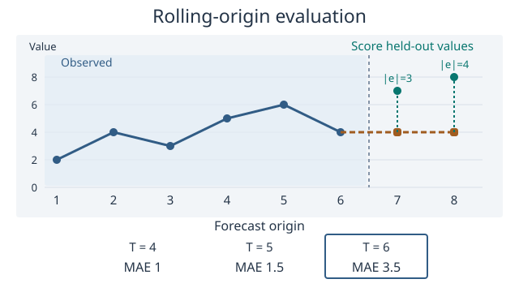
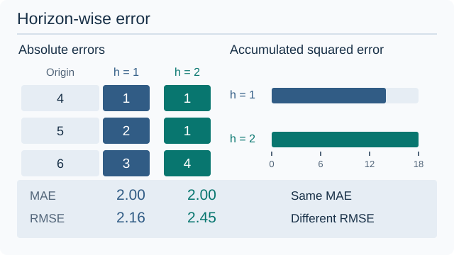

# Time-Series Forecasting

Time-series forecasting predicts future values of a quantity from its past values and, often, from related variables. Electricity demand, sales, traffic, temperature, and the readings of a sensor are all sequences observed over time, and a good forecast lets a planner act before the event. The problem looks like language modelling, but the data are numbers measured at regular intervals, the cost of error is usually in the units of the quantity itself, and the uncertainty of the forecast often matters as much as its central value.

## Overview

A forecast is a function from a history of observations to a prediction for one or more future steps, the *horizon*. Forecasts can be point estimates, which give a single value, or probabilistic, which give a distribution or a set of quantiles. Probabilistic forecasts are needed when a decision depends on the risk of an extreme value, such as stocking enough of a product or reserving enough power.

Evaluation must respect time. A model is trained on the past and tested on a later period, and the test window is usually rolled forward over many origins, so that the result does not depend on one lucky split. Shuffling the data, as is standard in many machine-learning tasks, leaks future information into training and can overstate accuracy.

### Rolling-origin evaluation without future leakage

For an illustrative series $(2,4,3,5,6,4,7,8)$, use an expanding history, horizon $H=2$, and a last-value baseline $\hat y_{T+h|T}=y_T$ for both horizons. At origin $T$, only values up to $T$ may be used to issue the prediction; the next two observations are revealed only to score that fixed prediction. Repeat retrospectively at origins 4, 5 and 6.

| Origin | Forecast | Held-out values | MAE |
| ---: | --- | --- | ---: |
| 4 | (5, 5) | (6, 4) | 1 |
| 5 | (6, 6) | (4, 7) | 1.5 |
| 6 | (4, 4) | (7, 8) | 3.5 |

The mean across these equal-horizon folds is 2. The blue line and shaded region show the available history; the orange squares and dashed line are the fixed forecasts, and the moving orange dot illustrates their issuance, not elapsed physical time. Green points and vertical error segments appear only during scoring. The lower strip reveals each fold's MAE only after scoring. Folds overlap (an observation can be a target at different origins); this is a retrospective replay, not a single real-time process or six independent errors. Any model fitting, scaling or tuning for an origin must use only information available at that origin; later evaluation results must not influence earlier forecasts. All values are schematic, not measured model performance.

*Original 12-second teaching animation (CC BY-SA 4.0).* Use the site's Play/Pause button; scroll horizontally on narrow screens. GitHub provides the [static fallback](../../../assets/concept-animations/rolling-origin-forecast-evaluation-still.svg) and [full SVG animation](../../../assets/concept-animations/rolling-origin-forecast-evaluation-motion.svg).

### Inspect errors by forecast horizon

A pooled MAE can hide differences in the distribution of errors at different horizons. For the three origins above, define the signed forecast error:

$$
e_{T,h}=y_{T+h}-\hat y_{T+h|T}
$$

With $n=3$ origins, compute the mean absolute error and root mean squared error separately for each horizon:

$$
\mathrm{MAE}_h=\frac{1}{n}\sum_T |e_{T,h}|
$$

$$
\mathrm{RMSE}_h=\sqrt{\frac{1}{n}\sum_T e_{T,h}^2}
$$

| Origin | Absolute error at h=1 | Absolute error at h=2 |
| ---: | ---: | ---: |
| 4 | 1 | 1 |
| 5 | 2 | 1 |
| 6 | 3 | 4 |
| MAE | 2 | 2 |
| RMSE | 2.16 | 2.45 |

The animation reveals the scored errors one origin at a time and accumulates their squares separately in blue (horizon 1) and green (horizon 2). The sums of squares are 14 and 18, so the two RMSE values are $\sqrt{14/3}$ and $\sqrt{18/3}$. The orange dot illustrates progression between folds, not elapsed physical time. Empty cells are not yet scored. The final aggregate is shown only after all three folds; the loop reset is not an additional observation. The equal MAEs do not imply equal error distributions. Report horizon-specific scores alongside aggregates, especially when large errors matter. These are analytic toy values, not measured forecasting performance.

*Original 12-second teaching animation (CC BY-SA 4.0).* Use the site's Play/Pause button; scroll horizontally on narrow screens. GitHub provides the [static fallback](../../../assets/concept-animations/forecast-horizon-error-still.svg) and [full SVG animation](../../../assets/concept-animations/forecast-horizon-error-motion.svg).

### Comparing errors across series

MASE scales forecast errors by a seasonal naïve error from the training range, not by a denominator estimated on the test set. For training length $T$, seasonal period $m$ and forecast horizon $H$:

$$
\begin{gathered}
d_m=\frac{1}{T-m}\sum_{t=m+1}^{T}|y_t-y_{t-m}|,\\
\mathrm{MASE}=\frac{1}{H}\sum_{h=1}^{H}
\frac{|y_{T+h}-\hat y_{T+h|T}|}{d_m}.
\end{gathered}
$$

Use $m=1$ for a non-seasonal series. When $d_m=0$, the ratio is undefined, not a zero error. M4 compared 100,000 series and 61 methods, but a competition advantage is not a guarantee for every application. Probabilistic forecasts also require calibration and interval evaluation rather than point errors alone. See [Hyndman and Koehler (2006)](https://doi.org/10.1016/j.ijforecast.2006.03.001), [FPP3](https://otexts.com/fpp3/toolbox.html#scaled-errors) and [Gneiting and Katzfuss (2014)](https://doi.org/10.1146/annurev-statistics-062713-085831).

## Key concepts

- **Horizon**: how far ahead the model predicts. Multi-horizon forecasts predict several steps at once.
- **Stationarity**: a series whose statistical properties do not change over time. Many classical methods assume it, or assume that it can be made stationary by differencing.
- **Covariates**: variables known in the future, such as holidays or planned prices, that can improve the forecast.
- **Related series**: many series from the same domain, such as the sales of thousands of products. Models can learn across them.
- **Encoder and decoder**: the part of the model that reads the history and the part that produces the forecast.

## How it works

Classical methods, such as exponential smoothing and autoregressive models, fit a small number of parameters to one series at a time. They are fast, interpretable and hard to beat on short, simple series. Deep learning methods instead learn from many series at once, and they can use many covariates. Lim and Zohren (2020) survey the encoder and decoder designs used in one-step-ahead and multi-horizon forecasting, including recurrent, convolutional and attention-based models.

**Probabilistic autoregression.** DeepAR (Salinas et al., 2017) trains an autoregressive recurrent network on a large number of related time series. For each step, the network outputs the parameters of a probability distribution over the next value, and the forecast is a sampled trajectory. The model learns the scale and shape of each series from the group, so new series with little history can still be forecast.

**Basis expansion without recurrence.** N-BEATS (Oreshkin et al., 2019) uses a deep stack of fully connected residual blocks that predict a forecast as a combination of basis functions. The authors present a generic version and an interpretable version whose basis functions are trend and seasonality. The abstract reports that the design improves forecast accuracy over a statistical benchmark by 11% and over the previous year's winner of the M4 competition by 3%.

**Long sequences with attention.** Informer (Zhou et al., 2020) adapts the [Transformer](../transformer/index.md) to long-sequence forecasting. Its abstract frames the problem as one that demands high prediction capacity for long horizons, which motivates a more efficient attention mechanism. It is one of several Transformer variants proposed for forecasting.

## Key methods

The three landmark methods below are compared briefly here. Each has its own page, which gives the problem, the core idea, the equations, the results and the limitations.

- [DeepAR](deepar.md): an autoregressive recurrent network trained on many series, with a distributional output. Natural for uncertainty, and sequential at inference.
- [N-BEATS](n-beats.md): stacked residual blocks that expand their outputs over basis functions, with no recurrence or attention. Interpretable or generic, and strong on univariate benchmarks.
- [Informer](informer.md): a Transformer variant for long horizons, with a cheaper attention mechanism and a decoder that predicts the whole horizon at once. Its gains over simple baselines have been questioned.

## Connections

The recurrent designs are described on the [Recurrent Networks](../rnn/index.md) page, and the attention designs on the [Transformer](../transformer/index.md) page. State-space models, which give long memory with linear-time updates, are on the [State-Space Models](../ssm/index.md) page. Forecasting also connects to probabilistic reasoning, since the output of a probabilistic forecast is a belief about the future, see [Probabilistic and Bayesian Methods](../../paradigms/probabilistic/index.md).

Neural recordings are time series too, so the same modelling questions arise in neuroscience. The connection is discussed in [NeuroAI](../../../brain-mind/neuroai/index.md).

## Applications

- **Energy.** Forecasting electricity demand and renewable generation to balance supply.
- **Retail and supply chains.** Forecasting demand for many products, where the decision is how much to stock.
- **Transport and weather.** Forecasting traffic flow and weather variables, where probabilistic forecasts support warnings and routing.

## Open questions

- Deep models are often evaluated on large collections of series, where they can benefit most. Their advantage on small or noisy series is less clear, so benchmark results need careful reading.
- Distribution shift breaks forecasts when the process changes, and detecting the change in time is hard.
- Fair evaluation needs held-out periods and baselines tuned as carefully as the new model, which is not always done.
- Combining forecasts with covariates that are themselves uncertain is an open modelling problem.

## References

### Seminal papers

- Salinas, D., Flunkert, V. & Gasthaus, J. (2017). *DeepAR: Probabilistic Forecasting with Autoregressive Recurrent Networks*. arXiv. https://arxiv.org/abs/1704.04110 — Trains an autoregressive recurrent network on many related series to output probabilistic forecasts.
- Oreshkin, B. N., Carpov, D., Chapados, N. & Bengio, Y. (2019). *N-BEATS: Neural basis expansion analysis for interpretable time series forecasting*. arXiv. https://arxiv.org/abs/1905.10437 — A deep residual architecture for forecasting that reports gains on the M4 benchmark.
- Zhou, H., Zhang, S., Peng, J., Zhang, S., Li, J., Xiong, H. & Zhang, W. (2020). *Informer: Beyond Efficient Transformer for Long Sequence Time-Series Forecasting*. arXiv. https://arxiv.org/abs/2012.07436 — A Transformer variant for long-horizon forecasting with a more efficient attention mechanism.

### Surveys and textbooks

- Lim, B. & Zohren, S. (2020). *Time Series Forecasting With Deep Learning: A Survey*. arXiv. https://arxiv.org/abs/2004.13408 — Surveys encoder and decoder designs for one-step-ahead and multi-horizon forecasting.
- Hyndman, R. J. & Athanasopoulos, G. *Forecasting: Principles and Practice*, 3rd ed. OTexts. https://otexts.com/fpp3/ — A textbook on classical and modern forecasting methods, free to read online. The page does not state a year.
- Makridakis, S., Spiliotis, E. & Assimakopoulos, V. (2020). The M4 Competition: 100,000 time series and 61 forecasting methods. *International Journal of Forecasting*, 36, 54–74. doi:[10.1016/j.ijforecast.2019.04.014](https://doi.org/10.1016/j.ijforecast.2019.04.014) — The large benchmark on which N-BEATS and other deep forecasters were evaluated.
- Zeng, A., Chen, M., Zhang, L. & Xu, Q. (2023). Are Transformers effective for time series forecasting? *Proceedings of the AAAI Conference on Artificial Intelligence*, 37(9), 11121–11128. doi:[10.1609/aaai.v37i9.26317](https://doi.org/10.1609/aaai.v37i9.26317) — A critique showing that simple linear models match or beat several Transformer forecasters, including Informer.
