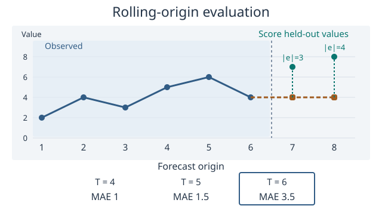
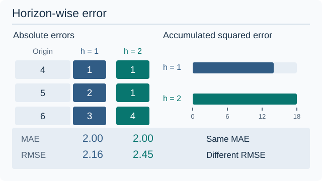

# 時間序列預測（Time-Series Forecasting）

時間序列預測根據某個量的過去數值，以及常見的相關變數，預測它未來的數值。電力需求、銷售量、交通流量、氣溫與感測器讀數，都是隨時間觀測到的序列，好的預測能讓規劃者在事件發生前採取行動。這個問題看起來像語言建模，但資料是以固定間隔測得的數字，誤差的代價通常以該量本身的單位計，而預測的不確定性往往與中心值一樣重要。

## 概述

預測是一個函數：輸入過去觀測值的歷史，輸出一個或多個未來步的預測，其中向前預測的步數稱為*預測期（horizon）*。預測可以是給出單一數值的點預測，也可以是給出分布或一組分位數的機率預測。當決策取決於極端值的風險時，就需要機率預測，例如決定要備足多少商品或保留多少電力。

評估必須尊重時間順序。模型在過去的資料上訓練，並在之後的期間上測試，測試視窗通常會在許多起點上向前滾動，使結果不依賴某一次幸運的切分。許多機器學習任務慣用的打亂資料順序，會把未來資訊洩漏到訓練中，可能使準確率被高估。

### 不洩漏未來資訊的滾動起點評估

考慮示意序列 $(2,4,3,5,6,4,7,8)$，採用逐步擴大的歷史視窗、預測期 $H=2$，以及末值天真預測 $\hat y_{T+h|T}=y_T$，兩個預測步皆使用相同末值。在起點 $T$，只能使用截至 $T$ 的觀測值發出預測；之後才揭露接下來兩筆觀測，用來評估已固定的預測。分別在起點 4、5、6 回溯評估。

| 起點 | 預測 | 保留觀測值 | MAE |
| ---: | --- | --- | ---: |
| 4 | (5, 5) | (6, 4) | 1 |
| 5 | (6, 6) | (4, 7) | 1.5 |
| 6 | (4, 4) | (7, 8) | 3.5 |

三個預測期相同的切分，其平均 MAE 為 2。藍線與淺色區域代表當時可用的歷史，橘色方點與虛線是固定預測，移動的橘色圓點用於示意預測的發出，不代表實際經過時間。綠色觀測點與垂直誤差線只在評分階段出現，下方各切分的 MAE 也只在評分後揭露。切分間可重疊（同一觀測可在不同起點成為預測目標）；動畫是回溯重播，不是單次即時流程，也不是六個獨立誤差。各起點的模型擬合、尺度轉換或調參均只能使用當時可得資訊；較晚的評估結果不得影響較早的預測。所有數值皆為示意，非模型實測結果。

*原創 12 秒教學動畫（CC BY-SA 4.0）。* 使用網站的播放／暫停按鈕；窄螢幕可水平捲動。GitHub 提供[靜態預覽](../../../assets/concept-animations/rolling-origin-forecast-evaluation-still.svg)與[完整 SVG 動畫](../../../assets/concept-animations/rolling-origin-forecast-evaluation-motion.svg)。

### 依預測步長檢視誤差

整體 MAE 可能掩蓋不同預測步長的誤差分布差異。沿用前三個預測起點，先定義帶符號的預測誤差：

$
e_{T,h}=y_{T+h}-\hat y_{T+h|T}
$

起點數量為 $n=3$，分別計算各預測步長的平均絕對誤差與均方根誤差：

$
\mathrm{MAE}_h=\frac{1}{n}\sum_T |e_{T,h}|
$

$
\mathrm{RMSE}_h=\sqrt{\frac{1}{n}\sum_T e_{T,h}^2}
$

| 起點 | 第 1 步絕對誤差 | 第 2 步絕對誤差 |
| ---: | ---: | ---: |
| 4 | 1 | 1 |
| 5 | 2 | 1 |
| 6 | 3 | 4 |
| MAE | 2 | 2 |
| RMSE | 2.16 | 2.45 |

動畫逐一揭露各起點已完成評分的誤差，並以藍色（第 1 步）與綠色（第 2 步）分別累計平方誤差。兩個平方和為 14 與 18，因此 RMSE 分別為 $\sqrt{14/3}$ 與 $\sqrt{18/3}$。橘色圓點示意切分間的進展，不代表真實經過時間；空白格表示尚未評分。三次評分皆完成後才顯示彙總結果，循環重設並非額外觀測。MAE 相等不代表誤差分布相同；若特別重視大誤差，應同時報告各預測步長及整體指標。所有數值均為解析算例，非模型實測結果。

*原創 12 秒教學動畫（CC BY-SA 4.0）。* 使用網站的播放／暫停按鈕；窄螢幕可水平捲動。GitHub 提供[靜態預覽](../../../assets/concept-animations/forecast-horizon-error-still.svg)與[完整 SVG 動畫](../../../assets/concept-animations/forecast-horizon-error-motion.svg)。

### 可跨序列比較的誤差尺度

MASE 以訓練區間內的季節性天真預測誤差作尺度，而不是使用測試資料估計分母。設訓練長度為 $T$、季節週期為 $m$、預測期為 $H$：

$$
\begin{gathered}
d_m=\frac{1}{T-m}\sum_{t=m+1}^{T}|y_t-y_{t-m}|,\\
\mathrm{MASE}=\frac{1}{H}\sum_{h=1}^{H}
\frac{|y_{T+h}-\hat y_{T+h|T}|}{d_m}.
\end{gathered}
$$

非季節序列取 $m=1$；若 $d_m=0$，此比值未定義，不能直接當成零誤差。M4 比較了 100,000 條序列與 61 種方法，但競賽中的優勢不是所有場景的保證。機率預測還要檢查校準與預測區間，而不只比較點誤差。參見 [Hyndman 與 Koehler (2006)](https://doi.org/10.1016/j.ijforecast.2006.03.001)、[FPP3](https://otexts.com/fpp3/toolbox.html#scaled-errors) 及 [Gneiting 與 Katzfuss (2014)](https://doi.org/10.1146/annurev-statistics-062713-085831)。

## 關鍵概念

- **預測期（horizon）**：模型向前預測多遠。多步預測會一次預測數步。
- **平穩性（stationarity）**：統計性質不隨時間改變的序列。許多經典方法假設它，或假設可以透過差分使其平穩。
- **共變量**：在未來已知的變數，例如假日或已規劃的價格，可以改善預測。
- **相關序列**：來自同一領域的許多序列，例如數千種商品的銷售。模型可以跨序列學習。
- **編碼器與解碼器**：模型中讀取歷史的部分，以及產生預測的部分。

## 運作方式

經典方法，例如指數平滑與自迴歸模型，每次只對一個序列擬合少量參數。它們快速、可解釋，並且在短而簡單的序列上很難被超越。深度學習方法則同時從許多序列學習，並能使用許多共變量。Lim 與 Zohren（2020）綜述了用於單步與多步預測的編碼器與解碼器設計，包括循環式、卷積式與注意力式模型。

**機率式自迴歸。** DeepAR（Salinas 等人，2017）在大量相關的時間序列上訓練自迴歸循環網路。每一步，網路輸出下一個值的機率分布參數，預測則是取樣得到的軌跡。模型從群體中學習每個序列的尺度與形狀，因此歷史很短的新序列也能被預測。

**無遞迴的基底展開。** N-BEATS（Oreshkin 等人，2019）使用由全連接殘差區塊組成的深層堆疊，把預測表示為基底函數的組合。作者提出一般版本與可解釋版本，後者的基底函數分別對應趨勢與季節性。摘要報告，此設計相較統計基準將預測準確率提升 11%，相較 M4 競賽上一屆冠軍提升 3%。

**以注意力處理長序列。** Informer（Zhou 等人，2020）把 [Transformer](../transformer/index.md) 改造用於長序列預測。摘要把問題表述為長期預測需要模型具有高度的預測能力，這促成了更有效率的注意力機制。它是為預測而提出的多種 Transformer 變體之一。

## 關鍵方法

以下三個代表性方法在此作簡要比較。每個方法都有自己的頁面，提供問題、核心想法、方程式、結果與限制。

- [DeepAR](deepar.md)：在許多序列上訓練的自迴歸循環網路，輸出為分布。適合處理不確定性，推論時是逐步進行的。
- [N-BEATS](n-beats.md)：堆疊的殘差區塊，其輸出為基函數展開，沒有遞迴或注意力。可解釋或通用，在單變量基準上表現強勁。
- [Informer](informer.md)：為長預測期設計的 Transformer 變體，採用成本較低的注意力機制，並以一次預測整個預測期的解碼器運作。它相對於簡單基準的優勢，已受到質疑。

## 關聯

循環式設計見[循環神經網路](../rnn/index.md)頁面，注意力式設計見 [Transformer](../transformer/index.md) 頁面。狀態空間模型能以線性時間的更新提供長期記憶，見[狀態空間模型](../ssm/index.md)頁面。預測也與機率推理相連，因為機率預測的輸出是對未來的一種信念，見[機率與貝氏方法](../../paradigms/probabilistic/index.md)。

神經記錄同樣是時間序列，因此神經科學中也會出現相同的建模問題。這個連結在 [NeuroAI](../../../brain-mind/neuroai/index.md) 中討論。

## 應用

- **能源。** 預測用電需求與再生能源發電量，以平衡供給。
- **零售與供應鏈。** 預測許多商品的需求，決策是要備多少貨。
- **交通與氣象。** 預測車流與氣象變數，機率預測可支援預警與路線規劃。

## 開放問題

- 深度模型常在大量序列的集合上被評估，在那裡它們最可能受益。它們在小型或雜訊較多的序列上的優勢較不清楚，因此需要仔細解讀基準結果。
- 當過程改變時，分布偏移會使預測失效，而即時偵測這種改變很困難。
- 公平的評估需要保留的期間，以及與新模型同樣仔細調校的基準，但這並非總是做得到。
- 以本身不確定的共變量來結合預測，是一個開放的建模問題。

## 參考文獻

### 開創性論文

- Salinas, D., Flunkert, V. & Gasthaus, J. (2017). *DeepAR: Probabilistic Forecasting with Autoregressive Recurrent Networks*. arXiv. https://arxiv.org/abs/1704.04110 — 在大量相關序列上訓練自迴歸循環網路，輸出機率預測。
- Oreshkin, B. N., Carpov, D., Chapados, N. & Bengio, Y. (2019). *N-BEATS: Neural basis expansion analysis for interpretable time series forecasting*. arXiv. https://arxiv.org/abs/1905.10437 — 用於預測的深層殘差架構，並報告在 M4 基準上的進步。
- Zhou, H., Zhang, S., Peng, J., Zhang, S., Li, J., Xiong, H. & Zhang, W. (2020). *Informer: Beyond Efficient Transformer for Long Sequence Time-Series Forecasting*. arXiv. https://arxiv.org/abs/2012.07436 — 用於長期預測的 Transformer 變體，採用較有效率的注意力機制。

### 綜述與教科書

- Lim, B. & Zohren, S. (2020). *Time Series Forecasting With Deep Learning: A Survey*. arXiv. https://arxiv.org/abs/2004.13408 — 綜述用於單步與多步預測的編碼器與解碼器設計。
- Hyndman, R. J. & Athanasopoulos, G. *Forecasting: Principles and Practice*, 第 3 版. OTexts. https://otexts.com/fpp3/ — 涵蓋經典與現代預測方法的教科書，可免費線上閱讀。該頁面未註明出版年份。
- Makridakis, S., Spiliotis, E. & Assimakopoulos, V. (2020). The M4 Competition: 100,000 time series and 61 forecasting methods. *International Journal of Forecasting*, 36, 54–74. doi:[10.1016/j.ijforecast.2019.04.014](https://doi.org/10.1016/j.ijforecast.2019.04.014) — 後來的深度預測方法（包括 N-BEATS）所採用的大型基準。
- Zeng, A., Chen, M., Zhang, L. & Xu, Q. (2023). Are Transformers effective for time series forecasting? *Proceedings of the AAAI Conference on Artificial Intelligence*, 37(9), 11121–11128. doi:[10.1609/aaai.v37i9.26317](https://doi.org/10.1609/aaai.v37i9.26317) — 批評文章，指出簡單線性模型在常見基準上能與數個 Transformer 預測器（包括 Informer）相當，甚至更好。
