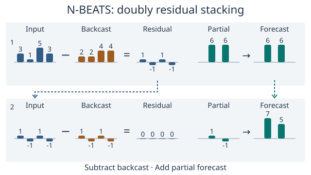
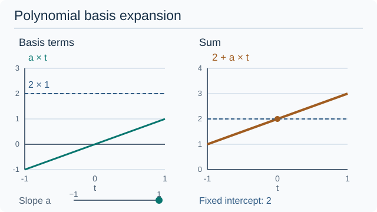

# N-BEATS

N-BEATS is a deep network for univariate point forecasting that uses no recurrence and no attention. It stacks fully connected residual blocks, and each block predicts a forecast and a backcast as a weighted sum of basis functions. Two configurations are proposed: a generic one, which learns its bases, and an interpretable one, whose bases are a trend polynomial and a seasonal Fourier series. It is one of the landmark methods compared on the [time-series forecasting](index.md) overview.

## Problem

Univariate forecasting, where each series is predicted from its own past, was long dominated by statistical hybrids and by hand-crafted combinations of models. Neural networks had been tried, but they were usually not competitive on standard benchmarks, and their outputs could not be explained. The paper asks whether a pure deep network, without time-series-specific machinery or ensembling of statistical models, can beat the best statistical and hybrid methods while keeping an interpretable form.

## Core idea

The architecture is built from blocks, and each block does two jobs. It estimates the part of its input that it can explain, called the *backcast*, and it produces a partial *forecast*. The next block receives the input with the backcast removed, so it models only what the earlier blocks left unexplained. The final forecast is the sum of all partial forecasts. The authors call this doubly residual stacking.

Within a block, the forecast and backcast are not free outputs. They are expansions of learned coefficients over basis functions, which is why the family is called neural basis expansion. The choice of basis is what separates the two configurations.

## Equation or algorithm

Let $x_\ell$ be the input to block $\ell$, which is a lookback window of length $L$, and let $H$ be the forecast horizon. Each block passes its input through four fully connected ReLU layers, giving a hidden vector $h_\ell$, and then two linear heads produce forward and backward coefficients:

$$
\theta^b_\ell = W^b h_\ell, \qquad \theta^f_\ell = W^f h_\ell
$$

The basis layers $g^b$ and $g^f$ map the coefficients to the backcast and the forecast:

$$
\hat{x}_\ell = \sum_i \theta^b_{\ell,i}\, g^b_i, \qquad \hat{y}_\ell = \sum_i \theta^f_{\ell,i}\, g^f_i
$$

The residual link then passes the unexplained input onward, and the forecast is accumulated:

$$
x_{\ell+1} = x_\ell - \hat{x}_\ell, \qquad \hat{y} = \sum_\ell \hat{y}_\ell
$$

In the **generic** configuration, $g^b$ and $g^f$ are learned linear projections with no time-series structure. In the **interpretable** configuration, a trend stack uses a polynomial basis of low degree, $T(t) = (1, t, t^2, \dots)$, evaluated on a normalised time index over the horizon, and a seasonality stack uses a Fourier basis of cosine and sine terms. Each stack is removed from the input before the next stack is applied, so the trend is explained first and the seasonal pattern is fitted to what remains.

Training uses the symmetric mean absolute percentage error:

$$
\text{sMAPE} = \frac{200}{H}\sum_{t=1}^{H}\frac{|y_t - \hat{y}_t|}{|y_t| + |\hat{y}_t|}
$$

The M4 and M3 models were also trained with MAPE and MASE, and the paper reports results from an ensemble. The final forecast is the median of 180 models, formed from three losses, six lookback windows of between two and seven times the horizon, and several random initialisations.

For TOURISM, model selection uses MAPE-only training (Appendix D.1); the three-loss ensemble description for M4/M3 does not apply unchanged to TOURISM.

### Worked example: subtract backcasts, add forecasts

Take a toy lookback vector $x_1=(3,1,5,3)$ and two blocks with horizon 2. Suppose the first block emits backcast $(2,2,4,4)$ and partial forecast $(6,6)$. Its residual $x_2=(1,-1,1,-1)$, not the original history or the partial forecast, becomes the second block's input. Suppose the second block emits backcast $(1,-1,1,-1)$ and partial forecast $(1,-1)$.

| Block | Input | Backcast | Residual | Partial forecast | Accumulated forecast |
| ---: | --- | --- | --- | --- | --- |
| 1 | (3,1,5,3) | (2,2,4,4) | (1,-1,1,-1) | (6,6) | (6,6) |
| 2 | (1,-1,1,-1) | (1,-1,1,-1) | (0,0,0,0) | (1,-1) | (7,5) |

The blue connector carries the first residual to the next block; the green connector carries the accumulated forecast, which is updated by adding the next partial forecast. Bars share a signed zero baseline and appear at completed block operations; the blue moving marker illustrates the residual transfer. The final forecast is $(6,6)+(1,-1)=(7,5)$, not the residual or the last partial forecast. A zero backcast residual does not establish correct future prediction. These vectors are stipulated teaching outputs of the blocks, not a trained model's results or a guarantee of exact decomposition.

*Original 12-second teaching animation (CC BY-SA 4.0).* Use the site's Play/Pause button; scroll horizontally on narrow screens. GitHub provides the [static fallback](../../../assets/concept-animations/nbeats-double-residual-still.svg) and [full SVG animation](../../../assets/concept-animations/nbeats-double-residual-motion.svg).

### Worked example: polynomial basis coefficients

A linear trend basis is the degree-one special case of polynomial expansion. For an illustrative coordinate $t\in[-1,1]$, fix the constant coefficient at 2 and vary the linear coefficient $a$:

$
g_0(t)=1,\quad g_1(t)=t
$

The weighted sum is:

$
f(t)=2g_0(t)+ag_1(t)=2+at
$

| Coefficient a | f(-1) | f(0) | f(1) |
| ---: | ---: | ---: | ---: |
| -1 | 3 | 2 | 1 |
| 0 | 2 | 2 | 2 |
| 1 | 1 | 2 | 3 |

The left plot separates the constant term (blue dashed line) from the weighted linear term (green); the right plot adds them pointwise (orange). Changing the slope coefficient changes both plots continuously while the intercept remains 2. The green bottom marker denotes the swept coefficient, not an interactive slider on the SVG. This is a sensitivity illustration, not an optimisation trajectory or a sequence of model inference steps: in N-BEATS the coefficients for a particular block input are emitted together by its head and then evaluated on the corresponding basis grid. The symmetric coordinate interval and coefficients are chosen for this teaching example, not taken from a trained N-BEATS model or its exact grid convention.

*Original 12-second teaching animation (CC BY-SA 4.0).* Use the site's Play/Pause button; scroll horizontally on narrow screens. GitHub provides the [static fallback](../../../assets/concept-animations/nbeats-basis-expansion-still.svg) and [full SVG animation](../../../assets/concept-animations/nbeats-basis-expansion-motion.svg).

## Results

On the M4 competition data, the combined generic-and-interpretable ensemble (N-BEATS-I+G) reaches an average sMAPE of 11.135, against 11.374 for the M4 winner, a hybrid of exponential smoothing and recurrent networks. The abstract reports 11% and 3% improvements, but these should not be read as reductions from the sMAPE values above. Table 1 reports OWA of 0.795 for N-BEATS-I+G versus 0.821 for the M4 winner, about a 3.2% reduction; its sMAPE reduction is about 2.1%. The generic and interpretable configurations are close in accuracy. The paper also reports results on the M3 and tourism datasets, where the same architecture is used without changes.

Table 1 separately reports OWA 0.797 for the generic-only N-BEATS-G and 0.861 for the best pure statistical entry; these differ from the combined ensemble and competition winner above. Lower OWA is better; it is not a classification accuracy.

## Limitations

- The paper treats univariate point forecasting only. It does not model covariates such as calendar features, and it does not produce probabilistic forecasts.
- The reported gains rely on ensembles of many networks, which makes training expensive compared with a single model.
- The generic outputs are not interpretable. The interpretable configuration reduces that cost but, on some subsets of M4, it scores slightly worse than the generic one.
- The M4 and M3 series contain no intermittent or lumpy demand, so the method is untested on that kind of data.
- The paper does not say when the architecture should not be used. Its meta-learning reading of the stacked blocks is offered as speculation.

## Connections

N-BEATS is a deep multilayer perceptron with residual links, so it sits close to the [multilayer perceptron](../mlp/index.md) and [residual network](../cnn/backbones-and-scaling/resnet/index.md) families. Its residual structure is a relative of the residual connections used in deep vision models. Its direct multi-horizon output contrasts with the step-by-step prediction of [DeepAR](deepar.md) and with the attention-based forecaster [Informer](informer.md). The choice of trend and seasonal bases is a use of prior knowledge about the data, the same idea that appears in classical decomposition methods covered in the [forecasting overview](index.md).

## References

### Seminal papers

- Oreshkin, B. N., Carpov, D., Chapados, N. & Bengio, Y. (2019). N-BEATS: Neural basis expansion analysis for interpretable time series forecasting. arXiv. https://arxiv.org/abs/1905.10437 — Defines the residual block, the generic and interpretable configurations, and the M4 results. Published at ICLR 2020.
- Smyl, S. (2020). A hybrid method of exponential smoothing and recurrent neural networks for time series forecasting. *International Journal of Forecasting*, 36, 75–85. doi:[10.1016/j.ijforecast.2019.03.017](https://doi.org/10.1016/j.ijforecast.2019.03.017) — The M4 winner, the hybrid method against which N-BEATS reports its 3% gain.

### Surveys and textbooks

- Makridakis, S., Spiliotis, E. & Assimakopoulos, V. (2020). The M4 Competition: 100,000 time series and 61 forecasting methods. *International Journal of Forecasting*, 36, 54–74. doi:[10.1016/j.ijforecast.2019.04.014](https://doi.org/10.1016/j.ijforecast.2019.04.014) — The benchmark, its metrics and the set of competing methods used in the N-BEATS evaluation.
- Lim, B. & Zohren, S. (2021). Time-series forecasting with deep learning: a survey. *Philosophical Transactions of the Royal Society A*, 379, 20200209. doi:[10.1098/rsta.2020.0209](https://doi.org/10.1098/rsta.2020.0209) — Places fully connected multi-horizon forecasters among the deep encoder and decoder designs.
- Hyndman, R. J. & Athanasopoulos, G. *Forecasting: Principles and Practice*, 3rd ed. OTexts. https://otexts.com/fpp3/ — Describes the classical decomposition and smoothing methods that the interpretable configuration resembles.
