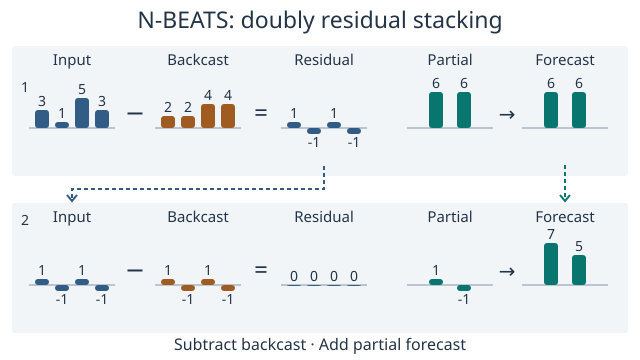
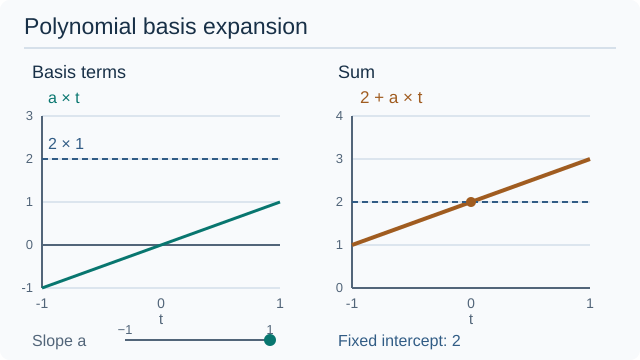

# N-BEATS

N-BEATS 是一種用於單變量點預測的深度網路，不使用循環結構，也不使用注意力。它堆疊全連接殘差區塊，每個區塊都把預測與回溯估計表示為基函數的加權和。論文提出兩種組態：一種是通用組態，會學習自己的基底；另一種是可解釋組態，其基底為趨勢多項式與季節性傅立葉級數。它是 [時間序列預測](index.md) 概觀頁比較的代表性方法之一。

## 問題

單變量預測（每個序列只用自身的過去值來預測）長期以來由統計混合模型與人工組合的模型主導。神經網路也曾被嘗試，但在標準基準上通常不具競爭力，而且輸出難以解釋。論文探討的問題是：一個純粹的深度網路，不加入時間序列專用的機制，也不與統計模型集成，能否在保持可解釋形式的同時，超越最佳的統計與混合方法。

## 核心想法

此架構由區塊組成，每個區塊負責兩件事。它估計輸入中自己能解釋的部分，稱為*回溯估計*（backcast），並產生一個局部*預測*。下一個區塊接收的是已扣除回溯估計的輸入，因此只需建模前面區塊沒有解釋的部分。最終預測是所有局部預測的總和。作者稱這種設計為雙重殘差堆疊。

在區塊內部，預測與回溯估計並不是自由的輸出，而是學到的係數在基函數上的展開，這也是「神經基展開」的名稱來源。兩種組態的差別，就在於選用的基底不同。

## 方程式與演算法

令 $x_\ell$ 為區塊 $\ell$ 的輸入，即長度為 $L$ 的回看視窗，並令 $H$ 為預測期長度。每個區塊先把輸入通過四個全連接的 ReLU 層，得到隱藏向量 $h_\ell$，再由兩個線性頭產生前向與後向係數：

$$
\theta^b_\ell = W^b h_\ell, \qquad \theta^f_\ell = W^f h_\ell
$$

基底層 $g^b$ 與 $g^f$ 把係數映射為回溯估計與預測：

$$
\hat{x}_\ell = \sum_i \theta^b_{\ell,i}\, g^b_i, \qquad \hat{y}_\ell = \sum_i \theta^f_{\ell,i}\, g^f_i
$$

殘差連結會把尚未被解釋的輸入傳給下一層，同時累加預測：

$$
x_{\ell+1} = x_\ell - \hat{x}_\ell, \qquad \hat{y} = \sum_\ell \hat{y}_\ell
$$

在**通用**組態中，$g^b$ 與 $g^f$ 是學到的線性投影，沒有任何時間序列結構。在**可解釋**組態中，趨勢堆疊使用低階多項式基底 $T(t) = (1, t, t^2, \dots)$，並在預測期上的正規化時間索引上求值；季節性堆疊則使用由餘弦與正弦項組成的傅立葉基底。每個堆疊在下一個堆疊作用之前，先從輸入中扣除，因此趨勢先被解釋，季節性模式則擬合剩餘的部分。

訓練使用對稱平均絕對百分比誤差：

$$
\text{sMAPE} = \frac{200}{H}\sum_{t=1}^{H}\frac{|y_t - \hat{y}_t|}{|y_t| + |\hat{y}_t|}
$$

M4 與 M3 的模型也曾以 MAPE 與 MASE 訓練，論文報告的結果來自集成。最終預測是 180 個模型的中位數，這些模型由三種損失函數、六個介於 2 到 7 倍預測期長度之間的回看視窗，以及數組隨機初始化組合而成。

TOURISM 的選模只使用 MAPE 損失（論文附錄 D.1）；不能把 M4/M3 的三損失集成描述直接套用到 TOURISM。

### 算例：扣除回溯估計、累加預測

令示意回看向量為 $x_1=(3,1,5,3)$，使用兩個區塊及長度為 2 的預測期。假設第一個區塊輸出回溯估計 $(2,2,4,4)$ 與局部預測 $(6,6)$。其殘差 $x_2=(1,-1,1,-1)$ 才是第二個區塊的輸入，而非原始歷史或局部預測。假設第二個區塊輸出回溯估計 $(1,-1,1,-1)$ 與局部預測 $(1,-1)$。

| 區塊 | 輸入 | 回溯估計 | 殘差 | 局部預測 | 累積預測 |
| ---: | --- | --- | --- | --- | --- |
| 1 | (3,1,5,3) | (2,2,4,4) | (1,-1,1,-1) | (6,6) | (6,6) |
| 2 | (1,-1,1,-1) | (1,-1,1,-1) | (0,0,0,0) | (1,-1) | (7,5) |

藍色連線將第一個殘差傳至下一區塊，綠色連線傳遞累積預測，並加上下個局部預測完成更新。長條共用有正負號的零基準線，在區塊運算完成時出現；移動的藍色圓點示意殘差傳遞。最終預測為 $(6,6)+(1,-1)=(7,5)$，不是殘差，也不是最後一個局部預測。回溯估計殘差為零不代表未來預測必然正確。這些向量為指定的區塊教學輸出，並非訓練模型實測結果，也不保證能精確分解。

*原創 12 秒教學動畫（CC BY-SA 4.0）。* 使用網站的播放／暫停按鈕；窄螢幕可水平捲動。GitHub 提供[靜態預覽](../../../assets/concept-animations/nbeats-double-residual-still.svg)與[完整 SVG 動畫](../../../assets/concept-animations/nbeats-double-residual-motion.svg)。

### 算例：多項式基底係數

線性趨勢基底是多項式展開的一階特例。選取示意座標 $t\in[-1,1]$，將常數係數固定為 2，改變線性係數 $a$：

$
g_0(t)=1,\quad g_1(t)=t,\quad
f(t)=2g_0(t)+ag_1(t)=2+at.
$

| 係數 a | f(-1) | f(0) | f(1) |
| ---: | ---: | ---: | ---: |
| -1 | 3 | 2 | 1 |
| 0 | 2 | 2 | 2 |
| 1 | 1 | 2 | 3 |

左圖分別呈現常數項（藍色虛線）與加權線性項（綠色），右圖呈現逐點相加的結果（橘色）。改變斜率係數會使兩圖連續變化，但截距始終為 2。下方綠色圓點代表掃描中的係數，並非 SVG 內可拖曳的滑桿。此動畫為敏感度示意，不是最佳化軌跡或模型推論的時間步驟：N-BEATS 對特定區塊輸入會由其輸出頭同時產生係數，再於相應的基底網格上求值。對稱座標區間與係數是為教學而設定，並非訓練後模型的數值，也非原論文的精確網格慣例。

*原創 12 秒教學動畫（CC BY-SA 4.0）。* 使用網站的播放／暫停按鈕；窄螢幕可水平捲動。GitHub 提供[靜態預覽](../../../assets/concept-animations/nbeats-basis-expansion-still.svg)與[完整 SVG 動畫](../../../assets/concept-animations/nbeats-basis-expansion-motion.svg)。

## 結果

在 M4 競賽資料上，結合通用與可解釋組態的集成（N-BEATS-I+G）達到平均 sMAPE 11.135，M4 冠軍（指數平滑與循環網路的混合方法）為 11.374。摘要報告了 11% 與 3% 的提升，但不應把它們解讀為上述 sMAPE 數值的降幅。表 1 中，N-BEATS-I+G 的 OWA 為 0.795，M4 冠軍為 0.821，降幅約 3.2%；sMAPE 的降幅則約為 2.1%。通用與可解釋組態的準確度相近。論文也在 M3 與旅遊資料集上報告結果，同一架構未作修改。

表 1 另外列出純通用組態 N-BEATS-G 的 OWA 為 0.797，最佳純統計參賽者為 0.861；這兩個數字不同於上述合併集成與競賽冠軍。OWA 越小越好，不是分類準確率。

## 限制

- 論文只處理單變量點預測，沒有建模日曆特徵等共變量，也沒有產生機率預測。
- 報告的提升依賴許多網路的集成，相較於單一模型，訓練成本高。
- 通用組態的輸出不可解釋。可解釋組態降低了這項代價，但在 M4 的某些子集上，其分數略低於通用組態。
- M4 與 M3 的序列不含間歇性或塊狀需求，因此此方法在這類資料上未經測試。
- 論文沒有說明此架構不適用的情況。它對堆疊區塊的元學習解讀，只是作為推測提出。

## 關聯

N-BEATS 是帶有殘差連結的深度多層感知器，因此與[多層感知器](../mlp/index.md)及[殘差網路](../cnn/backbones-and-scaling/resnet/index.md)家族很接近。它的殘差結構與深度視覺模型中的殘差連接是近親。它一次輸出整個預測期，與 [DeepAR](deepar.md) 逐步預測的做法形成對比，也與以注意力為基礎的預測器 [Informer](informer.md) 不同。趨勢與季節性基底的選擇，是對資料使用先驗知識，這與[預測概觀頁](index.md)所涵蓋的古典分解方法是同一種想法。

## 參考文獻

### 開創性論文

- Oreshkin, B. N., Carpov, D., Chapados, N. & Bengio, Y. (2019). N-BEATS: Neural basis expansion analysis for interpretable time series forecasting. arXiv. https://arxiv.org/abs/1905.10437 — 定義殘差區塊、通用與可解釋組態，以及 M4 的結果。論文發表於 ICLR 2020。
- Smyl, S. (2020). A hybrid method of exponential smoothing and recurrent neural networks for time series forecasting. *International Journal of Forecasting*, 36, 75–85. doi:[10.1016/j.ijforecast.2019.03.017](https://doi.org/10.1016/j.ijforecast.2019.03.017) — M4 冠軍，即 N-BEATS 報告其 3% 提升時所對照的混合方法。

### 綜述與教科書

- Makridakis, S., Spiliotis, E. & Assimakopoulos, V. (2020). The M4 Competition: 100,000 time series and 61 forecasting methods. *International Journal of Forecasting*, 36, 54–74. doi:[10.1016/j.ijforecast.2019.04.014](https://doi.org/10.1016/j.ijforecast.2019.04.014) — N-BEATS 評估所用的基準、其指標與競爭方法。
- Lim, B. & Zohren, S. (2021). Time-series forecasting with deep learning: a survey. *Philosophical Transactions of the Royal Society A*, 379, 20200209. doi:[10.1098/rsta.2020.0209](https://doi.org/10.1098/rsta.2020.0209) — 將全連接的多步預測器歸入深度編碼器與解碼器設計之中。
- Hyndman, R. J. & Athanasopoulos, G. *Forecasting: Principles and Practice*, 第 3 版. OTexts. https://otexts.com/fpp3/ — 說明可解釋組態所類似的古典分解與平滑方法。
