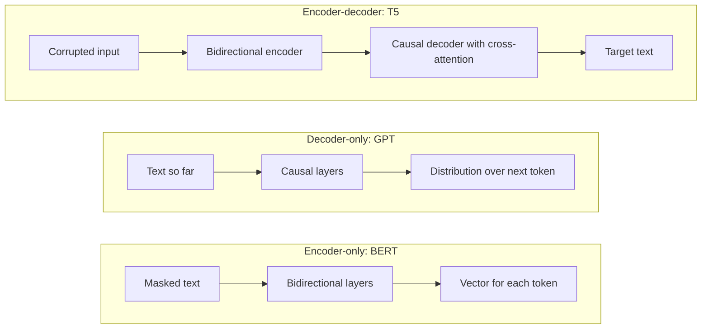

# Encoder-only, decoder-only and encoder-decoder Transformers

The Transformer was first built from two halves: an encoder that reads an input and a decoder that writes an output. Within about three years of its introduction, researchers had split it into three families that keep one half, the other, or both. The choice decides which tokens each position may see and what the model is trained to predict.

## Overview

The original Transformer, described in [Transformers & Attention](../index.md), was built for machine translation. Its encoder read the source sentence with attention in both directions. Its decoder generated the target one token at a time, and in every layer it also attended to the encoder's output through *cross-attention*.

Three designs followed:

- **Encoder-only** models, led by BERT (Devlin et al., 2018), keep the bidirectional stack. They are pre-trained by hiding some words and predicting them from the words around them. Their outputs serve classification, tagging and retrieval.
- **Decoder-only** models, led by the GPT series, keep only the causal stack. They are pre-trained to predict the next token, which makes them natural text generators.
- **Encoder–decoder** models, led by T5 (Raffel et al., 2019) and BART (Lewis et al., 2019), keep both halves. The encoder reads a corrupted or instructed input and the decoder writes the target.

Decoder-only models became the default for large language models after GPT-3 (Brown et al., 2020). The other two families are not obsolete. They remain common for embeddings, classification, translation and speech.

## Key concepts

- **Attention mask.** A rule that says which positions a token may attend to. A *bidirectional* mask lets each token see the whole sequence. A *causal* mask lets it see only earlier positions.
- **Cross-attention.** Attention in a decoder layer over the encoder's output, so the decoder can read the input.
- **Pre-training objective.** The task used on large unlabelled text before any specific use. The common choices are masked language modelling (MLM), span corruption (a form of denoising) and causal language modelling, also called next-token prediction.
- **Fine-tuning.** Continuing training of a pre-trained model on labelled data for one task.
- **Prompting.** Stating the task in the input text, with no change to the weights.
- **Zero-shot and few-shot use.** Solving a task with no examples, or with a few examples in the prompt. See [GPT-3 few-shot learning](../../llm/gpt-3-few-shot/index.md).

## How it works

### Masks define what each token sees

Attention scores are computed for every pair of positions, and the mask decides which pairs are kept. For a four-token sequence, a causal mask is lower-triangular:

```text
            t1  t2  t3  t4
   t1        1   0   0   0
   t2        1   1   0   0
   t3        1   1   1   0
   t4        1   1   1   1
```

An encoder-only model uses an all-ones mask, so every pair is kept. The encoder of an encoder–decoder model is bidirectional, its decoder is causal, and cross-attention lets each decoder position read every encoder position. A *prefix* mask is bidirectional over a prefix and causal over the rest. UniLM (Dong et al., 2019) showed that one shared network can be trained under several such masks, and T5 compared a prefix variant with the other two structures.



### Pre-training objectives

- **Masked language modelling.** BERT chooses 15% of the token positions. Of those, 80% are replaced by a mask token, 10% by a random token and 10% are left unchanged. The model must recover the original tokens from context on both sides (Devlin et al., 2018). The loss is computed only on the chosen positions:

$$
\mathcal{L}_{\text{MLM}} = -\sum_{t \in M} \log p_\theta\!\left(x_t \mid x_{\setminus M}\right)
$$

Here \(M\) is the set of chosen positions and \(x_{\setminus M}\) is the corrupted input.

- **Span corruption.** T5 drops consecutive spans of tokens, replaces each span with a unique sentinel token, and asks the decoder to write the dropped spans, each after its sentinel. The final objective corrupts 15% of the tokens with an average span length of three (Raffel et al., 2019).
- **Causal language modelling.** Every position predicts the next token from the tokens before it:

$$
\mathcal{L}_{\text{CLM}} = -\sum_{t} \log p_\theta\!\left(x_t \mid x_{<t}\right)
$$

The two losses extract different amounts of signal. The causal loss has a prediction at every position, whereas MLM predicts only the chosen 15%. The trade-off is that MLM sees context on both sides, while the causal loss sees only the past.

## Key methods

Each landmark method has its own page. The table gives a brief comparison.

| Method | Family | Pre-training objective | Main point |
|---|---|---|---|
| [BERT](bert/index.md) | Encoder-only | Masked language modelling and next-sentence prediction | Bidirectional representations, fine-tuned with one added output layer |
| [T5](t5/index.md) | Encoder–decoder | Span corruption | Every task recast as text in, text out |
| [GPT-3](../../llm/gpt-3-few-shot/index.md) | Decoder-only | Causal language modelling | Scale plus prompting, with no gradient updates for the task |

## Connections

- The [Transformers & Attention](../index.md) overview lists the three variants in one table. This page explains how they differ in masks and objectives, and why the field settled where it did.
- Mask and position mechanics are covered in [Attention variants](../attention-variants/index.md) and [Positional encodings](../positional-encodings/index.md).
- Generation in decoder-side models depends on the [KV cache](../kv-cache/index.md). An encoder-only model runs one pass over a fixed input, so it gains little from that cache.
- Predicting hidden parts of an input is a general self-supervised idea; see [Masked prediction](../../../paradigms/self-supervised/masked-prediction/index.md).
- Dense retrieval systems use BERT-style encoders; see [Dense passage retrieval](../../../../engineering/vector-databases/dense-passage-retrieval.md).

Goldstein et al. (2022) recorded electrocorticography from nine listeners hearing a 30-minute podcast. They reported that the brain predicts upcoming words before they arrive, and that autoregressive language models share this pattern and use contextual embeddings in the same way. Caucheteux and King (2022) compared a range of deep language models with fMRI and MEG responses to sentences. They found that the similarity between a model and the brain depended mainly on how well the model predicted words from context. The shared principle is prediction, not the particular mask. See [Language in the brain](../../../../brain-mind/language-in-brain/index.md) and [Predictive coding](../../../../brain-mind/predictive-coding/index.md).

## Applications

| Family | Typical uses | Examples |
|---|---|---|
| Encoder-only | Classification, token tagging, sentence embeddings for search | BERT and its successors; retrieval models built on BERT-style encoders |
| Encoder–decoder | Translation, summarisation, speech recognition | T5; Whisper, a speech recognizer built on an encoder–decoder Transformer (Radford et al., 2022) |
| Decoder-only | Chat assistants, code, general-purpose generation | GPT-3 and later large language models; instruction-tuned chat models (Ouyang et al., 2022) |

### Why decoder-only models became the default

Several strands of evidence point the same way.

1. **Scaling.** The scaling-law study by Kaplan et al. (2020) was carried out on autoregressive Transformers. It found that loss falls as a power law with model size, dataset size and compute. A single causal objective applied to every token is a simple recipe to scale.
2. **Generation is the training task.** A causal model is trained to continue text, so prompting, continuation and dialogue all use the same mechanism. An encoder–decoder model needs a separate input and output format for each task.
3. **Few-shot ability.** GPT-3 (Brown et al., 2020) showed that a large causal model could perform new tasks from a few examples in its prompt, without gradient updates.
4. **Controlled comparisons are mixed.** Wang et al. (2022) compared causal decoder-only, non-causal decoder and encoder–decoder models at more than 5 billion parameters. Causal models trained with autoregressive language modelling showed the strongest zero-shot generalisation after purely unsupervised pre-training. Non-causal models trained with masked modelling and then multitask fine-tuning performed best overall in that study. The T5 paper found a similar split at its own scale.
5. **Post-training.** InstructGPT (Ouyang et al., 2022) applied supervised instruction tuning and reinforcement learning from human feedback to a decoder-only GPT-3 model. That recipe has since been widely copied for chat models.

The short answer is that decoder-only models won on scale, generality and generation. The evidence does not show that bidirectional attention is worse on every task.

## Open questions

- **Is the decoder-only advantage general?** The answer depends on how models are adapted after pre-training, and the comparisons above varied that step. It is unclear whether the ranking holds at much larger scales.
- **Can one objective serve every family?** UL2 (Tay et al., 2022) argues that architecture and pre-training objective are often conflated. It proposes a mixture of denoising objectives, which it reports outperforms T5 and GPT-like models in several setups.
- **Encoders for embeddings.** It is still debated whether decoder-only models can match encoder-only models for embeddings at comparable cost.
- **Brain and model.** Similar predictions do not show that brains and models share mechanisms. The studies above measure correlation, and it is open how far the correspondence goes.

## References

### Seminal papers

- Vaswani, A., et al. (2017). *Attention Is All You Need*. NeurIPS. https://arxiv.org/abs/1706.03762 — Introduces the encoder–decoder Transformer from which all three families descend.
- Devlin, J., et al. (2018). *BERT: Pre-training of Deep Bidirectional Transformers for Language Understanding*. arXiv; NAACL 2019. https://arxiv.org/abs/1810.04805 — Introduces the encoder-only model trained with masked language modelling and next-sentence prediction.
- Raffel, C., et al. (2019). *Exploring the Limits of Transfer Learning with a Unified Text-to-Text Transformer*. arXiv; JMLR 2020. https://arxiv.org/abs/1910.10683 — Casts every NLP task as text-to-text and compares architectures and objectives in a controlled study.
- Lewis, M., et al. (2019). *BART: Denoising Sequence-to-Sequence Pre-training for Natural Language Generation, Translation, and Comprehension*. arXiv; ACL 2020. https://arxiv.org/abs/1910.13461 — Pre-trains an encoder–decoder by corrupting text and reconstructing it.
- Dong, L., et al. (2019). *Unified Language Model Pre-training for Natural Language Understanding and Generation*. NeurIPS. https://arxiv.org/abs/1905.03197 — Trains one Transformer under several self-attention masks.
- Brown, T. B., et al. (2020). *Language Models are Few-Shot Learners*. NeurIPS. https://arxiv.org/abs/2005.14165 — Shows that a 175-billion-parameter decoder-only model can perform tasks from prompts with few or no examples.
- Kaplan, J., et al. (2020). *Scaling Laws for Neural Language Models*. arXiv. https://arxiv.org/abs/2001.08361 — Measures how cross-entropy loss falls as a power law with model size, data and compute in autoregressive Transformers.
- Wang, T., et al. (2022). *What Language Model Architecture and Pretraining Objective Work Best for Zero-Shot Generalization?* arXiv. https://arxiv.org/abs/2204.05832 — A large-scale comparison of decoder-only and encoder–decoder models.
- Ouyang, L., et al. (2022). *Training language models to follow instructions with human feedback*. NeurIPS. https://arxiv.org/abs/2203.02155 — Fine-tunes a decoder-only GPT-3 model with human feedback to follow instructions.
- Tay, Y., et al. (2022). *UL2: Unifying Language Learning Paradigms*. arXiv; ICLR 2023. https://arxiv.org/abs/2205.05131 — Separates architecture from objective and proposes a mixture of denoisers that outperforms T5 and GPT-like models in several setups.

### Surveys and textbooks

- Zhao, W. X., et al. (2023). *A Survey of Large Language Models*. arXiv. https://arxiv.org/abs/2303.18223 — A broad survey of language model development, from statistical models to large pre-trained Transformers and their scaling.

### Articles and documentation

- Radford, A., et al. (2022). *Robust Speech Recognition via Large-Scale Weak Supervision*. arXiv; ICML 2023. https://arxiv.org/abs/2212.04356 — Trains an encoder–decoder Transformer on 680,000 hours of multilingual transcribed audio for speech recognition.
- Goldstein, A., et al. (2022). Shared computational principles for language processing in humans and deep language models. *Nature Neuroscience*. https://doi.org/10.1038/s41593-022-01026-4 — Compares ECoG recordings during a podcast with autoregressive language models, finding shared next-word prediction and contextual embeddings.
- Caucheteux, C. & King, J.-R. (2022). Brains and algorithms partially converge in natural language processing. *Communications Biology*. https://doi.org/10.1038/s42003-022-03036-1 — Compares many language models with fMRI and MEG responses to sentences and finds that brain similarity depends mainly on predictive ability.
