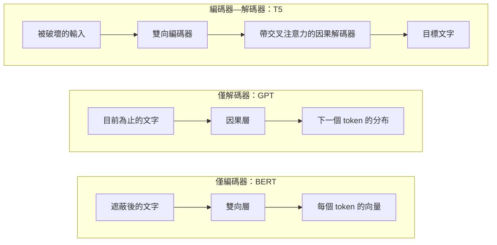

# 僅編碼器、僅解碼器與編碼器—解碼器 Transformer

Transformer 最初由兩個部分組成：讀取輸入的編碼器，以及寫出輸出的解碼器。在它問世後大約三年內，研究者就把它拆成三個家族，分別保留其中一半、另一半，或兩者都保留。這個選擇決定了每個位置能看到哪些 token，以及模型被訓練去預測什麼。

## 概觀

原始的 Transformer（見 [Transformers & Attention](../index.md)）是為機器翻譯而設計的。它的編碼器以雙向的注意力讀取來源句，解碼器則一次生成一個 token 的目標句，並在每一層透過*交叉注意力（cross-attention）*讀取編碼器的輸出。

之後出現三種設計：

- **僅編碼器**模型以 BERT（Devlin et al., 2018）為代表，保留雙向堆疊。它們的預訓練方式是遮住部分詞，再根據周圍的詞來預測。它們的輸出可用於分類、標註與檢索。
- **僅解碼器**模型以 GPT 系列為代表，只保留因果式堆疊。它們被預訓練來預測下一個 token，因此天然適合生成文字。
- **編碼器—解碼器**模型以 T5（Raffel et al., 2019）與 BART（Lewis et al., 2019）為代表，兩半都保留。編碼器讀取被破壞或附帶指令的輸入，解碼器寫出目標。

GPT-3（Brown et al., 2020）之後，僅解碼器模型成為大型語言模型的預設架構。另外兩個家族並未過時，它們在嵌入、分類、翻譯與語音等任務上仍然常見。

## 關鍵概念

- **注意力遮罩（attention mask）。** 規定一個 token 可以關注哪些位置的規則。*雙向*遮罩讓每個 token 看到整個序列；*因果*遮罩只讓它看到較早的位置。
- **交叉注意力。** 解碼器層對編碼器輸出的注意力，讓解碼器能讀取輸入。
- **預訓練目標。** 在大量未標註文字上使用的任務，尚未針對特定用途。常見的選擇有遮罩語言模型（MLM）、片段破壞（一種去噪形式），以及因果語言模型（也稱為下一個 token 預測）。
- **微調。** 在標註資料上，針對單一任務繼續訓練預訓練好的模型。
- **提示。** 以輸入文字說明任務，不更動權重。
- **零樣本與少樣本使用。** 在沒有範例，或只有少數範例放在提示中時解決任務。見 [GPT-3 少樣本學習](../../llm/gpt-3-few-shot/index.md)。

## 運作方式

### 遮罩決定每個 token 能看到什麼

注意力分數會對每一對位置計算，而遮罩決定哪些配對會被保留。對一個四個 token 的序列來說，因果遮罩是下三角形：

```text
            t1  t2  t3  t4
   t1        1   0   0   0
   t2        1   1   0   0
   t3        1   1   1   0
   t4        1   1   1   1
```

僅編碼器模型使用全為 1 的遮罩，因此每一對都被保留。編碼器—解碼器模型的編碼器是雙向的，解碼器是因果式的，交叉注意力則讓每個解碼器位置都能讀取每個編碼器位置。*前綴（prefix）*遮罩對前綴是雙向的，對其餘部分則是因果式的。UniLM（Dong et al., 2019）顯示，同一個共享網路可以在多種這類遮罩下訓練；T5 則比較了前綴變體與另外兩種結構。



### 預訓練目標

- **遮罩語言模型。** BERT 隨機選出 15% 的 token 位置。其中 80% 替換為遮罩 token，10% 替換為隨機 token，另外 10% 保持不變。模型必須從前後文脈恢復原始 token（Devlin et al., 2018）。損失只在被選中的位置上計算：

$$
\mathcal{L}_{\text{MLM}} = -\sum_{t \in M} \log p_\theta\!\left(x_t \mid x_{\setminus M}\right)
$$

這裡 \(M\) 是被選中的位置集合，\(x_{\setminus M}\) 是被破壞後的輸入。

- **片段破壞。** T5 移除連續的 token 片段，把每個片段替換成一個獨一無二的哨兵（sentinel）token，並要求解碼器寫出被移除的片段，每段前面接上它的哨兵。最終目標是破壞 15% 的 token，平均片段長度為三（Raffel et al., 2019）。
- **因果語言模型。** 每個位置根據前面的 token 預測下一個 token：

$$
\mathcal{L}_{\text{CLM}} = -\sum_{t} \log p_\theta\!\left(x_t \mid x_{<t}\right)
$$

兩種損失擷取的訊號量不同。因果損失在每個位置都有預測，而 MLM 只預測被選中的 15%。取捨在於：MLM 能看到兩側的脈絡，而因果損失只能看到過去。

## 關鍵方法

每個代表性方法都有自己的頁面。下表是簡要比較。

| 方法 | 家族 | 預訓練目標 | 重點 |
|---|---|---|---|
| [BERT](bert/index.md) | 僅編碼器 | 遮罩語言模型與下一句預測 | 雙向表示，加上一個輸出層後微調 |
| [T5](t5/index.md) | 編碼器—解碼器 | 片段破壞 | 把每個任務改寫成「文字進、文字出」 |
| [GPT-3](../../llm/gpt-3-few-shot/index.md) | 僅解碼器 | 因果語言模型 | 靠規模與提示完成任務，不需為任務更新梯度 |

## 相關連結

- [Transformers & Attention](../index.md) 概覽以一張表列出三種變體。本頁說明它們在遮罩與目標上的差異，以及領域為何走向目前的選擇。
- 遮罩與位置的機制見 [注意力變體](../attention-variants/index.md) 與 [位置編碼](../positional-encodings/index.md)。
- 解碼端的生成依賴 [KV 快取](../kv-cache/index.md)。僅編碼器模型只對固定輸入做一次前向計算，因此從這個快取獲益很少。
- 預測輸入中被隱藏的部分是一般性的自監督想法，見[遮罩預測](../../../paradigms/self-supervised/masked-prediction/index.md)。
- 密集檢索系統使用 BERT 式的編碼器，見[密集段落檢索](../../../../engineering/vector-databases/dense-passage-retrieval.md)。

這三個家族也與人類語言處理的研究相連。Goldstein et al.（2022）記錄了九位聽者聽一段 30 分鐘 podcast 時的皮質腦電圖（ECoG）。他們報告，大腦會在每個詞抵達之前預測即將出現的詞，而自迴歸語言模型也具有同樣的模式，並以相同方式使用脈絡嵌入。Caucheteux 與 King（2022）則把多種深度語言模型與人類對句子的 fMRI 與 MEG 反應做比較，發現模型與大腦之間的相似程度主要取決於模型從脈絡預測詞的能力。共通的原理是預測，而不是特定的遮罩方式。見[大腦中的語言](../../../../brain-mind/language-in-brain/index.md)與[預測編碼](../../../../brain-mind/predictive-coding/index.md)。

## 應用

| 家族 | 典型用途 | 例子 |
|---|---|---|
| 僅編碼器 | 分類、詞元標註、供搜尋使用的句子嵌入 | BERT 及其後繼者；以 BERT 式編碼器為基礎的檢索模型 |
| 編碼器—解碼器 | 翻譯、摘要、語音辨識 | T5；Whisper，以編碼器—解碼器 Transformer 建構的語音辨識系統（Radford et al., 2022） |
| 僅解碼器 | 聊天助理、程式碼、通用生成 | GPT-3 及之後的大型語言模型；經指令微調的聊天模型（Ouyang et al., 2022） |

### 為何僅解碼器模型成為預設

幾個方向的證據指向同一個結論。

1. **規模化。** Kaplan et al.（2020）的縮放定律研究是在自迴歸 Transformer 上進行的。它發現損失隨模型大小、資料量與運算量呈冪次下降。把單一的因果目標套用到每個 token 上，是一個容易規模化的簡單配方。
2. **生成就是訓練任務。** 因果模型被訓練去接續文字，因此提示、接續與對話都使用同一套機制。編碼器—解碼器模型則需要為每種任務設計不同的輸入與輸出格式。
3. **少樣本能力。** GPT-3（Brown et al., 2020）顯示，大型因果模型只要在提示中看到幾個範例，就能完成新任務，而不需要更新梯度。
4. **受控比較的結果並不一致。** Wang et al.（2022）在超過 50 億參數的規模上，比較了因果僅解碼器、非因果解碼器與編碼器—解碼器模型。在純無監督預訓練之後，以自迴歸語言模型訓練的因果模型，零樣本泛化最強。但在該研究中，以遮罩建模訓練、再經多任務微調的非因果模型整體表現最佳。T5 論文在自身規模上也發現了類似的分歧。
5. **後訓練。** InstructGPT（Ouyang et al., 2022）把監督式指令微調與人類回饋強化學習套用在僅解碼器的 GPT-3 模型上。這套做法之後被廣泛複製到聊天模型。

簡短的答案是：僅解碼器模型在規模、通用性與生成上勝出。證據並未顯示雙向注意力在每項任務上都較差。

## 未解問題

- **僅解碼器的優勢是否普遍成立？** 答案取決於預訓練後如何調整模型，而上述比較恰好改變了這一步。目前還不清楚這個排序在更大規模下是否仍然成立。
- **一個目標能否服務所有家族？** UL2（Tay et al., 2022）主張，架構與預訓練目標常被混為一談。它提出混合多種去噪目標的做法，並報告在多種設定下勝過 T5 與 GPT 式模型。
- **編碼器與嵌入。** 僅解碼器模型能否以相近成本，在嵌入任務上追上僅編碼器模型，仍有爭議。
- **大腦與模型。** 預測相似並不代表大腦與模型共享機制。上述研究測量的是相關性，而這種對應關係能延伸到什麼程度，尚待釐清。

## 參考文獻

### 開創性論文

- Vaswani, A., et al. (2017). *Attention Is All You Need*. NeurIPS. https://arxiv.org/abs/1706.03762 — 提出所有三個家族都由此衍生的編碼器—解碼器 Transformer。
- Devlin, J., et al. (2018). *BERT: Pre-training of Deep Bidirectional Transformers for Language Understanding*. arXiv；NAACL 2019. https://arxiv.org/abs/1810.04805 — 提出以遮罩語言模型與下一句預測訓練的僅編碼器模型。
- Raffel, C., et al. (2019). *Exploring the Limits of Transfer Learning with a Unified Text-to-Text Transformer*. arXiv；JMLR 2020. https://arxiv.org/abs/1910.10683 — 把所有 NLP 任務改寫成文字到文字的格式，並在受控研究中比較架構與目標。
- Lewis, M., et al. (2019). *BART: Denoising Sequence-to-Sequence Pre-training for Natural Language Generation, Translation, and Comprehension*. arXiv；ACL 2020. https://arxiv.org/abs/1910.13461 — 透過破壞文字再重建來預訓練編碼器—解碼器。
- Dong, L., et al. (2019). *Unified Language Model Pre-training for Natural Language Understanding and Generation*. NeurIPS. https://arxiv.org/abs/1905.03197 — 以多種自注意力遮罩訓練同一個 Transformer。
- Brown, T. B., et al. (2020). *Language Models are Few-Shot Learners*. NeurIPS. https://arxiv.org/abs/2005.14165 — 顯示一個 1750 億參數的僅解碼器模型，能在只有少數或沒有範例的提示下完成任務。
- Kaplan, J., et al. (2020). *Scaling Laws for Neural Language Models*. arXiv. https://arxiv.org/abs/2001.08361 — 測量自迴歸 Transformer 的交叉熵損失如何隨模型大小、資料與運算量呈冪次下降。
- Wang, T., et al. (2022). *What Language Model Architecture and Pretraining Objective Work Best for Zero-Shot Generalization?* arXiv. https://arxiv.org/abs/2204.05832 — 對僅解碼器與編碼器—解碼器模型的大規模比較，使用兩種預訓練目標。
- Ouyang, L., et al. (2022). *Training language models to follow instructions with human feedback*. NeurIPS. https://arxiv.org/abs/2203.02155 — 以人類回饋微調僅解碼器的 GPT-3 模型，使其能遵循指令。
- Tay, Y., et al. (2022). *UL2: Unifying Language Learning Paradigms*. arXiv；ICLR 2023. https://arxiv.org/abs/2205.05131 — 把架構與目標分開，提出在多種設定下勝過 T5 與 GPT 式模型的混合去噪器。

### 綜述與教科書

- Zhao, W. X., et al. (2023). *A Survey of Large Language Models*. arXiv. https://arxiv.org/abs/2303.18223 — 對語言模型發展的廣泛綜述，從統計模型到大型預訓練 Transformer 及其規模化。

### 文章與文件

- Radford, A., et al. (2022). *Robust Speech Recognition via Large-Scale Weak Supervision*. arXiv；ICML 2023. https://arxiv.org/abs/2212.04356 — 在超過 68 萬小時的多語言轉錄音訊上，訓練一個編碼器—解碼器 Transformer 進行語音辨識。
- Goldstein, A., et al. (2022). Shared computational principles for language processing in humans and deep language models. *Nature Neuroscience*. https://doi.org/10.1038/s41593-022-01026-4 — 比較 podcast 期間的 ECoG 記錄與自迴歸語言模型，發現兩者共享下一個詞的預測與脈絡嵌入。
- Caucheteux, C. & King, J.-R. (2022). Brains and algorithms partially converge in natural language processing. *Communications Biology*. https://doi.org/10.1038/s42003-022-03036-1 — 把多種語言模型與句子的 fMRI 和 MEG 反應做比較，發現腦部相似度主要來自預測能力。
