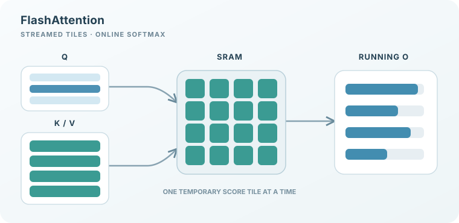
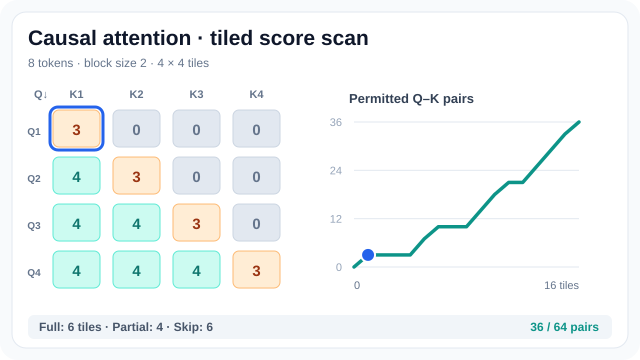
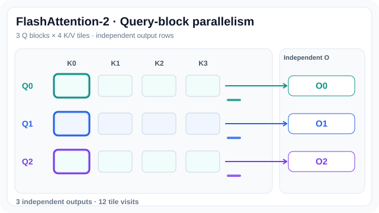
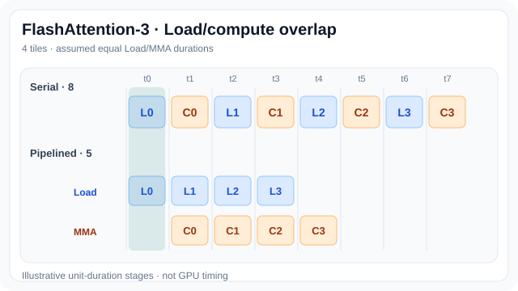

# FlashAttention

FlashAttention computes exact scaled dot-product attention with far less traffic to high-bandwidth memory. It does not approximate the attention matrix. It tiles the computation so that blocks of queries, keys and values stay in fast on-chip memory, and it never writes the full \(n \times n\) score matrix to slow memory. Dao et al. (2022) introduced it, and later versions improved its parallelism and its use of newer GPUs. It is the standard example of an [IO-aware](../index.md) exact attention variant, listed beside the other families on the [attention variants](../index.md) overview.

## Problem

Standard attention computes the score matrix \(S = QK^\top / \sqrt{d}\), applies a softmax to each row, and multiplies by \(V\). The matrix has \(n^2\) entries for a sequence of length \(n\). On a GPU, writing it to and reading it from high-bandwidth memory costs more time than the arithmetic, so attention is limited by memory traffic rather than by FLOPs, as the [memory hierarchy](../../../../../engineering/hardware/memory-hierarchy/index.md) page explains.

## Core idea

Split \(Q\), \(K\) and \(V\) into blocks that fit in on-chip SRAM. For each block of queries, stream over the blocks of keys and values, compute the partial scores, and update the output as each block arrives. The softmax is computed incrementally, so the full row of scores never exists in memory at once. In the backward pass, the method recomputes the scores that it did not store, which trades a little extra arithmetic for much less memory traffic.

### Animated walkthrough

*Original CC BY-SA 4.0 teaching animation. The highlighted columns **schematically represent successive K/V blocks**, not a full attention matrix stored in SRAM or HBM. The bars indicate repeated updates to the running output, not measured values or a GPU execution trace. This is exact attention with online softmax, not a sparse or approximate attention algorithm (Dao et al., 2022; see References). [Open the full-size animation](../../../../../assets/concept-animations/flashattention-streaming-tiles.svg) to inspect it on a small screen; in the standalone SVG, hover or focus with the keyboard to pause. On MkDocs, the keyboard-accessible **Play/Pause** control switches to the [static overview](../../../../../assets/concept-animations/flashattention-streaming-tiles-still.svg); reduced-motion settings show this overview initially. GitHub readers can open the same still image even if SVG motion is suppressed.*

## Equation or algorithm

For one query row, let the running maximum be \(m\) and the running normaliser be \(\ell\). When a new block of scores \(s\) arrives, the update is

\[
m' = \max(m, \max(s)), \qquad
\ell' = e^{m - m'}\,\ell + \sum e^{s - m'}
\]

and the partial output is rescaled by the same factor \(e^{m - m'}\) before the new block's contribution is added. The final output equals the standard softmax attention exactly, because the rescaling keeps every term relative to the final maximum. The incremental form of the softmax follows the running-normaliser technique described by Milakov and Gimelshein (2018).

The memory needed for the attention output and the statistics is \(O(n)\) rather than \(O(n^2)\), while the arithmetic remains \(O(n^2 d)\).

### Online softmax: rescaling when the maximum changes

*Original CC BY-SA 4.0 preview; [open the 12-second SVG animation](../../../../../assets/concept-animations/flashattention-online-rescale-motion.svg).* For synthetic score tiles \(A=[1,2]\) and \(B=[5,0]\), tile A has running maximum \(m_A=2\) and mass \(\ell_A=1+e^{-1}\approx1.368\). The second tile raises the maximum to \(m'=5\), so the **old mass must be rescaled** by \(e^{2-5}\). Its contribution becomes \(0.068\); the new tile contributes \(1+e^{-5}\approx1.007\), giving \(\ell'\approx1.075\). Simply adding separately normalised tile masses would give an incorrect result. The graphic displays exact analytic calculations rounded to three decimals, **not model measurements or GPU timings**. On MkDocs, Play/Pause and keyboard activation select the animation or static fallback; reduced-motion users see the still initially (Milakov & Gimelshein, 2018; Dao et al., 2022).

### Exact blockwise output is not the average of tile outputs

*Original CC BY-SA 4.0 preview; [open the 12-second SVG animation](../../../../../assets/concept-animations/flashattention-exact-merge-motion.svg).* Give the four synthetic scores \([1,2,5,0]\) values \([1,3,4,-2]\). Independent softmax of tile A yields \(y_A\approx2.462\), and of tile B yields \(y_B\approx3.960\). Averaging those tile outputs gives **3.211**, which is wrong because their normalisation masses differ. Correctly merge the *unnormalised value-weighted sums* after moving both tiles to the shared maximum \(m'=5\):

\[
a'=e^{-3}(e^{-1}\cdot1+3)+(4-2e^{-5}),\qquad
\ell'=e^{-3}(1+e^{-1})+1+e^{-5},\qquad y=a'/\ell'\approx3.865.
\]

The result agrees with dense softmax up to floating-point rounding. The animated marker distinguishes the incorrect tile average from the exact streaming merge; the diagram is an **analytic illustration**, not an observed model output. The same MkDocs motion controls and reduced-motion fallback apply (Dao et al., 2022).

### Causal block classification: skip, mask, or compute

*Original CC BY-SA 4.0 fallback; [open the 12-second SVG tile-scan animation](../../../../../assets/concept-animations/flashattention-causal-tiles-motion.svg).* For a synthetic **causal** sequence of eight tokens with a score-tile width of two, the four-by-four block grid contains **6 fully masked future tiles**, **4 diagonal tiles** with three permitted query–key pairs each, and **6 complete past tiles** with four pairs each. The total is \(6\times 0+4\times 3+6\times 4=36=8(8+1)/2\) directed causal pairs, compared with 64 entries in the unrestricted square grid. The blue marker visits every tile and the curve tracks the exact cumulative permitted-pair count; these are *algorithmic mask permissions*, not measured GPU execution, throughput, or guaranteed kernel tile-skipping behaviour. Actual implementations depend on block size and masking strategy (Dao et al., 2022; see References). MkDocs adds keyboard-accessible Play/Pause and a reduced-motion still.

### Backward recomputation: save statistics instead of the probability matrix

*Original CC BY-SA 4.0 fallback; [open the 12-second SVG forward/backward data-flow animation](../../../../../assets/concept-animations/flashattention-backward-remat-motion.svg).* The schematic traces four operations: read query/key/value data into on-chip memory, save the output and row log-sum-exp statistics, reload the needed inputs in the backward pass, then **recompute each score tile** to recover local softmax probabilities and accumulate \(dQ,dK,dV\). The full \(n\times n\) attention probability matrix need not persist in high-bandwidth memory. Retained intermediates and gradient-kernel details vary between FlashAttention versions; the diagram shows the central **memory-versus-recomputation** trade-off rather than literal allocation sizes or hardware timings. This is an architectural explanation, not a measured model trace (Dao et al., 2022; see References). The built site supports Play/Pause and reduced-motion fallback.

### FlashAttention-2: independent query-row blocks

*Original CC BY-SA 4.0 static fallback; [open the 12-second moving query-block SVG](../../../../../assets/concept-animations/flashattention2-query-parallel-motion.svg).* The synthetic example partitions three query row blocks across independent work units. Each streams over four K/V tiles and maintains **its own** online-softmax statistics and output; there are \(3\times4=12\) conceptual tile visits. Dividing work by **query rows** avoids a cross-block merge of partial outputs for those rows, unlike assigning separate key partitions to different work units. The three synchronised markers illustrate independent progress, **not an observed thread-block schedule, throughput result or an assertion that all implementations use exactly three blocks**. The actual scheduling and block shapes depend on the GPU and kernel (Dao, 2023; see References). The MkDocs page exposes Play/Pause, keyboard control and a reduced-motion still; the SVG itself does not offer seek or single-step.

### FlashAttention-3: overlapping tile transfer and matrix multiplication

*Original CC BY-SA 4.0 static fallback; [open the 12-second pipelined-timeline SVG](../../../../../assets/concept-animations/flashattention3-load-compute-pipeline-motion.svg).* To isolate the dependency, suppose four synthetic tiles each require **one abstract time unit to load** and **one to compute**. Fully serial execution takes \(2T=8\) units. With two idealised asynchronous stages, loading tile \(i+1\) can coincide with computing tile \(i\), yielding \(T+1=5\) units for \(T=4\). The moving column reveals the overlap, warm-up and drain. **These units are deliberately artificial:** memory and MMA costs are not equal in general, launch overhead is omitted, and 8 versus 5 is **not** a FlashAttention-3 speedup or GPU measurement. Actual implementations exploit hardware-supported asynchronous copy and matrix-multiply scheduling (Shah et al., 2024; see References). MkDocs adds Play/Pause and reduced-motion fallback.

## Results

Dao et al. (2022) report that the method is faster than standard exact attention and uses less memory, with the same output. FlashAttention-2 (Dao, 2023) reports about twice the speed of the original, and reaches roughly 50 to 73 percent of the A100's theoretical peak FLOPs per second. FlashAttention-3 (Shah et al., 2024) reports attention that runs 1.5 to 2 times faster on H100 GPUs, at about 740 TFLOPs per second in FP16 and nearly 1.2 PFLOPs per second in FP8.

## Limitations

The method is exact, so its time complexity remains \(O(n^2)\). Rabe and Staats (2021) show that exact attention can be computed in \(O(\log n)\) memory, but that bound still needs quadratic time, so long sequences remain costly. The kernels are written for specific GPU architectures, and each generation requires new work. Gains also depend on the sequence length, head dimension and batch size, so benchmark numbers from one configuration do not transfer directly to another.

## Open issues and related variants

- **Long-context cost.** Exact attention stays quadratic in time. Whether sparse or linear variants keep quality as the sequence grows is task dependent; see the [attention variants](../index.md) overview.
- **Low precision.** FlashAttention-3 uses FP8 on recent hardware. How much accuracy the lower precision costs across tasks is an open question, and it links to the [co-design](../../../../../engineering/hardware/co-design/index.md) trade-offs.
- **Decoding.** During generation, each step reads the whole [KV cache](../../kv-cache/index.md) rather than computing a large score matrix, so FlashAttention helps prefill more than single-token decoding.
- **Related:** the [KV cache](../../kv-cache/index.md) and shared-head designs address a different cost, the memory of keys and values, rather than the traffic of the score matrix.

## Connections

FlashAttention is a software answer to the memory-bound behaviour analysed in the [memory hierarchy](../../../../../engineering/hardware/memory-hierarchy/index.md) page. It shows how a kernel can change the bytes term of the roofline without changing the model, which is the same logic as the [co-design](../../../../../engineering/hardware/co-design/index.md) page.

## References

### Seminal papers

- Dao, T., et al. (2022). *FlashAttention: Fast and Memory-Efficient Exact Attention with IO-Awareness*. arXiv:2205.14135. https://arxiv.org/abs/2205.14135 — Tiled, IO-aware exact attention that avoids writing the score matrix to high-bandwidth memory.
- Dao, T. (2023). *FlashAttention-2: Faster Attention with Better Parallelism and Work Partitioning*. arXiv:2307.08691. https://arxiv.org/abs/2307.08691 — Reports about twice the speed of the original, through better parallelism across GPU threads.
- Shah, J., et al. (2024). *FlashAttention-3: Fast and Accurate Attention with Asynchrony and Low-precision*. arXiv:2407.08608. https://arxiv.org/abs/2407.08608 — Reports 1.5 to 2 times faster attention on H100 GPUs, including FP8 kernels.

### Surveys and textbooks

(none checked for this page)

### Lectures and videos

(none checked for this page)

### Articles and documentation

- Rabe, M. N., Staats, C. (2021). *Self-attention Does Not Need O(n²) Memory*. arXiv:2112.05682. https://arxiv.org/abs/2112.05682 — Shows that exact self-attention can be computed in logarithmic memory, while its time remains quadratic.
- Milakov, M., Gimelshein, N. (2018). *Online normalizer calculation for softmax*. arXiv:1805.02867. https://arxiv.org/abs/1805.02867 — Computes softmax with fewer memory accesses by updating a running maximum and normaliser.
