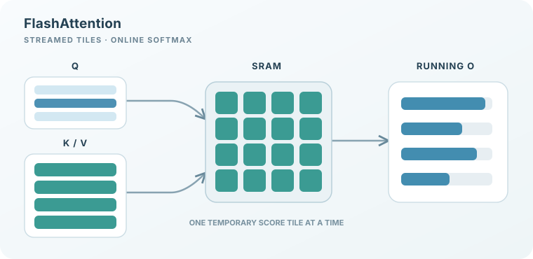
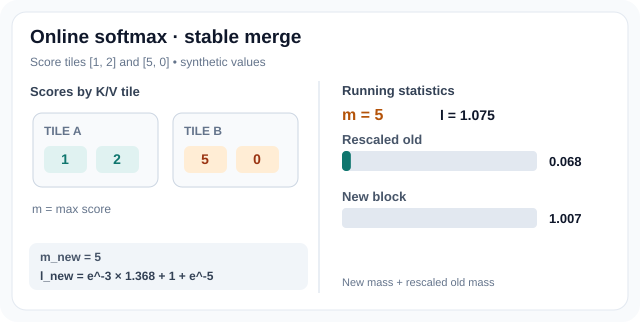
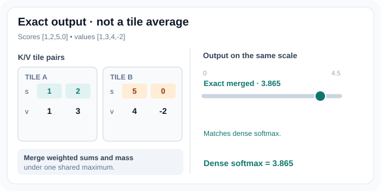
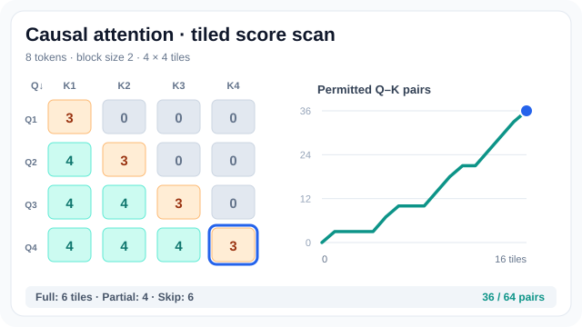
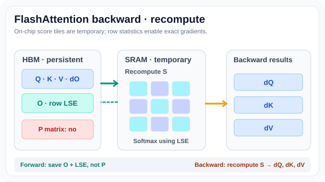
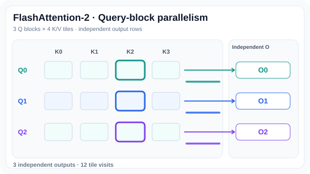
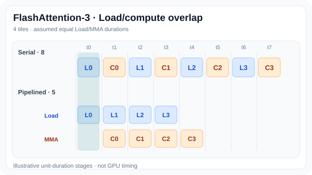

# FlashAttention

FlashAttention 計算精確的縮放點積注意力，並大幅減少與高頻寬記憶體之間的資料流量。它不近似注意力矩陣。它把計算切分成區塊，使查詢、鍵與值的區塊留在快速的晶片上記憶體中，並且從不把完整的 \(n \times n\) 分數矩陣寫到較慢的記憶體。Dao 等人（2022）提出此方法，後續版本改善了平行性，並更善用新世代的 GPU。它是 [IO 感知](../index.zh-TW.md)精確注意力的標準例子，與[注意力變體](../index.zh-TW.md)總覽中的其他家族並列。

## 問題

標準注意力計算分數矩陣 \(S = QK^\top / \sqrt{d}\)，對每一列套用 softmax，再乘上 \(V\)。對長度為 \(n\) 的序列，這個矩陣有 \(n^2\) 個元素。在 GPU 上，把它寫入與讀出高頻寬記憶體的時間，超過運算本身，因此注意力受記憶體流量限制，而非受 FLOPs 限制，正如[記憶體階層](../../../../../engineering/hardware/memory-hierarchy/index.zh-TW.md)頁所說明的。

## 核心想法

把 \(Q\)、\(K\) 與 \(V\) 切成能放進晶片上 SRAM 的區塊。對每一個查詢區塊，串流掃過各個鍵與值的區塊，計算部分分數，並在每個區塊到達時更新輸出。softmax 以增量方式計算，因此完整的分數列從未同時存在於記憶體中。在反向傳播時，此方法會重算它沒有儲存的分數，以少量額外運算換取大幅減少的記憶體流量。

### 動畫示意

*原創教學動畫，採 CC BY-SA 4.0 授權。依序亮起的欄位**僅示意不同 K/V 區塊的處理順序**，不代表將完整注意力矩陣存放在 SRAM 或 HBM。右側長條示意輸出反覆更新，並非模型實測數值或 GPU 執行紀錄。這是使用線上 softmax 的精確注意力，並非稀疏或近似注意力演算法（Dao 等人，2022；參見參考文獻）。手機可[開啟原尺寸動畫](../../../../../assets/concept-animations/flashattention-streaming-tiles.svg)檢視；獨立開啟 SVG 後，可用滑鼠停留或鍵盤聚焦來暫停。MkDocs 提供可用鍵盤操作的**播放／暫停**控制，暫停時會顯示[靜態概覽](../../../../../assets/concept-animations/flashattention-streaming-tiles-still.svg)；啟用減少動態效果時預設顯示靜態概覽。即使 GitHub 不播放 SVG 動畫，也可直接查看此圖。*

## 公式或演算法

對一個查詢列，令執行中的最大值為 \(m\)，執行中的正規化項為 \(\ell\)。當一個新的分數區塊 \(s\) 到達時，更新為

\[
m' = \max(m, \max(s)), \qquad
\ell' = e^{m - m'}\,\ell + \sum e^{s - m'}
\]

部分輸出在加入新區塊的貢獻前，以同一個因子 \(e^{m - m'}\) 重新縮放。最終輸出與標準的 softmax 注意力完全相等，因為縮放使每一項都相對於最終的最大值。softmax 的增量形式沿用 Milakov 與 Gimelshein（2018）所描述的執行正規化技巧。

注意力輸出與統計量所需的記憶體為 \(O(n)\)，而非 \(O(n^2)\)；運算量仍為 \(O(n^2 d)\)。

### 線上 Softmax：最大值變更時必須重新縮放

*原創 CC BY-SA 4.0 靜態預覽；[開啟 12 秒 SVG 動畫](../../../../../assets/concept-animations/flashattention-online-rescale-motion.svg)。* 以人工設定的兩個分數區塊 \(A=[1,2]\)、\(B=[5,0]\) 為例。第一個區塊的最大值為 \(m_A=2\)，正規化項為 \(\ell_A=1+e^{-1}\approx1.368\)。第二個區塊使共同最大值變成 \(m'=5\)，因此先前的正規化質量**必須乘上** \(e^{2-5}\)，降至約 \(0.068\)；新區塊貢獻 \(1+e^{-5}\approx1.007\)，合併後為 \(\ell'\approx1.075\)。直接相加各區塊在不同最大值下的質量會得到錯誤結果。圖內數值為解析計算並四捨五入至小數第三位，**不是模型實測或 GPU 耗時**。MkDocs 提供播放／暫停及鍵盤操作，偏好減少動態效果時預設顯示靜態圖（Milakov 與 Gimelshein，2018；Dao 等人，2022）。

### 區塊輸出的簡單平均不等於精確注意力

*原創 CC BY-SA 4.0 靜態預覽；[開啟 12 秒 SVG 動畫](../../../../../assets/concept-animations/flashattention-exact-merge-motion.svg)。* 設四個人工分數為 \([1,2,5,0]\)，對應數值為 \([1,3,4,-2]\)。各自正規化後，區塊 A 的輸出 \(y_A\approx2.462\)，區塊 B 的輸出 \(y_B\approx3.960\)；直接平均會得到 **3.211**，但兩個區塊的正規化質量並不相同。正確方法是先將*未正規化的數值加權總和*轉換到共同最大值 \(m'=5\)，再做合併：

\[
a'=e^{-3}(e^{-1}\cdot1+3)+(4-2e^{-5}),\qquad
\ell'=e^{-3}(1+e^{-1})+1+e^{-5},\qquad y=a'/\ell'\approx3.865.
\]

結果與完整 Dense Softmax 一致（除浮點數四捨五入誤差）。動畫以不同標記呈現錯誤的區塊平均與精確的串流合併；這是**解析式教學示意，不是訓練模型輸出**。沿用 MkDocs 的播放／暫停、鍵盤操作及 Reduced Motion 靜態回退（Dao 等人，2022）。

### 因果注意力分塊：略過、遮罩或完整計算

*原創 CC BY-SA 4.0 回退預覽；[開啟 12 秒 SVG 分塊掃描動畫](../../../../../assets/concept-animations/flashattention-causal-tiles-motion.svg)。* 以八個人工 Token、每個分數區塊寬度為二的**因果注意力**為例，四乘四的分塊網格包含 **6 個全部位於未來的略過區塊**、**4 個各有三組合法 Query–Key 配對的對角區塊**，以及 **6 個各有四組合法配對的完整過去區塊**。因此共有 \(6\times 0+4\times 3+6\times 4=36=8(8+1)/2\) 組合法的有向因果配對，而未限制的八乘八網格則有 64 格。藍色游標依序掃過各區塊，折線累加每一步確切的合法配對數；這些是**注意力遮罩允許的連線**，並非實測 GPU 執行過程、吞吐量或特定核心程式一定會略過的工作量。實際區塊處理與遮罩策略依實作而定（Dao 等人，2022；見參考文獻）。MkDocs 提供鍵盤可操作的播放／暫停及 Reduced Motion 靜態回退。

### 反向傳播重算：儲存統計量，而非機率矩陣

*原創 CC BY-SA 4.0 回退預覽；[開啟 12 秒 SVG 前向與反向資料流動畫](../../../../../assets/concept-animations/flashattention-backward-remat-motion.svg)。* 此示意流程包含四個操作：讀取 Query／Key／Value 至晶片上記憶體、保存輸出與每列 log-sum-exp 統計量、反向傳播時重新載入所需輸入，最後**重新計算分數區塊**，求出局部 Softmax 機率並累加 \(dQ,dK,dV\)。完整的 \(n\times n\) 注意力機率矩陣不必持續存放於高頻寬記憶體。各版本實際保留哪些中間結果以及梯度核心程式細節會有所不同；此圖解釋的是**儲存空間與重算成本的取捨**，不是記憶體配置或硬體耗時實測，也不是訓練模型的執行軌跡（Dao 等人，2022；見參考文獻）。網站支援播放／暫停和 Reduced Motion 回退。

### FlashAttention-2：以 Query 區塊分工，避免跨區塊合併輸出

*原創 CC BY-SA 4.0 靜態回退圖；[開啟 12 秒 Query 區塊分工動畫](../../../../../assets/concept-animations/flashattention2-query-parallel-motion.svg)。* 人工示例將三個 Query 列區塊分配給彼此獨立的運算工作單位，每組依序處理四個 K/V 區塊，且**各自維護**線上 Softmax 統計量與輸出，因此概念上共有 \(3\times4=12\) 次分塊操作。依**查詢列**切分時，每組工作單位擁有不同的輸出列，無須在不同工作單位間合併同一輸出列的局部結果；這與將同一列的 Key 維度分割給不同工作單位的做法不同。三個游標同步前進只是方便理解的示意，**不代表真實 GPU 執行緒區塊排程、吞吐量實測，也不代表實作一定只有三個區塊**。實際區塊尺寸及排程取決於核心程式與硬體（Dao，2023；見參考文獻）。MkDocs 提供播放／暫停、鍵盤操作及 Reduced Motion 回退；SVG 本身未提供單步或進度拖曳。

### FlashAttention-3：重疊載入與矩陣乘法運算

*原創 CC BY-SA 4.0 靜態回退圖；[開啟 12 秒管線時間軸動畫](../../../../../assets/concept-animations/flashattention3-load-compute-pipeline-motion.svg)。* 為了隔離資料相依關係，假設四個人工區塊各需要**一單位載入時間**與**一單位矩陣乘法時間**。完全串列處理需要 \(2T=8\) 單位；在理想化雙階段非同步管線中，處理第 \(i\) 個區塊的矩陣乘法時可同時載入第 \(i+1\) 個區塊，因此 \(T=4\) 時為 \(T+1=5\) 單位。移動游標凸顯載入與計算重疊，以及管線啟動與排空。**這些時間單位完全是假設值**：真實記憶體載入與矩陣運算時間未必相等，此圖忽略額外開銷，**8 與 5 不是 FlashAttention-3 的實測加速比**。實際核心程式利用硬體非同步載入及矩陣乘法排程（Shah 等人，2024；見參考文獻）。網站支援播放／暫停與減少動態效果回退。

## 結果

Dao 等人（2022）報告，此方法比標準的精確注意力更快，且使用較少記憶體，輸出相同。FlashAttention-2（Dao，2023）報告其速度約為原版的兩倍，並達到 A100 理論峰值 FLOPs 每秒的約 50% 至 73%。FlashAttention-3（Shah 等人，2024）報告在 H100 GPU 上注意力快 1.5 至 2 倍，FP16 約達每秒 740 TFLOPs，FP8 則接近每秒 1.2 PFLOPs。

## 限制

此方法是精確的，因此其時間複雜度仍為 \(O(n^2)\)。Rabe 與 Staats（2021）顯示精確注意力可以用 \(O(\log n)\) 的記憶體計算，但該界限仍需要二次方的時間，因此長序列仍然昂貴。核心程式是為特定的 GPU 架構撰寫的，每一世代都需要新的工作。收益也取決於序列長度、頭維度與批次大小，因此某一組設定下的基準數字無法直接套用到另一組。

## 開放問題與相關變體

- **長上下文成本。** 精確注意力的時間仍是二次方。稀疏或線性變體能否在序列變長時維持品質，取決於任務，見[注意力變體](../index.zh-TW.md)總覽。
- **低精度。** FlashAttention-3 在新硬體上使用 FP8。低精度在各類任務上的準確度代價仍是開放問題，這也與[協同設計](../../../../../engineering/hardware/co-design/index.zh-TW.md)的取捨有關。
- **解碼。** 生成時，每一步讀取的是整個 [KV 快取](../../kv-cache/index.zh-TW.md)，而非計算大型分數矩陣，因此 FlashAttention 對預填階段的幫助大於對單一 token 解碼的幫助。
- **相關：** [KV 快取](../../kv-cache/index.zh-TW.md)與共享頭的設計處理的是另一種成本，即鍵與值的記憶體，而非分數矩陣的流量。

## 相關連結

FlashAttention 是對[記憶體階層](../../../../../engineering/hardware/memory-hierarchy/index.zh-TW.md)頁中分析的記憶體受限行為的軟體解法。它展示了核心程式如何在不改變模型的情況下改變屋頂線模型中的位元組項，這與[協同設計](../../../../../engineering/hardware/co-design/index.zh-TW.md)頁的邏輯相同。

## 參考文獻

### 開創性論文

- Dao, T., 等人 (2022). *FlashAttention: Fast and Memory-Efficient Exact Attention with IO-Awareness*. arXiv:2205.14135. https://arxiv.org/abs/2205.14135 — 具分塊與 IO 感知能力的精確注意力，避免把分數矩陣寫入高頻寬記憶體。
- Dao, T. (2023). *FlashAttention-2: Faster Attention with Better Parallelism and Work Partitioning*. arXiv:2307.08691. https://arxiv.org/abs/2307.08691 — 透過更好的 GPU 執行緒平行性，報告速度約為原版的兩倍。
- Shah, J., 等人 (2024). *FlashAttention-3: Fast and Accurate Attention with Asynchrony and Low-precision*. arXiv:2407.08608. https://arxiv.org/abs/2407.08608 — 報告在 H100 GPU 上注意力快 1.5 至 2 倍，包括 FP8 核心。

### 綜述與教科書

（本頁尚未查核任何項目）

### 講座與影片

（本頁尚未查核任何項目）

### 文章與文件

- Rabe, M. N., Staats, C. (2021). *Self-attention Does Not Need O(n²) Memory*. arXiv:2112.05682. https://arxiv.org/abs/2112.05682 — 顯示精確的自注意力可以用對數記憶體計算，但時間仍為二次方。
- Milakov, M., Gimelshein, N. (2018). *Online normalizer calculation for softmax*. arXiv:1805.02867. https://arxiv.org/abs/1805.02867 — 以更新執行中的最大值與正規化項的方式，以較少的記憶體存取計算 softmax。
