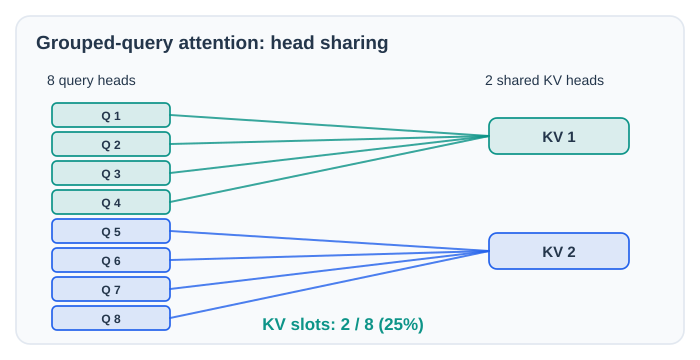
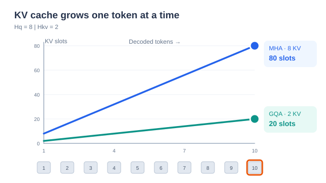
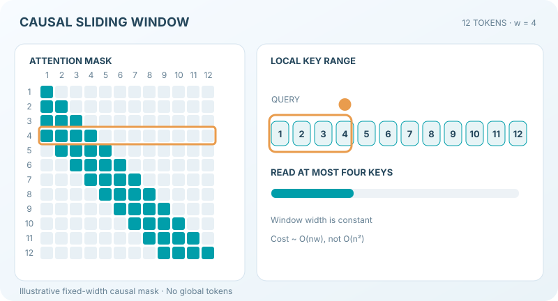
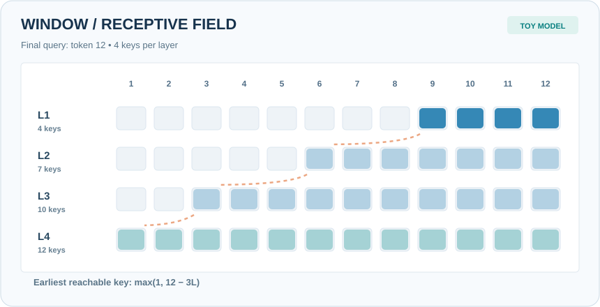
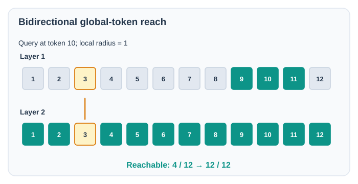
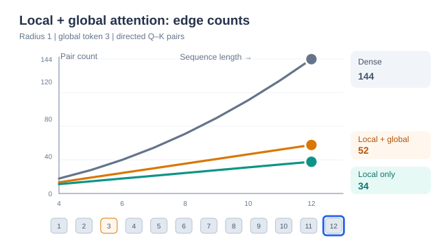

---
related:
- theory/models/llm
aliases:
  - Attention Variants
  - Efficient Attention
  - 注意力變體
  - 高效注意力
tags:
  - attention
  - efficient inference
  - long context
last_reviewed: 2026-10-28
---

# Attention Variants

Standard scaled dot-product attention costs \(O(n^2)\) time and memory in the sequence length \(n\). During training this limits context length. During generation it also makes each new token read a large [key–value cache](../kv-cache/index.md). Most attention variants target one of three costs: the number of key–value heads that must be stored, the number of query–key pairs that are computed, or the memory traffic needed to compute the exact result. This page covers the variants that change the attention computation itself; the choice of positional encoding is covered in [Positional encodings](../positional-encodings/index.md).

## Overview

| Family | What is reduced | Examples | Cost after change |
|---|---|---|---|
| Shared heads | Size of the key–value cache | MQA, GQA | Same compute, less memory |
| Sparse or local patterns | Number of query–key pairs | Sparse Transformer, Longformer, sliding window | About \(O(n\sqrt{n})\) or \(O(nw)\) |
| Linear attention | Use of the softmax | Linear Transformers, Performers | \(O(n)\), approximate |
| IO-aware exact attention | Memory traffic | FlashAttention | Same result, less memory and time |

## Approaches

### Shared key and value heads

In multi-head attention each head has its own keys and values. Multi-query attention (MQA) keeps one shared set of keys and values for all query heads, which shrinks the key–value cache by the number of heads. Grouped-query attention (GQA) shares keys and values within groups of query heads, so it sits between full multi-head and multi-query attention. GQA can be obtained by converting an existing multi-head checkpoint with a short extra training run, which is why many open models use it.

*Original CC BY-SA 4.0 fallback preview.* Eight query heads are mapped to 1, 2, 4 or 8 shared key/value heads. With equal head dimensions and context length, the **KV-head count** relative to eight-head MHA is 12.5%, 25%, 50% or 100%; this is not the complete model-memory ratio or a benchmark result. [Ainslie et al. (2023)](https://arxiv.org/abs/2305.13245).

The image above remains readable on GitHub or without JavaScript; MkDocs enables the interactive head-sharing calculation.

*Interactive exercise: use the KV-head slider, Previous/Next, Play/Pause, Speed and Reset. The connecting edges and allocated KV-head slots update for each grouping. This is an architectural illustration, not an accuracy or runtime measurement.*

#### Incremental KV-cache growth

*Original CC BY-SA 4.0 temporal visual.* [Open the 11-second SVG animation](../../../../assets/concept-animations/gqa-cache-growth-motion.svg) to watch a token-by-token cursor traverse both cumulative traces. With eight query heads, full MHA uses \(H_{kv}=8\) and this GQA example uses \(H_{kv}=2\). The number of stored **per-head K/V position pairs** is \(8n\) versus \(2n\); at \(n=10\), that is **80 versus 20**. Each plotted “slot” includes one K and V position at a fixed matched head dimension, **not** bytes, total model memory, or measured decoding speed. The points correspond to discrete decoded tokens; graph segments are only interpolation. MkDocs reuses Play/Pause, Enter/Space and a reduced-motion still (Ainslie et al., 2023; see References).

### Sparse and local patterns

Instead of attending to all earlier tokens, sparse attention restricts each query to a fixed pattern. The Sparse Transformer uses strided and fixed patterns that reach far back while keeping cost near \(O(n\sqrt{n})\). Longformer combines a sliding window with a few global tokens, which gives linear cost in \(n\). Sliding-window attention with a fixed window is used in Mistral 7B, where information still spreads through the layers because each layer passes information forward by one window. Local patterns are fast but cannot retrieve arbitrary distant tokens unless other mechanisms exist.

*Original CC BY-SA 4.0 teaching visual. The orange query and its last four accessible keys move together across a 12-token, width-4 causal mask. Row \(t\) can read only keys \(j\in[\max(1,t-3),t]\); there are no global tokens in this example. The continuous positions between token indices are **visual interpolation**, not fractional token computation. [Open the motion SVG](../../../../assets/concept-animations/sliding-window-mask-motion.svg). On MkDocs, **Play/Pause** (also Enter/Space) switches between motion and a readable still, with reduced-motion settings respected. The colours and width are illustrative, not benchmark measurements (Beltagy et al., 2020; see References).*

The static concept image above remains available without JavaScript. The interactive calculation is enhanced on the MkDocs site.

*Interactive exercise: change query index and window width; the mask, visible keys, and exact permitted-pair count update together. Use Previous/Next, the seek slider, Play/Pause, Speed and Reset. For 12 tokens and window width 4 there are **42** permitted causal pairs versus **78** in full causal attention. This is an analytic pattern count, not a measured runtime.*

*Original CC BY-SA 4.0 multi-layer receptive-field animation.* A width-4 causal window gives the final token at position 12 access to positions **9–12** in one layer, **6–12** in two, **3–12** in three, and **1–12** in four. Under local mixing at each layer, without global tokens, the earliest possible source at depth \(L\) is \(\max(1,12-3L)\). The coloured rows distinguish **possible information dependence**, not learned attention weights or guaranteed retention. The four-stage emphasis shows how reach propagates through successive layers; it is **not a continuous fractional-layer computation**. [Open the animated SVG](../../../../assets/concept-animations/sliding-window-depth-reach-motion.svg). MkDocs supports Play/Pause, Enter/Space, keyboard-focusable horizontal scrolling and a reduced-motion still. This is a constructed example, not a model measurement (Beltagy et al., 2020; Jiang et al., 2023; see References).

*Original CC BY-SA 4.0 static fallback.* This separate **bidirectional encoder** experiment starts at query position 10, uses local radius 1, and optionally makes position 3 a globally connected token. With global links, backward reachability expands from **1 → 4 → 12** positions over depths 0–2; without the global token it is **1 → 3 → 5**. In the first layer the reachable set is {3, 9, 10, 11}. In the second layer token 3 itself attends all twelve positions. This is a graph-of-possible-dependencies calculation, **not a causal decoder mask**, learned attention strength, or measured recall (Beltagy et al., 2020).

The static example above remains readable on GitHub or without JavaScript; MkDocs enables the layer-wise reachability explorer.

*Interactive exercise: choose depth 0–3, toggle the global token, or use Previous/Next, Play/Pause, Speed and Reset. Both the previous reachability set and new source positions are recalculated.*

#### Counting local and global links

*Original CC BY-SA 4.0 counting animation.* [Open the 11-second SVG animation](../../../../assets/concept-animations/global-local-pair-count-motion.svg) to watch new positions arrive in a **bidirectional** local-radius-one encoder with token 3 globally connected. For \(4\le n\le12\), the number of distinct directed query–key pairs (including self-pairs) is \(n^2\) for dense attention, \(3n-2\) for local-only attention and \(5n-8\) for local-plus-global attention. At \(n=12\) the constructed counts are **144, 34, and 52**. Both directions of every global edge are considered but already-local edges are not double-counted. These are permitted connection counts, **not** equal-cost operations, measured runtime, or learned attention. The marker advances in integer token steps and connecting lines are visual interpolation. MkDocs provides Play/Pause, keyboard activation and reduced-motion stills (Beltagy et al., 2020; see References).

### Linear attention

Linear attention replaces the softmax with a kernel feature map \(\phi\), so that the product can be reordered as \(\phi(Q)\,(\phi(K)^\top V)\). The expression \(\phi(K)^\top V\) can be accumulated as a running state, which turns attention into a recurrent update with constant cost per token. Katharopoulos et al. (2020) showed this equivalence and its autoregressive form. Performers approximate the softmax kernel with random features (FAVOR+), so that the approximation can be made as accurate as needed by using more features.

Original CC BY-SA 4.0 teaching visual. In causal **normalised kernel linear attention**, \(S_t=S_{t-1}+\phi(k_t)v_t^{\top}\), \(z_t=z_{t-1}+\phi(k_t)\), and

$$
y_t=\frac{\phi(q_t)^{\top}S_t}{\phi(q_t)^{\top}z_t}
$$

, assuming a nonzero denominator. The scalar illustration fixes \(\phi(q_t)=1\), keys \((1,2,1,2)\) and values \((1,0,3,2)\). Its cumulative \((S_t,z_t,y_t)\) are \((1,1,1)\), \((1,3,1/3)\), \((4,4,1)\), \((8,6,4/3)\). This **changes the attention kernel**; it is not equivalent to standard softmax attention, and the token-flow interpolation is not a measured model trace. [Open the motion SVG](../../../../assets/concept-animations/linear-attention-recurrence-motion.svg); MkDocs adds keyboard-accessible **Play/Pause**, with a still fallback for reduced motion (Katharopoulos et al., 2020; see References).

The static concept image above remains available without JavaScript. The interactive calculation is enhanced on the MkDocs site.

*Interactive exercise: step through the exact scalar recurrence and change the third value from 3 to 5. The final state changes from \(S_4=8,z_4=6,y_4=4/3\) to \(S_4=10,z_4=6,y_4=5/3\). This uses \(\phi(q)=1\) and positive mapped keys; it is a toy calculation, not a trained model or softmax-equivalent computation.*

*Original CC BY-SA 4.0 computational-pattern animation.* For an illustrative causal prefix of length \(n\), unrestricted pairwise query–key scoring considers exactly \(n(n+1)/2\) pairs (**55** at \(n=10\), including each token's self-pair). A fixed-dimension kernel linear-attention recurrence performs one **state-update event per incoming token** (**10** at \(n=10\)); the highlighted triangular rows and cumulative state updates grow with the prefix. This counts **different algorithmic primitives**, not equal-cost arithmetic operations or measured wall-clock speed. The kernel feature dimension must stay fixed as \(n\) grows, and the recurrence does **not** reproduce softmax attention numerically. [Open the animated SVG](../../../../assets/concept-animations/linear-attention-work-growth-motion.svg). On MkDocs, Play/Pause and Enter/Space use the shared accessible motion player; reduced-motion mode starts with the static fallback (Katharopoulos et al., 2020; see References).

### IO-aware exact attention

FlashAttention computes exactly the same result as standard attention while reducing memory traffic. It is covered on its own page, [FlashAttention](flash-attention/index.md), with its algorithm, results and later versions. This family is the exact alternative to the approximate methods above.

## Trade-offs

- **Exact versus approximate.** FlashAttention preserves the given attention computation up to floating-point rounding. Shared heads still use softmax attention but change the key/value parameterisation, so converting MHA to GQA/MQA does not generally preserve its outputs. Sparse, linear and random-feature methods change what is computed, and their quality depends on the task.
- **Retrieval.** Methods that compress or restrict context can lose a specific distant token. Tasks that require retrieving one fact from a long input expose this loss most clearly.
- **Hardware.** Speed depends on kernels and memory layout. A variant that saves operations may not save time on a particular accelerator.
- **Training and inference.** A variant can be used in both, or only at inference after conversion, which changes the cost of experimentation.

## Connections

These variants are the main tools behind long-context [large language models](../../llm/index.md). The cache that shared heads and latent attention reduce is discussed in [KV cache management](../kv-cache/index.md). The alternatives to attention altogether, such as state-space models, are covered on the [Transformers & Attention](../index.md) overview.

## Open issues and further variants

- **Recall gap.** Linear and state-space models are efficient but often weaker than attention at recalling exact details from long inputs. Hybrids that mix a few full-attention layers with efficient layers are one response, and the best mix is not settled.
- **Learned sparsity.** Most sparse patterns are fixed by hand. Learning which tokens to attend to, for example with routing or top-k selection, is promising but harder to train.
- **Head configuration.** The number of key–value groups in GQA is usually chosen by trial. A principled way to set it for a target quality and memory budget is missing.
- **Kernel design.** Feature maps for linear attention are mostly hand-designed. Their approximation error for the softmax is well understood only for simple cases.
- **Long-context evaluation.** Benchmarks that test whether an attention variant keeps information across very long inputs are still inconsistent.

## References

### Seminal papers

- Vaswani, A., et al. (2017). *Attention Is All You Need*. [arXiv:1706.03762](https://arxiv.org/abs/1706.03762) — Introduces scaled dot-product and multi-head attention, the baseline for all variants here.
- Shazeer, N. (2019). "Fast Transformer Decoding: One Write-Head is All You Need". [arXiv:1911.02150](https://arxiv.org/abs/1911.02150) — Multi-query attention, with one shared key–value head for all queries.
- Ainslie, J., et al. (2023). "GQA: Training Generalized Multi-Query Transformer Models from Multi-Head Checkpoints". [arXiv:2305.13245](https://arxiv.org/abs/2305.13245) — Grouped-query attention, converted from multi-head checkpoints.
- Child, R., et al. (2019). "Generating Long Sequences with Sparse Transformers". [arXiv:1904.10509](https://arxiv.org/abs/1904.10509) — Factorised sparse attention patterns with near-\(O(n\sqrt{n})\) cost.
- Beltagy, I., Peters, M. E. & Cohan, A. (2020). "Longformer: The Long-Document Transformer". [arXiv:2004.05150](https://arxiv.org/abs/2004.05150) — Sliding-window attention with global tokens for long documents.

### Surveys and textbooks

(none checked for this page)

### Lectures and videos

(none checked for this page)

### Articles and documentation

- Katharopoulos, A., et al. (2020). "Transformers are RNNs: Fast Autoregressive Transformers with Linear Attention". ICML 2020. [arXiv:2006.16236](https://arxiv.org/abs/2006.16236) — Linear attention with a recurrent form for fast autoregressive decoding.
- Choromanski, K., et al. (2020). "Rethinking Attention with Performers". [arXiv:2009.14794](https://arxiv.org/abs/2009.14794) — Random-feature approximation of softmax attention (FAVOR+).
- Dao, T., et al. (2022). "FlashAttention: Fast and Memory-Efficient Exact Attention with IO-Awareness". [arXiv:2205.14135](https://arxiv.org/abs/2205.14135) — Tiled, IO-aware exact attention that cuts memory traffic.
- Dao, T. (2023). "FlashAttention-2: Faster Attention with Better Parallelism and Work Partitioning". [arXiv:2307.08691](https://arxiv.org/abs/2307.08691) — Improved parallelism and work partitioning of FlashAttention.
- Jiang, A. Q., et al. (2023). "Mistral 7B". [arXiv:2310.06825](https://arxiv.org/abs/2310.06825) — Uses sliding-window attention in a widely used open model.
