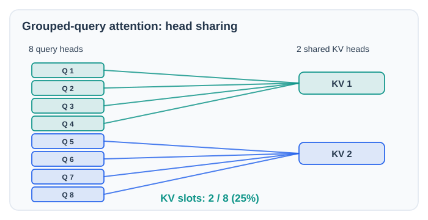
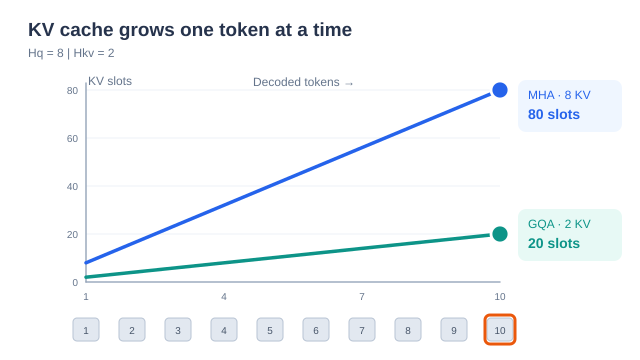
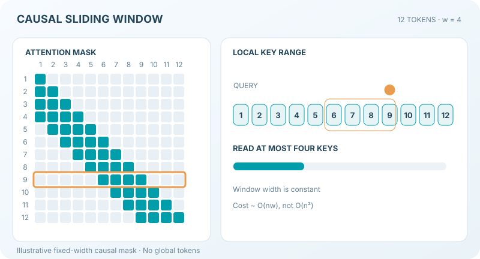
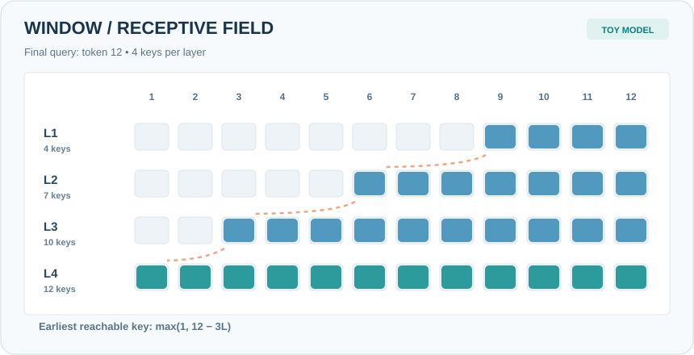
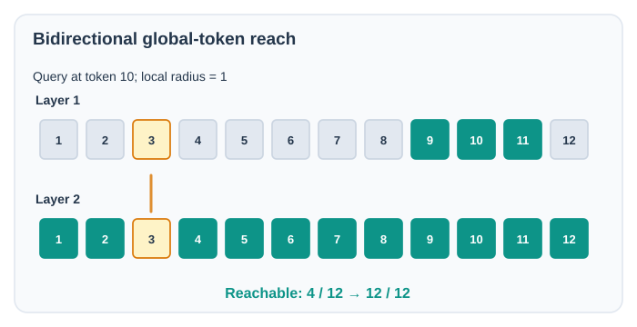
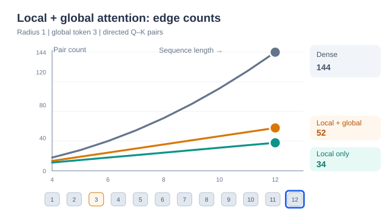
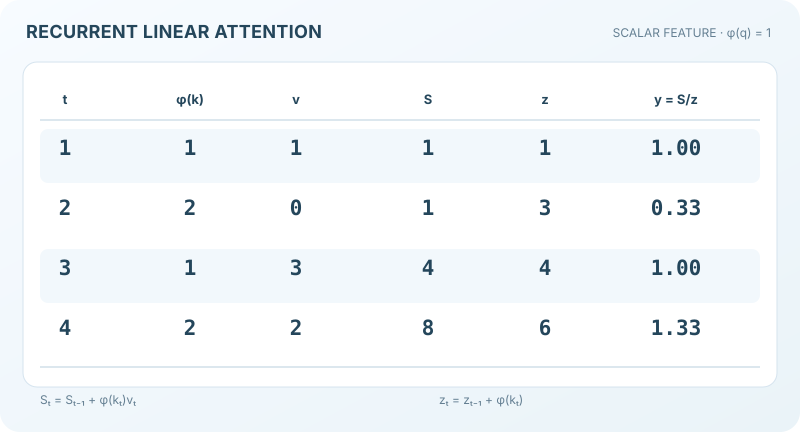
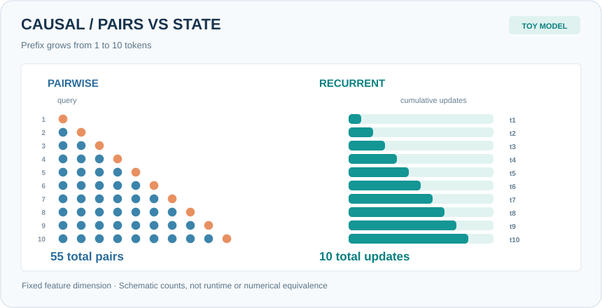

---
related:
- theory/models/llm
aliases:
  - Attention Variants
  - Efficient Attention
  - 注意力變體
  - 高效注意力
tags:
  - attention
  - efficient inference
  - long context
translation_reviewed: 2026-11-15
---

# 注意力變體

標準的縮放點積注意力，其時間與記憶體成本都是序列長度 \(n\) 的 \(O(n^2)\)。訓練時，這會限制上下文長度；生成時，每個新 token 都要讀取龐大的[鍵值快取](../kv-cache/index.md)。多數注意力變體針對三種成本之一：需要儲存的鍵值頭數、需要計算的查詢–鍵配對數，或精確計算所需的記憶體傳輸量。本頁介紹會改變注意力計算本身的變體；位置編碼的選擇見[位置編碼](../positional-encodings/index.md)。

## 概觀

| 家族 | 減少的項目 | 例子 | 改變後的成本 |
|---|---|---|---|
| 共享頭 | 鍵值快取大小 | MQA、GQA | 計算相同，記憶體較少 |
| 稀疏或局部模式 | 查詢–鍵配對數 | Sparse Transformer、Longformer、滑動窗口 | 約 \(O(n\sqrt{n})\) 或 \(O(nw)\) |
| 線性注意力 | softmax 的使用 | 線性 Transformer、Performers | \(O(n)\)，為近似 |
| IO 感知的精確注意力 | 記憶體傳輸 | FlashAttention | 結果相同，記憶體與時間較少 |

## 做法

### 共享的鍵與值頭

在多頭注意力中，每個頭都有自己的鍵與值。多查詢注意力（MQA）讓所有查詢頭共用一組鍵與值，因此鍵值快取會縮小為頭數的倒數。分組查詢注意力（GQA）則是在查詢頭的群組內共享鍵與值，介於完整多頭與多查詢之間。GQA 可以透過一段短暫的額外訓練，把既有的多頭檢查點轉換而成，這也是許多開源模型採用它的原因。

*原創 CC BY-SA 4.0 靜態回退預覽。* 八個 Query Head 可以映射至 1、2、4 或 8 個共享 KV Head。在每頭維度與上下文長度相同的前提下，相對於八頭 MHA 的**鍵值頭配置數**分別是 12.5%、25%、50%、100%；這不是完整模型記憶體比例或效能量測（[Ainslie 等人，2023](https://arxiv.org/abs/2305.13245)）。

GitHub 與停用 JavaScript 時仍可閱讀上方圖片；MkDocs 網站會啟用分組運算實驗。

*互動練習：操作 KV Head 滑桿、上一步／下一步、播放／暫停、速度與重設，觀察對應連線及鍵值頭配置數。這是架構示意，而非準確率或延遲實測。*

#### 解碼時的 KV 快取累積

*原創 CC BY-SA 4.0 時間演進教學圖。* [開啟 11 秒 SVG 動畫](../../../../assets/concept-animations/gqa-cache-growth-motion.svg)，觀察逐 Token 解碼如何增加 MHA 與 GQA 的 KV 配置。固定八個查詢頭，完整 MHA 為 \(H_{kv}=8\)、示例 GQA 為 \(H_{kv}=2\)，累積 \(n\) 個 Token 的**每頭 K／V 成對位置數**為 \(8n\) 與 \(2n\)；\(n=10\) 時為 **80 與 20**。圖中一個 slot 表示相同單頭維度下的一組 K 與 V 位置，**不是實際位元組、整體模型記憶體節省或推論速度測量**。游標依離散 Token 移動，折線只是解析點之間的視覺連接。MkDocs 沿用播放／暫停、Enter／Space 及 Reduced Motion 靜態回退（Ainslie 等人，2023；見參考文獻）。

### 稀疏與局部模式

稀疏注意力不讓每個查詢都看所有較早的 token，而是限制在固定模式內。Sparse Transformer 使用跨步與固定模式，能看得很遠，同時讓成本接近 \(O(n\sqrt{n})\)。Longformer 結合滑動窗口與少數全域 token，成本與 \(n\) 呈線性。Mistral 7B 使用固定窗口的滑動窗口注意力，資訊仍能隨層數擴散，因為每一層都把資訊向前傳遞一個窗口。局部模式很快，但除非有其他機制，否則無法檢索任意的遠距 token。

*原創 CC BY-SA 4.0 教學視覺。橘色查詢位置與最多四個可存取鍵的位置同步移動；在此 12-token、視窗寬度為 4 的因果遮罩中，第 \(t\) 列只可讀取 \(\max(1,t-3)\le j\le t\) 的鍵，沒有全域 token。token 索引之間的平滑位移只是**視覺插值**，不代表存在小數索引的計算。[開啟 SVG 動畫](../../../../assets/concept-animations/sliding-window-mask-motion.svg)。在 MkDocs 網站可用**播放／暫停**（也支援 Enter／Space），並尊重減少動態效果設定。顏色及視窗大小皆為示意，不是效能實測值（Beltagy 等人，2020；見參考文獻）。*

上方靜態概念圖不依賴 JavaScript，MkDocs 網站則會啟用可操作的數值實驗。

*互動練習：調整查詢位置與視窗寬度，注意力遮罩、可讀取的 Key 與確切配對總數會同步更新。支援上一步／下一步、進度滑桿、播放／暫停、速度與重設。在 12 個 Token、視窗寬度為 4 時，合法因果配對共有 **42** 個，完整因果注意力則有 **78** 個。這是解析式的模式計數，不是執行時間測量。*

*原創 CC BY-SA 4.0 多層感受範圍動畫。* 當因果視窗寬度為 4、最後的查詢位置為 12，第一層只能接觸第 **9–12** 個位置；第二層經由前一層的局部混合可間接接觸 **6–12**，第三層 **3–12**，第四層 **1–12**。在沒有全域 Token、每層都能混合視窗內資訊的假設下，深度 \(L\) 所能追溯的最早位置為 \(\max(1,12-3L)\)。色塊表示**可能的資訊依賴範圍**，不等於學得的注意力權重，也不保證資訊能完整保留。動畫的分層聚焦不是連續的小數層運算。[開啟 SVG 動畫](../../../../assets/concept-animations/sliding-window-depth-reach-motion.svg)。MkDocs 提供播放／暫停、Enter／Space、鍵盤聚焦後水平捲動與減少動態效果的靜態回退；數值皆為人工示意而非模型量測（參見 Beltagy 等人，2020；Jiang 等人，2023）。

*原創 CC BY-SA 4.0 靜態回退預覽。* 這是獨立的**雙向編碼器**實驗，查詢位置固定為 10，局部半徑為 1，並可選擇將第 3 個位置設為全域 Token。啟用全域連線時，深度 0–2 的可追溯來源數由 **1 → 4 → 12**；不啟用時則為 **1 → 3 → 5**。第一層來源集合為 {3, 9, 10, 11}，第二層可經全域 Token 3 間接接觸全部位置。這是**可能依賴的拓樸推演**，並非因果解碼器的遮罩、學得的權重或記憶效果實測（Beltagy 等人，2020）。

停用 JavaScript 時仍可閱讀上方靜態圖；MkDocs 網站可操作逐層可達性實驗。

*互動練習：調整層數 0–3、開關全域 Token，或透過上一步／下一步、播放／暫停、速度與重設，觀察前一層來源集合如何擴展。*

#### 局部與全域連線的配對數

*原創 CC BY-SA 4.0 配對計數動畫。* [開啟 11 秒 SVG 動畫](../../../../assets/concept-animations/global-local-pair-count-motion.svg)，觀察**雙向編碼器**在局部半徑為 1、第 3 個 Token 具全域連線時，逐 Token 增加的連線數。對 \(4\le n\le12\)，計入自身但不重複計算的有向 Query–Key 配對數，完整注意力為 \(n^2\)、純局部為 \(3n-2\)、局部加全域為 \(5n-8\)，因此 \(n=12\) 時依序為 **144、34、52**。全域 Token 雙向連線與既有局部連線的交集不可重複計算。縱軸是允許的配對數，**不是等成本運算、注意力權重或實測加速效果**。游標依整數 Token 前進，折線僅供視覺連接。MkDocs 沿用播放／暫停、鍵盤操作與 Reduced Motion 回退（Beltagy 等人，2020；見參考文獻）。

### 線性注意力

線性注意力以核特徵映射 \(\phi\) 取代 softmax，使乘積可以重排為 \(\phi(Q)\,(\phi(K)^\top V)\)。項 \(\phi(K)^\top V\) 可以累積成一個遞迴狀態，讓注意力變成每個 token 成本固定的循環更新。Katharopoulos et al.（2020）展示了這個等價關係及其自回歸形式。Performers 則用隨機特徵（FAVOR+）近似 softmax 核，使用的特徵越多，近似就越準確。

*原創 CC BY-SA 4.0 教學視覺。在因果、**已正規化的核線性注意力**中，\(S_t=S_{t-1}+\phi(k_t)v_t^{\top}\)、\(z_t=z_{t-1}+\phi(k_t)\)，而 \(y_t=\phi(q_t)^{\top}S_t/(\phi(q_t)^{\top}z_t)\)（假設分母非零）。純量示例固定 \(\phi(q_t)=1\)，鍵為 \((1,2,1,2)\)、值為 \((1,0,3,2)\)，累積的 \((S_t,z_t,y_t)\) 依序是 \((1,1,1)\)、\((1,3,1/3)\)、\((4,4,1)\)、\((8,6,4/3)\)。這種方法**改變注意力核**，不是一般 softmax 注意力的數值等價實作；流動與轉場也是教學插值，非實際模型紀錄。[開啟 SVG 動畫](../../../../assets/concept-animations/linear-attention-recurrence-motion.svg)；MkDocs 提供鍵盤可操作的**播放／暫停**及減少動態效果的靜態回退（Katharopoulos 等人，2020；見參考文獻）。*

上方靜態概念圖不依賴 JavaScript，MkDocs 網站則會啟用可操作的數值實驗。

*互動練習：逐步檢視精確的純量遞迴運算，並把第三個值由 3 調整成 5。最後的狀態會從 \(S_4=8,z_4=6,y_4=4/3\) 變為 \(S_4=10,z_4=6,y_4=5/3\)。此例固定 \(\phi(q)=1\)、映射後的 Key 為正數，屬人工計算示意，並非訓練模型或與 Softmax 數值等價的演算法。*

*原創 CC BY-SA 4.0 計算模式動畫。* 對長度為 \(n\) 的因果序列，完整逐對查詢–鍵計分需要 \(n(n+1)/2\) 組配對，包含每個位置對自己的配對；\(n=10\) 時為 **55 組**。當核特徵維度固定時，線性注意力的遞迴表示對每個新 Token 只需更新一次累積狀態，\(n=10\) 時為 **10 次狀態更新事件**。動畫以三角形配對與累積更新條呈現不同的成長方式。兩側計數代表**不同運算原語**，不是等成本的 FLOP、實測執行時間或效能倍數；核線性注意力也不會產生與標準 Softmax 相同的數值。[開啟 SVG 動畫](../../../../assets/concept-animations/linear-attention-work-growth-motion.svg)。MkDocs 以共用播放器提供播放／暫停、Enter／Space 和減少動態效果回退（參見 Katharopoulos 等人，2020）。

### IO 感知的精確注意力

FlashAttention 計算的結果與標準注意力完全相同，同時減少記憶體流量。它有獨立的頁面，見 [FlashAttention](flash-attention/index.zh-TW.md)，內容包括其演算法、結果與後續版本。這一類是精確的注意力，與上面的近似方法相對。

## 取捨

- **精確與近似。** 共享頭與 FlashAttention 保留精確的注意力計算。稀疏、線性與隨機特徵方法改變了計算的內容，其品質取決於任務。
- **檢索能力。** 壓縮或限制上下文的方法可能遺失特定的遠距 token。需要從長輸入中檢索單一事實的任務，最能暴露這種損失。
- **硬體。** 速度取決於核心實作與記憶體佈局。省下運算量的變體，在某些加速器上不一定省時間。
- **訓練與推論。** 有些變體可以在訓練與推論中都使用，有些只能在推論時轉換後使用，這會影響實驗的成本。

## 相關連結

這些變體是長上下文[大型語言模型](../../llm/index.md)背後的主要工具。共享頭與潛在注意力所減少的快取，在[KV 快取管理](../kv-cache/index.md)中討論。完全不用注意力的替代架構（例如狀態空間模型）則在 [Transformers & Attention](../index.md) 總覽頁中介紹。

## 未解問題與更多變體

- **檢索差距。** 線性與狀態空間模型效率高，但在從長輸入中精確回想細節時，通常不如注意力。混合架構（少數完整注意力層搭配高效層）是一種回應，但最佳比例尚無定論。
- **學習式稀疏。** 大多數稀疏模式是人工固定的。學習該關注哪些 token（例如透過路由或 top-k 選擇）很有潛力，但比較難訓練。
- **頭的配置。** GQA 中鍵值群組的數量通常靠試驗決定。缺少一個能依品質與記憶體預算來設定的原則性方法。
- **核設計。** 線性注意力的特徵映射大多是人工設計的，其對 softmax 的近似誤差只在簡單情況下被充分理解。
- **長上下文評估。** 用來測試注意力變體能否在極長輸入中保留資訊的基準仍不一致。

## 參考文獻

### 開創性論文

- Vaswani, A., et al. (2017). *Attention Is All You Need*. [arXiv:1706.03762](https://arxiv.org/abs/1706.03762) — 提出縮放點積與多頭注意力，是本頁所有變體的基準。
- Shazeer, N. (2019). "Fast Transformer Decoding: One Write-Head is All You Need". [arXiv:1911.02150](https://arxiv.org/abs/1911.02150) — 多查詢注意力，所有查詢共用一個鍵值頭。
- Ainslie, J., et al. (2023). "GQA: Training Generalized Multi-Query Transformer Models from Multi-Head Checkpoints". [arXiv:2305.13245](https://arxiv.org/abs/2305.13245) — 分組查詢注意力，從多頭檢查點轉換而來。
- Child, R., et al. (2019). "Generating Long Sequences with Sparse Transformers". [arXiv:1904.10509](https://arxiv.org/abs/1904.10509) — 因式分解的稀疏注意力模式，成本接近 \(O(n\sqrt{n})\)。
- Beltagy, I., Peters, M. E. & Cohan, A. (2020). "Longformer: The Long-Document Transformer". [arXiv:2004.05150](https://arxiv.org/abs/2004.05150) — 結合全域 token 的滑動窗口注意力，用於長文件。

### 綜述與教科書

（本頁尚未核對）

### 講座與影片

（本頁尚未核對）

### 文章與文件

- Katharopoulos, A., et al. (2020). "Transformers are RNNs: Fast Autoregressive Transformers with Linear Attention". ICML 2020. [arXiv:2006.16236](https://arxiv.org/abs/2006.16236) — 線性注意力，並具有快速自回歸解碼的循環形式。
- Choromanski, K., et al. (2020). "Rethinking Attention with Performers". [arXiv:2009.14794](https://arxiv.org/abs/2009.14794) — 以隨機特徵近似 softmax 注意力（FAVOR+）。
- Dao, T., et al. (2022). "FlashAttention: Fast and Memory-Efficient Exact Attention with IO-Awareness". [arXiv:2205.14135](https://arxiv.org/abs/2205.14135) — 分塊、IO 感知的精確注意力。
- Dao, T. (2023). "FlashAttention-2: Faster Attention with Better Parallelism and Work Partitioning". [arXiv:2307.08691](https://arxiv.org/abs/2307.08691) — 改善 FlashAttention 的平行性與工作分配。
- Jiang, A. Q., et al. (2023). "Mistral 7B". [arXiv:2310.06825](https://arxiv.org/abs/2310.06825) — 在廣泛使用的開源模型中採用滑動窗口注意力。
