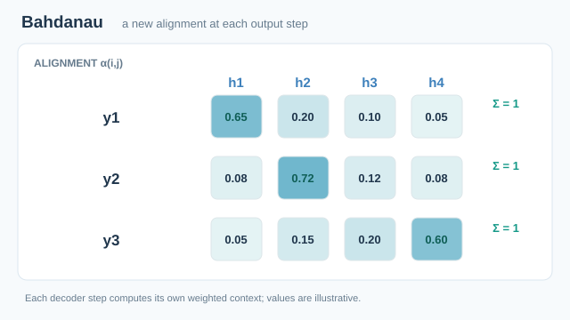

# 以學習對齊進行神經機器翻譯（Bahdanau 等人，2015）

本論文提出一種編碼器–解碼器翻譯模型，解碼器在每個輸出詞時，都以學得的軟對齊權重搜尋來源句。它以對所有來源位置的加權平均，取代早期模型所用的單一固定長度向量。這種計分機制今日通常稱為加性注意力。

## 問題

在基本的編碼器–解碼器中，編碼器把整個來源句壓縮成一個固定長度的向量，解碼器只能從這個向量產生譯文。作者主張這個固定長度向量是瓶頸。他們的實驗顯示，隨著句子變長，基本模型的表現迅速惡化。

## 核心想法

模型有三個部分：

1. **雙向循環編碼器**從兩個方向讀入來源句。每個位置的標註 $h_j$ 串接其前向與後向狀態，因此總結了位置 $j$ 附近的詞。
2. **對齊模型** $a$ 是一個與系統其他部分一起訓練的小型前饋網路，它為解碼器前一個狀態與每個標註的匹配程度計分。
3. **解碼器**為每個輸出詞建立脈絡向量，即所有標註的加權平均，再依據自身狀態與該脈絡預測此詞。

權重經 softmax 正規化，總和為一。論文回報，學得的軟對齊在語言上是合理的，包括英文與法文之間所需的詞序調整。

## 方程式

$$
e_{ij} = a(s_{i-1}, h_j), \qquad
\alpha_{ij} = \frac{\exp(e_{ij})}{\sum_{k=1}^{T_x} \exp(e_{ik})}, \qquad
c_i = \sum_{j=1}^{T_x} \alpha_{ij} h_j
$$

$$
s_i = f(s_{i-1}, y_{i-1}, c_i), \qquad
p(y_i \mid y_{<i}, x) = g(y_{i-1}, s_i, c_i)
$$

其中 $s_i$ 是解碼器狀態，$y_i$ 是輸出詞，$T_x$ 是來源長度。循環單元 $f$ 採用論文所用的門控隱藏單元。由於對齊模型是可微分的前饋網路，整個系統可以用梯度下降端到端訓練。

## 動態圖解：隨解碼步驟改變的軟對齊

*原創教學動畫，CC BY-SA 4.0。* 四個編碼器標註 $h_1,\ldots,h_4$ 保持固定，解碼器依序處理**三個假設的輸出步驟**；各步的軟對齊向量分別是：

$
\alpha_{1,:}=(0.65,0.20,0.10,0.05),\quad
\alpha_{2,:}=(0.08,0.72,0.12,0.08),\quad
\alpha_{3,:}=(0.05,0.15,0.20,0.60).
$

青綠色長條及連線呈現 $c_i=\sum_j\alpha_{ij}h_j$ 如何對**全部**編碼器標註加權，而非只挑選一個來源詞。動畫中間的平滑轉場只是**離散解碼步驟之間的視覺插值**，並非真實翻譯過程中連續變化的注意力狀態；所有權重均為人工示意，**不是** Bahdanau 模型的實測對齊。原方法在每個輸出步驟計算 $e_{ij}=a(s_{i-1},h_j)$，再經 Softmax 得到脈絡向量，供循環式解碼器更新使用。

在 MkDocs 網站可使用**播放／暫停**，聚焦控制按鈕後也可按 Enter／Space；偏好減少動態效果時預設顯示靜態圖。GitHub 可直接閱讀包含三列權重的[靜態對齊矩陣](../../../../assets/concept-animations/bahdanau-alignment-context-still.svg)，也可透過支援 SVG 動畫的檢視器播放[完整動畫](../../../../assets/concept-animations/bahdanau-alignment-context-motion.svg)。

## 結果

實驗使用 WMT '14 英譯法語料，並在 news-test-2014 測試集上評估。表 1 回報所有測試句與不含未知詞子集上的 BLEU。

| 模型 | 所有句子 | 不含未知詞 |
|---|---|---|
| RNNencdec-30 | 13.93 | 24.19 |
| RNNsearch-30 | 21.50 | 31.44 |
| RNNencdec-50 | 17.82 | 26.71 |
| RNNsearch-50 | 26.75 | 34.16 |
| RNNsearch-50（訓練較久） | 28.45 | 36.15 |
| Moses（短語式） | 33.30 | 35.63 |

後綴代表訓練句長上限，即 30 或 50 詞。RNNsearch-30 已勝過以 50 詞句訓練的固定向量模型，而且隨著測試句變長，注意力模型的表現更為穩定。在不含未知詞的子集上，訓練最久的注意力模型超過短語式基線；在全部句子上，基線仍然較高。

## 限制

- 編碼器與解碼器仍是循環式的，因此訓練時仍需依序走過整個句子。
- 每個輸出詞都要對所有來源位置計分，因此每個輸出詞的成本隨來源長度增加。
- 未知詞會拉低全部句子的分數。論文因此另外回報不含未知詞的子集。

## 關鍵方法

與接續而來的注意力設計作簡要比較：

- [Attention Is All You Need](../attention-is-all-you-need/index.md)：完全移除遞迴，改用縮放點積注意力，所有位置並行地關注。
- [注意力變體](../attention-variants/index.md)：之後對注意力運算本身的修改，本頁未詳細說明。

## 關聯

- 母主題：[Transformer 與注意力機制](../index.md)
- 認知科學：學得的對齊為每個輸出選取輸入中相關的部分，這與認知中的選擇性注意相似。論文對神經機制沒有任何主張。

## 應用

- 神經機器翻譯，以及在本論文之後出現的序列到序列系統。
- 檢視對齊：軟對齊權重形成詞對詞的矩陣，可以對照句對來閱讀。

## 開放問題

- 學得的權重是忠實地解釋了模型的輸出，還是只與之相關。
- 對於很長的輸入，注意力的成本應如何隨之擴展。

## 參考文獻

### 開創性論文

- Bahdanau, D., Cho, K. & Bengio, Y. (2015). Neural Machine Translation by Jointly Learning to Align and Translate. ICLR. https://arxiv.org/abs/1409.0473 — 原始論文：以雙向編碼器與學得的軟對齊進行翻譯。
- Vaswani, A., et al. (2017). *Attention Is All You Need*. NeurIPS. https://arxiv.org/abs/1706.03762 — 提出 Transformer，以多頭自注意力取代遞迴。
- Luong, M.-T., Pham, H. & Manning, C. D. (2015). *Effective Approaches to Attention-based Neural Machine Translation*. EMNLP. https://arxiv.org/abs/1508.04025 — 比較神經機器翻譯中的全域與局部注意力，以及多種計分函數。

### 綜述與教科書

- Tay, Y., et al. (2020). *Efficient Transformers: A Survey*. arXiv. https://arxiv.org/abs/2009.06732 — 綜述許多降低注意力二次方成本的嘗試，並提供方法分類。

### 文章與文件

- Rush, A. M. (2018). *The Annotated Transformer*. Proceedings of Workshop for NLP Open Source Software (NLP-OSS). https://doi.org/10.18653/v1/w18-2509 — 逐篇對照原文的 PyTorch 實作，並附帶註解。

## 延伸學習

- Karpathy, A. (2023). *Let's build GPT: from scratch, in code, spelled out*. YouTube. https://www.youtube.com/watch?v=kCc8FmEb1nY — 從空白檔案現場撰寫一個小型 GPT，寫的同時解說 Transformer 的每個部分。
