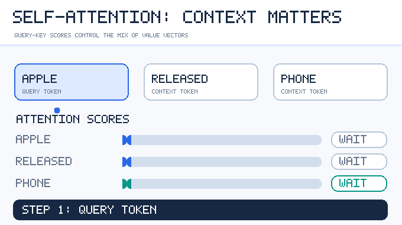

---
related:
- theory/models/llm
- society/interpretability
- brain-mind/memory-learning
aliases:
  - Attention
  - 自注意力
  - 注意力機制
---

# Transformers & Attention

## Intuition

The meaning of each word depends on its context: in "Apple released a new phone", "Apple" is a company because of "phone". **Attention** lets every position directly *query* all other positions and combine their information weighted by relevance.

The Transformer (Vaswani et al., 2017, "Attention Is All You Need") replaced recurrence entirely with attention. It parallelises well in training and became the backbone of LLMs, vision transformers, speech models, protein models — nearly everything.

## Scaled dot-product attention

Each token's vector is projected into:

- **Query (Q)** — what am I looking for?
- **Key (K)** — what do I offer to be found?
- **Value (V)** — what do I contribute when found?

\[
\text{Attention}(Q,K,V) = \text{softmax}\!\left(\frac{QK^\top}{\sqrt{d_k}}\right)V
\]

Dividing by \(\sqrt{d_k}\) keeps dot products from growing so large that the softmax saturates.

**Multi-head attention** splits vectors into h heads that attend independently and are concatenated, letting the model track different relations (syntax, coreference, position) at once.

## The Transformer block

*Animated concept diagram · Original illustration, CC BY-SA 4.0.*

**Reading the animation:** For the query token “Apple,” the model compares keys from all visible positions; the illustrated weights assign more relevance to “phone” than to the other words. The weighted value vectors then produce a context-dependent representation. The weights shown are **illustrative, not outputs of a trained model**.

A common *pre-normalization* Transformer block wraps self-attention in a normalization-and-residual step, then applies a feed-forward network (or MoE) with its own normalization and residual connection. The animation zooms into the attention operation; it does not depict those surrounding operations.

## Three variants

| Type | Attention | Examples | Uses |
|---|---|---|---|
| Encoder-only | Bidirectional | BERT, RoBERTa | Understanding, classification, embeddings |
| Encoder–decoder | Bidirectional encoder + cross-attention | Original Transformer, T5, Whisper | Translation, summarisation, speech recognition |
| Decoder-only | Causal (past only) | GPT, Llama, Claude, Gemini, etc. | Generation, general-purpose LLMs |

The [architecture families](architecture-families/index.md) page compares the three shapes and their pre-training objectives. [BERT](architecture-families/bert/index.md) and [T5](architecture-families/t5/index.md) have their own pages.

## Positional information

Attention is order-agnostic, so position must be injected:

- Sinusoidal encodings (original paper)
- Learned absolute embeddings (BERT, GPT-2)
- **Rotary position embeddings (RoPE)** — today's default
- ALiBi (linear biases; extrapolates to longer sequences)

## Efficiency

Standard attention costs \(O(n^2)\) in sequence length n.

| Technique | Idea |
|---|---|
| FlashAttention | Tiled, IO-aware exact attention — faster, less memory |
| KV cache | Store past keys and values during generation |
| MQA / GQA | Query heads share key/value heads, shrinking the KV cache |
| Multi-head latent attention (MLA) | Compress K/V into a low-dimensional latent (DeepSeek-V2 onward) |
| Sparse / sliding-window attention | Attend to a subset of positions (Longformer, Mistral) |
| Linear attention | Kernel approximations reduce cost to \(O(n)\) |
| [Mixture of experts (MoE)](../mixture-of-experts/index.md) | Replace the FFN with many experts and route each token to a few — many parameters, modest compute |

## Key methods

Each method has its own page. The overview and comparison here are brief.

### Attention Is All You Need (Vaswani et al., 2017)

- **Overview:** Replaces recurrence and convolution with multi-head scaled dot-product attention, so each position attends to all others in parallel.
- **Comparison:** The architecture the rest of this page builds on. The attention variants and positional encodings below change its parts.
- **Full write-up:** [Attention Is All You Need](attention-is-all-you-need/index.md)

### Neural machine translation with learned alignment (Bahdanau et al., 2015)

- **Overview:** The decoder searches the source sentence with learned soft alignment weights, instead of relying on one fixed-length vector.
- **Comparison:** The earlier, recurrent form of attention. The Transformer above removes the recurrence that this paper still needs.
- **Full write-up:** [Additive Attention (Bahdanau)](bahdanau-attention/index.md)

### Diffusion Transformer (Peebles & Xie, 2022)

- **Overview:** Replaces the U-Net denoiser of latent diffusion with a Transformer over latent patches, and shows that sample quality improves with more compute.
- **Comparison:** The same attention block as above, used as a denoiser rather than a language model. The generative algorithm it plugs into is in [Diffusion Models](../../paradigms/unsupervised/density-and-generative-models/diffusion/index.md).
- **Full write-up:** [Diffusion Transformer (DiT)](dit/index.md)

### An Image is Worth 16x16 Words (Dosovitskiy et al., 2021)

- **Overview:** Splits an image into fixed-size patches, embeds each as a token, and runs an unmodified Transformer encoder over the sequence, with no convolutional layers.
- **Comparison:** The same attention block as above, applied to images instead of text. Its weaker inductive bias needs more data than a CNN, and it is compared with convolutional backbones on the [CNN backbones page](../cnn/backbones-and-scaling/index.md).
- **Full write-up:** [Vision Transformer (ViT)](vision-transformer/index.md)

### QK-normalisation (Dehghani et al., 2023)

- **Overview:** Layer-normalises queries and keys before the dot product, so attention logits no longer grow with the weight norms.
- **Comparison:** A change inside attention. It bounds the logits, but it does not limit the growth of norms in other layers.
- **Full write-up:** [QK-normalisation](qk-norm.md)

### σReparam (Zhai et al., 2023)

- **Overview:** Reparameterises every linear layer by its spectral norm and a learnable scalar, to prevent attention entropy collapse.
- **Comparison:** The alternative to QK-normalisation that acts on every linear layer, not only on queries and keys.
- **Full write-up:** [σReparam](sigma-reparam.md)

## Components and variants

Each part of the Transformer has its own family of variants, with its own trade-offs and open questions:

- [Attention variants](attention-variants/index.md): sparse and linear attention, shared key–value heads, and IO-aware exact attention.
- [Positional encodings](positional-encodings/index.md): relative, rotary and bias-based encodings, and methods for extending the context length.
- [KV cache management](kv-cache/index.md): memory paging, eviction, quantisation, latent compression and offloading.

## Alternative architectures

- **State-space models**: S4, Mamba, Mamba-2 — constant cost per generated token, efficient on long sequences
- **Modern RNNs**: RWKV, xLSTM, Griffin
- **Hybrids**: interleave Transformer layers with SSM or linear-attention layers (e.g. Jamba), trading off quality and efficiency
- As of 2026, frontier models are still predominantly Transformers (often MoE); hybrids are increasingly common for long context and on-device use

## Mechanistic understanding

- **Induction heads**: a two-head circuit implementing "after A B … A, predict B", thought to underlie much in-context learning (Olsson et al., 2022)
- The **residual stream** as a shared communication channel that layers read from and write to
- **Feed-forward layers as key–value memories** (Geva et al., 2021)
- See [Interpretability](../../../society/interpretability/index.md)

## Links to the brain

- The name "attention" comes from psychology's selective attention, but the mechanisms are not the same thing
- Transformers with recurrent positional encodings develop place-cell- and grid-cell-like representations, suggesting a formal link to **hippocampal** computation (Whittington et al., 2022)
- The update rule of **modern Hopfield networks** is equivalent to attention (Ramsauer et al., 2020, "Hopfield Networks is All You Need")
- A proposal maps attention onto neuron–astrocyte interactions (Kozachkov et al., 2023)
- LLM internal representations predict fMRI/ECoG responses in human language areas (Schrimpf et al., 2021; Goldstein et al., 2022) — see [NeuroAI](../../../brain-mind/neuroai/index.md)

## Resources

- Jay Alammar, "The Illustrated Transformer"
- [The Annotated Transformer](https://nlp.seas.harvard.edu/annotated-transformer/) (Harvard NLP)
- Karpathy, "Let's build GPT: from scratch"; nanoGPT
- 3Blue1Brown deep learning series, chapters 5–7

## References

### Seminal papers

- Vaswani, A., et al. (2017). *Attention Is All You Need*. NeurIPS. https://arxiv.org/abs/1706.03762 — Introduces the Transformer, replacing recurrence with multi-head self-attention.
- Bahdanau, D., Cho, K. & Bengio, Y. (2015). Neural Machine Translation by Jointly Learning to Align and Translate. ICLR. https://arxiv.org/abs/1409.0473 — Adds learned attention to sequence-to-sequence translation, the idea the Transformer later generalised.
- Elhage, N., et al. (2021). *A Mathematical Framework for Transformer Circuits*. Anthropic. https://transformer-circuits.pub/2021/framework/index.html — Treats the Transformer as a set of linear paths between residual-stream reads and writes, the basis of mechanistic interpretability work.

### Surveys and textbooks

- Tay, Y., et al. (2020). *Efficient Transformers: A Survey*. arXiv. https://arxiv.org/abs/2009.06732 — Surveys the many attempts to reduce the quadratic cost of attention, with a taxonomy of approaches.

### Lectures and videos

- Radford, A., Wu, J., Child, R., Luan, D., Amodei, D. & Sutskever, I. (2019). *Language Models are Unsupervised Multitask Learners*. OpenAI technical report. https://cdn.openai.com/better-language-models/language_models_are_unsupervised_multitask_learners.pdf — The GPT-2 technical report, describing the decoder-only Transformer language model that the video builds.

### Articles and documentation

- Rush, A. M. (2018). *The Annotated Transformer*. Proceedings of Workshop for NLP Open Source Software (NLP-OSS). https://doi.org/10.18653/v1/w18-2509 — Paper-by-paper PyTorch implementation with commentary alongside the original text.

## Further learning

- Karpathy, A. (2023). *Let's build GPT: from scratch, in code, spelled out*. YouTube. https://www.youtube.com/watch?v=kCc8FmEb1nY — Live coding of a small GPT from an empty file, explaining each part of the Transformer as it is written.
