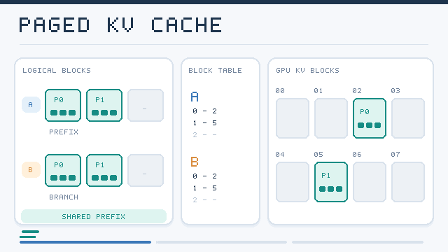

---
related:
- theory/models/llm
- engineering/mlops
aliases:
  - KV Cache
  - Key-Value Cache
  - KV Cache Compression
  - KV 快取
  - 鍵值快取
tags:
  - KV cache
  - inference efficiency
  - LLM serving
last_reviewed: 2026-10-28
---

# KV Cache Management

During autoregressive generation a decoder stores the keys and values of every earlier token, so that each new token needs only one new key and value per layer. This key–value (KV) cache removes repeated computation, but its size grows with the sequence length, the number of layers and the number of heads. For long contexts and many simultaneous requests, the cache often uses more memory than the model weights. Managing it is therefore a central problem of [LLM serving](../../llm/index.md). The methods fall into four groups: how memory is allocated, which tokens are kept, how the stored values are compressed, and how the architecture reduces what must be stored in the first place.

## Overview

| Strategy | Question it answers | Examples |
|---|---|---|
| Memory management | How are cache blocks allocated and shared? | PagedAttention, prefix sharing |
| Eviction | Which tokens can be dropped? | H2O, Scissorhands, StreamingLLM, SnapKV |
| Quantisation | With how few bits can values be stored? | KIVI, KVQuant |
| Architectural reduction | Can fewer values be stored in the first place? | MQA and GQA, multi-head latent attention |
| Offloading | Where can the cache live? | FlexGen |

## Approaches

### Memory management

vLLM's PagedAttention stores the cache in fixed-size blocks, mapped through a table as in virtual memory. Requests then no longer need one large contiguous region, which removes most fragmentation and lets requests that share a prompt prefix share its blocks. Kwon et al. (2023) reported substantially higher serving throughput than systems that reserved memory per request.

*Original animated schematic, CC BY-SA 4.0.* The block table maps logical blocks to physical GPU KV-cache blocks; **P0** and **P1** are a shared, identical prompt prefix, while **A2** and **B2** are request-specific continuations. Physical block IDs are illustrative, not memory addresses or measured allocation results. The animation shows **block allocation and sharing**, not attention weights or KV quantisation. See [Kwon et al. (2023)](https://arxiv.org/abs/2309.06180).

### Eviction

Eviction keeps a fixed budget of tokens and removes the rest. H2O keeps the "heavy hitters", the tokens that have received the most accumulated attention, together with the most recent tokens. Scissorhands keeps tokens whose importance has persisted over time. StreamingLLM observed that the first few tokens receive large attention whatever their content, and that keeping these attention sinks with a recent window lets a model run on very long streams without retraining. It does not preserve distant content, so it is a stabilising method rather than a memory method. SnapKV uses the attention from the last part of the prompt to choose, for each head, which earlier positions to keep.

### Quantisation

Quantising the cache stores each value in fewer bits. The difficulty is that keys and values have different statistics. KIVI quantises keys per channel and values per token, to two bits, without tuning. KVQuant quantises keys before rotary embedding is applied, uses non-uniform levels, and stores a few outlier values separately, which allows very long contexts.

### Architectural reduction

Shared heads, covered in [attention variants](../attention-variants/index.md), reduce the number of stored heads. Multi-head latent attention, introduced in DeepSeek-V2, goes further: keys and values are compressed into a low-dimensional latent vector, and only the latent is cached. The keys and values are reconstructed when attention is computed. The reduction is built into training, so it cannot be applied to an arbitrary model after the fact.

### Offloading

FlexGen moves the weights and the cache between GPU memory, CPU memory and disk, and schedules the transfers to hide their cost. The aim is throughput on a single GPU rather than latency, which makes it suited to batch inference.

## Trade-offs

- **Quality versus memory.** Eviction and aggressive quantisation both risk losing information that a later token needs. Losses are often small on average but large on specific retrieval tasks.
- **Architecture versus post-hoc methods.** Architectural reduction gives predictable savings but requires training a new model. Eviction and quantisation can be applied to existing models.
- **Latency.** Offloading and some compression schemes add computation or transfers per token, which can slow generation even when memory falls.
- **Evaluation.** Results depend on the benchmark. A method that preserves summarisation quality may fail on needle-in-a-haystack retrieval.

## Connections

The cache is where the costs of [attention](../attention-variants/index.md) meet hardware. Eviction interacts with [positional encodings](../positional-encodings/index.md), since removing tokens changes the positions that remain. Serving systems that use these methods are discussed under [MLOps and deployment](../../../../engineering/mlops/index.md).

## Open issues and further variants

- **Tasks that need distant detail.** Eviction methods keep recent and important tokens, so they can lose a fact mentioned once early in a long input. Methods that retrieve evicted entries on demand are one response, with extra latency.
- **Query-aware selection.** Most eviction decisions are made before the question is known, or from a short observation window. Selecting tokens with knowledge of the query is an open direction.
- **Outliers and low bits.** Quantising below four bits is still sensitive to outlier channels, and the best handling of outliers differs between keys and values.
- **Sharing across requests.** Prefix caching works when prompts repeat. How to share and compress caches across users without leaking information between them is less developed.
- **Learned compression.** Latent compression like MLA is learned during training. Learning a compressor for an existing model, with little compute, is an open problem.
- **Speculative and multi-token decoding.** How these decoding methods interact with cache eviction and compression is largely unstudied.

## References

### Seminal papers

- Vaswani, A., et al. (2017). *Attention Is All You Need*. arXiv:1706.03762 — Defines the multi-head attention whose keys and values are cached during generation.
- Kwon, W., et al. (2023). "Efficient Memory Management for Large Language Model Serving with PagedAttention". SOSP. arXiv:2309.06180 — Paged allocation of the KV cache, the basis of vLLM.
- Zhang, Z., et al. (2023). "H2O: Heavy-Hitter Oracle for Efficient Generative Inference of Large Language Models". arXiv:2306.14048 — Eviction that keeps the tokens with the largest accumulated attention.
- Xiao, G., et al. (2024). "Efficient Streaming Language Models with Attention Sinks". ICLR. arXiv:2309.17453 — Attention sinks and a recent window for stable streaming generation.
- Liu, Z., et al. (2024). "KIVI: A Tuning-Free Asymmetric 2bit Quantization for KV Cache". arXiv:2402.02750 — Two-bit cache quantisation with different schemes for keys and values.

### Surveys and textbooks

(none checked for this page)

### Lectures and videos

(none checked for this page)

### Articles and documentation

- Liu, Z., et al. (2023). "Scissorhands: Exploiting the Persistence of Importance Hypothesis for LLM KV Cache Compression at Test Time". arXiv:2305.17118 — Eviction based on tokens whose importance persists over time.
- Li, Y., et al. (2024). "SnapKV: LLM Knows What You are Looking for Before Generation". arXiv:2404.14469 — Chooses per-head prefix tokens to keep using an observation window at the end of the prompt.
- Hooper, C., et al. (2024). "KVQuant: Towards 10 Million Context Length LLM Inference with KV Cache Quantization". arXiv:2401.18079 — Quantisation of keys before rotary embedding, with non-uniform levels and outlier handling.
- DeepSeek-AI (2024). "DeepSeek-V2: A Strong, Economical, and Efficient Mixture-of-Experts Language Model". arXiv:2405.04434 — Multi-head latent attention, which caches a compressed latent instead of full keys and values.
- Sheng, Y., et al. (2023). "FlexGen: High-Throughput Generative Inference of Large Language Models with a Single GPU". arXiv:2303.06865 — Offloads weights and cache across GPU, CPU and disk with scheduled transfers.
