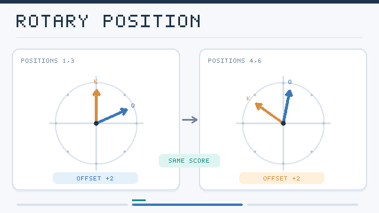

---
related:
- theory/models/llm
aliases:
  - Positional Encodings
  - Positional Embeddings
  - Length Extrapolation
  - 位置編碼
  - 長度外推
tags:
  - positional encoding
  - length generalisation
  - long context
last_reviewed: 2026-10-28
---

# Positional Encodings

Attention treats its input as a set: permuting the tokens permutes the outputs in the same way. Position information therefore has to be added, either to the token embeddings, to the attention scores, or to the queries and keys. The choice matters for two reasons. The encoding determines what relationships the model can represent, and it determines whether a model trained on sequences of one length still works on longer ones. This page covers the families of encodings and the methods for extending them to longer contexts. The overview of the Transformer, including the original sinusoidal encoding, is on the [Transformers & Attention](../index.md) page.

## Overview

Encodings fall into three groups:

- **Absolute** encodings add a vector for each position index to the token embedding. They are simple, but a position seen only in training has no meaningful vector beyond the trained range.
- **Relative** encodings make the attention score depend on the distance between two tokens, which is the quantity that usually matters for language.
- **Rotary and bias-based** encodings build the relative dependence into the query–key product or add a distance penalty, without learned position vectors.

## Approaches

| Method | Where position enters | Key paper |
|---|---|---|
| Sinusoidal | Added to token embeddings, fixed functions of the index | Vaswani et al. (2017), arXiv:1706.03762 |
| Relative position representations | Learned vectors for clipped distances, added to keys and values | Shaw et al. (2018), arXiv:1803.02155 |
| Rotary (RoPE) | Queries and keys rotated by angles proportional to position | Su et al. (2021), arXiv:2104.09864 |
| ALiBi | Linear penalty on the score, proportional to the distance | Press et al. (2021), arXiv:2108.12409 |
| Position interpolation | Position indices scaled down to fit the trained range, then briefly fine-tuned | Chen et al. (2023), arXiv:2306.15595 |
| YaRN | Frequency-dependent interpolation plus a temperature change in attention | Peng et al. (2023), arXiv:2309.00071 |

### Relative and rotary encodings

Shaw et al. added learned vectors for each relative distance, clipped beyond a maximum, to the keys and values. RoPE takes a different route: each pair of dimensions in a query or key is rotated by an angle that grows with the token's position. The dot product of two rotated vectors then depends only on the difference of their positions. RoPE needs no extra parameters, works with the usual key–value cache, and is the default in many current open models.

*Original two-dimensional RoPE schematic, CC BY-SA 4.0.* For the **same underlying query and key vectors** and a fixed frequency, shifting positions from **(1, 3)** to **(4, 6)** adds the same rotation to both vectors. Their relative offset remains two positions, so their inner product is unchanged: \((R_m q)^\top(R_n k)=q^\top R_{n-m}k\). The animated arrows are schematic directions, **not measured attention scores**. In full RoPE, different pairs of dimensions use different rotation frequencies. See [Su et al. (2021)](https://arxiv.org/abs/2104.09864).

### Bias-based encodings

ALiBi adds to each attention score a penalty proportional to the distance between the query and the key, with a different slope for each head. The model learns no position vectors, and Press et al. showed that models trained on short sequences could be evaluated on longer ones without the collapse seen with sinusoidal encodings.

### Extending the context

A RoPE model trained on 4,096 positions degrades when given 16,384, because the rotation angles reach values it never saw in training. Position interpolation divides the position indices so that the longer sequence maps back into the trained range, and then fine-tunes briefly. YaRN goes further: it leaves the high-frequency dimensions unchanged, interpolates only the low-frequency ones, and rescales attention so that its entropy stays comparable at longer lengths. A related idea, NTK-aware scaling, was first proposed in an informal community post rather than a paper, and YaRN analyses its behaviour.

## Trade-offs

- **Extrapolation versus accuracy.** Encodings that extrapolate, such as ALiBi, may give up some accuracy at the trained length. Interpolated RoPE keeps accuracy within the trained range but needs fine-tuning to extend.
- **Cost of extension.** Interpolation methods need training data and compute for the longer context, while bias-based methods need none.
- **Interaction with caching.** Some cache-eviction methods drop tokens, which changes the relative distances the model sees. Positional handling must stay consistent with the cache.
- **Multimodal inputs.** Images and video are two- or three-dimensional, so one-dimensional rotations need generalising to grids of positions.

## Connections

Positional encodings matter for [attention variants](../attention-variants/index.md) because sparse and local patterns already encode some position through their structure. They also interact with [KV cache management](../kv-cache/index.md): evicting tokens from the middle of a sequence changes the positions that the remaining tokens expose to the model. The link to the brain is indirect. Recurrent positional encodings in trained Transformers can produce place-cell- and grid-cell-like representations, as discussed on the [Transformers & Attention](../index.md) page.

## Open issues and further variants

- **Length generalisation without fine-tuning.** Methods that extrapolate are still limited, and models often degrade well before the nominal limit. The exact causes are not settled.
- **Decoder-only models without explicit positions.** A causal mask alone lets a decoder infer order. Kazemnejad et al. (2023) studied when this works and found that it generalises well on some tasks and poorly on others.
- **Scaling choices.** The interpolation factor, the frequency bands and the attention temperature in YaRN-style methods are chosen by search. A principled rule for a target length is missing.
- **Two-dimensional and multimodal positions.** Extending RoPE to images, video and mixed text–image sequences is an active area, with several competing designs.
- **Position and memory.** Methods that keep a short window and summarise the rest raise the question of which positions to keep, and how to represent gaps in them.

## References

### Seminal papers

- Vaswani, A., et al. (2017). *Attention Is All You Need*. arXiv:1706.03762 — Introduces sinusoidal position encodings added to the embeddings.
- Shaw, P., Uszkoreit, J. & Vaswani, A. (2018). "Self-Attention with Relative Position Representations". NAACL 2018. arXiv:1803.02155 — Relative position vectors for clipped distances in self-attention.
- Su, J., et al. (2021). "RoFormer: Enhanced Transformer with Rotary Position Embedding". arXiv:2104.09864 — Rotary position embedding, which makes the dot product depend only on relative position.
- Press, O., Smith, N. A. & Lewis, M. (2021). "Train Short, Test Long: Attention with Linear Biases Enables Input Length Extrapolation". arXiv:2108.12409 — ALiBi, a distance penalty on attention scores that extrapolates to longer inputs.

### Surveys and textbooks

(none checked for this page)

### Lectures and videos

(none checked for this page)

### Articles and documentation

- Chen, S., et al. (2023). "Extending Context Window of Large Language Models via Positional Interpolation". arXiv:2306.15595 — Scales position indices to fit a longer context into the trained range, with brief fine-tuning.
- Peng, B., et al. (2023). "YaRN: Efficient Context Window Extension of Large Language Models". arXiv:2309.00071 — Frequency-dependent interpolation and attention scaling for context extension.
- Kazemnejad, A., et al. (2023). "The Impact of Positional Encoding on Length Generalization in Transformers". NeurIPS. arXiv:2305.19466 — Compares positional encodings for length generalisation, including no explicit encoding.
