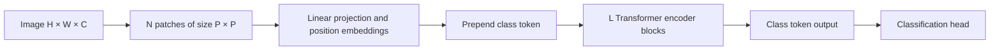

# Vision Transformer (ViT)

The Vision Transformer (ViT) applies the standard Transformer encoder to an image by cutting the image into fixed-size patches and treating each patch as a token. Introduced by Dosovitskiy et al. in 2020, it showed that a model with no convolution can match convolutional networks at image classification when it is pre-trained on enough data.

## Overview

For most of the 2010s, image recognition was built on [convolutional neural networks](../../cnn/index.md) (CNNs). A convolution builds two assumptions into the network: nearby pixels are related, and a useful pattern can appear anywhere. A Transformer makes fewer assumptions. Each self-attention layer lets any token relate to any other. Applying attention to raw pixels is too costly, because the cost grows with the square of the number of pixels. Earlier work limited attention to local neighbourhoods or combined it with CNNs.

ViT takes a simpler route. It keeps the original Transformer encoder almost unchanged and changes only the input. The image is split into patches, each patch is flattened and linearly projected, and the resulting sequence is processed like a sentence of word embeddings. 

The central finding concerns data. Trained on ImageNet-1K alone, ViT scores below ResNets of similar size. Pre-trained on ImageNet-21K (about 14 million images) or on the internal JFT-300M dataset (about 303 million), it approaches or beats the best CNNs while needing fewer resources to pre-train (Dosovitskiy et al., 2020). The architecture and its experiments are set out on the [ViT method page](vit/index.md).

## Key concepts

- **Patch embedding**: a patch of P × P pixels with C channels is flattened and multiplied by a learned matrix, giving a token of width D. This is the only step where the image's two-dimensional layout is cut into pieces.
- **Class token**: an extra learned vector placed at the front of the sequence. Its output after the last layer is the image representation. It is borrowed from BERT (see [architecture families](../architecture-families/index.md)).
- **Position embedding**: a learned vector added to each token to say where its patch sits. Without it, the attention layers would see the patches as an unordered set. See [positional encodings](../positional-encodings/index.md) for the general case.
- **Inductive bias**: the built-in assumptions that let a model learn from fewer examples. CNNs have locality and translation equivariance in every layer. ViT has them only in its patch cut and in its MLP blocks, which explains most of its behaviour on small data.
- **Hierarchical representation**: a feature map that is repeatedly downsampled, as in a CNN. The original ViT keeps one resolution throughout.

## How it works

A 224 × 224 RGB image cut into 16 × 16 patches gives 196 patches, so the Transformer sees 197 tokens with the class token included. The steps are:

1. Split the image into N = HW / P² patches and flatten each one.
2. Project each flattened patch to width D with one shared linear map.
3. Prepend the learned class token and add the position embeddings.
4. Pass the sequence through L pre-normalised Transformer blocks, each made of multi-head self-attention and an MLP, with residual connections.
5. Apply a classification head to the class token's output.

Written as equations, the class token is the first position and the blocks compute

$$
z_0 = [x_{\text{class}};\, x_p^1 E;\, \dots;\, x_p^N E] + E_{\text{pos}}
$$

$$
z'_\ell = \text{MSA}(\text{LN}(z_{\ell-1})) + z_{\ell-1}, \qquad z_\ell = \text{MLP}(\text{LN}(z'_\ell)) + z'_\ell
$$

where \(E\) is the patch projection and \(\text{LN}\) is layer normalisation. The attention and MLP equations are those of the language Transformer in [Attention Is All You Need](../attention-is-all-you-need/index.md); only the tokens differ.

The number of tokens is set by the patch size. Halving the patch side quadruples the token count, and attention cost grows with the square of that count. This is why models are named by patch size: ViT-L/16 is the Large model with 16 × 16 patches.

### Why data scale matters

The architecture carries little built-in structure, so the pre-training data has to supply it. On ImageNet-1K alone, the Large model does worse than the Base model. On ImageNet-21K the two are similar, and only with JFT-300M does the larger model show its full advantage. At small data sizes ViT overfits more than a comparable ResNet, while at the largest sizes it overtakes the ResNet (Dosovitskiy et al., 2020). The authors read this as a trade-off between built-in bias and learning from data.

Later work tested the question from other sides. Sun et al. (2017) found that vision performance grew roughly with the logarithm of training set size. Steiner et al. (2021) showed that stronger augmentation and regularisation can stand in for data: ViT models trained on ImageNet-21K with more compute matched or outperformed models trained on JFT-300M. DeiT showed that ImageNet-1K alone can suffice with careful training (Touvron et al., 2021).

## Key methods

Three landmark variants are compared below. Each has its own page.

| Method | Year | Main change | Page |
|---|---|---|---|
| ViT (Dosovitskiy et al.) | 2020 | A plain Transformer on image patches, which needs large-scale pre-training | [ViT](vit/index.md) |
| DeiT (Touvron et al.) | 2020 | Trains ViT on ImageNet-1K alone, with strong augmentation and a distillation token | [DeiT](deit/index.md) |
| Swin (Liu et al.) | 2021 | Hierarchical features, with attention inside shifted local windows so cost grows linearly with image size | [Swin](swin/index.md) |

## Connections

- **CNN backbones.** ViT is the direct challenger to the designs in [Backbones and Scaling](../../cnn/backbones-and-scaling/index.md). [ConvNeXt](../../cnn/backbones-and-scaling/convnext/index.md) starts from a [ResNet](../../cnn/backbones-and-scaling/resnet/index.md) and adopts Transformer-style design choices step by step. It matches or outperforms Swin at similar cost (Liu et al., 2022).
- **Attention in images.** A multi-head self-attention layer with enough heads can express any convolution, and trained attention often learns to do so (Cordonnier et al., 2020).
- **Architecture families.** ViT is encoder-only, like [BERT](../architecture-families/bert/index.md), and its class token plays the role of BERT's `[CLS]` token.
- **Self-supervised pre-training.** The ViT paper includes a preliminary masked-patch objective. [Masked prediction](../../../paradigms/self-supervised/masked-prediction/index.md) methods extend it, and masked autoencoders reach strong accuracy from ImageNet-1K data alone (He et al., 2021).
- **Knowledge distillation.** DeiT's extra token copies a teacher's output, linking it to [knowledge distillation](../../../model-compression/knowledge-distillation/index.md). ViTs are also often the image encoder in [multimodal models](../../multimodal/index.md).
- **Brain and mind.** Performance-optimised hierarchical networks predict responses in V4 and inferior temporal cortex (Yamins et al., 2014), see [visual perception](../../../../brain-mind/visual-perception/index.md). CNNs lean heavily on texture (Geirhos et al., 2019), but ViTs rely less on texture and are robust to occlusion (Naseer et al., 2021). Their errors are also more consistent with human errors than CNN errors are (Tuli et al., 2021). For the wider picture, see [NeuroAI](../../../../brain-mind/neuroai/index.md).

## Applications

- **Image classification.** The ViT-H/14 model pre-trained on JFT-300M reaches 88.55% top-1 accuracy on ImageNet, and ViT-L/16 pre-trained on ImageNet-21K reaches 85.30% (Dosovitskiy et al., 2020).
- **Dense prediction.** Plain ViT has a single feature resolution, which limits detection and segmentation. Swin's hierarchical backbone was built to fix this and is used with Cascade Mask R-CNN and UperNet (Liu et al., 2021). See [object detection](../../computer-vision/object-detection/index.md).
- **Transfer learning.** DeiT-B transfers to CIFAR-10, Flowers and Stanford Cars at 99.1%, 98.4% and 92.1% (Touvron et al., 2021).

## Open questions

- **How much of the gap is architecture?** ConvNeXt argues that much of the credit given to Transformers belongs to training recipes and design choices (Liu et al., 2022). Steiner et al. (2021) show that the recipe matters a great deal. The question is not settled.
- **Does scale replace bias?** Zhai et al. (2021) report that ViT performance does not saturate across the scales they tried. Whether bias still helps at the largest sizes is unclear.
- **Is the human-likeness real?** Tuli et al. (2021) and Naseer et al. (2021) find ViT behaves more like humans on some measures. Whether this reflects shape-based reasoning or a different set of shortcuts is open.
- **Cost at high resolution.** Global attention is still quadratic in the number of tokens. Windowed designs such as Swin trade some global reach for linear cost.

## References

### Seminal papers

- Dosovitskiy, A., et al. (2020). *An Image is Worth 16x16 Words: Transformers for Image Recognition at Scale*. arXiv; ICLR 2021. https://arxiv.org/abs/2010.11929 — Introduces the Vision Transformer, a plain Transformer applied to image patches, and its pre-training results.
- Vaswani, A., et al. (2017). *Attention Is All You Need*. NeurIPS. https://arxiv.org/abs/1706.03762 — The Transformer encoder that ViT reuses almost unchanged.
- Touvron, H., et al. (2020). *Training data-efficient image transformers & distillation through attention*. arXiv; ICML 2021. https://arxiv.org/abs/2012.12877 — Trains a ViT on ImageNet-1K alone with strong augmentation and a distillation token.
- Liu, Z., et al. (2021). *Swin Transformer: Hierarchical Vision Transformer using Shifted Windows*. arXiv; ICCV 2021. https://arxiv.org/abs/2103.14030 — A hierarchical vision Transformer with attention inside shifted local windows, used as a general backbone.
- He, K., et al. (2016). *Deep Residual Learning for Image Recognition*. arXiv; CVPR 2016. https://arxiv.org/abs/1512.03385 — The residual CNN that ViT is most often compared with in data-scale experiments.
- Sun, C., et al. (2017). *Revisiting Unreasonable Effectiveness of Data in Deep Learning Era*. arXiv. https://arxiv.org/abs/1707.02968 — Studies how vision performance grows with training data on the JFT-300M dataset.
- Yamins, D. L. K., et al. (2014). Performance-optimized hierarchical models predict neural responses in higher visual cortex. *PNAS*. https://doi.org/10.1073/pnas.1403112111 — Shows that a hierarchical network optimised for object recognition predicts responses in IT cortex, the basis of the brain link.
- Geirhos, R., et al. (2019). *ImageNet-trained CNNs are biased towards texture; increasing shape bias improves accuracy and robustness*. arXiv; ICLR 2019. https://arxiv.org/abs/1811.12231 — Shows that ImageNet-trained CNNs rely mainly on texture, and that training for shape improves robustness.

### Surveys and textbooks

- Khan, S., et al. (2021). *Transformers in Vision: A Survey*. arXiv. https://arxiv.org/abs/2101.01169 — Surveys Transformer models across recognition, generation, video and 3D vision, with open directions.

### Articles and documentation

- Steiner, A., et al. (2021). *How to train your ViT? Data, Augmentation, and Regularization in Vision Transformers*. arXiv. https://arxiv.org/abs/2106.10270 — A controlled study showing that augmentation and compute can match larger pre-training datasets.
- Zhai, X., et al. (2021). *Scaling Vision Transformers*. arXiv. https://arxiv.org/abs/2106.04560 — Measures how ViT error falls with data and compute, and trains a two-billion-parameter ViT.
- Cordonnier, J.-B., et al. (2020). *On the Relationship between Self-Attention and Convolutional Layers*. arXiv. https://arxiv.org/abs/1911.03584 — Proves that multi-head self-attention can express any convolution, and shows that trained attention often learns one.
- Liu, Z., et al. (2022). *A ConvNet for the 2020s*. arXiv; CVPR 2022. https://arxiv.org/abs/2201.03545 — ConvNeXt, a modernised CNN that matches or outperforms Swin Transformers at similar cost.
- Naseer, M., et al. (2021). *Intriguing Properties of Vision Transformers*. arXiv. https://arxiv.org/abs/2105.10497 — Shows that ViTs are robust to occlusion and less biased toward texture than CNNs.
- Tuli, S., et al. (2021). *Are Convolutional Neural Networks or Transformers more like human vision?* arXiv. https://arxiv.org/abs/2105.07197 — Compares the error patterns of CNNs and ViTs with human error patterns on image recognition.
- He, K., et al. (2021). *Masked Autoencoders Are Scalable Vision Learners*. arXiv; CVPR 2022. https://arxiv.org/abs/2111.06377 — Masked-patch self-supervision for ViT, reaching strong accuracy with ImageNet-1K data alone.
