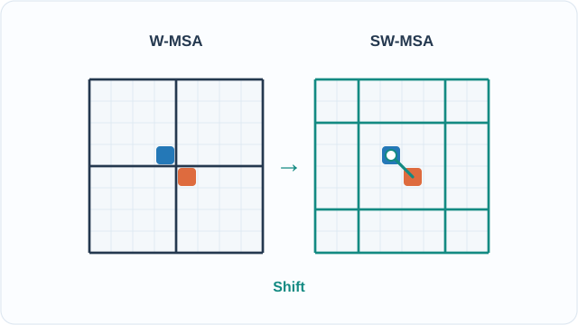

# Swin Transformer

Swin Transformer 是一種階層式的[視覺 Transformer](../index.md)，只在局部視窗內計算自注意力，並讓視窗在相鄰層之間移位，使資訊能在視窗之間流動。Liu 等人（2021）以此設計建立通用骨幹，可用於分類、偵測與分割，其成本隨影像大小線性成長。

## 概述

[ViT](../index.md)對每個區塊都做全域自注意力。這個成本隨區塊數量的平方成長，使高解析度影像與密集預測變得昂貴，而且只產生單一尺度的特徵圖。Swin 保留 Transformer 區塊，但把注意力限制在視窗內，並在各階段之間合併區塊，建立如 CNN 骨幹般的特徵金字塔。這使它能用於偵測與分割，而這正是 ViT 較難調整的地方。

## 關鍵概念

- **視窗（window）**：一組互不重疊、大小為 \(M \times M\) 的區塊，視窗內計算自注意力。預設 \(M = 7\)。
- **移位視窗（shifted window）**：在交替的層中，把分割整體平移 \((\lfloor M/2 \rfloor, \lfloor M/2 \rfloor)\) 個像素，使下一層的每個視窗與鄰近視窗重疊。
- **區塊合併（patch merging）**：把每 \(2 \times 2\) 的相鄰區塊串接，並投影到 \(2C\) 通道，使解析度減半。
- **相對位置偏置（relative position bias）**：加到注意力邏輯值上的可學習偏置，依兩個區塊之間的相對位移索引。
- **模型變體**：Swin-T、Swin-S、Swin-B 與 Swin-L，差別在於基礎通道寬度 \(C\) 與各層深度。

## 運作方式

網路分為四個階段。第一階段把影像切成 \(4 \times 4\) 的區塊，並投影到寬度 \(C\)。之後每個階段都先以區塊合併層開始，使解析度減半、通道加倍，然後以成對的方式套用區塊：一個一般的視窗區塊，接著一個移位視窗區塊。每一對的計算方式為：

\[
\hat z^{l} = \mathrm{W\text{-}MSA}\big(\mathrm{LN}(z^{l-1})\big) + z^{l-1}, \qquad
z^{l} = \mathrm{MLP}\big(\mathrm{LN}(\hat z^{l})\big) + \hat z^{l}
\]

接著以相同模式套用移位視窗注意力（SW-MSA）。視窗內的注意力為

\[
\mathrm{Attention}(Q, K, V) = \mathrm{SoftMax}\!\left(\frac{QK^\top}{\sqrt{d}} + B\right)V
\]

其中 \(B\) 是相對位置偏置，取自一個較小、大小為 \((2M-1)\times(2M-1)\) 的可學習表。對移位視窗，論文使用特徵圖的循環移位與注意力遮罩，把自注意力限制在各子視窗之內。

論文中的成本比較為：全域注意力 \(\Omega(\text{MSA}) = 4hwC^2 + 2(hw)^2C\)，視窗注意力 \(\Omega(\text{W-MSA}) = 4hwC^2 + 2M^2hwC\)。第一項隨區塊數 \(hw\) 的平方成長；當 \(M\) 固定時，第二項則隨 \(hw\) 線性成長。

*原創示意圖（CC BY-SA 4.0）。* 藍色與橘色區塊在 **W-MSA** 中分屬不同視窗，到了下一層的 **SW-MSA** 則落在同一個視窗；移動標記顯示新的資訊交換路徑。此圖採 **8×8 區塊、4×4 視窗與兩個區塊的位移**，不是實測注意力圖或模型輸出。實際 Swin 通常採 7×7 視窗，並透過循環移位與邊界注意力遮罩處理視窗，此處為便於理解而省略。MkDocs 網站可使用**播放／暫停**，偏好減少動態效果時會顯示[靜態影格](../../../../../assets/concept-animations/swin-shifted-windows-still.svg)，GitHub 也可直接開啟。

## 關鍵方法

### Swin Transformer: Hierarchical Vision Transformer using Shifted Windows（Liu 等人，2021）

- **問題：** Transformer 已成為強大的視覺骨幹，但一般 ViT 採用全域注意力與單一尺度的特徵，對高解析度輸入成本高，對偵測與分割也不便。
- **核心想法：** 把自注意力限制在局部視窗，在層與層之間移位視窗使視窗彼此相連，並在各階段之間合併區塊以建立階層。
- **方程式或演算法：** 上述帶相對位置偏置的視窗注意力、帶遮罩的移位視窗機制，以及區塊合併層。
- **結果：** 摘要報告其最大模型在 ImageNet-22K 預訓練後，於 ImageNet-1K 上達到 87.3% top-1 準確率；在 COCO test-dev 上為 58.7 box AP 與 51.1 mask AP；在 ADE20K 驗證集上為 53.5 mIoU。論文指出，這些結果比先前的最佳方法分別高出 COCO 的 +2.7 box AP 與 +2.6 mask AP，以及 ADE20K 的 +3.2 mIoU。論文表 1 顯示，Swin-T 在 \(224^2\) 下以 29M 參數達到 81.3% top-1，Swin-S 以 50M 參數達到 83.0%。表 1 列出 Swin-B 為 83.5%（88M 參數），論文另一個表則給出同一設定的 83.3%。
- **限制：** 視窗注意力限制了遠距區塊之間的直接互動，因此跨越整張影像的資訊混合要靠移位視窗在多層之後才能完成。視窗大小 \(M\) 是固定的超參數，論文預設為 7。Swin-L 的 ImageNet-1K 準確率是在 ImageNet-22K 預訓練後報告的，並非只用 ImageNet-1K 訓練。

## 組件與變體

- **模型大小。** Swin-T 的基礎寬度為 \(C = 96\)，各層深度為 \(\{2, 2, 6, 2\}\)。Swin-S 為 \(C = 96\)，深度 \(\{2, 2, 18, 2\}\)。Swin-B 為 \(C = 128\)，深度與 Swin-S 相同。Swin-L 為 \(C = 192\)。
- **視窗大小。** 預設 \(M = 7\) 使視窗成本維持線性。較大的視窗會接近全域注意力，但成本也隨之提高。
- **相對位置偏置。** 以相對位移為索引的可學習表取代絕對位置嵌入，使模型能跨視窗泛化。

## 連結

- [視覺 Transformer（ViT）](../index.md)是 Swin 所改動的全域注意力基線。
- [DeiT](../deit/index.md)是使用全域注意力的 ViT 訓練配方，與 Swin 的架構改動形成對照。
- [ConvNeXt](../../../cnn/backbones-and-scaling/convnext/index.md)是 ConvNeXt 論文在相同偵測與分割基準上直接與 Swin 比較的卷積網路。
- [Transformer 與注意力機制](../../index.md)提供 Swin 所修改的注意力區塊。
- [電腦視覺](../../../computer-vision/index.md)把 Swin 列為用於偵測與分割的骨幹之一。

## 未解問題

- **局部性與全域脈絡。** 移位視窗需要經過多層才能連結遠距區域。對於需要長距離建模的任務，它能否提供與全域注意力相同的效果，尚無定論。
- **人工設計的階層。** 階段配置與視窗大小都是人工選定的。增益來自階層還是來自視窗注意力本身，很難分開。
- **與卷積網路的比較。** 後續的卷積網路研究在相同基準上報告了能與 Swin 相當的結果。造成差距的設計選擇仍在討論中。

## 參考文獻

### 開創性論文

- Liu, Z., et al. (2021). *Swin Transformer: Hierarchical Vision Transformer using Shifted Windows*. ICCV 2021. [DOI 10.1109/ICCV48922.2021.00986](https://doi.org/10.1109/ICCV48922.2021.00986)。另見 [arXiv:2103.14030](https://arxiv.org/abs/2103.14030) — 提出 Swin，包含移位視窗注意力與階層式設計。
- Dosovitskiy, A., et al. (2021). *An Image is Worth 16x16 Words: Transformers for Image Recognition at Scale*. ICLR 2021. [arXiv:2010.11929](https://arxiv.org/abs/2010.11929) — Swin 所修改的全域注意力 ViT。
- Liu, Z., et al. (2022). *A ConvNet for the 2020s*. CVPR 2022. [DOI 10.1109/CVPR52688.2022.01167](https://doi.org/10.1109/CVPR52688.2022.01167) — 在 ImageNet、COCO 與 ADE20K 上與 Swin 直接比較的卷積網路。
- Touvron, H., et al. (2021). *Training data-efficient image transformers & distillation through attention*. ICML 2021, PMLR 139. [arXiv:2012.12877](https://arxiv.org/abs/2012.12877) — DeiT，保留全域注意力並只用 ImageNet 訓練的 ViT，是 Swin 視窗式設計的對照。

### 綜述與教科書

（本頁尚未查核）

### 講座

（本頁尚未查核）

### 文章與文件

- Microsoft, *Swin-Transformer*, GitHub. [microsoft/Swin-Transformer](https://github.com/microsoft/Swin-Transformer) — 官方程式碼與模型，由 arXiv 摘要連結。

## 延伸學習

（尚未新增）
