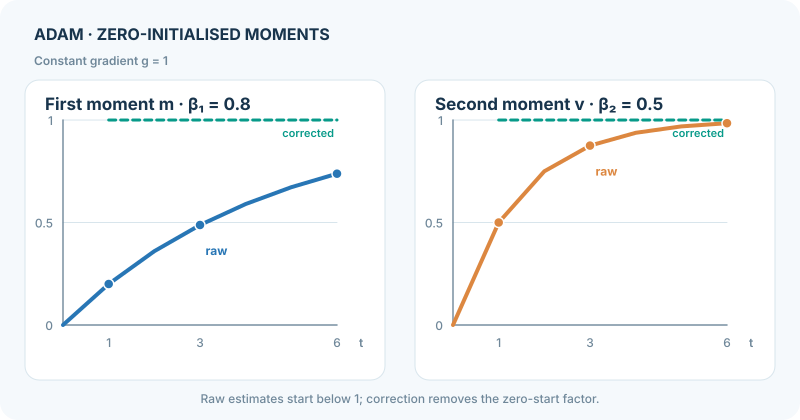
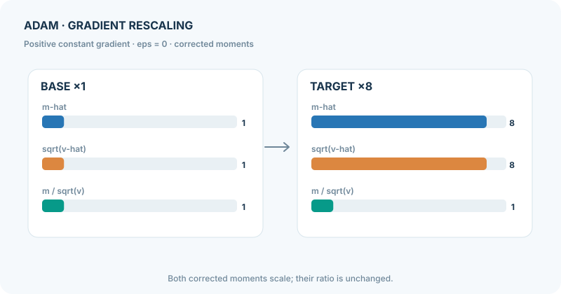

# Adam

Adam (adaptive moment estimation) is an optimiser that combines a momentum term with a per-parameter step size. It keeps running averages of each gradient and of its square, and divides the momentum by the root of the second moment. It is one of the most widely used optimisers for training neural networks. The family overview is on the [Adaptive Methods](index.md) page, and its decoupled-decay variant is [AdamW](adamw.md).

## Overview

Kingma and Ba (2014, published at ICLR 2015) proposed Adam for stochastic objectives, where gradients are noisy and often sparse. Their aim was an optimiser that is straightforward to implement, computationally efficient, light on memory and needs little hyper-parameter tuning. The abstract also notes that the method is invariant to diagonal rescaling of the gradients, and it gives a regret bound under the online convex optimisation framework.

## Key concepts

- **First moment \(m_t\)**: an exponential moving average of the gradient, which acts as momentum.
- **Second moment \(v_t\)**: an exponential moving average of the squared gradient, which measures how large each parameter's gradients have been.
- **Bias correction**: both averages start at zero, so they are too small early in training. Dividing by \(1-\beta^t\) corrects this.
- **\(\epsilon\)**: a small constant that prevents division by zero.

## How it works

For each parameter, with gradient \(g_t\) at step \(t\):

\[
\begin{aligned}
m_t &= \beta_1 m_{t-1} + (1-\beta_1)\, g_t \\
v_t &= \beta_2 v_{t-1} + (1-\beta_2)\, g_t^2 \\
\hat m_t &= \frac{m_t}{1-\beta_1^t}, \qquad \hat v_t = \frac{v_t}{1-\beta_2^t} \\
\theta_t &= \theta_{t-1} - \eta\, \frac{\hat m_t}{\sqrt{\hat v_t}+\epsilon}
\end{aligned}
\]

The paper's suggested defaults are \(\alpha = 0.001\) for the step size (written \(\eta\) here), \(\beta_1 = 0.9\), \(\beta_2 = 0.999\) and \(\epsilon = 10^{-8}\). Because the update is divided by the root of the second moment, each coordinate moves by roughly \(\eta\) per step, whatever the scale of its gradients. The effective step still changes as \(v_t\) moves, which is why learning-rate schedules matter in practice.

### Animated bias correction for zero-initialised moments

For the **illustrative constant gradient** $g_t=1$, with $m_0=v_0=0$, $\beta_1=0.8$ and $\beta_2=0.5$, the exact discrete-time values are $m_t=1-0.8^t$, $v_t=1-0.5^t$, and $\hat m_t=\hat v_t=1$ at every $t\ge1$. The synchronised cursor follows those samples; the movement *between* integer steps is only visual interpolation, not extra optimiser steps or measured model behaviour. In MkDocs, use Play/Pause (keyboard accessible) and focus the illustration to scroll on narrow screens. The [GitHub-readable static plot](../../../assets/concept-animations/adam-bias-correction-still.svg) is also the reduced-motion fallback. Original artwork, CC BY-SA 4.0. See [Kingma and Ba](https://arxiv.org/abs/1412.6980).

### Animated positive gradient rescaling

If **every gradient in a positive, constant history** is multiplied by $c=8$, then (with zero initial moments) $\hat m_t$ and $\sqrt{\hat v_t}$ both multiply by $8$. Thus $\hat m_t/\sqrt{\hat v_t}=1$ in both cases when $\epsilon=0$. The blue and orange bars interpolate a *hypothetical rescaling*, not consecutive optimiser updates. The static panel shows the target $8\times$ endpoint. With a nonzero $\epsilon$, exact scale invariance need not hold, especially for small gradients; this is a controlled scalar example, **not** a general performance or convergence guarantee. MkDocs provides Play/Pause and reduced-motion fallback; [GitHub-readable endpoint comparison](../../../assets/concept-animations/adam-scale-invariance-still.svg). Original artwork, CC BY-SA 4.0. See [Kingma and Ba](https://arxiv.org/abs/1412.6980).

## Key methods

### Adam (Kingma & Ba, 2014/2015)

- **Problem:** stochastic gradients are noisy and sparse, and first-order methods need careful, problem-specific learning rates.
- **Core idea:** adapt a separate step size for each parameter using running estimates of the first and second moments of its gradient, with bias correction for early steps.
- **Equation or algorithm:** the update above, with the bias-corrected moments and the defaults listed.
- **Results:** the paper tests Adam on L2-regularised logistic regression on MNIST, fully connected networks and convolutional networks, against accelerated SGD with Nesterov momentum, AdaGrad and other methods. The abstract gives no benchmark numbers; they are in the experiments section.
- **Limitations:** the paper's convergence analysis is in the online convex optimisation framework, not for deep networks. Adam can also generalise worse than SGD: [Wilson et al. (2017)](https://arxiv.org/abs/1705.08292) show that adaptive methods can find solutions that generalise worse. Its per-parameter scaling interacts badly with L2 regularisation, and [AdamW](adamw.md) addresses that.

## Connections

- [SGD and momentum](../sgd-and-momentum/index.md) is the non-adaptive baseline it is compared with.
- [AdamW](adamw.md) changes only how weight decay is applied.
- [Loss functions and optimisation](../../paradigms/supervised/loss-functions-and-optimization/index.md) covers the regularisation side.
- [Mathematics](../../math/index.md) gives the moment and convexity background.

## Open questions

- When does Adam's generalisation gap with SGD close under tuning, and when does it persist?
- How should the defaults \(\beta_1\), \(\beta_2\) and \(\epsilon\) change with very large batches?

## References

### Seminal papers

- Kingma, D. P. & Ba, J. (2015). Adam: A Method for Stochastic Optimization. ICLR. https://arxiv.org/abs/1412.6980 — Proposes Adam, with bias-corrected first and second moment estimates of the gradient.
- Loshchilov, I. & Hutter, F. (2019). Decoupled Weight Decay Regularization. ICLR. https://arxiv.org/abs/1711.05101 — Shows that L2 regularisation and weight decay differ under Adam's adaptive scaling.
- Duchi, J., Hazan, E. & Singer, Y. (2011). Adaptive Subgradient Methods for Online Learning and Stochastic Optimization. *JMLR*. https://jmlr.org/papers/v12/duchi11a.html — Introduces per-coordinate adaptive step sizes that Adam's second moment builds on.
- Wilson, A. C., Roelofs, R., Stern, M., Srebro, N. & Recht, B. (2017). The Marginal Value of Adaptive Gradient Methods in Machine Learning. NeurIPS. https://proceedings.neurips.cc/paper_files/paper/2017/hash/81b3833e2504647f9d794f7d7b9bf341-Abstract.html — Shows that adaptive methods can find solutions that generalise worse than SGD, on a constructed problem and on several deep networks.

### Surveys and textbooks

- Bottou, L., Curtis, F. E. & Nocedal, J. (2018). Optimization Methods for Large-Scale Machine Learning. *SIAM Review*. https://arxiv.org/abs/1606.04838 — Survey of stochastic gradient methods, including adaptive variants, and their trade-offs.
- Goodfellow, I., Bengio, Y. & Courville, A. (2016). *Deep Learning*, Chapter 8. MIT Press. https://www.deeplearningbook.org/ — Textbook treatment of adaptive optimisers in the context of deep-network training, free online.
