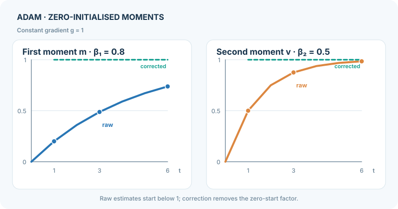
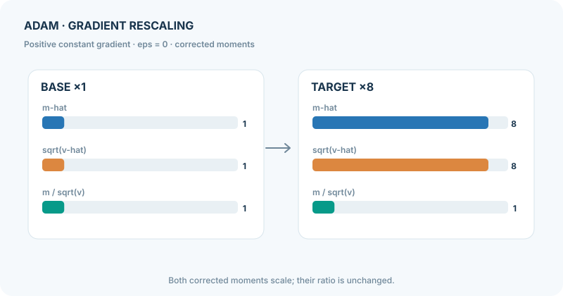

# Adam

Adam（自適應矩估計）是一種結合動量項與逐參數步長的最佳化器。它同時保存每個梯度與其平方的移動平均，並把動量除以二階矩的平方根。它是訓練神經網路最廣泛使用的最佳化器之一。家族概述見[自適應方法](index.md)頁，其解耦衰減的變體是 [AdamW](adamw.md)。

## 概述

Kingma 與 Ba（2014，2015 年於 ICLR 發表）為隨機目標提出 Adam，這類問題的梯度有雜訊且常常稀疏。他們的目標是一個實作簡單、計算效率高、記憶體需求低，且幾乎不需要超參數調校的最佳化器。摘要還指出，此方法對梯度的對角重新縮放具有不變性，並在線上凸最佳化框架下給出遺憾界（regret bound）。

## 核心概念

- **一階矩 \(m_t\)**：梯度的指數移動平均，作為動量使用。
- **二階矩 \(v_t\)**：梯度平方的指數移動平均，衡量每個參數的梯度曾經有多大。
- **偏差校正**：兩個平均都從零開始，因此在訓練初期偏小。除以 \(1-\beta^t\) 可以修正。
- **\(\epsilon\)**：防止除以零的小常數。

## 運作方式

對每個參數，設第 \(t\) 步的梯度為 \(g_t\)：

\[
\begin{aligned}
m_t &= \beta_1 m_{t-1} + (1-\beta_1)\, g_t \\
v_t &= \beta_2 v_{t-1} + (1-\beta_2)\, g_t^2 \\
\hat m_t &= \frac{m_t}{1-\beta_1^t}, \qquad \hat v_t = \frac{v_t}{1-\beta_2^t} \\
\theta_t &= \theta_{t-1} - \eta\, \frac{\hat m_t}{\sqrt{\hat v_t}+\epsilon}
\end{aligned}
\]

論文建議的預設值為步長 \(\alpha = 0.001\)（此處寫作 \(\eta\)）、\(\beta_1 = 0.9\)、\(\beta_2 = 0.999\)，以及 \(\epsilon = 10^{-8}\)。由於更新量除以二階矩的平方根，每個座標每步大致移動 \(\eta\)，不論其梯度的尺度如何。有效步長仍會隨 \(v_t\) 變動而改變，這也是學習率排程在實務上重要的原因。

### 偏差校正與零初始化動差：動態示範

在**人工設定的固定梯度** $g_t=1$、$m_0=v_0=0$、$\beta_1=0.8$、$\beta_2=0.5$ 下，離散時間的精確結果為 $m_t=1-0.8^t$、$v_t=1-0.5^t$，且每個 $t\ge1$ 都有 $\hat m_t=\hat v_t=1$。游標同步掃過各時間步；**整數時間步之間的移動只是視覺插值**，不是額外最佳化步驟，更不是模型實測軌跡。MkDocs 可透過支援鍵盤的播放／暫停控制觀看，手機可聚焦圖面後水平捲動；[GitHub 靜態預覽](../../../assets/concept-animations/adam-bias-correction-still.svg)同時作為低動態偏好回退圖。原創視覺，CC BY-SA 4.0。參考 [Kingma 與 Ba](https://arxiv.org/abs/1412.6980)。

### 正梯度整體縮放的不變性：動態示範

若將**整段固定正梯度歷史**同時乘以 $c=8$，且初始動差為零，則 $\hat m_t$ 與 $\sqrt{\hat v_t}$ 都會放大八倍；當 $\epsilon=0$，兩者比值 $\hat m_t/\sqrt{\hat v_t}=1$ 保持不變。圖中的藍色、橘色長條連續變化表示**假設性的尺度掃描**，並非連續最佳化步驟；靜態面板呈現八倍端點。當 $\epsilon\ne0$，尤其梯度較小時，縮放不變性不再精確成立。這是解析式**示意數值，不是模型實測或收斂保證**。MkDocs 可播放／暫停並支援低動態偏好；[GitHub 靜態比較](../../../assets/concept-animations/adam-scale-invariance-still.svg)。原創視覺，CC BY-SA 4.0。參考 [Kingma 與 Ba](https://arxiv.org/abs/1412.6980)。

## 關鍵方法

### Adam（Kingma & Ba，2014/2015）

- **問題：** 隨機梯度有雜訊且稀疏，一階方法需要仔細、針對問題調整的學習率。
- **核心想法：** 利用每個參數梯度的一階與二階矩的移動估計，為每個參數調整步長，並對初期步驟做偏差校正。
- **公式或演算法：** 上述更新式，搭配偏差校正後的矩與預設值。
- **結果：** 論文在 L2 正則化的 MNIST 邏輯迴歸、全連接網路與卷積網路上測試 Adam，並與帶 Nesterov 動量的加速 SGD、AdaGrad 等方法比較。摘要中沒有基準測試數字，數字見論文的實驗章節。
- **限制：** 論文的收斂分析是在線上凸最佳化框架下進行，而非針對深度網路。Adam 的泛化能力也可能比 SGD 差：[Wilson 等人（2017）](https://arxiv.org/abs/1705.08292) 指出，自適應方法可能找到泛化較差的解。其逐參數縮放也與 L2 正則化相互干擾，[AdamW](adamw.md) 處理的正是這點。

## 關聯

- [SGD 與動量](../sgd-and-momentum/index.md)是它比較的非自適應基準。
- [AdamW](adamw.md) 只改變權重衰減的施加方式。
- [損失函數與最佳化](../../paradigms/supervised/loss-functions-and-optimization/index.md)說明正則化的一面。
- [數學](../../math/index.md)提供矩估計與凸性的背景。

## 開放問題

- 經過調校後，Adam 與 SGD 的泛化差距何時會消失，何時會持續存在？
- 在極大批次下，預設值 \(\beta_1\)、\(\beta_2\) 與 \(\epsilon\) 應如何調整？

## 參考文獻

### 開創性論文

- Kingma, D. P. & Ba, J. (2015). Adam: A Method for Stochastic Optimization. ICLR. https://arxiv.org/abs/1412.6980 — 提出 Adam，使用梯度偏差校正後的一階與二階矩估計。
- Loshchilov, I. & Hutter, F. (2019). Decoupled Weight Decay Regularization. ICLR. https://arxiv.org/abs/1711.05101 — 指出在 Adam 的自適應縮放下，L2 正則化與權重衰減不同。
- Duchi, J., Hazan, E. & Singer, Y. (2011). Adaptive Subgradient Methods for Online Learning and Stochastic Optimization. *JMLR*. https://jmlr.org/papers/v12/duchi11a.html — 提出 Adam 二階矩所建立於其上的逐座標自適應步長。
- Wilson, A. C., Roelofs, R., Stern, M., Srebro, N. & Recht, B. (2017). The Marginal Value of Adaptive Gradient Methods in Machine Learning. NeurIPS. https://proceedings.neurips.cc/paper_files/paper/2017/hash/81b3833e2504647f9d794f7d7b9bf341-Abstract.html — 顯示自適應方法可能找到泛化劣於 SGD 的解，包括在構造的問題上與數個深度網路上。

### 綜述與教科書

- Bottou, L., Curtis, F. E. & Nocedal, J. (2018). Optimization Methods for Large-Scale Machine Learning. *SIAM Review*. https://arxiv.org/abs/1606.04838 — 隨機梯度方法綜述，包含自適應變體及其取捨。
- Goodfellow, I., Bengio, Y. & Courville, A. (2016). *Deep Learning*，第 8 章。MIT Press。https://www.deeplearningbook.org/ — 在深度網路訓練背景下對自適應最佳化器的教科書說明，可線上免費閱讀。
