# AdamW

AdamW 是帶有解耦權重衰減的 Adam。它把權重衰減懲罰直接作用在參數上，置於自適應步驟之外，而不是在梯度中加入 L2 項。Loshchilov 與 Hutter（2017，2019 年於 ICLR 發表）指出這個差異對自適應方法很重要，如今 AdamW 常用於訓練 Transformer 模型。家族概述見[自適應方法](index.md)頁，它所修改的方法是 [Adam](adam.md)。

## 概述

在普通 SGD 中，在損失中加入 L2 懲罰 \(\frac{\lambda}{2}\|\theta\|^2\) 再做梯度步，等同於衰減係數為 \(\eta\lambda\) 的權重衰減。Loshchilov 與 Hutter 觀察到，在 Adam 下這個等價性會失效。L2 項進入梯度，因此 Adam 會把它除以二階矩的平方根。梯度大的參數因此得到較少的衰減，這與正則化的用意正好相反。

## 核心概念

- **L2 正則化**：加在損失上的懲罰，其梯度會被最佳化器縮放。
- **權重衰減**：每步對參數的收縮，施加在梯度之外。
- **解耦**：以自己的係數 \(\lambda\) 施加衰減，與自適應分母無關。
- **學習率獨立性**：論文指出，採用解耦衰減後，最佳的衰減係數大致與學習率無關，因此兩者可以分開調校。

## 運作方式

依 [Adam](adam.md) 中的定義取 \(\hat m_t\) 與 \(\hat v_t\)，AdamW 的更新為

\[
\theta_t = \theta_{t-1} - \eta\left(\frac{\hat m_t}{\sqrt{\hat v_t}+\epsilon} + \lambda\,\theta_{t-1}\right)
\]

衰減項 \(\lambda\theta_{t-1}\) 在自適應步驟之後加入，因此不會被 \(\sqrt{\hat v_t}\) 除。若使用 L2 正則化的 Adam，則會把 \(\lambda\theta_{t-1}\) 放進梯度 \(g_t\) 中，於是自適應縮放會削弱梯度大的參數的衰減。

*原創教學動畫（CC BY-SA 4.0）。* 上方橘色路徑表示**帶 L2 正則化的 Adam**：正則化梯度先與任務梯度相加，再進入自適應動差。下方青色路徑表示 **AdamW**：自適應梯度步驟與直接的參數收縮分開計算，最後才共同作用於參數。四個階段是運算依賴關係的**教學示意，不是實測梯度、係數或訓練軌跡**。MkDocs 可使用支援鍵盤操作的播放／暫停按鈕；GitHub 可查看[靜態比較圖](../../../assets/concept-animations/adamw-decoupled-paths-still.svg)。圖中省略偏差校正與動差遞迴細節，詳見 [AdamW 原始論文](https://arxiv.org/abs/1711.05101)。

## 關鍵方法

### Decoupled Weight Decay Regularization（Loshchilov & Hutter，2017/2019）

- **問題：** 對自適應方法而言，在損失中加入 L2 懲罰並不等同於權重衰減。懲罰項會被自適應分母重新縮放，因此梯度大的參數其正則化效果會減弱。
- **核心想法：** 把權重衰減直接作用在參數上，置於自適應步驟之外，使衰減係數與梯度縮放脫鉤。
- **公式或演算法：** 上述更新式，其中 \(\lambda\) 為衰減係數。
- **結果：** 摘要指出，脫鉤後的衰減能大幅改善 Adam 的泛化能力，使其在影像分類上能與帶動量的 SGD 競爭。摘要中未給出具體數字。
- **限制：** 論文的證據主要來自影像分類，在其他任務上的優勢仍取決於調校。AdamW 廣泛用於 Transformer 模型，其相對於帶 L2 正則化的 Adam 的增益，取決於設定。

## 關聯

- [Adam](adam.md) 是此方法所修改的最佳化器。
- [損失函數與最佳化](../../paradigms/supervised/loss-functions-and-optimization/index.md)把權重衰減解釋為損失上的懲罰。
- [SGD 與動量](../sgd-and-momentum/index.md)是 L2 與權重衰減相同的情境。

## 應用

- Transformer 語言模型與視覺 Transformer 的預訓練與微調。
- 許多開源訓練流程中的預設最佳化器設定。

## 開放問題

- AdamW 優於帶 L2 的 Adam 的好處，在影像與語言模型之外還能保持多少？
- 是否有依學習率自動設定衰減係數的規則？

## 參考文獻

### 開創性論文

- Loshchilov, I. & Hutter, F. (2019). Decoupled Weight Decay Regularization. ICLR. https://arxiv.org/abs/1711.05101 — 指出在自適應方法下，L2 正則化與權重衰減不同，並提出 AdamW。
- Kingma, D. P. & Ba, J. (2015). Adam: A Method for Stochastic Optimization. ICLR. https://arxiv.org/abs/1412.6980 — AdamW 所修改的基礎最佳化器。
- Wilson, A. C., Roelofs, R., Stern, M., Srebro, N. & Recht, B. (2017). The Marginal Value of Adaptive Gradient Methods in Machine Learning. NeurIPS. https://proceedings.neurips.cc/paper_files/paper/2017/hash/81b3833e2504647f9d794f7d7b9bf341-Abstract.html — 顯示自適應方法可能找到泛化劣於 SGD 的解，正是解耦衰減所要處理的差距。

### 綜述與教科書

- Bottou, L., Curtis, F. E. & Nocedal, J. (2018). Optimization Methods for Large-Scale Machine Learning. *SIAM Review*. https://arxiv.org/abs/1606.04838 — 隨機梯度方法綜述，包含自適應變體及其取捨。
- Goodfellow, I., Bengio, Y. & Courville, A. (2016). *Deep Learning*，第 7 章正則化。MIT Press。https://www.deeplearningbook.org/ — 將權重衰減作為正則化項的教科書說明，可線上免費閱讀。